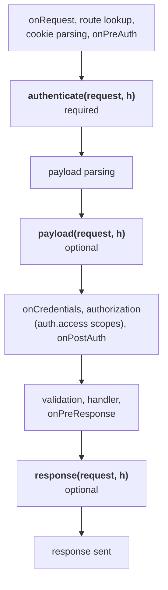
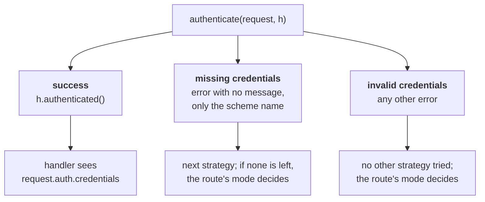
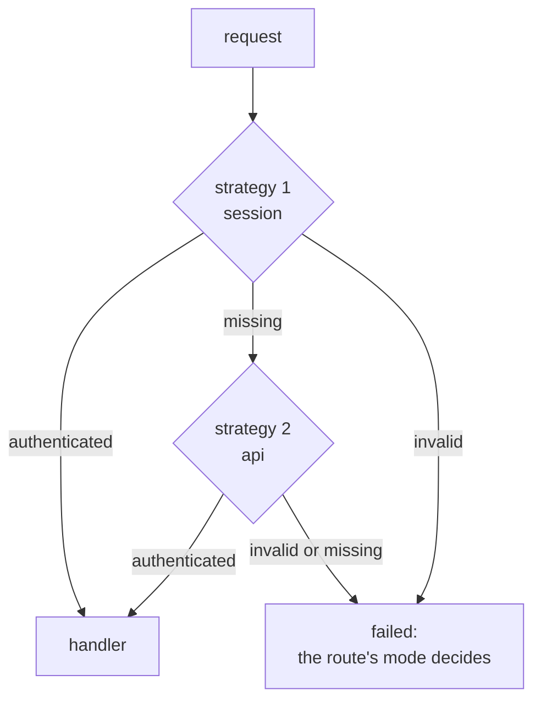
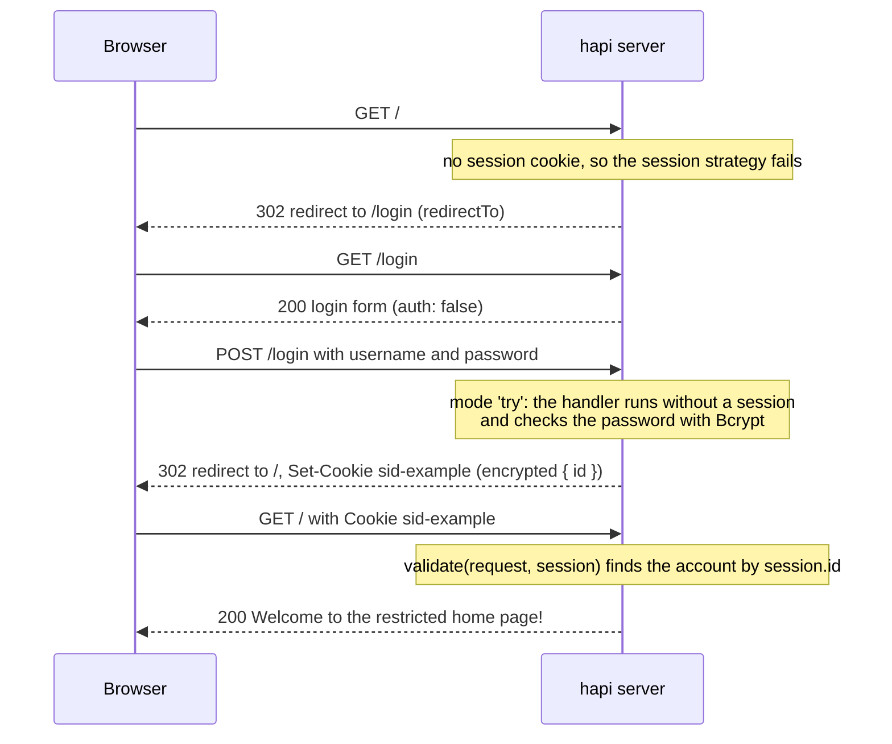
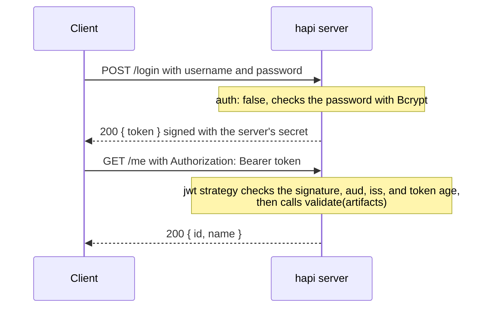

<TutorialLang />

# Authentication

_This tutorial is compatible with hapi v21 and newer_

## <a name="overview"></a> Overview

Most modern web apps use some form of authentication. Authentication in hapi is built from two pieces, `schemes` and `strategies`:

- A `scheme` is a general way of authenticating, such as "HTTP basic auth" or "session cookie". Plugins like `@hapi/basic` and `@hapi/cookie` each register a scheme.
- A `strategy` is a scheme with a name and a configuration, such as "basic auth, checked against my users table". Routes refer to strategies by name.

Using `@hapi/basic`, the plugin registers a scheme, you configure a strategy from it, and a route uses that strategy:

```ts
// Registers the 'basic' scheme.
await server.register(Basic);

server.auth.strategy('simple', 'basic', { validate });

server.route({
    method: 'GET',
    path: '/',
    options: { auth: 'simple' },
    handler: (request, h) => 'welcome',
});
```

## <a name="schemes"></a> Schemes

A `scheme` is a function with the signature `function (server, options)`. `server` is the server the scheme is added to, and `options` is the configuration object passed when a strategy is created from this scheme. The function returns a scheme object, and hapi calls the methods on that object at three points in the [request lifecycle](/api#request-lifecycle):



`payload` and `response` only run for requests that `authenticate` accepted.

You can write your own scheme, or use one of the hapi auth plugins such as `@hapi/basic` or `@hapi/cookie`. Here is a complete scheme that reads an API token from a request header:

```ts
import Boom from '@hapi/boom';
import Hapi from '@hapi/hapi';

import type { ServerAuthScheme } from '@hapi/hapi';

declare module '@hapi/hapi' {
    interface UserCredentials {
        id: string;
        name: string;
    }
}

interface TokenOptions {
    tokens: Map<string, { id: string; name: string }>;
}

const tokenScheme: ServerAuthScheme<TokenOptions> = (server, options) => {
    return {
        authenticate: (request, h) => {
            const token = request.headers['x-api-token'];
            if (typeof token !== 'string') {
                throw Boom.unauthorized(null, 'token');
            }

            const user = options?.tokens.get(token);
            if (!user) {
                throw Boom.unauthorized('Invalid token', 'token');
            }

            return h.authenticated({ credentials: { user }, artifacts: { token } });
        },
        response: (request, h) => {
            if (!Boom.isBoom(request.response)) {
                request.response.header('x-authenticated-user', request.auth.credentials.user?.id ?? '');
            }

            return h.continue;
        },
    };
};

const server = Hapi.server({ port: 4000 });

server.auth.scheme('token', tokenScheme);
server.auth.strategy('api', 'token', {
    tokens: new Map([['a1b2c3', { id: '2133d32a', name: 'John Doe' }]]),
});

server.route({
    method: 'GET',
    path: '/me',
    options: { auth: 'api' },
    handler: (request, h) => {
        return request.auth.credentials.user;
    },
});

await server.start();
```

`ServerAuthScheme<TokenOptions>` types the `options` the scheme receives. The tokens live in a `Map` rather than a plain object on purpose: looking up a client-supplied key on a plain object also finds inherited properties, so a token of `constructor` or `toString` would authenticate. The `declare module` block tells TypeScript what your credentials contain: hapi exports an empty `UserCredentials` interface for you to extend, and after this `request.auth.credentials.user` is typed in every handler.

### <a name="authenticate"></a> authenticate

The `authenticate` method has the signature `function (request, h)`, and is the only _required_ method in a scheme. `request` is the same [request object](/api#request) a route handler receives, and `h` is the standard [response toolkit](/api#response-toolkit).

`authenticate` ends in one of three ways, and each one leads somewhere different:



- **Success:** return `h.authenticated({ credentials, artifacts })`. `credentials` represents the authenticated user. `artifacts` is optional and holds any other authentication data, such as the raw token. Both are available later as `request.auth.credentials` and `request.auth.artifacts`.
- **Missing credentials:** throw an error with no message and the scheme name, such as `Boom.unauthorized(null, 'token')`. hapi treats the request as carrying no credentials for this scheme, so it moves on to the route's next strategy, and the scheme name ends up in the `WWW-Authenticate` header.
- **Invalid credentials:** throw any other error, such as `Boom.unauthorized('Invalid token', 'token')`. hapi stops trying other strategies. A `Boom.unauthorized()` with no message _and_ no scheme name also counts as invalid.

What happens after a failure depends on the route's [`mode`](#mode).

Instead of throwing, you can return `h.unauthenticated(error, data)`. It behaves like throwing `error`, but `data` lets you attach `credentials` and `artifacts` to the failed request, which a route in `'try'` mode can then read. Without `data`, `return h.unauthenticated(error)` and `throw error` are the same. See [`server.auth.scheme()`](/api#server-auth-scheme-name-scheme) for the full rules. [boom](/module/boom) is the recommended way to create these errors.

### <a name="payload"></a> payload

The `payload` method has the signature `function (request, h)`. It runs after the payload is parsed, so it can check the payload itself, for example a signature computed over the request body.

Return `h.continue` when the payload passes, and throw an error when it fails. Routes turn payload authentication on with the [`payload` route option](#route). A scheme that always needs it can return `options: { payload: true }` next to its methods, which stops routes from turning it off.

### <a name="response"></a> response

The `response` method has the signature `function (request, h)`. It runs after `onPreResponse`, just before the response headers are written, so it can add authentication headers to `request.response`. The token scheme above uses it to add an `x-authenticated-user` header.

By the time `response` runs, hapi has already turned any error into a response object, so error responses get the header too. The `Boom.isBoom()` check narrows `request.response` to a response object, so `.header()` typechecks. Return `h.continue` when you are done. To fail, throw an error.

## <a name="strategies"></a> Strategies

A scheme does nothing until you create a strategy from it with `server.auth.strategy(name, scheme, [options])`:

- `name` is the strategy's name. Routes use it to pick the strategy.
- `scheme` is the name of a registered scheme.
- `options` is passed to the scheme function as its `options` argument.

One scheme can back many strategies, each with its own configuration:

```ts
server.auth.strategy('session', 'cookie', {
    cookie: {
        name: 'sid-example',
        password: '!wsYhFA*C2U6nz=Bu^%A@^F#SF3&kSR6',
        isSecure: false,
    },
});

server.auth.strategy('admin-session', 'cookie', {
    cookie: {
        name: 'sid-admin',
        password: 'Q7v!kW2#pL9@zR4$mT6^xB1&nD8*cF3%',
        isSecure: false,
    },
    redirectTo: '/admin/login',
    requestDecoratorName: 'adminCookieAuth',
});
```

Each `@hapi/cookie` strategy adds a `request.cookieAuth` helper, and hapi refuses to add the same request decoration twice, so the second strategy needs `requestDecoratorName` to give its helper another name. Its routes call `request.adminCookieAuth.set()`. The `@types/hapi__cookie` package (see [cookie](#cookie)) only types `cookieAuth`, so in TypeScript declare the renamed helper too:

```ts
declare module '@hapi/hapi' {
    interface Request {
        adminCookieAuth: Request['cookieAuth'];
    }
}
```

## <a name="default"></a> Default Strategy

`server.auth.default()` sets the strategy every route uses unless it says otherwise. It accepts a strategy name, or an object in the same format as a route's [auth options](#route). The default applies to every route whose `auth` option names no strategy, including routes added _before_ `server.auth.default()` is called. The exception is a route whose `auth` sets only `mode` or `access`: hapi merges it with the default when the route is added, so call `server.auth.default()` first.

```ts
server.auth.default('session');

server.route({
    method: 'GET',
    path: '/account',
    handler: (request, h) => 'protected by the session strategy',
});

server.route({
    method: 'GET',
    path: '/health',
    options: { auth: false },
    handler: (request, h) => 'public',
});
```

## <a name="route"></a> Route Configuration

A route sets authentication with its `options.auth` property:

```ts
server.route({
    method: 'GET',
    path: '/feed',
    options: {
        auth: {
            mode: 'try',
            strategies: ['session', 'api'],
        },
    },
    handler: (request, h) => {
        if (!request.auth.isAuthenticated) {
            return 'public feed';
        }

        return `personal feed, signed in with ${request.auth.strategy}`;
    },
});
```

`options.auth` can be:

- `false`, to turn authentication off for the route.
- A strategy name, such as `'session'`.
- An object with `mode`, `strategy` or `strategies`, and `payload`.

### mode

`mode` decides what happens to a request that has no credentials, or bad ones:

| `mode`                 | No credentials                | Invalid credentials           | Valid credentials |
| ---------------------- | ----------------------------- | ----------------------------- | ----------------- |
| `'required'` (default) | 401                           | 401                           | handler runs      |
| `'optional'`           | handler runs, unauthenticated | 401                           | handler runs      |
| `'try'`                | handler runs, unauthenticated | handler runs, unauthenticated | handler runs      |

"No credentials" and "invalid credentials" are the two kinds of [`authenticate` failure](#authenticate). When the handler runs after a failure, `request.auth.isAuthenticated` is `false` and `request.auth.error` holds the reason: `Missing authentication` when no strategy found credentials, or the error a strategy threw when it rejected them.

### strategy and strategies

Use `strategy: 'session'` for one strategy, or `strategies: ['session', 'api']` for several. hapi tries them in order, and moves to the next one only while each reports missing credentials:



### payload

`payload` turns on the scheme's [`payload` method](#payload) for the route:

- `false`: the payload is not authenticated.
- `'required'` or `true`: the payload must be authenticated.
- `'optional'`: the payload is checked only if the client sent payload authentication information.

It only works with a strategy whose scheme has a `payload` method.

## <a name="scopes"></a> Scopes

Authentication decides _who_ is making the request. Scopes decide _what_ they may do. A strategy puts a list of scope strings in `credentials.scope`, a route lists the scopes it accepts in `options.auth.access.scope`, and hapi compares the two in its authorization step, after `onCredentials` and before your handler runs. A request without a matching scope gets `403 Insufficient scope`, and the handler never runs.

Scopes usually come from the strategy's `validate` function. With the [basic](#basic) example's users, each given a `roles` array:

```ts
const validate: Basic.Validate = async (request, username, password) => {
    const user = users.get(username);
    if (!user || !(await Bcrypt.compare(password, user.password))) {
        return { isValid: false, credentials: null };
    }

    return { isValid: true, credentials: { id: user.id, name: user.name, scope: user.roles } };
};
```

When the roles live somewhere else, an `onCredentials` hook can add them after authentication; see [Lifecycle Hooks](/tutorials/en_US/lifecycle-hooks#credentials).

Routes then declare the scopes they accept:

```ts
server.route({
    method: 'GET',
    path: '/reports',
    options: { auth: { strategy: 'simple', access: { scope: ['admin', 'analyst'] } } },
    handler: (request, h) => 'any admin or analyst',
});

server.route({
    method: 'DELETE',
    path: '/users/{id}',
    options: { auth: { strategy: 'simple', access: { scope: ['+admin', '!suspended'] } } },
    handler: (request, h) => 'an admin who is not suspended',
});

server.route({
    method: 'PUT',
    path: '/users/{id}/profile',
    options: { auth: { strategy: 'simple', access: { scope: ['admin', 'user-{params.id}'] } } },
    handler: (request, h) => 'an admin, or the user whose id is in the path',
});
```

| Route scope            | `credentials.scope` must                                                                       |
| ---------------------- | ---------------------------------------------------------------------------------------------- |
| `'admin'`              | include `admin`                                                                                |
| `['admin', 'analyst']` | include at least one of them                                                                   |
| `'+admin'`             | include `admin`, whatever else the list says                                                   |
| `'!suspended'`         | not include `suspended`                                                                        |
| `'user-{params.id}'`   | include `user-42` for a request to `/users/42`; `query`, `payload`, and `credentials` work too |

Scope rules that are easy to miss:

- Scopes are checked only for authenticated requests. On a route in `'optional'` or `'try'` mode, a request without credentials still reaches the handler, with `request.auth.isAuthorized` set to `false`. Check it before doing anything only some users may do.
- `access.entity` restricts a route to users or applications: `'user'` requires `credentials.user` to be set, `'app'` requires it to be absent. Use it when the same strategy authenticates both people and machine clients.
- `access` can be a list of rules, and a request needs to satisfy only one of them.
- `server.auth.default()` accepts the same `access` options, so a scope can apply to every route.

See [`route.options.auth.access`](/api#route-options-auth-access) for the full rules.

## <a name="basic"></a> basic

The first `scheme` we will look at is the [@hapi/basic](/module/basic) plugin. Just like the name says, the `@hapi/basic` plugin uses basic authentication to validate users. Here is an example of setting up `@hapi/basic`:

```ts
import Basic from '@hapi/basic';
import Bcrypt from 'bcrypt';
import Hapi from '@hapi/hapi';

const users = new Map([
    [
        'john',
        {
            username: 'john',
            password: '$2a$10$iqJSHD.BGr0E2IxQwYgJmeP3NvhPrXAeLSaGCj6IR/XU5QtjVu5Tm', // 'secret'
            name: 'John Doe',
            id: '2133d32a',
        },
    ],
]);

const validate: Basic.Validate = async (request, username, password) => {
    const user = users.get(username);
    if (!user) {
        return { credentials: null, isValid: false };
    }

    const isValid = await Bcrypt.compare(password, user.password);
    const credentials = { id: user.id, name: user.name };

    return { isValid, credentials };
};

const start = async () => {
    const server = Hapi.server({ port: 4000 });

    await server.register(Basic);

    server.auth.strategy('simple', 'basic', { validate });

    server.route({
        method: 'GET',
        path: '/',
        options: {
            auth: 'simple',
        },
        handler: function (request, h) {
            return 'welcome';
        },
    });

    await server.start();

    console.log('server running at: ' + server.info.uri);
};

start();
```

First, you define your `users` database, a `Map` keyed by username in this example, for the reason given under [Schemes](#schemes). Then you define a validation function, which is a feature specific to [@hapi/basic](/module/basic) and allows you to verify that the user has provided valid credentials. Typing it as `Basic.Validate` lets TypeScript infer `request`, `username`, and `password`, and checks the object you return. For this validation function, you use `Bcrypt` to compare the user provided password with the hashed password in your database.

Next, you register the plugin, which creates a scheme with the name of `basic`. This is done within the plugin via [server.auth.scheme()](/api#server-auth-scheme-name-scheme).

Once the plugin has been registered, you use [server.auth.strategy()](/api#server-auth-strategy-name-scheme-options) to create a strategy with the name of `simple` that refers to your scheme named `basic`. You also pass an options object that gets passed to the scheme and allows you to configure its behavior.

The last thing you do is tell a route to use the strategy named `simple` for authentication.

## <a name="cookie"></a> cookie

[@hapi/cookie](/module/cookie) is a plugin that stores the session in an encrypted cookie in the user's browser once they are authenticated. Without a `cookie.ttl`, the cookie lasts until the browser closes; set `ttl` to keep the user logged in across browser sessions.

In this example, the home route, "/", is restricted and can only be accessed once a user has logged in. The browser is redirected to the login form, posts the username and password, and then reaches the home page with the session cookie:



```ts
import Bcrypt from 'bcrypt';
import Cookie from '@hapi/cookie';
import Hapi from '@hapi/hapi';

const users = [
    {
        username: 'john',
        password: '$2a$10$iqJSHD.BGr0E2IxQwYgJmeP3NvhPrXAeLSaGCj6IR/XU5QtjVu5Tm', // 'secret'
        name: 'John Doe',
        id: '2133d32a',
    },
];

const start = async () => {
    const server = Hapi.server({ port: 4000 });

    await server.register(Cookie);

    server.auth.strategy('session', 'cookie', {
        cookie: {
            name: 'sid-example',
            password: '!wsYhFA*C2U6nz=Bu^%A@^F#SF3&kSR6',
            isSecure: false,
        },
        redirectTo: '/login',
        validate: async (request, session) => {
            if (!session || !('id' in session)) {
                return { isValid: false };
            }

            const account = users.find((user) => user.id === session.id);
            if (!account) {
                return { isValid: false };
            }

            return { isValid: true, credentials: { id: account.id, name: account.name } };
        },
    });

    server.auth.default('session');

    server.route([
        {
            method: 'GET',
            path: '/',
            handler: function (request, h) {
                return 'Welcome to the restricted home page!';
            },
        },
        {
            method: 'GET',
            path: '/login',
            handler: function (request, h) {
                return ` <html>
                            <head>
                                <title>Login page</title>
                            </head>
                            <body>
                                <h3>Please Log In</h3>
                                <form method="post" action="/login">
                                    Username: <input type="text" name="username"><br>
                                    Password: <input type="password" name="password"><br/>
                                <input type="submit" value="Login"></form>
                            </body>
                        </html>`;
            },
            options: {
                auth: false,
            },
        },
    ]);

    server.route<{ Payload: { username: string; password: string } }>({
        method: 'POST',
        path: '/login',
        handler: async (request, h) => {
            const { username, password } = request.payload;
            const account = users.find((user) => user.username === username);

            if (!account || !(await Bcrypt.compare(password, account.password))) {
                return h.redirect('/login');
            }

            request.cookieAuth.set({ id: account.id });

            return h.redirect('/');
        },
        options: {
            auth: {
                mode: 'try',
            },
        },
    });

    await server.start();

    console.log('server running at: ' + server.info.uri);
};

start();
```

`@hapi/cookie` does not ship its own types. If you use TypeScript, install them with `npm install --save-dev @types/hapi__cookie`. They add `request.cookieAuth` to hapi's `Request` type and type the `cookie` strategy options. The session arrives in `validate` as a plain `object`, so the `'id' in session` check is what lets TypeScript read `session.id`. The `POST /login` route declares its form fields with a type argument to `server.route()`; this is a type only, so add [payload validation](/tutorials/en_US/validation) to enforce it at runtime.

First, you register the `@hapi/cookie` plugin with `server.register`, which adds the `cookie` scheme. Then you create the `session` strategy from it with `server.auth.strategy`, passing three options:

- `cookie` configures the cookie itself. `name` is the cookie's name, `sid-example`. `password` encrypts the cookie and must be at least 32 characters long. `isSecure: false` lets the cookie travel over plain HTTP, which is fine in development; leave it at its default of `true` in production.
- `redirectTo` is where the server sends an unauthenticated user who requests a protected route.
- `validate` runs on every request that carries the cookie, and checks that the session is still good. Here it looks the account up by the `id` stored in the cookie, so a deleted account is logged out on its next request.

`server.auth.default('session')` protects every route with the `session` strategy. `GET /login` opts out with `auth: false`, so anyone can see the form.

`POST /login` uses `mode: 'try'`, so the handler runs even though the user has no session yet. It finds the account by `username`, and compares the submitted password with the stored hash using `Bcrypt`. If either check fails, the user goes back to the login page. If both pass, `request.cookieAuth.set()` stores `{ id }` in the encrypted cookie, and the user is redirected to the home page.

## <a name="jwt"></a> jwt

[@hapi/jwt](/module/jwt) authenticates requests that carry a JSON Web Token in the `Authorization: Bearer <token>` header. Like `@hapi/cookie`, it stores no session on the server; the difference is how the identity travels:

|          | `@hapi/cookie`                      | `@hapi/jwt`                                           |
| -------- | ----------------------------------- | ----------------------------------------------------- |
| Sent in  | a cookie the browser attaches       | the `Authorization` header the client sets            |
| Contents | encrypted: unreadable to the client | signed but readable by anyone who holds the token     |
| Suits    | browser apps on your own domain     | APIs called from mobile apps, other servers, and SPAs |

Never put secrets in a JWT payload, since signing prevents tampering but not reading.

The client logs in once, then sends the token with every request:



```ts
import Bcrypt from 'bcrypt';
import Hapi from '@hapi/hapi';
import Jwt from '@hapi/jwt';

const users = [
    {
        username: 'john',
        password: '$2a$10$iqJSHD.BGr0E2IxQwYgJmeP3NvhPrXAeLSaGCj6IR/XU5QtjVu5Tm', // 'secret'
        name: 'John Doe',
        id: '2133d32a',
    },
];

const secret = 'hR7#mX2!vQ9@kL4$wP8^zT1&nB6*cJ3%';

const start = async () => {
    const server = Hapi.server({ port: 4000 });

    await server.register(Jwt);

    server.auth.strategy('bearer', 'jwt', {
        keys: secret,
        verify: {
            aud: 'urn:audience:my-api',
            iss: 'urn:issuer:my-api',
            sub: false,
            maxAgeSec: 4 * 60 * 60,
        },
        validate: async (artifacts, request, h) => {
            const account = users.find((user) => user.id === artifacts.decoded.payload.id);
            if (!account) {
                return { isValid: false };
            }

            return { isValid: true, credentials: { id: account.id, name: account.name } };
        },
    });

    server.auth.default('bearer');

    server.route<{ Payload: { username: string; password: string } }>({
        method: 'POST',
        path: '/login',
        options: { auth: false },
        handler: async (request, h) => {
            const { username, password } = request.payload;
            const account = users.find((user) => user.username === username);

            if (!account || !(await Bcrypt.compare(password, account.password))) {
                return h.response({ error: 'Invalid username or password' }).code(401);
            }

            const token = Jwt.token.generate(
                { aud: 'urn:audience:my-api', iss: 'urn:issuer:my-api', id: account.id },
                secret,
            );

            return { token };
        },
    });

    server.route({
        method: 'GET',
        path: '/me',
        handler: (request, h) => {
            return request.auth.credentials;
        },
    });

    await server.start();

    console.log('server running at: ' + server.info.uri);
};

start();
```

You register the plugin, which adds the `jwt` scheme, and create the `bearer` strategy from it:

- `keys` is the secret the tokens are signed with. A shared secret works when the same server issues and checks the tokens. To accept tokens from an identity provider instead, `keys` can point to the provider's public keys; see the `keys` options in the [@hapi/jwt API](/module/jwt).
- `verify` lists the claims a token must carry. `aud` (audience) and `iss` (issuer) must match the values you issue tokens with. `maxAgeSec` rejects tokens whose `iat` (issued at) is more than four hours ago. The tokens in this example carry no `exp`; if yours do, `exp` and `nbf` are checked by default.
- `validate` runs only after the signature and claims pass. It receives the decoded token as `artifacts.decoded.payload`, and decides what goes into `request.auth.credentials`. Here it also checks that the account still exists, since a token stays valid until it expires even if the account is deleted.

`POST /login` opts out of authentication with `auth: false`, checks the password, and returns a token from `Jwt.token.generate()` with the same `aud` and `iss` the strategy verifies. The client then calls `GET /me` with `Authorization: Bearer <token>`. `artifacts.decoded.payload` is not typed, because hapi cannot know which claims you put in a token; `validate` is where you check them and build typed credentials.

For more info on additional hapi auth plugins, please see the [plugin section](/plugins).
