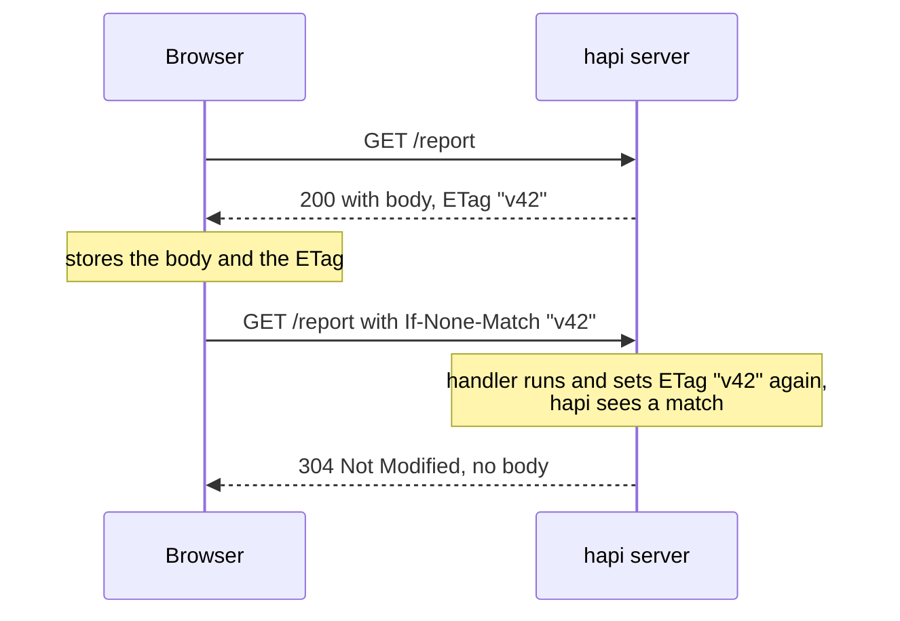
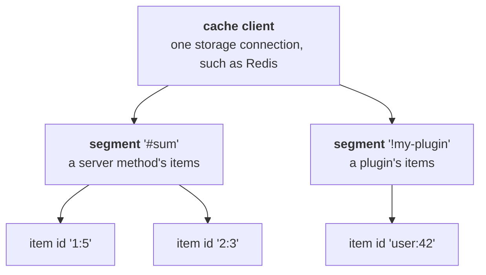
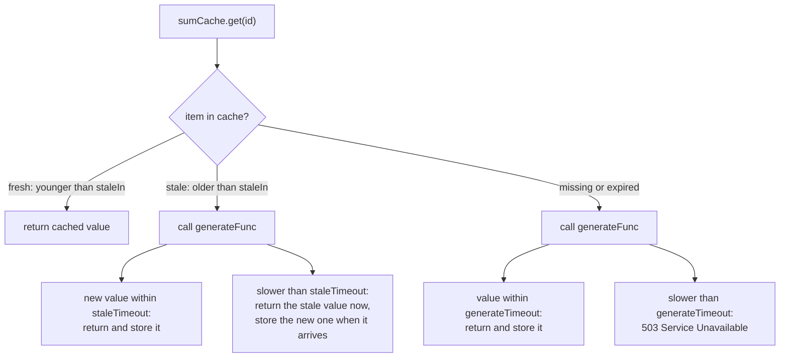

<TutorialLang />

# Caching

_This tutorial is compatible with hapi v21 and newer_

## <a name="overview"></a> Overview

hapi caches at two levels, and most applications use both:

| Level                       | Where the copy lives                                     | What it saves                                     | How you configure it                                                          |
| --------------------------- | -------------------------------------------------------- | ------------------------------------------------- | ----------------------------------------------------------------------------- |
| [Client-side](#client-side) | the browser, or a CDN or proxy in between                | the whole request: the client never reaches hapi  | HTTP headers: `Cache-Control`, `ETag`, `Last-Modified`                        |
| [Server-side](#server-side) | memory, Redis, or another [catbox](/module/catbox) store | the expensive work: a database query, an API call | `server.cache()` or a cached [server method](/tutorials/en_US/server-methods) |

## <a name="client-side"></a> Client-side Caching

HTTP headers tell clients whether, and for how long, they can reuse a response. MDN's [HTTP caching guide](https://developer.mozilla.org/en-US/docs/Web/HTTP/Caching) explains the headers in depth. This section shows how hapi sets them.

### <a name="cache-control"></a> Cache-Control

Set the route's `cache` option, and hapi writes the `Cache-Control` header for you:

```ts
server.route({
    path: '/hapi/{ttl?}',
    method: 'GET',
    handler: function (request, h) {
        const response = h.response({ be: 'hapi' });

        if (request.params.ttl) {
            response.ttl(Number(request.params.ttl));
        }

        return response;
    },
    options: {
        cache: {
            expiresIn: 30 * 1000,
            privacy: 'private',
        },
    },
});
```

`response.ttl(msec)` overrides `expiresIn` for a single response. The header hapi sends depends on the response:

| Request                                                     | `Cache-Control` header                     |
| ----------------------------------------------------------- | ------------------------------------------ |
| `GET /hapi`                                                 | `max-age=30, must-revalidate, private`     |
| `GET /hapi/5000` (calls `response.ttl(5000)`)               | `max-age=5, must-revalidate, private`      |
| response status other than 200 or 204, such as a 404 or 500 | `no-cache` (the route's `cache.otherwise`) |

What to know:

- If the request is authenticated, hapi always adds `private`, even when the route says `privacy: 'public'`. Shared caches such as CDNs never store `private` responses.
- Cookies set with `h.state()` do not change the header: hapi writes them after it builds `Cache-Control`. Set `privacy: 'private'` yourself on cached routes that set cookies.
- Only status codes listed in the route's `cache.statuses` (default `[200, 204]`) get `max-age`. Error responses are never cached by accident.

See [route options](/api#route-options-cache) for every `cache` setting.

### <a name="last-modified"></a> Conditional requests: ETag and Last-Modified

A conditional request lets the client ask "has this changed since my copy?" and get an empty `304 Not Modified` instead of the full body:



Set the `ETag` with [`response.etag()`](/api#response-object), usually from a version number or a hash of the content:

```ts
return h.response(report).etag(String(report.version));
```

Or set `Last-Modified`, and hapi compares it with the client's `If-Modified-Since` header:

```ts
return h.response(report).header('Last-Modified', report.updatedAt.toUTCString());
```

What to know:

- hapi only answers `304` on `GET` routes (and routes with method `*`).
- The handler still runs on every request. Conditional requests save bandwidth, not server work. Pair them with [server-side caching](#server-side) to save both.
- [inert](/module/inert) sets `ETag` and `Last-Modified` automatically for static files.

## <a name="server-side"></a> Server-side Caching

hapi caches values on the server through [catbox](/module/catbox), a key-value store with interchangeable storage adapters: memory (the default), [Redis](/module/catbox-redis), and [Memcached](/module/catbox-memcached).

### <a name="catbox"></a> catbox

Cached items are organized in three levels:



catbox has two interfaces to these items:

- **[Client](/module/catbox#client)**: the low-level storage connection. hapi creates a memory client for you, and you add others in the server's `cache` option.
- **[Policy](/module/catbox#policy)**: a segment of a client, with expiration rules and an optional function that generates missing values. Your code uses policies, created with [`server.cache()`](/api#server-cache-options) or by caching a [server method](#servermethods).

### <a name="client"></a> Client

Add a Redis client named `my_cache` next to the default memory client:

```ts
import Hapi from '@hapi/hapi';
import { Engine as CatboxRedis } from '@hapi/catbox-redis';

const server = Hapi.server({
    port: 8000,
    cache: [
        {
            name: 'my_cache',
            provider: {
                constructor: CatboxRedis,
                options: {
                    partition: 'my_cached_data',
                    host: 'redis-cluster.domain.com',
                    port: 6379,
                    database: 0,
                    tls: {},
                },
            },
        },
    ],
});
```

- `name` is how policies pick this client, with `cache: 'my_cache'`. Leave `name` out to replace the default memory client instead.
- `partition` keeps this application's keys apart from others sharing the Redis database. In Redis it becomes a key prefix. It defaults to `'catbox'`.
- Cache clients connect when the server starts, in [`server.initialize()`](/api#await-server-initialize) or [`server.start()`](/api#await-server-start). Policies cannot read or write before then.

### <a name="policy" /> Policy

[`server.cache(options)`](/api#server-cache-options) creates a policy. This example caches the result of a slow addition for ten seconds:

```ts
import Hapi from '@hapi/hapi';
import * as Hoek from '@hapi/hoek';

const add = async (a: string, b: string) => {
    await Hoek.wait(1000); // Simulates a slow database call

    return Number(a) + Number(b);
};

const start = async () => {
    const server = Hapi.server({ port: 8000 });

    const sumCache = server.cache({
        segment: 'sums',
        expiresIn: 10 * 1000,
        generateFunc: async (id) => {
            const key = typeof id === 'string' ? id : id.id;
            const [a, b] = key.split(':');

            return await add(a, b);
        },
        generateTimeout: 2000,
    });

    server.route<{ Params: { a: string; b: string } }>({
        path: '/add/{a}/{b}',
        method: 'GET',
        handler: async function (request, h) {
            const { a, b } = request.params;

            return await sumCache.get(`${a}:${b}`);
        },
    });

    await server.start();

    console.log('Server running at:', server.info.uri);
};

start();
```

`GET /add/1/5` answers `6` after about a second. Repeat it within ten seconds and it answers immediately, from the cache.

| Option            | Meaning                                                                                                                                                                         |
| ----------------- | ------------------------------------------------------------------------------------------------------------------------------------------------------------------------------- |
| `segment`         | Names this policy's items. Required at the server root. Inside a plugin it defaults to `'!' + plugin name`. Two policies cannot share a segment unless they set `shared: true`. |
| `cache`           | The client to use, such as `'my_cache'`. Defaults to the memory client.                                                                                                         |
| `expiresIn`       | How long an item lives after it is stored, in milliseconds. `expiresAt: 'HH:MM'` expires everything at a time of day instead.                                                   |
| `generateFunc`    | Creates the value when `get()` finds nothing. catbox stores the result.                                                                                                         |
| `generateTimeout` | How long `get()` waits for `generateFunc` before failing with `503 Service Unavailable`. Required with `generateFunc`; `false` waits forever.                                   |

The id passed to `get()` is either a string or an object with an `id` string, and `generateFunc` receives it unchanged. catbox types it as `string | { id: string }`, so the example narrows it before splitting it back into `a` and `b`.

### <a name="stale"></a> Serving stale values while regenerating

An expired item makes the next caller wait for `generateFunc`. To avoid that wait, mark items stale before they expire with `staleIn`. A stale item is still served, while catbox regenerates it in the background:



```ts
const reportCache = server.cache({
    segment: 'reports',
    expiresIn: 60 * 60 * 1000,
    staleIn: 10 * 60 * 1000,
    staleTimeout: 100,
    generateTimeout: 5000,
    generateFunc: async (id) => await buildReport(id),
});
```

catbox enforces `staleIn < expiresIn`, requires `staleTimeout` whenever `staleIn` is set, and requires `staleTimeout < expiresIn - staleIn`. Concurrent `get()` calls for the same id share one `generateFunc` call, so a burst of requests for a missing item queries your database once. See the [policy options](/module/catbox#policy) for error handling settings such as `dropOnError` and `generateOnReadError`.

### <a name="servermethods"></a> Server methods

Most of the time, a cached [server method](/tutorials/en_US/server-methods) is shorter than a hand-made policy. hapi creates the policy, names its segment `'#sum'`, and builds the item id from the arguments:

```ts
import Hapi from '@hapi/hapi';
import * as Hoek from '@hapi/hoek';

declare module '@hapi/hapi' {
    interface ServerMethods {
        sum: (a: string, b: string) => Promise<number>;
    }
}

const add = async (a: string, b: string) => {
    await Hoek.wait(1000);

    return Number(a) + Number(b);
};

const start = async () => {
    const server = Hapi.server({ port: 8000 });

    server.method('sum', add, {
        cache: {
            expiresIn: 10 * 1000,
            generateTimeout: 2000,
        },
    });

    server.route<{ Params: { a: string; b: string } }>({
        path: '/add/{a}/{b}',
        method: 'GET',
        handler: async function (request, h) {
            const { a, b } = request.params;

            return await server.methods.sum(a, b);
        },
    });

    await server.start();
};

start();
```

- The `declare module` block adds `sum` to hapi's `ServerMethods` interface, so `server.methods.sum` has a type.
- hapi builds the item id from `string`, `number`, and `boolean` arguments, such as `'1:5'`. Other argument types need a [`generateKey`](/tutorials/en_US/server-methods#key) function.

## <a name="clientandserver"></a> Client and Server caching

Combine the two levels: the server cache records when it stored each value, and that time is the right `Last-Modified` for the response. Set `getDecoratedValue: true`, and the cached method returns `{ value, cached, report }` instead of the bare value. `cached` is `null` when the value was just generated:

```ts
import Hapi from '@hapi/hapi';
import * as Hoek from '@hapi/hoek';

declare module '@hapi/hapi' {
    interface ServerMethods {
        sum: (a: string, b: string) => Promise<{ value: number; cached: { stored: number } | null }>;
    }
}

const add = async (a: string, b: string) => {
    await Hoek.wait(1000);

    return Number(a) + Number(b);
};

const start = async () => {
    const server = Hapi.server({ port: 8000 });

    const cache = {
        expiresIn: 10 * 1000,
        generateTimeout: 2000,
        getDecoratedValue: true,
    };

    server.method('sum', add, { cache });

    server.route<{ Params: { a: string; b: string } }>({
        path: '/add/{a}/{b}',
        method: 'GET',
        handler: async function (request, h) {
            const { a, b } = request.params;
            const { value, cached } = await server.methods.sum(a, b);
            const lastModified = cached ? new Date(cached.stored) : new Date();

            return h.response({ sum: value }).header('Last-Modified', lastModified.toUTCString());
        },
    });

    await server.start();
};

start();
```

See the [policy API](/module/catbox#api-1) for what `cached` and `report` contain.
