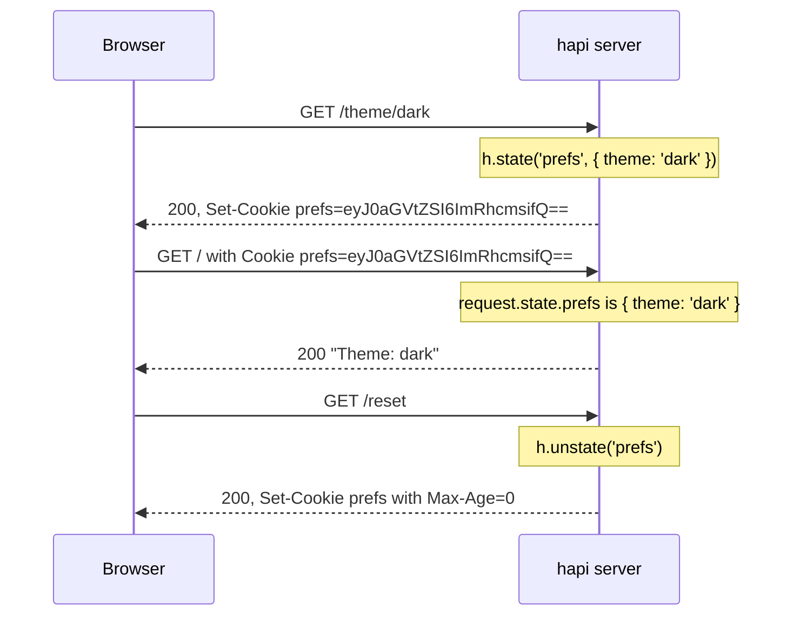

<TutorialLang />

# Cookies

_This tutorial is compatible with hapi v21 and newer_

## <a name="overview"></a> Overview

hapi reads the request's `Cookie` header into `request.state`, and writes `Set-Cookie` headers from `h.state()`. Each cookie is declared once with `server.state()`, which sets its encoding and security flags, so handlers only deal with values:



The complete server behind this exchange:

```ts
import Hapi from '@hapi/hapi';

const server = Hapi.server({ port: 3000 });

server.state('prefs', {
    encoding: 'base64json',
    ttl: 365 * 24 * 60 * 60 * 1000,
    isSecure: process.env.NODE_ENV === 'production',
    path: '/',
});

server.route<{ Params: { theme: string } }>({
    method: 'GET',
    path: '/theme/{theme}',
    handler: (request, h) => {
        h.state('prefs', { theme: request.params.theme });
        return 'saved';
    },
});

server.route({
    method: 'GET',
    path: '/',
    handler: (request, h) => {
        const prefs = request.state.prefs;
        const theme = typeof prefs === 'object' && prefs !== null && 'theme' in prefs ? prefs.theme : 'light';

        return `Theme: ${theme}`;
    },
});

server.route({
    method: 'GET',
    path: '/reset',
    handler: (request, h) => {
        return h.response('reset').unstate('prefs');
    },
});

await server.start();
```

`request.state` is typed `Record<string, unknown>`, because a cookie holds whatever the client sends. The `/` handler checks the value's shape before reading `theme`, and falls back to a default.

## <a name="server"></a> Configuring the server

### <a name="server.state"></a> server.state()

[`server.state(name, [options])`](/api#server-state-name-options) declares a cookie. The defaults are secure, so most applications only set `encoding`, `ttl`, and `path`:

| Option         | Default    | Meaning                                                                                                                                                                          |
| -------------- | ---------- | -------------------------------------------------------------------------------------------------------------------------------------------------------------------------------- |
| `ttl`          | `null`     | Lifetime in milliseconds. `null` makes a session cookie, deleted when the browser closes.                                                                                        |
| `encoding`     | `'none'`   | How the value is stored: `'none'` (a string), `'base64'`, `'base64json'` (any JSON value), `'form'`, or `'iron'` (encrypted, see [below](#iron)).                                |
| `path`         | `null`     | The URL path the browser sends the cookie for. `null` leaves the attribute out, and browsers then use the directory of the request that set it. Set `'/'` for site-wide cookies. |
| `isSecure`     | `true`     | Sent only over HTTPS. Set `false` for plain HTTP during development.                                                                                                             |
| `isHttpOnly`   | `true`     | Hidden from browser JavaScript, which protects it from cross-site scripting.                                                                                                     |
| `isSameSite`   | `'Strict'` | Withheld on requests from other sites. `'Lax'` allows top-level navigation from other sites; `false` omits the attribute.                                                        |
| `clearInvalid` | `false`    | Tells the browser to delete the cookie when its value fails to parse.                                                                                                            |
| `strictHeader` | `true`     | Rejects names and values that break [RFC 6265](https://tools.ietf.org/html/rfc6265).                                                                                             |

See [`server.state()`](/api#server-state-name-options) for the rest, such as `domain`, `autoValue`, and signing. To change the defaults for every cookie, pass the same options as the server's [`state`](/api#server-options-state) option.

### <a name="iron"></a> Encrypted cookies

`encoding: 'iron'` encrypts and signs the value with [iron](/module/iron). The client cannot read it, and hapi rejects it if it was changed. Use it for anything you would not show the user, such as a session id:

```ts
const password = process.env.COOKIE_PASSWORD;
if (!password || password.length < 32) {
    throw new Error('COOKIE_PASSWORD must be set to at least 32 characters');
}

server.state('session', {
    encoding: 'iron',
    password,
    ttl: 24 * 60 * 60 * 1000,
    path: '/',
});
```

For login sessions, [@hapi/cookie](/module/cookie) builds on this: it manages an encrypted session cookie as an [authentication strategy](/tutorials/en_US/auth#cookie).

### <a name="options.state"></a> route.options.state

Routes control parsing with [`options.state`](/api#route-options-state):

| Option       | Default   | Meaning                                                                         |
| ------------ | --------- | ------------------------------------------------------------------------------- |
| `parse`      | `true`    | Parse cookies into `request.state`. Set `false` on routes that never read them. |
| `failAction` | `'error'` | What happens when a cookie fails to parse or decrypt.                           |

A cookie fails when its value doesn't match its encoding, or an iron cookie was tampered with or encrypted with another password:

| `failAction` | Result                                                             |
| ------------ | ------------------------------------------------------------------ |
| `'error'`    | the request fails with `400 Bad Request`                           |
| `'log'`      | the request continues without that cookie, and hapi logs the error |
| `'ignore'`   | the request continues without that cookie                          |

With `clearInvalid: true` on the cookie, the response also deletes the bad cookie from the browser. Combine it with `'log'` or `'ignore'` so the request carrying a stale cookie, for example one encrypted before a password change, succeeds instead of failing once with 400.

## <a name="setting"></a> Setting a cookie

### <a name="h.state"></a> h.state()

[`h.state(name, value, [options])`](/api#h-state-name-value-options) sets a cookie from a handler, a [pre-handler](/api#route-options-pre), or a [lifecycle hook](/tutorials/en_US/lifecycle-hooks). The same method exists on the response object, for chaining:

```ts
h.state('prefs', { theme: 'dark' });

return h.response('Hello').state('prefs', { theme: 'dark' });
```

## <a name="override"></a> Overriding options

The third argument overrides the cookie's declared options for this response only:

```ts
return h.response('Hello').state('prefs', 'dark', { encoding: 'none' });
```

## <a name="value"></a> Getting a cookie value

`request.state` holds every parsed cookie, keyed by name. If the browser sends two cookies with the same name, the value is an array. Read values the way the overview example does: check the shape, then use it.

## <a name="clear"></a> Clearing a cookie

[`h.unstate(name)`](/api#h-unstate-name-options), or `unstate()` on the response, tells the browser to delete the cookie:

```ts
return h.response('Bye').unstate('prefs');
```
