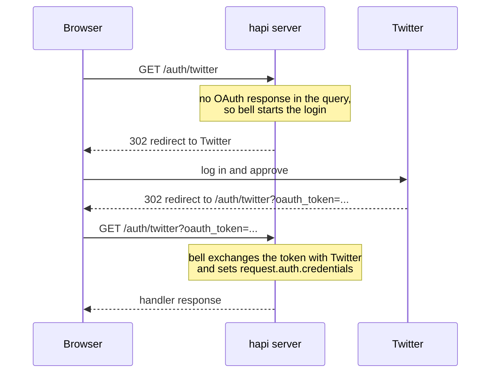

<TutorialLang />

# Express Migration

_This guide is compatible with hapi v21 and newer_

## <a name="overview" ></a> Overview

This guide shows how to take what you do in Express and do it in hapi. The examples use Express 5.

The biggest difference: Express adds features through middleware you install and order with `app.use()`, while hapi builds most of them into its core and configures them per route. Where hapi does need a plugin, the plugin comes from the hapi team. hapi's own runtime dependencies are all `@hapi/*` packages maintained by the same team.

| In Express you use              | In hapi you use                                                                                                                                              |
| ------------------------------- | ------------------------------------------------------------------------------------------------------------------------------------------------------------ |
| `express.json()`, `body-parser` | built in: [payload parsing](#bodyparser)                                                                                                                     |
| `cookie-parser`                 | built in: [`server.state()`](#config)                                                                                                                        |
| `express-validator`             | built in: route [`validate`](#joi) with [joi](https://joi.dev)                                                                                               |
| `passport`                      | auth framework built in; schemes from plugins such as `@hapi/basic`, `@hapi/cookie`, `@hapi/jwt`, and [bell](#bell) ([auth tutorial](/tutorials/en_US/auth)) |
| `cors`                          | built in: route [`cors`](/api#route-options-cors) option                                                                                                     |
| `helmet`                        | partly built in: route [`security`](/api#route-options-security) option (no Content-Security-Policy)                                                         |
| `compression`                   | built in, on by default                                                                                                                                      |
| `app.set('view engine')`        | [vision](#vision) plugin                                                                                                                                     |
| `express.static()`              | [inert](#inert) plugin                                                                                                                                       |
| custom middleware               | [extension points](#extension) and [plugins](#creating)                                                                                                      |
| error-handling middleware       | an `onPreResponse` [extension](#extension); throw [boom](#boom) errors in place of `next(err)`                                                               |

## <a name="setup" ></a> Setup

### <a name="installation" ></a> Installation

|                  | Express                                 | hapi                     |
| ---------------- | --------------------------------------- | ------------------------ |
| Install          | `npm install express`                   | `npm install @hapi/hapi` |
| TypeScript types | `npm install --save-dev @types/express` | included                 |

### <a name="server" ></a> Creating a Server

Express:

```ts
import express from 'express';

const app = express();

app.listen(3000, function () {
    console.log('Server is running on port 3000');
});
```

hapi:

```ts
import Hapi from '@hapi/hapi';

const init = async () => {
    const server = Hapi.server({
        port: 3000,
        host: 'localhost',
    });

    await server.start();
    console.log('Server running on port 3000');
};

init();
```

In hapi, the `server` object is the center of the application. Its options (port, host, default route settings) decide how the server behaves, and routes, plugins, and extensions are all added to it. `server.start()` returns a promise.

## <a name="routes" ></a> Routes

Express:

```ts
app.get('/hello', function (req, res) {
    res.send('Hello World!');
});
```

hapi:

```ts
server.route({
    method: 'GET',
    path: '/hello',
    handler: (request, h) => {
        return 'Hello World!';
    },
});
```

|                    | Express                                 | hapi                                                     |
| ------------------ | --------------------------------------- | -------------------------------------------------------- |
| Define a route     | `app.METHOD(path, handler)`             | `server.route({ method, path, handler })`                |
| Send a response    | call `res.send()`                       | return the value                                         |
| Which route runs   | the first registered route that matches | the most specific match, whatever the registration order |
| Overlapping routes | both registered; the first one wins     | `server.route()` throws when two routes conflict         |

Because hapi picks the most specific route, `'/home'` always wins over `'/{any*}'`, and registration order never decides which route answers. See the [routing tutorial](/tutorials/en_US/routing) for the rules.

### <a name="methods" ></a> Methods

| Express               | hapi                                          |
| --------------------- | --------------------------------------------- |
| `app.get(path, ...)`  | `method: 'GET'`                               |
| one route per method  | `method: ['PUT', 'POST']`                     |
| `app.all(path, ...)`  | `method: '*'`                                 |
| `app.head(path, ...)` | not allowed: every `GET` route answers `HEAD` |

```ts
server.route({
    method: ['PUT', 'POST'],
    path: '/',
    handler: function (request, h) {
        return 'I did something!';
    },
});
```

### <a name="path" ></a> Path

Parameters go in curly braces in hapi:

|                    | Express 5        | hapi              |
| ------------------ | ---------------- | ----------------- |
| Parameter          | `/users/:userId` | `/users/{userId}` |
| Optional parameter | `/hello{/:user}` | `/hello/{user?}`  |
| Wildcard           | `/files/*path`   | `/files/{path*}`  |

In hapi, `{user*}` and a whole-segment `{user?}` must be the last segment; `{user*2}` and a partial-segment optional such as `/a{user?}/b` can appear anywhere.

### <a name="parameters" ></a> Parameters

Express:

```ts
app.get('/hello/:name', function (req, res) {
    const name = req.params.name;
    res.send('Hello ' + name);
});
```

hapi:

```ts
server.route({
    method: 'GET',
    path: '/hello/{name}',
    handler: function (request, h) {
        const name = request.params.name;
        return 'Hello ' + name;
    },
});
```

| Express      | hapi              |
| ------------ | ----------------- |
| `req.params` | `request.params`  |
| `req.query`  | `request.query`   |
| `req.body`   | `request.payload` |

### <a name="handler" ></a> Handler

An Express handler receives `req` and `res`, and calls methods on `res` to respond. A hapi handler receives `request` and `h`, the [response toolkit](/api#response-toolkit), and returns the response:

| Express                        | hapi                                                     |
| ------------------------------ | -------------------------------------------------------- |
| `res.send('text')`             | `return 'text'`                                          |
| `res.json(object)`             | `return object`                                          |
| `res.status(201).send(object)` | `return h.response(object).code(201)`                    |
| `res.set('x-name', 'value')`   | `return h.response(object).header('x-name', 'value')`    |
| `res.redirect('/')`            | `return h.redirect('/')`                                 |
| `res.cookie('name', 'value')`  | `h.state('name', 'value')`, see [cookies](#config)       |
| `res.sendFile(file)`           | `return h.file(file)`, see [inert](#inert)               |
| `res.render('index', context)` | `return h.view('index', context)`, see [vision](#vision) |
| `next(err)`                    | `throw Boom.notFound()`, see [boom](#boom)               |

When the handler needs to set a status code or headers, it wraps the value in `h.response()`:

```ts
server.route({
    method: 'POST',
    path: '/user',
    handler: function (request, h) {
        const user = {
            firstName: 'John',
            lastName: 'Doe',
            id: 123,
        };

        return h.response(user).code(201).header('location', '/user/123');
    },
});
```

hapi serializes the returned object as JSON and sets the `content-type`. See the [response marshalling tutorial](/tutorials/en_US/response-marshalling) for how hapi turns a returned value into a response.

## <a name="plugins" ></a> Middleware vs Plugins and Extensions

Express runs middleware in the order you call `app.use()`. If one middleware depends on another, you keep them in the right order by hand, and a wrong order fails at request time.

hapi runs every request through a fixed sequence of steps, the [request lifecycle](/api#request-lifecycle). Instead of ordering middleware, you attach code to a named step. Each step below also shows the Express middleware whose job it does:

| hapi step                    | Extension point                  | Express equivalent           |
| ---------------------------- | -------------------------------- | ---------------------------- |
| request received             | `onRequest`                      | `app.use()` before routing   |
| route lookup, cookie parsing |                                  | `app.get()`, `cookie-parser` |
| before authentication        | `onPreAuth`                      |                              |
| authentication               |                                  | `passport`                   |
| payload parsing              |                                  | `express.json()`             |
| after authentication         | `onCredentials`, `onPostAuth`    |                              |
| validation                   |                                  | `express-validator`          |
| before the handler           | `onPreHandler`                   |                              |
| handler                      |                                  | route callback               |
| after the handler            | `onPostHandler`, `onPreResponse` | error-handling middleware    |
| after the response is sent   | `onPostResponse`                 |                              |

The extension points are where you add your own code with `server.ext()`. hapi runs the other steps from each route's configuration.

Plugins replace reusable middleware. A plugin is a named unit that registers routes, extensions, and decorations on the server. A plugin can declare the other plugins it needs in its `dependencies` property, and hapi refuses to start when one is missing, instead of failing at request time. See the [plugins tutorial](/tutorials/en_US/plugins).

### <a name="extension" ></a> Extension Points

A middleware that runs for every request becomes an extension:

Express:

```ts
app.use(function (req, res, next) {
    console.log(req.method, req.url);
    next();
});
```

hapi:

```ts
server.ext('onRequest', function (request, h) {
    console.log(request.method, request.path);
    return h.continue;
});
```

`return h.continue` plays the role of `next()`: the request moves on to the next step. Returning a takeover response (`h.response(...).takeover()`), or throwing an error, ends the request there instead.

hapi has eight request extension points: `onRequest`, `onPreAuth`, `onCredentials`, `onPostAuth`, `onPreHandler`, `onPostHandler`, `onPreResponse`, and `onPostResponse`. The [lifecycle hooks tutorial](/tutorials/en_US/lifecycle-hooks) covers when to use each one, and [`server.ext()`](/api#server-ext-events) lists the options.

### <a name="creating" ></a> Creating a Plugin

A middleware that adds a helper to every request becomes a plugin that adds a [decoration](/tutorials/en_US/decorators). A plugin is an object with a `name` (or `pkg`) and an `async register(server, options)` function.

Express:

```ts
import type { NextFunction, Request, Response } from 'express';

declare global {
    namespace Express {
        interface Request {
            getDate(): Date;
        }
    }
}

const getDate = function (req: Request, res: Response, next: NextFunction) {
    req.getDate = function () {
        const date = new Date();
        return date;
    };

    next();
};
```

hapi:

```ts
import type { Plugin } from '@hapi/hapi';

declare module '@hapi/hapi' {
    interface ResponseToolkit {
        getDate(): Date;
    }
}

const getDate: Plugin<void> = {
    name: 'getDate',
    version: '1.0.0',
    register: async function (server, options) {
        const currentDate = function () {
            const date = new Date();
            return date;
        };

        server.decorate('toolkit', 'getDate', currentDate);
    },
};
```

- The Express middleware sets `req.getDate` again on every request. The hapi plugin calls `server.decorate()` once, at registration, and every handler then has `h.getDate()`.
- TypeScript only knows about the new method once you declare it: Express through its global `Express.Request` interface, hapi by adding it to the `ResponseToolkit` interface of `@hapi/hapi`.

### <a name="load" ></a> Loading a Plugin

Express:

```ts
app.use(getDate);
```

hapi:

```ts
await server.register({
    plugin: getDate,
});
```

### <a name="options" ></a> Options

An Express middleware takes options by being a function that returns the middleware. A hapi plugin receives its options as the second argument of `register`.

Express:

```ts
import type { NextFunction, Request, Response } from 'express';

declare global {
    namespace Express {
        interface Request {
            getDate(): string;
        }
    }
}

export default function (options: { name: string }) {
    return function getDate(req: Request, res: Response, next: NextFunction) {
        req.getDate = function () {
            const date = 'Hello ' + options.name + ', the date is ' + new Date();
            return date;
        };

        next();
    };
}
```

hapi:

```ts
import type { Plugin } from '@hapi/hapi';

declare module '@hapi/hapi' {
    interface ResponseToolkit {
        getDate(): string;
    }
}

const getDate: Plugin<{ name: string }> = {
    name: 'getDate',
    version: '1.0.0',
    register: async function (server, options) {
        const currentDate = function () {
            const date = 'Hello ' + options.name + ', the date is ' + new Date();
            return date;
        };

        server.decorate('toolkit', 'getDate', currentDate);
    },
};
```

You pass the options when you register the plugin. The type argument of `Plugin<{ name: string }>` types `options` inside `register`, and TypeScript flags a `server.register()` call whose options don't match it; hapi does not check them at runtime:

Express:

```ts
import getDate from './mw/getDate.ts';

app.use(getDate({ name: 'Tom' }));
```

hapi:

```ts
await server.register({
    plugin: getDate,
    options: {
        name: 'Tom',
    },
});
```

## <a name="bodyparser" ></a> body-parser

hapi parses the request payload before the handler runs, with no middleware. The result is in `request.payload`.

| Content type                        | Express                              | hapi                                        |
| ----------------------------------- | ------------------------------------ | ------------------------------------------- |
| `application/json`                  | `app.use(express.json())`            | parsed by default                           |
| `application/x-www-form-urlencoded` | `app.use(express.urlencoded())`      | parsed by default                           |
| `text/*`                            | `app.use(express.text())`            | parsed by default                           |
| `multipart/form-data`               | a separate package, such as `multer` | route option `payload: { multipart: true }` |

Express:

```ts
import express from 'express';

const app = express();

app.use(express.urlencoded());

app.post('/hello', function (req, res) {
    const name = req.body.name;
    res.send('Hello ' + name);
});
```

hapi:

```ts
server.route<{ Payload: { name: string } }>({
    method: 'POST',
    path: '/hello',
    handler: function (request, h) {
        const name = request.payload.name;
        return 'Hello ' + name;
    },
});
```

`request.payload` has no fixed shape, since hapi can't know what clients will send. The type argument `server.route<{ Payload: { name: string } }>()` tells TypeScript what the handler receives. It is a type only: to check the payload at runtime, add [validation](#joi). Size limits, timeouts, and file uploads are set with the route's [`payload` options](/api#route-options-payload).

## <a name="config" ></a> cookie-parser

hapi reads and writes cookies without middleware. Where Express takes cookie options on every `res.cookie()` call, hapi defines each cookie once with `server.state()`, and every route then sets it by name.

| Option          | Express `res.cookie()`     | hapi `server.state()`               |
| --------------- | -------------------------- | ----------------------------------- |
| Secure flag     | `secure`, off by default   | `isSecure`, on by default           |
| HttpOnly flag   | `httpOnly`, off by default | `isHttpOnly`, on by default         |
| SameSite        | `sameSite`                 | `isSameSite`, `'Strict'` by default |
| Lifetime        | `maxAge` (ms)              | `ttl` (ms)                          |
| Signed value    | `signed`                   | `sign: { password }`                |
| Encrypted value | not built in               | `encoding: 'iron'`                  |

See [`server.state()`](/api#server-state-name-options) for every option, and the [cookies tutorial](/tutorials/en_US/cookies).

### <a name="setCookie" ></a> Setting a Cookie

Express:

```ts
import express from 'express';
import cookieParser from 'cookie-parser';

const app = express();

app.use(cookieParser());

app.get('/', function (req, res) {
    res.cookie('username', 'tom', { secure: true, httpOnly: true });
    res.send('Hello');
});
```

hapi:

```ts
import Hapi from '@hapi/hapi';

const server = Hapi.server({ port: 8000 });

server.state('username', {
    ttl: null,
    isSecure: true,
    isHttpOnly: true,
});

server.route({
    method: 'GET',
    path: '/',
    handler: function (request, h) {
        h.state('username', 'tom');
        return 'Hello';
    },
});
```

### <a name="getCookie" ></a> Getting a Cookie Value

Express:

```ts
app.get('/whoami', (req, res) => {
    res.send(req.cookies.username);
});
```

hapi:

```ts
server.route({
    method: 'GET',
    path: '/whoami',
    handler: (request, h) => {
        const username = request.state.username;
        if (typeof username !== 'string') {
            return 'No username cookie';
        }

        return username;
    },
});
```

`request.state` holds whatever cookies the client sent, so hapi types each value as `unknown`. Check the type before you use it.

## <a name="bell" ></a> Passport -> bell

Express handles third-party login with Passport. hapi uses [bell](/module/bell), which has built-in configurations for over 30 OAuth providers, including Twitter, Facebook, Google, and GitHub, and supports custom providers. See the [bell providers list](/module/bell/providers).

Passport needs two routes, one to start the login and one for the provider's callback. bell uses one route for both:



Express:

```
npm install passport passport-twitter
```

If you use TypeScript, also run `npm install --save-dev @types/passport @types/passport-twitter`.

```ts
import passport from 'passport';
import { Strategy as TwitterStrategy } from 'passport-twitter';

passport.use(
    new TwitterStrategy(
        {
            consumerKey: TWITTER_CONSUMER_KEY,
            consumerSecret: TWITTER_CONSUMER_SECRET,
            callbackURL: '/auth/twitter/callback',
        },
        function (token, tokenSecret, profile, cb) {
            User.findOrCreate({ twitterId: profile.id }, function (err, user) {
                return cb(err, user);
            });
        },
    ),
);

passport.serializeUser(function (user, cb) {
    cb(null, user);
});

passport.deserializeUser(function (user: Express.User, cb) {
    cb(null, user);
});

app.get('/auth/twitter', passport.authenticate('twitter'));
app.get('/auth/twitter/callback', passport.authenticate('twitter', { failureRedirect: '/login' }), function (req, res) {
    res.redirect('/');
});
```

hapi:

```
npm install @hapi/bell
```

```ts
import Hapi from '@hapi/hapi';
import Bell from '@hapi/bell';

const server = Hapi.server({ port: 8000 });

await server.register(Bell);

server.auth.strategy('twitter', 'bell', {
    provider: 'twitter',
    password: 'cookie_encryption_password_secure',
    clientId: TWITTER_CONSUMER_KEY,
    clientSecret: TWITTER_CONSUMER_SECRET,
    isSecure: false,
});

server.route({
    method: '*',
    path: '/auth/twitter', // The callback endpoint registered with the provider
    handler: function (request, h) {
        if (!request.auth.isAuthenticated) {
            return `Authentication failed due to: ${request.auth.error.message}`;
        }

        // Look up or register the account, start a local session, and redirect.
        // request.auth.credentials holds the provider's profile and tokens.

        return h.redirect('/home');
    },
    options: {
        auth: {
            strategy: 'twitter',
            mode: 'try',
        },
    },
});
```

| Option         | What it is                                                                                                 |
| -------------- | ---------------------------------------------------------------------------------------------------------- |
| `provider`     | the name of the built-in provider configuration                                                            |
| `password`     | encrypts the temporary cookie bell keeps between the two requests; at least 32 characters                  |
| `clientId`     | the OAuth client ID from the provider                                                                      |
| `clientSecret` | the OAuth client secret from the provider                                                                  |
| `isSecure`     | the cookie's Secure flag. `false` allows plain HTTP in development; leave the default `true` in production |

`mode: 'try'` lets the handler run when the login fails, so it can show the error instead of a bare 401. Query parameters from the request that started the login come back on `request.auth.credentials.query`, so you can carry a return URL through the provider round trip.

## <a name="joi" ></a> express-validator -> joi

hapi validates requests and responses from the route's configuration, using [joi](https://joi.dev) schemas. express-validator checks requests only; hapi can also check what your handler returns. See the [validation tutorial](/tutorials/en_US/validation) for more.

### <a name="input" ></a> Input Validation

Express:

```
npm install express-validator
```

```ts
import express from 'express';
import { body, validationResult } from 'express-validator';

app.use(express.json());
app.use(express.urlencoded());

app.post('/post', body('post', 'Post too long').isLength({ max: 140 }), function (req, res) {
    const errors = validationResult(req);
    if (!errors.isEmpty()) {
        res.status(400).send(errors.array());
    } else {
        res.send('Blog post added!');
    }
});
```

hapi:

```
npm install joi
```

```ts
import Joi from 'joi';

server.route({
    method: 'POST',
    path: '/post',
    handler: (request, h) => {
        return 'Blog post added!';
    },
    options: {
        validate: {
            payload: Joi.object({
                post: Joi.string().max(140),
            }),
        },
    },
});
```

- The handler only runs when the payload passes. Otherwise hapi responds with a 400 on its own, so the handler has no error branch.
- Rules chain, such as `Joi.string().min(1).max(140)`.
- `validate` also accepts `params`, `query`, `headers`, and `state` schemas.

### <a name="output" ></a> Output Validation

```ts
const bookSchema = Joi.object({
    title: Joi.string().required(),
    author: Joi.string().required(),
    isbn: Joi.string().length(10),
    pageCount: Joi.number(),
    datePublished: Joi.date().iso(),
});

server.route({
    method: 'GET',
    path: '/books',
    handler: async function (request, h) {
        return await getBooks();
    },
    options: {
        response: {
            schema: Joi.array().items(bookSchema),
            failAction: 'log',
        },
    },
});
```

`response.schema` checks the list of books the handler returns. With `failAction: 'log'`, a response that fails the schema is still sent and the failure is logged; the default, `'error'`, replaces it with a 500.

## <a name="vision" ></a> app.set('view engine') -> vision

hapi renders templates through the [vision](/module/vision) plugin. It supports several template engines at once, plus partials, helpers, and layouts. See the [views tutorial](/tutorials/en_US/views) for more.

### <a name="viewengine" ></a> Setting the View Engine

Express:

```ts
app.set('view engine', 'pug');
```

hapi:

```ts
import Vision from '@hapi/vision';
import Pug from 'pug';

await server.register(Vision);

server.views({
    engines: {
        pug: Pug,
    },
    relativeTo: import.meta.dirname,
    path: 'views',
});
```

Express looks for templates in `./views` by default. In hapi, you set the folder with `relativeTo` and `path`.

### <a name="view" ></a> Rendering a View

Express:

```ts
app.get('/', function (req, res) {
    res.render('index', { title: 'Homepage', message: 'Welcome' });
});
```

hapi, with `h.view()`:

```ts
server.route({
    method: 'GET',
    path: '/',
    handler: function (request, h) {
        return h.view('index', { title: 'Homepage', message: 'Welcome' });
    },
});
```

hapi, with the `view` handler, when the route only renders a template:

```ts
server.route({
    method: 'GET',
    path: '/',
    handler: {
        view: {
            template: 'index',
            context: {
                title: 'Homepage',
                message: 'Welcome',
            },
        },
    },
});
```

## <a name="inert" ></a> express.static() -> inert

hapi serves static files through the [inert](/module/inert) plugin. It adds the `file` and `directory` handlers and the `h.file()` method. See the [serving files tutorial](/tutorials/en_US/serving-files) for more.

Both examples below use this setup, which registers inert and sets the folder that file paths are relative to:

```ts
import Path from 'node:path';
import Hapi from '@hapi/hapi';
import Inert from '@hapi/inert';

const server = Hapi.server({
    port: 3000,
    routes: {
        files: {
            relativeTo: Path.join(import.meta.dirname, 'public'),
        },
    },
});

await server.register(Inert);
```

### <a name="single" ></a> Serving Single Files

Express:

```ts
app.get('/image', function (req, res) {
    res.sendFile('image.jpg', { root: './public' });
});
```

hapi, with `h.file()`:

```ts
server.route({
    method: 'GET',
    path: '/image',
    handler: function (request, h) {
        return h.file('image.jpg');
    },
});
```

hapi, with the `file` handler:

```ts
server.route({
    method: 'GET',
    path: '/image',
    handler: {
        file: 'image.jpg',
    },
});
```

### <a name="static" ></a> Static File Server

Express:

```ts
app.use(express.static('public'));
```

hapi:

```ts
server.route({
    method: 'GET',
    path: '/{param*}',
    handler: {
        directory: {
            path: '.',
        },
    },
});
```

The `{param*}` wildcard matches any path, and the `directory` handler serves the matching file from the `public` folder, so `/logo.png` returns `public/logo.png`. Because hapi picks the most specific route, your other routes still win over this catch-all.

## <a name="boom" ></a> Error Handling -> boom

hapi responds to errors with JSON, built from [boom](/module/boom) error objects. Express responds with an HTML page. For a `GET /hello` that matches no route:

Express:

```text
Cannot GET /hello
```

hapi:

```json
{
    "statusCode": 404,
    "error": "Not Found",
    "message": "Not Found"
}
```

### <a name="custom" ></a> Custom Messages

Express:

```ts
res.status(404).send({ status: 404, error: 'Page not found' });
```

hapi:

```ts
throw Boom.notFound('Page not found');
```

The thrown error becomes this response:

```json
{
    "statusCode": 404,
    "error": "Not Found",
    "message": "Page not found"
}
```

boom has a function for the common 4xx and 5xx statuses, such as `Boom.badRequest()`, `Boom.unauthorized()`, and `Boom.badImplementation()`. Throw one anywhere in a handler, extension, or plugin, and hapi turns it into the response. Errors that are not boom errors become a 500, and their message is hidden from the client. See the [boom documentation](/module/boom) for the full list.
