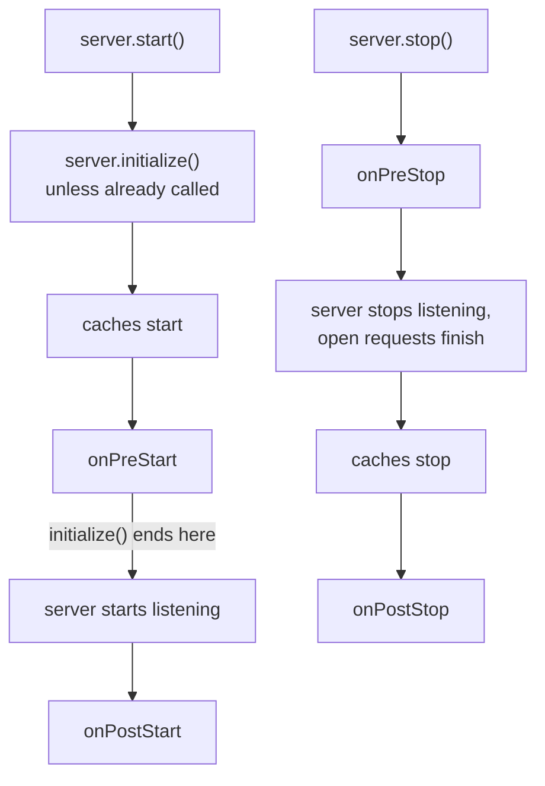
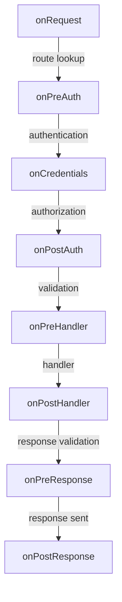

<TutorialLang />

# Lifecycle Hooks

_This tutorial is compatible with hapi v21 and newer_

## <a name="overview"></a> Overview

hapi runs every request through the same fixed sequence of steps: route lookup, authentication, validation, the handler, and so on. A lifecycle hook, which the API reference calls an extension point, lets you run your own function at a named point in that sequence. The server itself has four more hooks for startup and shutdown.

Hooks are how most cross-cutting features are built. Several official plugins are mostly a few hooks:

| Plugin                 | Hook            | What it does there                                    |
| ---------------------- | --------------- | ----------------------------------------------------- |
| [yar](/module/yar)     | `onPreAuth`     | loads the session, so authentication can use it       |
| [yar](/module/yar)     | `onPreResponse` | saves the session into a cookie                       |
| [crumb](/module/crumb) | `onPostAuth`    | rejects requests with a missing or wrong CSRF token   |
| [crumb](/module/crumb) | `onPreResponse` | adds the CSRF token to the view context of HTML pages |
| [nes](/module/nes)     | `onPreStart`    | starts WebSocket heartbeats                           |
| [nes](/module/nes)     | `onPreStop`     | closes open WebSocket connections                     |

You add a hook with [`server.ext()`](/api#server-ext-events); the API reference has the full option list.

## <a name="server-hooks"></a> Server hooks: startup and shutdown

Server hooks run once, when the server starts or stops. Each receives the `server` and returns nothing, or a promise. A thrown error stops startup or shutdown.



[`server.start()`](/api#await-server-start) runs `server.initialize()` first if you have not called it. `initialize()` stops before the listening step, so it runs `onPreStart` but never opens a port. That makes it the right call in tests, where you send requests with `server.inject()`.

| Hook          | Runs                              | Use it for                                                                 |
| ------------- | --------------------------------- | -------------------------------------------------------------------------- |
| `onPreStart`  | before the server listens         | connecting to databases and checking config, so a failure stops startup    |
| `onPostStart` | after the server listens          | work that needs the bound port, such as registering with service discovery |
| `onPreStop`   | before the server stops listening | telling load balancers and long-lived connections to go away               |
| `onPostStop`  | after open requests have finished | closing the database pool and other resources requests were using          |

A database pool is the common case. Connecting in `onPreStart` makes a missing database fail `server.start()` instead of the first request. Closing in `onPostStop` waits until in-flight requests have finished their queries:

```ts
import Hapi from '@hapi/hapi';
import { Pool } from 'pg';

import type { Plugin } from '@hapi/hapi';

const database: Plugin<{ connectionString: string }> = {
    name: 'database',
    register(server, options) {
        const pool = new Pool({ connectionString: options.connectionString });

        server.ext('onPreStart', async () => {
            await pool.query('SELECT 1');
        });

        server.ext('onPostStop', async () => {
            await pool.end();
        });

        server.expose('pool', pool);
    },
};

const server = Hapi.server({ port: 4000 });

await server.register({
    plugin: database,
    options: { connectionString: 'postgres://localhost/app' },
});

await server.start();

process.on('SIGTERM', async () => {
    await server.stop({ timeout: 10_000 });
    process.exit(0);
});
```

`server.stop({ timeout })` gives open requests that long to finish before their connections are closed. To share a service like this pool with handlers, use a [server decoration](/tutorials/en_US/decorators#server).

Two rules for server hooks:

- Add `onPreStart` before calling `initialize()` or `start()`. Adding one afterwards throws `Cannot add onPreStart (after) extension after the server was initialized`.
- When one plugin's startup work needs another plugin to be ready, put it in a [`server.dependency()`](/api#server-dependency-dependencies-after) callback. hapi runs the callback during `onPreStart`, after the plugins it names, whatever order they were registered in. See [Dependencies](/tutorials/en_US/plugins#dependencies) in the Plugins tutorial.

## <a name="request-hooks"></a> Request hooks

Request hooks run for each request. The eight hooks sit between the steps of the [request lifecycle](/api#request-lifecycle):



`onRequest`, `onPreResponse`, and `onPostResponse` run for every request, including 404s and requests rejected by authentication or validation. The exception is a request that is aborted or closed with `h.close`, which skips `onPreResponse`. `onCredentials` runs whenever the route has authentication configured, even when no credentials were found. The others run when the request gets that far.

| Hook             | What you can rely on                                                      | Typical use                                     |
| ---------------- | ------------------------------------------------------------------------- | ----------------------------------------------- |
| `onRequest`      | the raw path and headers; no route yet; can change the URL                | request ids, URL rewrites, maintenance mode     |
| `onPreAuth`      | `request.route` and parsed cookies                                        | loading a session that authentication will read |
| `onCredentials`  | `request.auth.credentials`, before scopes are checked                     | adding roles or scopes from your database       |
| `onPostAuth`     | authentication done, payload parsed but not validated                     | CSRF checks, loading the tenant or account      |
| `onPreHandler`   | params, query, and payload validated                                      | checks that need validated input                |
| `onPostHandler`  | the handler's response object; a failing handler skips to `onPreResponse` | changing successful responses                   |
| `onPreResponse`  | the final `request.response`, errors included                             | error pages, response headers, saving sessions  |
| `onPostResponse` | the response has been sent                                                | metrics, access logs, cleanup                   |

### <a name="return-values"></a> What a hook returns

A request hook is a [lifecycle method](/api#lifecycle-methods): it receives `(request, h)` and must return something. What it returns decides what happens next:

| Return                         | `onRequest`              | `onPreAuth` to `onPreHandler`                                  | `onPostHandler`, `onPreResponse`                                | `onPostResponse`                 |
| ------------------------------ | ------------------------ | -------------------------------------------------------------- | --------------------------------------------------------------- | -------------------------------- |
| `h.continue`                   | the next step runs       | the next step runs                                             | the current response is kept                                    | ignored                          |
| `h.response(value).takeover()` | skips to `onPreResponse` | skips to the route's response validation, then `onPreResponse` | replaces the response; later hooks of the same type are skipped | ignored                          |
| an error, thrown or returned   | skips to `onPreResponse` | skips to `onPreResponse`                                       | replaces the response; later hooks of the same type are skipped | thrown, or returned boom: logged |
| any other value                | 500 error                | 500 error                                                      | replaces the response; later hooks of the same type still run   | ignored                          |
| nothing (`undefined`)          | 500 error                | 500 error                                                      | 500 error                                                       | ignored                          |

[`h.continue`](/api#h-continue) is how a hook says "nothing to do here". A takeover is how a hook before the handler answers the request itself, and even a takeover from `onRequest` passes through `onPreResponse`. The [lifecycle workflow](/api#lifecycle-workflow) in the API reference has the full rules.

## <a name="patterns"></a> Patterns

### <a name="request-id"></a> Request ids and timing

A request id ties a client's error report to your logs. This plugin accepts an id from the client or creates one, returns it in a header, and records how long each request took:

```ts
import { randomUUID } from 'node:crypto';
import Boom from '@hapi/boom';

import type { Plugin } from '@hapi/hapi';

declare module '@hapi/hapi' {
    interface PluginsStates {
        'request-tracing': { id: string };
    }
}

const requestTracing: Plugin<void> = {
    name: 'request-tracing',
    register(server) {
        server.ext('onRequest', (request, h) => {
            const incoming = request.headers['x-request-id'];
            request.plugins['request-tracing'] = { id: typeof incoming === 'string' ? incoming : randomUUID() };
            return h.continue;
        });

        server.ext('onPreResponse', (request, h) => {
            const { response } = request;
            const { id } = request.plugins['request-tracing'];
            if (Boom.isBoom(response)) {
                response.output.headers['x-request-id'] = id;
            } else {
                response.header('x-request-id', id);
            }

            return h.continue;
        });

        server.ext('onPostResponse', (request, h) => {
            const { response } = request;
            const statusCode = Boom.isBoom(response) ? response.output.statusCode : response.statusCode;
            const duration = request.info.completed - request.info.received;

            request.log(['metrics'], {
                id: request.plugins['request-tracing'].id,
                path: request.path,
                statusCode,
                duration,
            });
            return h.continue;
        });
    },
};
```

- A plugin keeps its per-request data under its own name in [`request.plugins`](/api#request-plugins), and the `declare module` block types that entry through hapi's `PluginsStates` interface. [`request.app`](/api#request-app) is for your application's own code.
- `request.response` is a boom error when the request failed, so `onPreResponse` sets the header on `response.output.headers` instead of calling `.header()`.
- `onPostResponse` runs after the response is sent, so the client never waits for it, and its return value is ignored. hapi runs the `onPostResponse` hooks one after another, so a slow hook still delays the hooks after it. Hand slow work such as sending metrics over the network to a queue, and return.
- hapi already records [`request.info.received`](/api#request-info) and `request.info.completed`, so there is no need to store a start time yourself.

### <a name="rewrite"></a> Rewriting URLs

`onRequest` is the only hook that runs before route lookup, so it is the only place a rewrite changes which route handles the request. [`request.setUrl()`](/api#request-seturl-url-striptrailingslash) does the rewrite:

```ts
server.ext('onRequest', (request, h) => {
    if (request.path.startsWith('/api/v1/')) {
        request.setUrl(request.url.pathname.replace('/api/v1/', '/api/') + request.url.search);
    }

    return h.continue;
});
```

Old clients keep calling `/api/v1/users?page=2`, and the `/api/users` route answers them with the query string intact.

### <a name="maintenance"></a> Maintenance mode

A takeover response from `onRequest` answers every request before any route runs:

```ts
let maintenance = false;

server.ext('onRequest', (request, h) => {
    if (!maintenance || request.path === '/health') {
        return h.continue;
    }

    return h.response({ message: 'Down for maintenance' }).code(503).header('retry-after', '600').takeover();
});
```

The health check stays reachable, so your load balancer can tell a planned outage from a crash.

### <a name="credentials"></a> Loading roles: onCredentials or onPostAuth

Both hooks run after authentication. The difference is the authorization step between them, which checks the route's [`auth.access.scope`](/api#route-options-auth-access-scope) (see [Scopes](/tutorials/en_US/auth#scopes)).

Use `onCredentials` when you add something authorization should see. A token often identifies the user but does not carry their roles, so you load the roles from your database and add them as scopes:

```ts
server.ext('onCredentials', async (request, h) => {
    if (!request.auth.isAuthenticated) {
        return h.continue;
    }

    const { user } = request.auth.credentials;
    if (user) {
        request.auth.credentials.scope = await loadRoles(user.id);
    }

    return h.continue;
});

server.route<{ Params: { id: string } }>({
    method: 'DELETE',
    path: '/projects/{id}',
    options: { auth: { access: { scope: 'admin' } } },
    handler: (request, h) => deleteProject(request.params.id),
});
```

`onCredentials` runs whenever the route has authentication configured, including `'try'` and `'optional'` routes where no credentials were found and `request.auth.credentials` is `null`, so check `request.auth.isAuthenticated` first. `user.id` relies on the `UserCredentials` declaration shown in the [Authentication tutorial](/tutorials/en_US/auth#schemes).

Use `onPostAuth` for work that does not change what the user is allowed to do, or that must also run on routes without authentication, such as loading the tenant named in the `Host` header. `onCredentials` never runs on a route with `auth: false`.

### <a name="errors"></a> Consistent error responses

`onPreResponse` sees every response on its way out, so it is where you change how errors look. A hook that replaces an error with its own response has to keep the error's headers, such as `WWW-Authenticate` on a 401:

```ts
import Boom from '@hapi/boom';

server.ext(
    'onPreResponse',
    (request, h) => {
        const { response } = request;
        if (!Boom.isBoom(response)) {
            return h.continue;
        }

        const { statusCode, payload, headers } = response.output;
        const reply = h.response({ error: payload.message }).code(statusCode);
        for (const [name, value] of Object.entries(headers)) {
            if (value !== undefined) {
                reply.header(name, String(value));
            }
        }

        return reply;
    },
    { before: ['request-tracing'] },
);
```

The new response replaces the error, and `onPreResponse` hooks that run after this one see the new response. With `before: ['request-tracing']`, the [request id hook](#request-id) runs after this one and adds its header to the new response. Without it, the request id hook would set its header on the error first, and only the header copy above would keep it. Ordering matters most for hooks that replace the response. The [Response Marshalling tutorial](/tutorials/en_US/response-marshalling#errors) has a full error format and HTML error pages.

## <a name="ordering"></a> Ordering and scoping

By default, hooks of the same type run in the order they were added, counting server hooks, plugin hooks, and route hooks together. Three options change which requests a hook sees and when it runs.

**`before` and `after`** take plugin names, and order your plugin's hook relative to theirs. A plugin that reads the session that yar loads would use:

```ts
server.ext('onPreAuth', loadPreferences, { after: ['@hapi/yar'] });
```

**`sandbox: 'plugin'`** limits a hook to the routes its plugin added. It works for every request hook except `onRequest`, which runs before hapi knows the route:

```ts
import type { Plugin } from '@hapi/hapi';

const adminPanel: Plugin<void> = {
    name: 'admin-panel',
    register(server) {
        server.ext('onPreHandler', auditAdminAccess, { sandbox: 'plugin' });

        server.route({ method: 'GET', path: '/admin', handler: (request, h) => 'admin' });
    },
};
```

**Route-level hooks** go in the route's [`options.ext`](/api#route-options-ext), and run only for that route:

```ts
server.route({
    method: 'POST',
    path: '/uploads',
    options: {
        ext: {
            onPreHandler: { method: checkStorageQuota },
        },
    },
    handler: (request, h) => saveUpload(request.payload),
});
```

`server.ext()` also takes an array, which keeps a plugin's hooks together in one place:

```ts
server.ext([
    { type: 'onRequest', method: assignRequestId },
    { type: 'onPreResponse', method: addRequestIdHeader },
    { type: 'onPostResponse', method: recordMetrics },
]);
```

## <a name="typing"></a> Typing hooks

Hooks written inline in `server.ext()` need no annotations: TypeScript infers `request` and `h` from the hook name, and infers `server` for server hooks. A hook defined on its own is a `Lifecycle.Method`:

```ts
import Boom from '@hapi/boom';

import type { Lifecycle } from '@hapi/hapi';

const checkStorageQuota: Lifecycle.Method = async (request, h) => {
    if (!request.auth.isAuthenticated) {
        throw Boom.unauthorized();
    }

    const quota = await getQuota(request.auth.credentials.user?.id);
    if (quota.used >= quota.limit) {
        throw Boom.forbidden('Storage quota exceeded');
    }

    return h.continue;
};
```

To type data your hooks store on the request, extend `PluginsStates` as in the [request id example](#request-id), or `RequestApplicationState` for `request.app` in application code. `user?.id` relies on the `UserCredentials` declaration shown in the [Authentication tutorial](/tutorials/en_US/auth#schemes).
