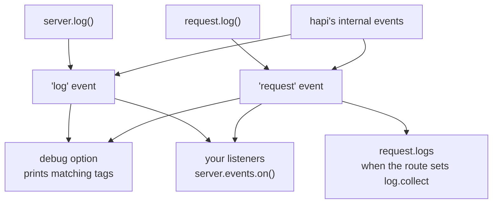

<TutorialLang />

# Logging

_This tutorial is compatible with hapi v21 and newer_

## <a name="overview"></a> Overview

Apart from the [`debug`](#debug) default, which prints errors from your own code to the console, hapi does not write logs anywhere. It turns every log call into an event on `server.events`, and you decide what to do with those events: print them, ship them to a logging service, or collect them per request.



## <a name="methods"></a> Built-in Methods

There are two logging methods. Pick the one that matches where your code runs:

| Method                                                            | Use it when                                                    | Emits       |
| ----------------------------------------------------------------- | -------------------------------------------------------------- | ----------- |
| [`request.log(tags, [data])`](/api#request-log-tags-data)         | a request is in scope: a handler, an extension, an auth scheme | `'request'` |
| [`server.log(tags, [data])`](/api#server-log-tags-data-timestamp) | no request is in scope: startup, a plugin's `register()`       | `'log'`     |

Both take the same two main arguments:

- `tags`: a string or an array of strings, such as `['error', 'database', 'read']`. hapi uses tags instead of log levels, so you can filter on any combination: everything tagged `database`, or only `error` and `database` together.
- `data`: optional. A message, an object, or an `Error`. Pass a function instead, and hapi calls it only when a listener receives the event, so expensive data costs nothing when nobody is listening.

### <a name="request.log"></a> request.log()

```ts
server.route({
    method: 'GET',
    path: '/users/{id}',
    handler: async (request, h) => {
        request.log(['users', 'read'], { id: request.params.id });

        return { id: request.params.id };
    },
});
```

Every event logged this way carries the request's id, so you can group the events of one request together.

### <a name="server.log"></a> server.log()

```ts
import Hapi from '@hapi/hapi';

const server = Hapi.server({ port: 3000 });

await server.start();

server.log(['startup'], `Server running at ${server.info.uri}`);
```

## <a name="display"></a> Retrieving and Displaying Logs

Listen on [`server.events`](/api#server-events). Besides your own calls, hapi emits its own events on the same channels:

| Event        | `event.channel` | Comes from                                                     |
| ------------ | --------------- | -------------------------------------------------------------- |
| `'log'`      | `'app'`         | your `server.log()` calls                                      |
| `'log'`      | `'internal'`    | hapi: server load rejections, client connection errors         |
| `'request'`  | `'app'`         | your `request.log()` calls                                     |
| `'request'`  | `'internal'`    | hapi: authentication failures, handler errors, invalid headers |
| `'request'`  | `'error'`       | hapi: once per request that ended with a 500                   |
| `'response'` | none            | hapi: once per request, after the response is sent             |

The full list of internal tags is in the API reference under the [`'log'`](/api#log-event) and [`'request'`](/api#request-event) events.

A typical setup prints application events, reports 500s, and writes one access-log line per request:

```ts
server.events.on('log', (event, tags) => {
    console.log(event.timestamp, event.tags, event.data ?? event.error);
});

server.events.on({ name: 'request', channels: 'app' }, (request, event, tags) => {
    console.log(request.info.id, event.tags, event.data ?? event.error);
});

server.events.on({ name: 'request', channels: 'error' }, (request, event, tags) => {
    console.error(`Request ${request.info.id} failed:`, event.error);
});

server.events.on('response', (request) => {
    const duration = request.info.completed - request.info.received;

    console.log(`${request.method.toUpperCase()} ${request.path} ${request.raw.res.statusCode} ${duration}ms`);
});
```

- `tags` is an object with one `true` key per tag, so `if (tags.error)` is a quick check.
- `event.data` and `event.error` never appear together: an `Error` passed as `data` arrives as `event.error`.
- The criteria object `{ name: 'request', channels: 'error' }` subscribes to one channel. Without it you get all three.

hapi emits `'response'` after the response is sent, and does not wait on promises a listener returns. For async work that hapi should await in order, use an `onPostResponse` extension; see [Lifecycle Hooks](/tutorials/en_US/lifecycle-hooks).

### Collecting the logs of one request

To read a request's events from inside the request, set `log.collect` on the route. Every event logged for that request then lands in `request.logs`:

```ts
server.route({
    method: 'GET',
    path: '/',
    options: {
        log: {
            collect: true,
        },
    },
    handler: function (request, h) {
        request.log(['step'], 'loaded user');
        request.log(['step'], 'loaded orders');

        return { steps: request.logs.length };
    },
});
```

Without `log.collect`, `request.logs` stays empty.

## <a name="debug"></a> Debug Mode (development only)

The [`debug`](/api#server-options-debug) server option prints matching events to the console with `console.error()`, with no listener code. It changes only what is printed, not what is emitted.

| Option          | Default              | Prints                                                                                          |
| --------------- | -------------------- | ----------------------------------------------------------------------------------------------- |
| `debug.request` | `['implementation']` | `'request'` events with any of these tags. The default prints 500s caused by bugs in your code. |
| `debug.log`     | none                 | `'log'` events with any of these tags.                                                          |
| `debug: false`  |                      | nothing                                                                                         |

Each list takes tags, `'*'` for every event, or `false` for none. To print every request error while developing:

```ts
import Hapi from '@hapi/hapi';

const server = Hapi.server({ debug: { request: ['error'] } });
```

## <a name="plugins"></a> Logging Plugins

For production logging, use a plugin that listens to these events for you, such as [hapi-pino](https://www.npmjs.com/package/hapi-pino) for structured JSON logs, [New Relic](https://newrelic.com/instant-observability/hapi/2124da5b-0174-457a-be5a-e0068673b2b5), or any of the other [hapi logging plugins](/plugins#logging).
