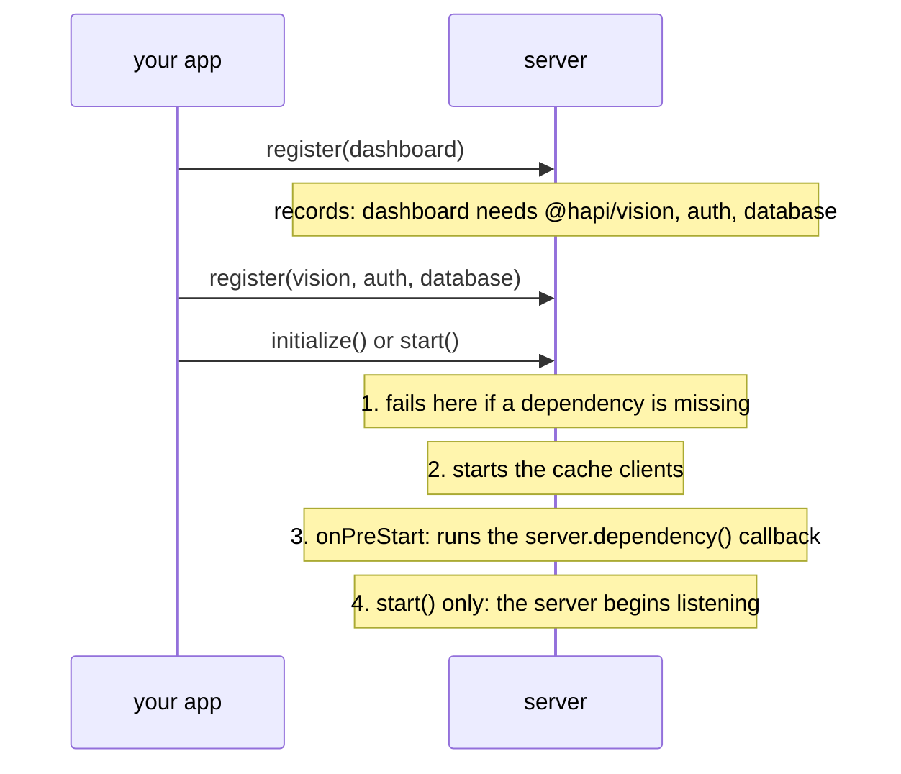

<TutorialLang />

# Plugins

_This tutorial is compatible with hapi v21 and newer_

## <a name="overview"></a> Overview

A plugin is a piece of a hapi application packaged so it can be registered on a server: a set of routes, an authentication scheme, a logger, a template engine. Most of the hapi ecosystem is published as plugins ([inert](/module/inert), [vision](/module/vision), [@hapi/basic](/module/basic)), and splitting your own application into plugins keeps each part isolated and testable.

A plugin receives the server in its `register` function and changes it through the normal server API. The ones that matter most for plugin authors:

| Server API                                                               | What the plugin adds                                                   | Tutorial                                            |
| ------------------------------------------------------------------------ | ---------------------------------------------------------------------- | --------------------------------------------------- |
| [`server.route()`](/api#server-route-route)                              | routes                                                                 | [Routing](/tutorials/en_US/routing)                 |
| [`server.ext()`](/api#server-ext-events)                                 | code that runs at a step of every request, or at server start and stop | [Lifecycle Hooks](/tutorials/en_US/lifecycle-hooks) |
| [`server.decorate()`](/api#server-decorate-type-property-method-options) | new methods on `server`, `request`, or `h`                             | [Decorators](/tutorials/en_US/decorators)           |
| [`server.auth.scheme()`](/api#server-auth-scheme-name-scheme)            | an authentication scheme                                               | [Authentication](/tutorials/en_US/auth)             |
| [`server.method()`](/api#server-method-name-method-options)              | shared, cacheable functions                                            | [Server Methods](/tutorials/en_US/server-methods)   |
| [`server.expose()`](/api#server-expose-key-value-options)                | values other plugins read from `server.plugins[name]`                  |                                                     |

## <a name="create"></a> Creating a plugin

A plugin is an object with a `name` and an async `register(server, options)` function:

```ts
import type { Plugin } from '@hapi/hapi';

const myPlugin: Plugin<void> = {
    name: 'myPlugin',
    version: '1.0.0',
    register: async function (server, options) {
        server.route({
            method: 'GET',
            path: '/test',
            handler: function (request, h) {
                return 'hello, world';
            },
        });
    },
};
```

Once registered, `GET /test` answers `'hello, world'`.

`Plugin<T>` takes the type of the plugin's options. This plugin has none, so it is `Plugin<void>`. With the plugin typed, TypeScript infers `server` and `options` in `register`, and checks that the plugin has a `name` or a `pkg`.

The plugin object's properties:

| Property       | Meaning                                                                                                   |
| -------------- | --------------------------------------------------------------------------------------------------------- |
| `register`     | Required. Sets the plugin up. Registration waits for it, and fails if it throws.                          |
| `name`         | Required unless `pkg` is set. Must be unique on the server. Published plugins use their npm package name. |
| `version`      | Informational. Other plugins can read it, and [dependencies](#dependencies) can require a version range.  |
| `pkg`          | Your `package.json`, used for `name` and `version` instead of setting them by hand.                       |
| `dependencies` | Plugins that must also be registered. See [dependencies](#dependencies).                                  |
| `requirements` | Supported `node` and `hapi` version ranges, such as `{ hapi: '>=21' }`. Registration fails outside them.  |
| `multiple`     | `true` allows registering the plugin more than once on the same server.                                   |
| `once`         | `true` makes repeated registrations a silent no-op instead of an error.                                   |

### <a name="module"></a> Publishing a plugin as a module

A plugin module exports the plugin object, either as the default export or as a named `plugin` export. `pkg` reads the name and version from `package.json`:

```ts
import Pkg from './package.json' with { type: 'json' };

import type { Plugin } from '@hapi/hapi';

export const plugin: Plugin<void> = {
    pkg: Pkg,
    register: async function (server, options) {
        server.route({
            method: 'GET',
            path: '/test',
            handler: function (request, h) {
                return 'hello, world';
            },
        });
    },
};
```

hapi accepts either export shape: `server.register()` takes a plugin object, or a module whose `plugin` property is one.

### <a name="register"></a> Plugin options

`options` is whatever the caller passes at registration, unchanged. Type it with `Plugin<Options>`:

```ts
import Pkg from './package.json' with { type: 'json' };

import type { Plugin } from '@hapi/hapi';

interface Options {
    name: string;
}

export const plugin: Plugin<Options> = {
    pkg: Pkg,
    register: async function (server, options) {
        server.route({
            method: 'GET',
            path: '/test',
            handler: function (request, h) {
                return `Hello ${options.name}`;
            },
        });
    },
};
```

`options.name` is a `string`, and TypeScript flags a `server.register()` call whose options don't match `Options`; hapi does not check them at runtime.

## <a name="loading"></a> Loading a plugin

Register plugins with [`server.register()`](/api#await-server-register-plugins-options). Pass the plugin itself, or an object with `plugin` and `options`, or an array of either:

```ts
import Hapi from '@hapi/hapi';
import { plugin as MyPlugin } from 'myplugin';
import { plugin as YourPlugin } from 'yourplugin';

const start = async function () {
    const server = Hapi.server();

    await server.register(YourPlugin);

    await server.register({
        plugin: MyPlugin,
        options: {
            name: 'Bob',
        },
    });

    await server.register([{ plugin: YourPlugin }, { plugin: MyPlugin, options: { name: 'Bob' } }]);
};
```

Plugins in an array register one after another, in order. Each `register` function finishes before the next one starts.

### <a name="registration"></a> Registration options

The second argument to `server.register()` configures how hapi registers the plugin. It is _not_ passed to the plugin:

| Option          | Effect                                                                           |
| --------------- | -------------------------------------------------------------------------------- |
| `routes.prefix` | Prepends a path to every route the plugin adds. `/test` becomes `/plugins/test`. |
| `routes.vhost`  | Applies a virtual host to every route the plugin adds.                           |
| `once`          | `true` skips the plugin if it is already registered, instead of throwing.        |

```ts
import Hapi from '@hapi/hapi';
import { plugin as MyPlugin } from 'myplugin';

const start = async function () {
    const server = Hapi.server();

    await server.register(MyPlugin, {
        routes: {
            prefix: '/plugins',
        },
    });
};
```

Prefixes nest: if a plugin registered with prefix `/api` registers a child plugin with prefix `/v1`, the child's routes start with `/api/v1`. See [`server.register()`](/api#await-server-register-plugins-options) for the full list.

## <a name="scope"></a> What a plugin can and cannot affect

Each plugin gets its own [`server.realm`](/api#server-realm): a container for settings that stay inside the plugin. Everything else a plugin does changes the whole server:

| Change                                                                                               | Scope                                                |
| ---------------------------------------------------------------------------------------------------- | ---------------------------------------------------- |
| route prefix and vhost from registration options                                                     | the plugin's routes and its child plugins            |
| [`server.bind()`](/api#server-bind-context), [`server.path()`](/api#server-path-relativeto)          | routes, handlers, and extensions added by the plugin |
| request [lifecycle hooks](/tutorials/en_US/lifecycle-hooks) with `options.sandbox: 'plugin'`         | the plugin's routes                                  |
| request lifecycle hooks without `sandbox`                                                            | **every route on the server**                        |
| [decorations](/tutorials/en_US/decorators), server methods, auth strategies, `server.auth.default()` | **the whole server**                                 |

A plugin that adds an `onPreResponse` hook to format its own errors should pass `sandbox: 'plugin'`, or it will reformat every other plugin's errors too.

## <a name="dependencies"></a> Dependencies

A plugin that needs another plugin declares it, instead of relying on registration order:

```ts
import type { Plugin } from '@hapi/hapi';

declare module '@hapi/hapi' {
    interface PluginProperties {
        database: { migrate: () => Promise<void> };
    }
}

export const plugin: Plugin<void> = {
    name: 'dashboard',
    dependencies: ['@hapi/vision', 'auth'],
    register: async function (server, options) {
        server.dependency('database', async (server) => {
            await server.plugins.database.migrate();
        });
    },
};
```

hapi checks dependencies when the server initializes, not when the plugin registers, so plugins can be registered in any order:



- `dependencies` is a list of names, or an object of names to version ranges such as `{ '@hapi/vision': '7.x' }`.
- [`server.dependency(names, after)`](/api#server-dependency-dependencies-after) declares the same thing from inside `register`, and accepts an `after` function. hapi runs `after` during server start, once every listed plugin is registered. Use it for setup that needs another plugin's API.
- hapi throws on circular `after` dependencies.

`server.plugins.database` is what the `database` plugin published with [`server.expose()`](/api#server-expose-key-value-options). hapi cannot know its shape, so the `declare module` block adds it to hapi's `PluginProperties` interface.
