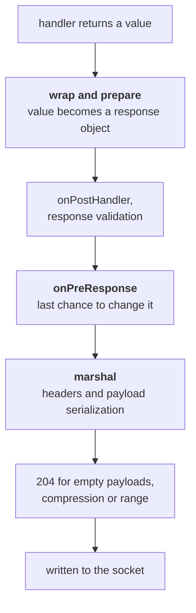

<TutorialLang />

# Response Marshalling

_This tutorial is compatible with hapi v21 and newer_

## <a name="overview"></a> Overview

A handler returns a value: a string, an object, a stream, an error. Response marshalling is everything hapi does to turn that value into an HTTP response: picking a status code, setting headers, serializing the payload, compressing it, and writing it to the socket.

Knowing how it works tells you where to put code. A consistent error format, an HTML error page, caching headers, compression, a custom response type like CSV, a byte counter for metrics: each of these belongs at a specific point in the marshalling pipeline. The [response object](/api#response-object) and [response toolkit](/api#response-toolkit) API references list every method.

## <a name="pipeline"></a> From return value to bytes

Marshalling happens in two phases with the `onPreResponse` extension point in between:



The marshal step runs in a fixed order, which decides which settings can see which headers:

1. `content-type` from the payload type
2. CORS and security headers, if the route enables them
3. ETag and `last-modified` from [`h.entity()`](/api#h-entity-options), then the 304 check on GET routes
4. `cache-control` from the route's `cache` option
5. `set-cookie` from [`h.state()`](/api#h-state-name-value-options) and cookies with an `autoValue`
6. payload serialization and `content-length`
7. the auth scheme's `response()` method, last, so it can read every header above

The split matters in practice:

- **Before `onPreResponse`**, the response is a response object or a [boom](/module/boom) error, and you can inspect it, change it, or replace it. Errors raised while wrapping and preparing, such as a file that does not exist, arrive in `onPreResponse` as boom errors.
- **After `onPreResponse`**, hapi serializes the payload and computes headers. An error at this stage, such as an object that `JSON.stringify()` cannot handle, becomes a 500 that `onPreResponse` never sees. Keep payloads plain data so marshalling cannot fail.

The order of the [request lifecycle](/api#request-lifecycle) steps is covered in the [Lifecycle Hooks](/tutorials/en_US/lifecycle-hooks) tutorial.

## <a name="return-values"></a> What you return, what hapi sends

| Handler returns     | Status               | Default `content-type`            | Notes                                                                                                                                                                      |
| ------------------- | -------------------- | --------------------------------- | -------------------------------------------------------------------------------------------------------------------------------------------------------------------------- |
| string              | 200, or 204 if empty | `text/html; charset=utf-8`        | Set `.type('text/plain')` for plain text                                                                                                                                   |
| object or array     | 200                  | `application/json; charset=utf-8` | Serialized with `JSON.stringify()` and the route's [`json` options](#json)                                                                                                 |
| `Buffer`            | 200                  | `application/octet-stream`        |                                                                                                                                                                            |
| readable stream     | 200                  | `application/octet-stream`        | Sent chunked. Must not be in object mode. Copies `statusCode` and `headers` if the stream has them                                                                         |
| `null`              | 204                  | none                              | Set the route's `response.emptyStatusCode` to `200` to send 200 instead                                                                                                    |
| `undefined`         | 500                  |                                   | A handler must return something; hapi logs "handler method did not return a value"                                                                                         |
| `Error`             | 500                  | `application/json; charset=utf-8` | The message is hidden from the client                                                                                                                                      |
| boom error          | the error's status   | `application/json; charset=utf-8` | `{ statusCode, error, message }`; 5xx messages are hidden                                                                                                                  |
| `h.response(value)` | as for `value`       | as for `value`                    | Chain `.code()`, `.header()`, `.type()` and the other [response object](/api#response-object) methods                                                                      |
| `h.redirect(uri)`   | 302                  | `text/html; charset=utf-8`        | Empty body. `.permanent()` gives 301, `.rewritable(false)` gives 307, both give 308. 307 and 308 make the client repeat the same method, so a redirected POST stays a POST |

- `Readable.from(array)` creates a stream in object mode, which hapi rejects with a 500. Pass `{ objectMode: false }`, or return a byte stream such as `Fs.createReadStream()`.
- A stream with `statusCode` and `headers` properties, such as an HTTP response from [wreck](/module/wreck), passes its status and headers through. That makes a basic proxy a one-line handler, and also means an upstream 404 becomes your 404.

## <a name="shaping"></a> Shaping a response with h.response()

Return a plain value when the defaults fit. When they don't, wrap the value with [`h.response()`](/api#h-response-value) and chain what you need:

```ts
import Hapi from '@hapi/hapi';

const server = Hapi.server({ port: 4000 });

server.route<{ Payload: { name: string } }>({
    method: 'POST',
    path: '/users',
    handler: (request, h) => {
        const user = { id: '2133d32a', name: request.payload.name };

        return h.response(user).created(`/users/${user.id}`).header('x-request-id', request.info.id);
    },
});

server.route({
    method: 'GET',
    path: '/robots.txt',
    handler: (request, h) => {
        return h.response('User-agent: *\nDisallow: /admin\n').type('text/plain');
    },
});
```

`.created()` sets the status to 201 and the `location` header in one call.

## <a name="errors"></a> Errors

Every error ends up as a boom object. hapi wraps a plain `Error` with `Boom.boomify()`, which gives it status 500, and boom hides the message of any 5xx error from the client. Your users see `An internal server error occurred`, and hapi emits the real error as a `'request'` event on the `'error'` channel; see [Logging](/tutorials/en_US/logging) to record it. Throw a boom error such as `Boom.notFound('No such user')` when the client should see the message.

A boom error's response comes from its `output` property:

```ts
import Boom from '@hapi/boom';

const error = Boom.notFound('No such user');

error.output.statusCode; // 404
error.output.payload; // { statusCode: 404, error: 'Not Found', message: 'No such user' }
error.output.headers; // {}, or headers such as WWW-Authenticate from auth errors
```

### A consistent error format

APIs often need errors in their own format rather than boom's. Convert them in `onPreResponse`, where every error passes through, including 404s for unknown routes and errors thrown by plugins:

```ts
import Boom from '@hapi/boom';
import Hapi from '@hapi/hapi';

const server = Hapi.server({ port: 4000 });

server.ext('onPreResponse', (request, h) => {
    const { response } = request;
    if (!Boom.isBoom(response)) {
        return h.continue;
    }

    const { statusCode, payload, headers } = response.output;
    const reply = h.response({
        error: {
            status: statusCode,
            code: payload.error,
            message: payload.message,
            requestId: request.info.id,
        },
    });

    reply.code(statusCode);
    for (const [name, value] of Object.entries(headers)) {
        if (value !== undefined) {
            reply.header(name, String(value));
        }
    }

    return reply;
});
```

Copy `output.headers` to the new response. Auth errors carry `WWW-Authenticate` there, and `Boom.methodNotAllowed()` can carry `Allow`. `payload.message` is already the safe message: for 5xx errors boom has replaced it with the generic text.

### HTML error pages

A site that renders HTML can return an error page from the same hook instead; the [Views tutorial](/tutorials/en_US/views#errors) shows it with @hapi/vision. In an app that serves both pages and an API, skip the page for API routes, for example with `request.path.startsWith('/api/')`, so API clients keep getting JSON.

## <a name="custom"></a> Custom response types

Plugins that send files and templates don't return strings. [@hapi/inert](/module/inert) and [@hapi/vision](/module/vision) create their responses with [`request.generateResponse()`](/api#request-generateresponse-source-options), which takes a source value and optional processors. `prepare` and `marshal` run at the two phases of the pipeline, and `close` runs when the response is done, whether it was sent or replaced:

| Plugin | `variety` | `prepare` runs before `onPreResponse`                                        | `marshal` runs after `onPreResponse`                                                         |
| ------ | --------- | ---------------------------------------------------------------------------- | -------------------------------------------------------------------------------------------- |
| inert  | `'file'`  | opens the file; sets `content-length`, `content-type`, `last-modified`, ETag | returns a read stream, or a precompressed file (`.gz`, or other extensions from `lookupMap`) |
| vision | `'view'`  | loads and compiles the template                                              | renders the template with its context; sets `content-type`                                   |

The split is deliberate. A missing file fails in `prepare`, so it reaches `onPreResponse` as a 404 your error handler can format. The expensive work, reading the file or rendering the template, happens in `marshal`, after `onPreResponse` has had the chance to replace the response. inert also passes `close`, which closes the file even when an `onPreResponse` hook replaced the response; a custom response that opens a resource needs one too.

You can use the same mechanism for your own formats. Here is a CSV response:

```ts
import Hapi from '@hapi/hapi';

import type { Request } from '@hapi/hapi';

const field = (value: string) => (/[",\n]/.test(value) ? `"${value.replaceAll('"', '""')}"` : value);

const csv = (request: Request, rows: string[][]) => {
    return request
        .generateResponse(rows, {
            variety: 'csv',
            marshal: async () => rows.map((row) => row.map(field).join(',')).join('\n'),
        })
        .type('text/csv');
};

const server = Hapi.server({ port: 4000 });

server.route({
    method: 'GET',
    path: '/users.csv',
    handler: (request, h) => {
        return csv(request, [
            ['id', 'name'],
            ['2133d32a', 'John Doe'],
        ]);
    },
});
```

`field()` quotes values that contain a comma, a quote, or a line break, so they cannot split a row. To call it as `h.csv(rows)` from any handler, add it to the response toolkit with a decorator; see the [Decorators](/tutorials/en_US/decorators) tutorial.

## <a name="json"></a> JSON serialization

Objects are serialized with `JSON.stringify()`. The route's [`json` options](/api#route-options-json) control how:

```ts
import Hapi from '@hapi/hapi';

const server = Hapi.server({
    port: 4000,
    routes: {
        json: {
            space: process.env.NODE_ENV === 'production' ? 0 : 2,
        },
    },
});

server.route({
    method: 'GET',
    path: '/widget-config',
    options: {
        json: { escape: true },
    },
    handler: (request, h) => {
        return { title: '</script><script>alert(1)</script>' };
    },
});
```

- `space` indents the output. Readable JSON helps during development and costs bytes in production.
- `escape: true` writes `<`, `>`, and `&` as `\u003c`, `\u003e`, and `\u0026`, and also escapes the U+2028 and U+2029 line separators. Use it on any route whose JSON gets embedded in an HTML page, so a value containing `</script>` cannot close the surrounding script tag.
- `replacer` is passed to `JSON.stringify()`, and `suffix` is appended to the output. A single response can override them with `.spaces()`, `.replacer()`, and `.suffix()`.

Don't rely on `replacer` to remove secrets such as password hashes. Build the response object from the fields you mean to send, and use [response validation](#validation) to catch mistakes.

## <a name="caching"></a> Caching and conditional requests

The route's [`cache` option](/api#route-options-cache) sets `cache-control` during marshalling:

```ts
server.route({
    method: 'GET',
    path: '/articles/{id}',
    options: {
        cache: { expiresIn: 60 * 1000, privacy: 'public' },
    },
    handler: (request, h) => {
        const article = { id: request.params.id, version: 7, body: '...' };

        const notModified = h.entity({ etag: `${article.id}-${article.version}` });
        if (notModified) {
            return notModified;
        }

        return article;
    },
});
```

- `cache` produces `cache-control: max-age=60, must-revalidate, public`. hapi switches it to `private` on its own when the request is authenticated. Cookies set with `h.state()` leave it unchanged, and session plugins such as yar and @hapi/cookie set theirs that way, so on a route that sets a cookie use `privacy: 'private'` or no `cache` at all. Otherwise a shared cache can store one user's cookie and hand it to another.
- [`h.entity()`](/api#h-entity-options) compares the ETag with the request's `If-None-Match` header. When they match, it returns a 304 response, and the handler skips building the body. When they don't, it sets the `etag` header and returns nothing.

Base the ETag on something cheap that changes whenever the content does, such as a version number or an update timestamp. Hashing the full body saves bandwidth but not the work of building it.

## <a name="compression"></a> Compression

hapi compresses a response with gzip or deflate when all of these are true:

- the client sends a matching `Accept-Encoding` header,
- the content type is compressible (text, JSON, JavaScript, SVG, and similar; not images or archives),
- the payload is at least [`compression.minBytes`](/api#server-options-compression-minbytes), 1024 bytes by default, or its size is unknown, as with streams.

hapi also adds `vary: accept-encoding`, so caches keep compressed and uncompressed copies apart. To support Brotli, register an encoder with [`server.encoder()`](/api#server-encoder-encoding-encoder):

```ts
import Zlib from 'node:zlib';

import Hapi from '@hapi/hapi';

const server = Hapi.server({ port: 4000 });

server.encoder('br', (options) => Zlib.createBrotliCompress(options));
```

hapi now prefers `br` when the client accepts it. A route's [`compression` option](/api#route-options-compression) passes settings to an encoder, such as `compression: { br: { params: { [Zlib.constants.BROTLI_PARAM_QUALITY]: 4 } } }` to trade size for speed. When a payload is already compressed, such as a `.gz` file read from disk, mark it with `.compressed('gzip')` so hapi sets the header and leaves the bytes alone.

## <a name="validation"></a> Response validation

[Response validation](/api#route-options-response) checks the payload against a schema before `onPreResponse`. It catches handlers that return the wrong shape, including fields that should never leave the server:

```ts
import Hapi from '@hapi/hapi';
import Joi from 'joi';

const server = Hapi.server({ port: 4000 });

const User = Joi.object({
    id: Joi.string().required(),
    name: Joi.string().required(),
});

server.route({
    method: 'GET',
    path: '/users/{id}',
    options: {
        response: {
            schema: User,
            sample: process.env.NODE_ENV === 'production' ? 10 : 100,
            failAction: process.env.NODE_ENV === 'production' ? 'log' : 'error',
        },
    },
    handler: (request, h) => {
        return { id: request.params.id, name: 'John Doe' };
    },
});
```

- With the default `failAction: 'error'`, a payload that fails the schema becomes a 500. Use it in development and tests, so mistakes fail loudly.
- `failAction: 'log'` sends the original payload and logs the failure with the tags `validation`, `response`, and `error`. In production this keeps a schema mistake from turning into an outage, but the payload still goes out, including any field the schema rejected.
- `sample` validates only a percentage of responses, which limits the cost on busy routes.

To remove unknown fields instead of rejecting them, set `modify: true` and `options: { stripUnknown: true }`, and remove `sample`. With `modify`, validation is part of your response logic, so hapi validates every response and does not accept `sample`.

## <a name="measuring"></a> Measuring responses

A response object emits [events](/api#response-events) while it is written: `'peek'` for each chunk and `'finish'` at the end. A plugin can use them to record response sizes:

```ts
import Boom from '@hapi/boom';
import Hapi from '@hapi/hapi';

const server = Hapi.server({ port: 4000 });

server.ext('onPreResponse', (request, h) => {
    const { response } = request;
    if (Boom.isBoom(response)) {
        return h.continue;
    }

    let bytes = 0;
    response.events.on('peek', (chunk) => {
        bytes += Buffer.byteLength(chunk);
    });
    response.events.once('finish', () => {
        request.log(['metrics'], { path: request.path, bytes });
    });

    return h.continue;
});
```

`'peek'` sees the payload before compression, so `bytes` is the uncompressed size. Error responses are skipped here: a boom error becomes a new response object during marshalling, after this hook runs. For timing a whole request, use the `onPostResponse` extension or the server's `'response'` event, covered in [Lifecycle Hooks](/tutorials/en_US/lifecycle-hooks) and [Logging](/tutorials/en_US/logging).
