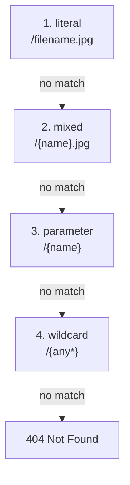

<TutorialLang />

# Routing

_This tutorial is compatible with hapi v21 and newer_

## <a name="overview"></a> Overview

A route needs three things: a `method`, a `path`, and a `handler`. You add it with [`server.route()`](/api#server-route-route):

```ts
server.route({
    method: 'GET',
    path: '/',
    handler: (request, h) => {
        return 'Hello World!';
    },
});
```

`server.route()` also accepts an array of route objects, so you can register many routes in one call.

## <a name="methods"></a> Methods

`method` is any HTTP method except `HEAD` (GET routes answer HEAD requests), an array of methods, or `'*'` for all of them:

```ts
server.route({
    method: ['PUT', 'POST'],
    path: '/',
    handler: (request, h) => {
        return 'I did something!';
    },
});
```

A route for `GET` also answers `HEAD` requests, so you never need a separate `HEAD` route.

## <a name="path"></a> Path

Wrap a path segment in `{}` to capture it as a named parameter. Its value is available on `request.params`:

```ts
import * as Hoek from '@hapi/hoek';

server.route<{ Params: { user: string } }>({
    method: 'GET',
    path: '/hello/{user}',
    handler: (request, h) => {
        return `Hello ${Hoek.escapeHtml(request.params.user)}!`;
    },
});
```

A request to `/hello/ferris` replies `Hello ferris!`.

- hapi URI-decodes parameter values, so `/hello/a%20b` gives `request.params.user === 'a b'`.
- The value comes straight from the URL. Escape it before you put it in HTML, as the [Hoek](/module/hoek) `escapeHtml()` call does above, or validate it with [joi](/tutorials/en_US/validation).
- Since hapi 21.4.10, `request.params` values are typed `unknown` by default. The type argument `server.route<{ Params: { user: string } }>()` declares the shape, so `request.params.user` is a `string` in the handler. The same type argument accepts `Query`, `Payload`, `Headers`, and the other request parts below.

### <a name="optionalParameters"></a> Parameter types

| Path                | Matches                                  | `request.params`                    |
| ------------------- | ---------------------------------------- | ----------------------------------- |
| `/hello/{user}`     | `/hello/ferris`                          | `{ user: 'ferris' }`                |
| `/hello/{user?}`    | `/hello`, `/hello/ferris`                | `{}` or `{ user: 'ferris' }`        |
| `/hello/{user*2}`   | `/hello/john/doe` (exactly two segments) | `{ user: 'john/doe' }`              |
| `/files/{path*}`    | `/files`, `/files/a`, `/files/a/b/c`     | `{}` or `{ path: 'a/b/c' }`         |
| `/{filename}.{ext}` | `/photo.jpg`                             | `{ filename: 'photo', ext: 'jpg' }` |

Rules hapi enforces when you add the route:

- `{user*}` and a whole-segment optional `{user?}` must be the last segment of the path. `{user*2}` and a partial-segment optional such as `/a{user?}/b` can appear anywhere.
- Two parameters in one segment need a literal separator between them: `{filename}.{ext}` is valid, `{filename}{ext}` is not.
- A parameter name can appear only once per path.
- Two routes with the same method and an equivalent path conflict, and `server.route()` throws. `/{name}` and `/{other}` are equivalent.

### <a name="multiParameters"></a> Multi-segment parameters

A multi-segment parameter holds the matched segments joined with `/`, so split it to get the parts:

```ts
server.route<{ Params: { user: string } }>({
    method: 'GET',
    path: '/hello/{user*2}',
    handler: (request, h) => {
        const [first, last] = request.params.user.split('/');

        return `Hello ${first} ${last}!`;
    },
});
```

A request to `/hello/john/doe` replies `Hello john doe!`.

### <a name="specificity"></a> Which route wins

hapi does not try routes in the order you added them. For each path segment it tries the kinds of match from most to least specific, and falls back to the next kind when the rest of the path does not match:



With these four routes registered:

| Request         | Route that answers |
| --------------- | ------------------ |
| `/filename.jpg` | `/filename.jpg`    |
| `/photo.jpg`    | `/{name}.jpg`      |
| `/photo`        | `/{name}`          |
| `/a/b`          | `/{any*}`          |

Paths are case-sensitive by default: with the routes above, `/Filename.jpg` is answered by `/{name}.jpg`. Set [`router.isCaseSensitive`](/api#server-options-router) to `false` on the server to change that.

## <a name="query"></a> Query parameters

`request.query` holds the parsed query string. For `/?name=ferris&location=chicago`:

```ts
server.route<{ Query: { name: string } }>({
    method: 'GET',
    path: '/',
    handler: (request, h) => {
        return `Hello ${request.query.name}!`;
    },
});
```

hapi's built-in parser does not understand nested keys: `/?foo[bar]=baz` gives `{ 'foo[bar]': 'baz' }`. To parse nested keys, set the server's `query.parser` to a parser such as [qs](https://github.com/ljharb/qs):

```ts
import Hapi from '@hapi/hapi';
import Qs from 'qs';

const server = Hapi.server({
    port: 3000,
    host: 'localhost',
    query: {
        parser: (query) => Qs.parse(query),
    },
});

server.route({
    method: 'GET',
    path: '/',
    handler: (request, h) => {
        return request.query;
    },
});

await server.start();
console.log('Server running on %s', server.info.uri);
```

Now `/?foo[bar]=baz` replies `{ "foo": { "bar": "baz" } }`. The parser receives the query hapi already parsed, such as `{ 'foo[bar]': 'baz' }`, not the raw string. Any function works, as long as it returns an object of parameter names to values.

## <a name="requestpayload"></a> Request payload

The parsed request body is on `request.payload`. hapi parses JSON, form-encoded, and text bodies based on the `Content-Type` header. Multipart bodies need the route option `payload: { multipart: true }`; without it they get `415 Unsupported Media Type`:

```ts
server.route<{ Payload: { username: string; password: string } }>({
    method: 'POST',
    path: '/signup',
    handler: (request, h) => {
        return `Welcome ${request.payload.username}!`;
    },
});
```

The type argument only tells TypeScript the shape. Nothing checks it at runtime until you add [payload validation](/tutorials/en_US/validation).

## <a name="handler"></a> Handler

The handler receives two arguments:

- `request` holds everything about the incoming request: `params`, `query`, `payload`, `headers`, `auth`, and more. See the [request object](/api#request).
- `h` is the [response toolkit](/api#response-toolkit), with methods such as `h.response()` and `h.redirect()`.

What the handler returns becomes the response:

| Handler returns                        | Response                                                           |
| -------------------------------------- | ------------------------------------------------------------------ |
| a string                               | `200`, `text/html; charset=utf-8`                                  |
| an object or array                     | `200`, `application/json; charset=utf-8`                           |
| a `Buffer`                             | `200`, `application/octet-stream`                                  |
| a readable stream                      | `200`, the stream piped to the client                              |
| `h.response(value)` with chained calls | full control, for example `h.response('created').code(201)`        |
| a thrown error                         | an error response, `500` unless it is a [boom](/module/boom) error |

A handler must return a value, a promise, or throw. [Response Marshalling](/tutorials/en_US/response-marshalling) covers how hapi turns these values into the bytes it sends.

Arrow functions cannot use `this`, so a handler written as an arrow function reads the value set by [`server.bind()`](/api#server-bind-context) from [`h.context`](/api#h-context) instead.

## <a name="options"></a> Options

Everything beyond method, path, and handler goes in the route's `options`:

```ts
import Joi from 'joi';

server.route<{ Payload: { username: string; password: string } }>({
    method: 'POST',
    path: '/signup',
    options: {
        auth: false,
        validate: {
            payload: Joi.object({
                username: Joi.string().min(1).max(20).required(),
                password: Joi.string().min(7).required(),
            }),
        },
    },
    handler: (request, h) => {
        return `Welcome ${request.payload.username}!`;
    },
});
```

| Option     | What it controls                          | Learn more                                          |
| ---------- | ----------------------------------------- | --------------------------------------------------- |
| `auth`     | which authentication strategy applies     | [Authentication](/tutorials/en_US/auth)             |
| `validate` | checks on params, query, payload, headers | [Validation](/tutorials/en_US/validation)           |
| `cache`    | `Cache-Control` headers for the response  | [Caching](/tutorials/en_US/caching)                 |
| `payload`  | body parsing, size limits, uploads        | [route payload options](/api#route-options-payload) |
| `pre`      | methods that run before the handler       | [route pre options](/api#route-options-pre)         |
| `ext`      | lifecycle hooks for this route only       | [Lifecycle Hooks](/tutorials/en_US/lifecycle-hooks) |

The full list is in the [route options reference](/api#route-options).

## <a name="missing"></a> 404 handling

When no route matches, hapi replies with a `404` JSON error. To send your own response instead, add a catch-all route. The `{any*}` wildcard is the least specific match, so it only answers requests no other route takes:

```ts
server.route({
    method: '*',
    path: '/{any*}',
    handler: (request, h) => {
        return h.response('404 Error! Page Not Found!').code(404);
    },
});
```

The catch-all route only covers unmatched paths. A `404` thrown by a matched route, such as a handler that throws `Boom.notFound()`, never reaches it. To customize every `404`, whatever produced it, change the response in an `onPreResponse` hook; see [Lifecycle Hooks](/tutorials/en_US/lifecycle-hooks).
