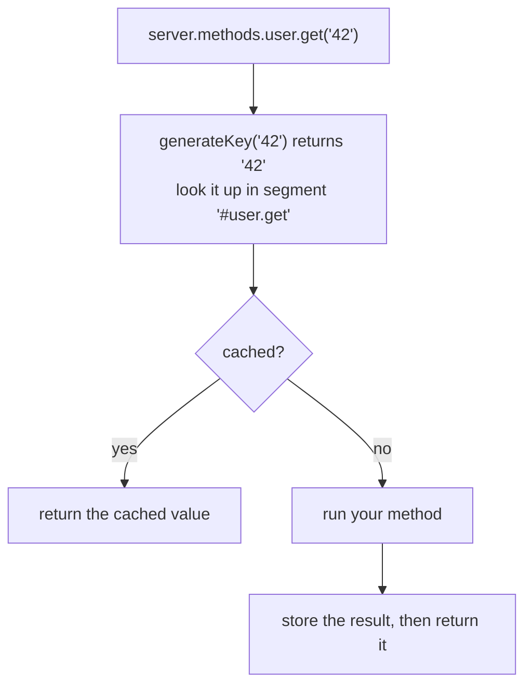

<TutorialLang />

# Server Methods

_This tutorial is compatible with hapi v21 and newer_

## <a name="overview"></a> Overview

A server method is a function you register on the server with [`server.method()`](/api#server-method-name-method-options), and call from anywhere that has the server: route handlers, plugins, extensions. Use one when:

- several routes or plugins need the same function, and you don't want each to import it.
- the function is expensive, and its result can be cached. One option turns on hapi's [caching](/tutorials/en_US/caching) for it.

```ts
import Hapi from '@hapi/hapi';

declare module '@hapi/hapi' {
    interface ServerMethods {
        add: (x: number, y: number) => number;
    }
}

const server = Hapi.server({ port: 3000 });

server.method('add', (x: number, y: number) => x + y);

server.route({
    method: 'GET',
    path: '/',
    handler: (request, h) => {
        return { sum: request.server.methods.add(1, 2) };
    },
});

await server.start();
```

- `server.methods.add` is the registered function. In a handler, `request.server.methods` reaches it without needing the `server` variable in scope.
- hapi does not know which methods you register, so TypeScript needs them in hapi's `ServerMethods` interface. The `declare module` block can live in any module of your project.
- Methods are global to the server: a method registered inside a plugin is available to every other plugin and route.

## <a name="server.method"></a> server.method()

`server.method()` takes either positional arguments, or one object (or an array of objects, to register several at once):

```ts
server.method('add', add, {});

server.method({
    name: 'add',
    method: add,
    options: {},
});
```

### <a name="name"></a> Name

A name with dots registers a nested method:

```ts
server.method('math.add', add);

server.methods.math.add(1, 2);
```

Declare it as a nested object in `ServerMethods`: `math: { add: (x: number, y: number) => number }`. Each segment of the name must be a valid JavaScript identifier.

### <a name="method"></a> Method

The method can take any arguments, and can be `async`. Return the result, or throw an error.

```ts
server.method('user.get', async (id: string) => {
    return await db.users.findById(id);
});
```

## <a name="options"></a> Options

| Option                | Use it to                                                                    |
| --------------------- | ---------------------------------------------------------------------------- |
| [`cache`](#cache)     | cache the method's results                                                   |
| [`generateKey`](#key) | build the cache key when the arguments are not strings, numbers, or booleans |
| [`bind`](#bind)       | set `this` inside the method                                                 |

### <a name="cache"></a> Cache

With a `cache` option, calling the method goes through a cache first:



```ts
server.method('user.get', getUser, {
    cache: {
        expiresIn: 60 * 1000,
        staleIn: 30 * 1000,
        staleTimeout: 100,
        generateTimeout: 2000,
    },
});
```

What to know:

- `generateTimeout` is required. It is how long a caller waits for your method before getting a `503`.
- A cached method always returns a promise, even when the method itself is synchronous. Declare it in `ServerMethods` with a `Promise` return type, and `await` it.
- hapi stores the items in a segment named `'#'` plus the method name. Set `cache: 'my_cache'` to use a [named cache client](/tutorials/en_US/caching#client) instead of the default memory cache.
- The other options (`expiresAt`, `staleIn`, `staleTimeout`, `segment`) are the same as for [`server.cache()`](/api#server-cache-options). The [caching tutorial](/tutorials/en_US/caching#stale) shows how stale values are served.

#### Changing the TTL per result

hapi passes one extra argument after yours: a `flags` object. Set `flags.ttl` to change how long this one result is cached, or to `0` to not cache it at all:

```ts
const getUser = async function (id: string, flags: { ttl: number }) {
    const user = await db.users.findById(id);
    if (!user) {
        flags.ttl = 0; // don't cache "not found"
    }

    return user;
};
```

hapi does not export a type for `flags`, so the example types it inline.

#### Removing a cached result

Every cached method gets a `cache.drop()` function. Call it with the same arguments to remove that result, for example after an update:

```ts
await db.users.update(id, changes);
await server.methods.user.get.cache?.drop(id);
```

hapi types `cache` as optional because uncached methods don't have it, hence the `?.`.

### <a name="key"></a> Generate a Custom Key

hapi builds the cache key by joining the arguments with `:`, which only works for strings, numbers, and booleans. Calling a cached method with any other argument type fails with a `500` error. Provide `generateKey` for other arguments:

```ts
const sum = function (numbers: number[]) {
    return numbers.reduce((total, item) => total + item, 0);
};

server.method('sum', sum, {
    cache: {
        expiresIn: 60 * 1000,
        generateTimeout: 100,
    },
    generateKey: (numbers: number[]) => numbers.join(','),
});
```

`generateKey` receives the same arguments as the method, and must return a string.

### <a name="bind"></a> Bind

`bind` sets `this` inside the method. Use it to hand the method a dependency, such as a database client, without adding it to the arguments (where it would also become part of the cache key):

```ts
const lookup = async function (this: typeof db, id: string) {
    return await this.users.findById(id);
};

server.method('lookup', lookup, { bind: db });
```

- The TypeScript `this` parameter declares the type of `this`. It is erased at compile time and is not one of the method's arguments.
- `bind` has no effect on arrow functions, which keep their own `this`.
- Without `bind`, `this` is the context set with [`server.bind()`](/api#server-bind-context) in the current plugin or server.

## <a name="server.methods"></a> server.methods

All registered methods are on [`server.methods`](/api#server-methods), which is also available as `request.server.methods` in handlers:

```ts
server.route<{ Params: { id: string } }>({
    method: 'GET',
    path: '/users/{id}',
    handler: async (request, h) => {
        return await request.server.methods.user.get(request.params.id);
    },
});
```

Each method used in this tutorial needs an entry in `ServerMethods`. Wrap cached methods in hapi's `CachedServerMethod` type, which adds `cache.drop()` and `cache.stats`:

```ts
import type { CachedServerMethod } from '@hapi/hapi';

declare module '@hapi/hapi' {
    interface ServerMethods {
        add: (x: number, y: number) => number;
        math: {
            add: (x: number, y: number) => number;
        };
        lookup: (id: string) => Promise<User | null>;
        sum: CachedServerMethod<(numbers: number[]) => Promise<number>>;
        user: {
            get: CachedServerMethod<(id: string) => Promise<User | null>>;
        };
    }
}
```
