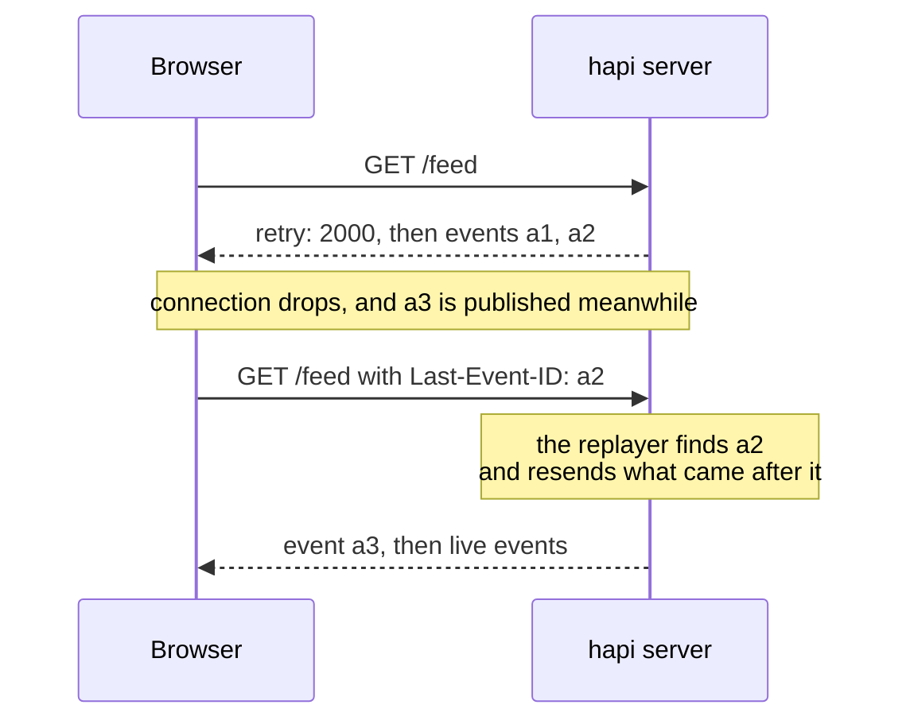
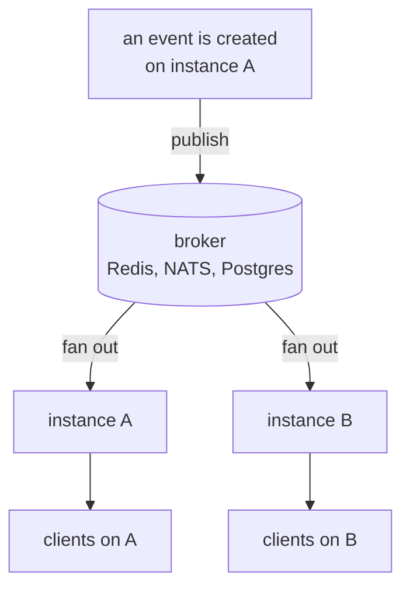

<TutorialLang />

# Server-Sent Events

_This tutorial is compatible with hapi v21 and newer_

## <a name="overview"></a> Overview

Server-Sent Events (SSE) is a way for the server to push a stream of events to the client over one ordinary HTTP response. The browser opens it with the built-in `EventSource` API, which also reconnects on its own when the connection drops. [@hapi/sse](/module/sse) adds SSE to hapi.

## <a name="when"></a> When to use SSE

|                       | SSE                                                      | [WebSockets](/tutorials/en_US/websockets)                                        | Polling                     |
| --------------------- | -------------------------------------------------------- | -------------------------------------------------------------------------------- | --------------------------- |
| Direction             | server to client only                                    | both ways                                                                        | client asks, server answers |
| Transport             | a normal HTTP response                                   | a protocol upgrade                                                               | normal HTTP requests        |
| Reconnects            | built into `EventSource`, resumes from the last event id | the nes client reconnects and resubscribes; messages sent while offline are lost | not needed                  |
| Works through proxies | yes, with buffering turned off                           | the proxy must support upgrades                                                  | yes                         |
| Latency               | immediate                                                | immediate                                                                        | up to the polling interval  |

Pick SSE when the server has news and the client only listens: job progress, notifications, live dashboards, log tails, and token-by-token output from an AI model. When the client also needs to send a steady stream of messages, use WebSockets. A client that only sends now and then can use SSE for the stream and plain `POST` requests for the rest.

## <a name="setup"></a> Setup

```sh
npm install @hapi/sse
```

```ts
import Hapi from '@hapi/hapi';
import { SsePlugin } from '@hapi/sse';

const server = Hapi.server({ port: 3000 });

await server.register(SsePlugin);
```

The plugin gives you two ways to open a stream:

| Use                        | Handler mode: `handler: { sse: { stream } }`    | Subscriptions: `server.sse.subscription()` |
| -------------------------- | ----------------------------------------------- | ------------------------------------------ |
| Who produces the events    | your `stream` function, for that one connection | any code, through `server.sse.publish()`   |
| Typical stream             | progress of one job, an AI response, a log tail | notifications, a live feed, a chat room    |
| Events per connection      | different for every client                      | the same event goes to every subscriber    |
| Resuming after a reconnect | you read `session.lastEventId` and continue     | a replayer resends what the client missed  |

## <a name="handler"></a> Handler mode: one stream per request

A route with the `sse` handler runs your `stream` function once per connection. Everything you `push()` reaches the client as it happens:

```ts
server.route({
    method: 'GET',
    path: '/jobs/{id}/progress',
    handler: {
        sse: {
            stream: async (request, session) => {
                for await (const update of watchJob(String(request.params.id))) {
                    session.push(update, 'progress', String(update.percent));
                }

                await session.complete();
            },
        },
    },
});
```

Each `push(data, event, id)` becomes one event on the wire. Objects are sent as JSON:

```text
event: progress
id: 50
data: {"percent":50}
```

`complete()` sends a final `complete` event and ends the response. Ending a response is not enough to stop a browser, because `EventSource` treats every closed connection as a dropped one and reconnects. The client has to close the connection itself when it sees `complete`:

```ts
const source = new EventSource('/jobs/7/progress');

source.addEventListener('progress', (event) => {
    const { percent } = JSON.parse(event.data);
    console.log(`${percent}%`);
});

source.addEventListener('complete', () => source.close());
```

Without the `close()`, the browser reconnects after the `retry` delay and the stream starts over.

Node.js has no global `EventSource` unless you start it with `--experimental-eventsource`. In Node, use that flag or the [`eventsource`](https://www.npmjs.com/package/eventsource) package; the client code is the same as in the browser.

## <a name="subscriptions"></a> Subscriptions: one event to many clients

A subscription is a route that clients connect to and that your code publishes to. The path can have parameters, so each user or room gets its own stream:

```ts
import Joi from 'joi';

server.sse.subscription('/rooms/{room}/messages');

server.route<{ Params: { room: string }; Payload: { text: string } }>({
    method: 'POST',
    path: '/rooms/{room}/messages',
    options: {
        validate: {
            params: Joi.object({ room: Joi.string().alphanum().max(50).required() }),
            payload: Joi.object({ text: Joi.string().max(2000).required() }),
        },
    },
    handler: async (request, h) => {
        const message = { text: request.payload.text, at: new Date().toISOString() };
        const delivered = await server.sse.publish(`/rooms/${request.params.room}/messages`, message, {
            event: 'message',
            matchMode: 'literal',
        });

        return { delivered };
    },
});
```

- `matchMode: 'literal'` sends the event only to clients of that exact path, so a message posted to `/rooms/lobby/messages` reaches the lobby and no other room. See [`server.sse.publish()`](/module/sse#server-sse-publish-path-data-opts).
- The route publishes only fields it [validated](/tutorials/en_US/validation), never the raw payload. Give it the same [route auth](/tutorials/en_US/auth) as any route that writes data.
- `publish()` returns the number of clients the event was delivered to.

Subscriptions also take `filter`, `onSubscribe`, `refuse`, and `maxSessions`; see [`server.sse.subscription()`](/module/sse#server-sse-subscription-path-config).

## <a name="reconnect"></a> Reconnects and `Last-Event-ID`

When a connection drops, the browser waits for the `retry` time the server sent, then reconnects with the id of the last event it received in a `Last-Event-ID` header:



The browser sends the header, but only your server can act on it, and the two modes differ:

- **Subscriptions:** give the subscription a replayer, which keeps recent events in memory and resends everything after the client's last id. A replayer keeps one history for the whole subscription, shared by every path and every client, so use it on subscriptions without path parameters, such as a public `/feed`. For per-user or per-room streams, resume from your database instead, as in handler mode.

    ```ts
    import { FiniteReplayer } from '@hapi/sse';

    server.sse.subscription('/feed', {
        replay: new FiniteReplayer({ size: 100 }),
    });

    await server.sse.publish('/feed', item, { event: 'news', id: item.id });
    ```

- **Handler mode:** read `session.lastEventId` in `stream` and continue from there, for example by querying your database for rows newer than that id.

If the client's last id is no longer in the buffer, for example after the server restarted, the replayer resends everything it holds, so give your events ids the client can use to drop duplicates. [Event replay](/module/sse#event-replay) describes what each replayer keeps. Replay buffers live in the memory of one process; see [Scaling](#scaling).

## <a name="disconnect"></a> Cleaning up when a stream ends

A stream stays open until one side closes it, so anything you start for a connection must stop when the stream ends, whether the client left, the stream completed, or the server is shutting down:

```ts
import type { Session } from '@hapi/sse';

const openStreams = new Map<Session, () => void>();

server.route({
    method: 'GET',
    path: '/jobs/{id}/progress',
    handler: {
        sse: {
            stream: async (request, session) => {
                const watcher = watchJob(String(request.params.id));
                openStreams.set(session, () => watcher.stop());
                request.events.once('disconnect', () => watcher.stop());

                try {
                    for await (const update of watcher) {
                        session.push(update, 'progress', String(update.percent));
                    }

                    if (session.isOpen) {
                        await session.complete();
                    }
                } finally {
                    watcher.stop();
                    openStreams.delete(session);
                }
            },
        },
    },
});

server.ext('onPreStop', () => {
    for (const [session, stop] of openStreams) {
        stop();
        session.close();
    }
});
```

- **Client leaves:** `request.events` emits `'disconnect'`, which stops the watcher and ends the loop.
- **Stream ends on the server:** the `finally` block runs, so the `Map` never holds a finished stream.
- **Server shuts down:** the `onPreStop` [server hook](/tutorials/en_US/lifecycle-hooks#server-hooks) stops every watcher and closes every stream, so `server.stop()` finishes without waiting out its `timeout`.
- **Subscriptions:** use the subscription's `onUnsubscribe`, or the plugin's `onSessionClose` hook for every subscription stream. The plugin removes the client from the subscription on its own.

## <a name="proxies"></a> Proxies, buffering, and idle timeouts

Most SSE problems in production come from something between the server and the browser holding events back or closing a quiet connection. The plugin handles part of it:

| Problem                                                            | What the plugin does                                        | What you do                                                                       |
| ------------------------------------------------------------------ | ----------------------------------------------------------- | --------------------------------------------------------------------------------- |
| A proxy buffers the response and delivers events in bursts         | sends `X-Accel-Buffering: no` and `Cache-Control: no-cache` | turn off response buffering in proxies that do not honor those headers            |
| Compression holds events until enough bytes accumulate             | flushes gzip and deflate after every write                  | nothing; events arrive one by one even when compressed                            |
| A load balancer or proxy closes connections that are idle too long | sends a `:` comment line every 15 seconds                   | keep `keepAlive.interval` below the shortest idle timeout on the path             |
| Browsers allow only 6 HTTP/1.1 connections per domain              | nothing                                                     | serve the site over HTTP/2, usually at the proxy, so streams share one connection |

## <a name="auth"></a> Authentication

An SSE stream is a normal hapi route, so the usual [route auth](/tutorials/en_US/auth) applies, scopes included. For subscriptions, pass it in the `auth` option:

```ts
server.sse.subscription('/users/{userId}/notifications', {
    auth: { strategy: 'session', access: { scope: 'user-{params.userId}' } },
});

await server.sse.publish(`/users/${userId}/notifications`, notification, {
    event: 'notification',
    matchMode: 'literal',
});
```

With the `user-{params.userId}` scope, a user can only open their own notification stream; anyone else gets a `403`. See [Scopes](/tutorials/en_US/auth#scopes). Publish with `matchMode: 'literal'` so each notification reaches only its own user's stream.

`EventSource` cannot set request headers, so a bearer token in `Authorization` is not an option. The choices:

| Approach                               | Good                                          | Watch out for                                                                                         |
| -------------------------------------- | --------------------------------------------- | ----------------------------------------------------------------------------------------------------- |
| Cookie session, such as `@hapi/cookie` | the browser sends it, including on reconnects | cross-origin streams need `new EventSource(url, { withCredentials: true })` and CORS with credentials |
| Token in the query string              | works with any client                         | URLs end up in server and proxy access logs; use a short-lived token made only for this stream        |
| `fetch()` with a streaming body        | can send any header                           | you lose `EventSource`'s reconnect and `Last-Event-ID` handling and must write them yourself          |

For a browser app on your own domain, a cookie is the simplest choice.

## <a name="scaling"></a> Scaling across instances

Two server instances do not share memory. An SSE stream is an open connection held by one process: a client connected to instance A exists only on A, and instance B has no way to write to it. An event published on A reaches only A's clients. This holds for every SSE library and hosting provider: each process can only write to the connections it owns.

The connected clients, the replay buffers, and by default the record of completed streams all live in that per-process memory. Scaling out needs message passing between the instances. A pub/sub backend such as Redis, NATS, or Postgres `LISTEN`/`NOTIFY` fans each event out to every instance, and each instance writes it to its own open streams:



With Redis:

```ts
import { createClient } from 'redis';

interface RoomMessage {
    room: string;
    text: string;
    at: string;
}

const publisher = createClient({ url: process.env.REDIS_URL });
const subscriber = publisher.duplicate();
publisher.on('error', (err) => server.log(['redis', 'error'], err));
subscriber.on('error', (err) => server.log(['redis', 'error'], err));
await Promise.all([publisher.connect(), subscriber.connect()]);

await subscriber.subscribe('rooms', async (raw) => {
    const message: RoomMessage = JSON.parse(raw);
    await server.sse.publish(`/rooms/${message.room}/messages`, message, { event: 'message', matchMode: 'literal' });
});

const publishToRoom = async (message: RoomMessage) => {
    await publisher.publish('rooms', JSON.stringify(message));
};
```

The `POST` route calls `publishToRoom()` instead of `server.sse.publish()`, and every instance, including the one that handled the request, publishes to its own streams.

- With the broker in place, every instance publishes every event, so every instance's replayer holds the same history and a reconnecting client can resume on any instance. Only events from before an instance started are missing, which the duplicate-safe ids from [Reconnects](#reconnect) already cover.
- Point the plugin's `completion.cache` option at a shared cache, such as catbox-redis, so a completed subscription stream is recognized on every instance.
- `maxDuration` closes each stream after a set time (with jitter), and the client reconnects. Long-lived streams then spread out again after you add instances, instead of staying on the old ones.

## <a name="next"></a> Next steps

- [@hapi/sse API reference](/module/sse): every option, `Session`, replayers, [backpressure](/module/sse#backpressure) for slow clients, and the [built-in security defenses](/module/sse#security).
- [WebSockets](/tutorials/en_US/websockets) when the client needs to send messages too.
- [Lifecycle Hooks](/tutorials/en_US/lifecycle-hooks) for `onPreStop` and other server hooks.
