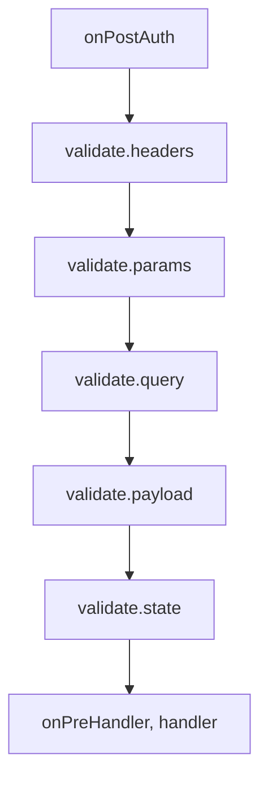

<TutorialLang />

# Validation

_This tutorial is compatible with hapi v21 and newer; and joi v16 and newer_

## <a name="overview"></a> Overview

hapi checks a request's headers, path parameters, query, payload, and cookies before your handler runs, and can check the response before it is sent. You describe what is allowed, usually with a [joi](https://joi.dev) schema, and hapi rejects anything else.

## <a name="joi"></a> Joi

Install joi and import it:

```sh
npm install joi
```

```ts
import Joi from 'joi';
```

joi includes its own TypeScript types, so there is no separate `@types` package to install.

## <a name="input"></a> Input validation

Input rules go in the route's `options.validate`. hapi runs them in this order, after authentication and before the handler, and stops at the first one that fails (see [failAction](#failaction)):



| Key       | Validates                 | Replaced on success |
| --------- | ------------------------- | ------------------- |
| `headers` | `request.headers`         | `request.headers`   |
| `params`  | `request.params`          | `request.params`    |
| `query`   | `request.query`           | `request.query`     |
| `payload` | `request.payload`         | `request.payload`   |
| `state`   | `request.state` (cookies) | `request.state`     |

Each key accepts:

| Value                         | Meaning                                                                       |
| ----------------------------- | ----------------------------------------------------------------------------- |
| `true` or not set (default)   | anything is allowed                                                           |
| `false`                       | no value is allowed                                                           |
| a joi schema                  | the value must match the schema                                               |
| a function                    | your own validator, see [Custom validators](#alternatives)                    |
| a plain object of joi schemas | allowed only after `server.validator(Joi)`; otherwise `server.route()` throws |

Validation replaces the request value with the validated one, so joi's type conversions and defaults reach your handler. A query of `?limit=5` arrives as the string `'5'`, and after `Joi.number()` the handler sees the number `5`. The original value stays on [`request.orig`](/api#request-orig).

### <a name="pathparams"></a> Path parameters

```ts
server.route<{ Params: { name: string } }>({
    method: 'GET',
    path: '/hello/{name}',
    handler: (request, h) => {
        return `Hello ${request.params.name}!`;
    },
    options: {
        validate: {
            params: Joi.object({
                name: Joi.string().min(3).max(10),
            }),
        },
    },
});
```

`/hello/jennifer` replies `Hello jennifer!`. `/hello/a` and `/hello/thisnameiswaytoolong` reply:

```json
{
    "statusCode": 400,
    "error": "Bad Request",
    "message": "Invalid request params input"
}
```

### <a name="queryparams"></a> Query parameters

```ts
server.route<{ Query: { limit: number } }>({
    method: 'GET',
    path: '/posts',
    handler: (request, h) => {
        return posts.slice(0, request.query.limit);
    },
    options: {
        validate: {
            query: Joi.object({
                limit: Joi.number().integer().min(1).max(100).default(10),
            }),
        },
    },
});
```

- `limit` must be an integer from 1 to 100, and defaults to 10 when the client leaves it out.
- `/posts?limit=15&offset=15` fails with `400`: a `Joi.object()` schema rejects keys it does not list. List every parameter you accept, or add `.unknown()` to the schema to let other keys through.
- The `Query: { limit: number }` type argument tells TypeScript what the handler receives. hapi does not infer it from the joi schema, so keep the two in sync yourself.

### <a name="payloadparams"></a> Payload

```ts
server.route({
    method: 'POST',
    path: '/post',
    handler: (request, h) => {
        return 'Blog post added';
    },
    options: {
        validate: {
            payload: Joi.object({
                post: Joi.string().min(1).max(140),
                date: Joi.date().required(),
            }),
        },
    },
});
```

`post` must be 1 to 140 characters, and `date` is required and must be something JavaScript can parse as a date, such as `'2026-10-25'`. joi converts it, so the handler receives a `Date` object. A failure replies `400` with the message `Invalid request payload input`.

### <a name="headers"></a> Headers

```ts
server.route({
    method: 'GET',
    path: '/hello/{name}',
    handler: (request, h) => {
        return `Hello ${request.params.name}!`;
    },
    options: {
        validate: {
            headers: Joi.object({
                cookie: Joi.string().required(),
            }),
            options: {
                allowUnknown: true,
            },
        },
    },
});
```

Browsers and proxies add many headers, so header schemas almost always need `allowUnknown: true`. `validate.options` passes joi options to every input schema on the route. Header names are lowercase in `request.headers`, so write them lowercase in the schema.

### <a name="failaction"></a> When validation fails

`validate.failAction` decides what happens:

| `failAction`        | Result                                                                                     |
| ------------------- | ------------------------------------------------------------------------------------------ |
| `'error'` (default) | `400` with a generic message such as `Invalid request query input`                         |
| `'log'`             | logs a `request` event tagged `validation`, `error`, and the source, then runs the handler |
| `'ignore'`          | runs the handler                                                                           |
| a function          | `(request, h, err)`: throw an error or return a takeover response                          |

With `'log'` and `'ignore'` the handler receives the original, unvalidated value: `?limit=500` arrives as the string `'500'`, not a number.

The default `400` hides which field failed, so clients cannot probe your schemas. During development, or on an API where clients need the details, rethrow the detailed error from a `failAction` function:

```ts
server.route({
    method: 'GET',
    path: '/posts',
    handler: (request, h) => posts,
    options: {
        validate: {
            query: Joi.object({
                limit: Joi.number().integer().max(100),
            }),
            failAction: (request, h, err) => {
                throw err;
            },
        },
    },
});
```

`/posts?limit=500` now replies with joi's message and the failing keys:

```json
{
    "statusCode": 400,
    "error": "Bad Request",
    "message": "\"limit\" must be less than or equal to 100",
    "validation": { "source": "query", "keys": ["limit"] }
}
```

To apply one `failAction` to every route, set it in the server's `routes.validate` option. See [`failAction`](/api#failaction-configuration) in the API reference.

## <a name="output"></a> Response validation

`options.response` checks what the handler returns, after the handler and before `onPreResponse`. Use it to make sure an endpoint matches its documented contract. Plugins like [hapi-swagger](https://github.com/glennjones/hapi-swagger) also read these schemas to document each endpoint's output.

```ts
const bookSchema = Joi.object({
    title: Joi.string().required(),
    author: Joi.string().required(),
    isbn: Joi.string().length(10),
    pageCount: Joi.number(),
    datePublished: Joi.date().iso(),
});

server.route({
    method: 'GET',
    path: '/books',
    handler: async (request, h) => {
        return await getBooks();
    },
    options: {
        response: {
            schema: Joi.array().items(bookSchema),
            failAction: 'log',
        },
    },
});
```

| Option       | What it does                                                                                                  |
| ------------ | ------------------------------------------------------------------------------------------------------------- |
| `schema`     | rule for every response, same values as input rules                                                           |
| `status`     | rules per status code, such as `{ 201: created, 202: Joi.object({ original, updated }) }`; overrides `schema` |
| `failAction` | `'error'` (default) replies `500`; also `'log'`, `'ignore'`, or a function                                    |
| `sample`     | percentage of responses to validate, `0` to `100`, to save CPU on busy routes                                 |
| `modify`     | when `true`, the validated value replaces the response, so joi conversions and `stripUnknown` apply           |
| `options`    | joi options for these schemas, such as `stripUnknown`                                                         |

What response validation skips or rejects:

- Error responses (status `400` and up) are not validated, unless `status` has a schema for that code.
- Only plain values (objects, arrays, strings) can be validated. A stream or file response with a response schema fails with `500`.

`modify: true` with `stripUnknown: true` is a practical way to keep fields like password hashes from leaking out of an endpoint:

```ts
server.route({
    method: 'GET',
    path: '/me',
    handler: (request, h) => {
        return { id: '2133d32a', name: 'John Doe', passwordHash: '$2a$10$...' };
    },
    options: {
        response: {
            schema: Joi.object({
                id: Joi.string(),
                name: Joi.string(),
            }).options({ stripUnknown: true }),
            modify: true,
        },
    },
});
```

The client receives `{ "id": "2133d32a", "name": "John Doe" }`.

## <a name="alternatives"></a> Custom validators

Any rule can be a function `async (value, options)` instead of a joi schema:

- Throw an error to fail validation. `failAction` handles it.
- Return a value to replace the one being validated. The original stays on `request.orig`.
- Return nothing to keep the value unchanged.

```ts
server.route({
    method: 'GET',
    path: '/items',
    handler: (request, h) => request.query,
    options: {
        validate: {
            query: async (value) => {
                if (typeof value !== 'object' || value === null || !('ids' in value) || typeof value.ids !== 'string') {
                    throw new Error('ids is required');
                }

                return { ids: value.ids.split(',') };
            },
        },
    },
});
```

`/items?ids=1,2,3` replies `{ "ids": ["1", "2", "3"] }`. A thrown error is turned into a `400`, the same as a joi failure.
