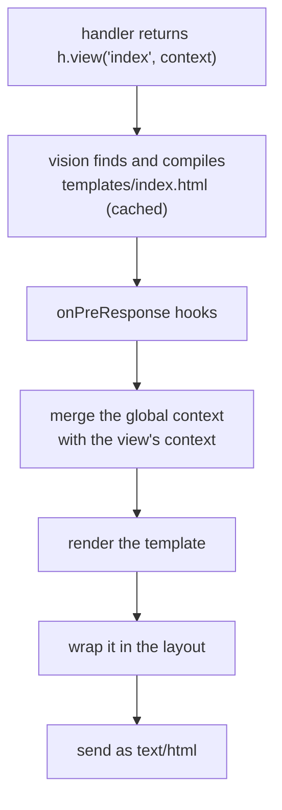

<TutorialLang />

# Views

_This tutorial is compatible with hapi v21 and newer_

## <a name="overview"></a> Overview

hapi renders HTML templates through the [vision](/module/vision) plugin. Vision works with any template engine that has a `compile` function, including handlebars, pug, and ejs (engines with a different `compile`, such as nunjucks, need the small wrapper described under [Engines](#engines)), and supports partials, helpers, and layouts.

## <a name="vision"></a> Vision

Install vision and an engine:

```sh
npm install @hapi/vision handlebars
```

Registering vision adds:

| What                                  | Use it for                                                 |
| ------------------------------------- | ---------------------------------------------------------- |
| `server.views(options)`               | configuring engines, template folders, layouts             |
| `h.view(template, context)`           | rendering a template from a handler                        |
| `view` handler                        | a route that only renders a template                       |
| `server.render()`, `request.render()` | rendering a template to a string, for example for an email |

Importing `@hapi/vision` also adds these to hapi's TypeScript types. The full API is in the [vision API reference](/module/vision).

## <a name="server"></a> Configuring the server

```ts
import Hapi from '@hapi/hapi';
import Vision from '@hapi/vision';
import Handlebars from 'handlebars';

const server = Hapi.server({ port: 3000 });

await server.register(Vision);

server.views({
    engines: {
        html: Handlebars,
    },
    relativeTo: import.meta.dirname,
    path: 'templates',
});

server.route({
    method: 'GET',
    path: '/',
    handler: (request, h) => {
        return h.view('index', { title: 'My home page' });
    },
});

await server.start();
```

- `engines` maps a file extension to an engine: files ending in `.html` render with handlebars.
- `path` is the folder that holds the templates, resolved from `relativeTo`. ES modules have no `__dirname`; `import.meta.dirname` is the folder of the current file.
- `h.view('index', ...)` renders `templates/index.html`. With one engine registered, you can leave off the extension.

### <a name="lifecycle"></a> How a view is rendered

`h.view()` does not render anything right away. It returns a view response, and vision renders it as hapi sends the response:



What this order means in practice:

- A missing template fails with a `500` as soon as the handler returns, before any `onPreResponse` hook.
- An `onPreResponse` hook runs before rendering, so it can still replace a view with a different response, such as an error page. See [Error pages](#errors) below.
- [Response Marshalling](/tutorials/en_US/response-marshalling) covers this prepare and render split for every response type.

## <a name="options"></a> server.views() options

| Option                | Default           | Effect                                                                      |
| --------------------- | ----------------- | --------------------------------------------------------------------------- |
| `engines`             | required          | extension to engine, such as `{ html: Handlebars, pug: Pug }`               |
| `path`                | none              | folder (or array of folders) with the templates                             |
| `relativeTo`          | working directory | base folder for every other path option                                     |
| `partialsPath`        | none              | folder with partials                                                        |
| `helpersPath`         | none              | folder with helper modules                                                  |
| `layout`              | `false`           | `true` to use `layout.html`, or the name of another layout file             |
| `layoutPath`          | none              | folder with layouts                                                         |
| `context`             | none              | context merged into every view; an object, or a function of the request     |
| `isCached`            | `true`            | `false` reads and compiles templates on every request; handy in development |
| `defaultExtension`    | the only engine   | extension used when `h.view()` gets a name without one                      |
| `compileMode`         | `'sync'`          | `'async'` for engines whose `compile` takes a callback                      |
| `allowAbsolutePaths`  | `false`           | allow absolute template names                                               |
| `allowInsecureAccess` | `false`           | allow `../` in template names                                               |

Options set on `server.views()` apply to every engine:

```ts
server.views({
    engines: { html: Handlebars },
    relativeTo: import.meta.dirname,
    path: 'templates',
    isCached: process.env.NODE_ENV === 'production',
});
```

Here templates load from `templates/`, and outside production vision reads and compiles them again on every request, so template edits show up without a restart.

### <a name="engines"></a> Engines

An engine is any object with a `compile` function:

| `compileMode`      | `compile` signature                           | Returns                                                                                                |
| ------------------ | --------------------------------------------- | ------------------------------------------------------------------------------------------------------ |
| `'sync'` (default) | `compile(template, compileOptions)`           | `render(context, runtimeOptions)`, which returns the HTML                                              |
| `'async'`          | `compile(template, compileOptions, callback)` | calls `callback(err, render)`; `render(context, runtimeOptions, callback)` calls `callback(err, html)` |

`compileOptions` and `runtimeOptions` are `server.views()` options passed through to your engine. An engine whose API does not match can be wrapped in an object with this `compile` function.

With more than one engine registered, `h.view()` needs the extension (`h.view('index.pug')`), unless you set `defaultExtension` to the one you use most.

### <a name="paths"></a> Paths

With this folder layout:

```
templates/
    index.html
    layout/
        layout.html
    helpers/
        fortune.js
```

the configuration is:

```ts
server.views({
    engines: {
        html: Handlebars,
    },
    relativeTo: import.meta.dirname,
    path: 'templates',
    layoutPath: 'templates/layout',
    helpersPath: 'templates/helpers',
});
```

### <a name="global"></a> Global context

`context` is merged into every view's context, and the view's own context wins when both set the same key. Pass a function to compute it per request, for example to show the logged-in user on every page:

```ts
server.views({
    engines: {
        html: Handlebars,
    },
    relativeTo: import.meta.dirname,
    path: 'templates',
    context: (request) => ({
        siteName: 'My personal site',
        user: request?.auth.credentials?.user ?? null,
    }),
});
```

`request` is undefined when you render outside a request with `server.render()`, which is why the function checks it.

### <a name="helpers"></a> View helpers

For engines that support helpers, such as handlebars, each module in `helpersPath` becomes a helper named after its file. This helper, saved as `templates/helpers/fortune.js`, returns a random fortune:

```js
export default function () {
    const fortunes = [
        'Heisenberg may have slept here...',
        'Wanna buy a duck?',
        'Say no, then negotiate.',
        'Time and tide wait for no man.',
        'To teach is to learn.',
        'Never ask the barber if you need a haircut.',
        'You will forget that you ever knew me.',
        'You will be run over by a beer truck.',
        'Fortune favors the lucky.',
        'Have a nice day!',
    ];

    const x = Math.floor(Math.random() * fortunes.length);
    return fortunes[x];
}
```

Helpers stay JavaScript files: vision loads them with `require()`, and skips any file whose extension Node.js has not registered with `require.extensions`, which does not include `.ts`.

Use it in `templates/index.html`:

```html
<h1>Your fortune</h1>
<p>{{fortune}}</p>
```

### <a name="layouts"></a> Layouts

Vision's layouts are off by default, because many engines have their own layout system. Use one or the other. To turn vision's on:

```ts
server.views({
    engines: {
        html: Handlebars,
    },
    relativeTo: import.meta.dirname,
    path: 'templates',
    layout: true,
    layoutPath: 'templates/layout',
});
```

`templates/layout/layout.html` marks where each view goes with `content`:

```html
<html>
    <body>
        {{{content}}}
    </body>
</html>
```

and a view holds only its own part:

```html
<div>Content</div>
```

| To                               | Do                                                        |
| -------------------------------- | --------------------------------------------------------- |
| use another default layout       | `layout: 'another_default'` in `server.views()`           |
| use another layout for one view  | `h.view('myview', context, { layout: 'another_layout' })` |
| render one view without a layout | `h.view('myview', context, { layout: false })`            |

Your context cannot have a `content` key while layouts are on; vision uses that name for the rendered view, and fails with a `500`. Change the name with the `layoutKeyword` option.

## <a name="render"></a> Rendering a view

### <a name="hview"></a> h.view()

Use [`h.view()`](/module/vision#h-view-template-context-options) when the handler has work to do first, such as loading data:

```ts
server.route({
    method: 'GET',
    path: '/',
    handler: (request, h) => {
        return h.view('index', { title: 'My home page' });
    },
});
```

`h.view()` returns a normal response object, so you can chain `.code()`, `.header()`, and the other [response object](/api#response-object) methods.

### <a name="viewhandler"></a> View handler

When a route only renders a template, use the `view` handler:

```ts
server.route({
    method: 'GET',
    path: '/',
    handler: {
        view: {
            template: 'index',
            context: {
                title: 'My home page',
            },
        },
    },
});
```

`handler: { view: 'index' }` is the short form. The view handler always adds `params`, `payload`, `query`, and `pre` to the context, so a template on `/users/{id}` can print `params.id` with no handler code.

## <a name="errors"></a> Error pages

hapi replies to errors with JSON. A site that renders HTML usually wants an HTML error page instead. Because rendering happens after `onPreResponse`, a hook there can swap any error for a view:

```ts
import Boom from '@hapi/boom';

server.ext('onPreResponse', (request, h) => {
    const response = request.response;
    if (!Boom.isBoom(response)) {
        return h.continue;
    }

    const { statusCode, payload } = response.output;

    return h.view('error', { statusCode, message: payload.message }).code(statusCode);
});
```

A request for a missing page now gets `templates/error.html`, rendered in the layout, with status `404`. The hook also catches errors thrown by handlers and failed validation. See [Lifecycle Hooks](/tutorials/en_US/lifecycle-hooks) for more on `onPreResponse`.
