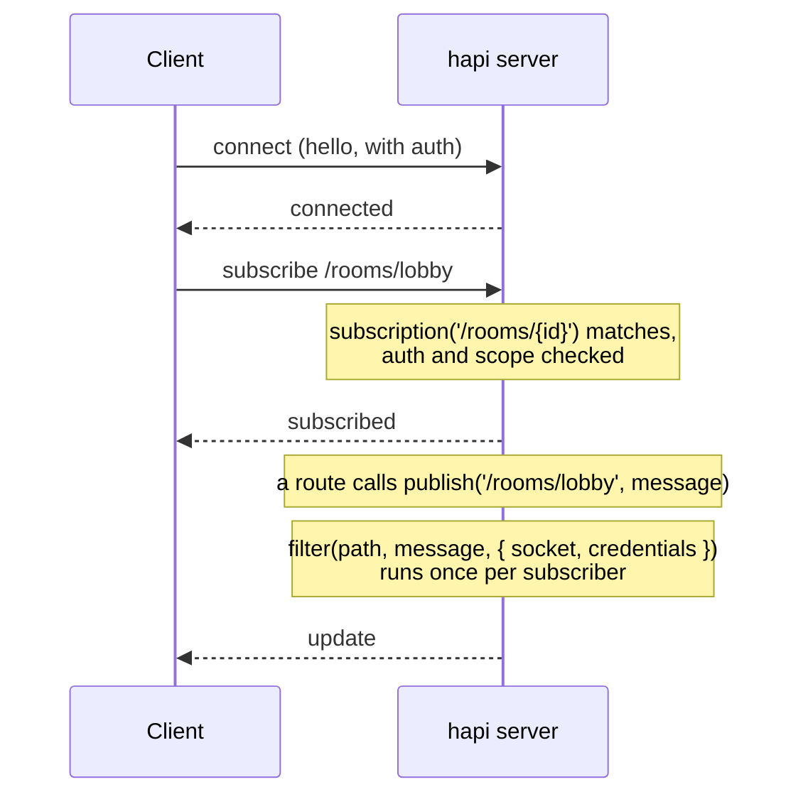
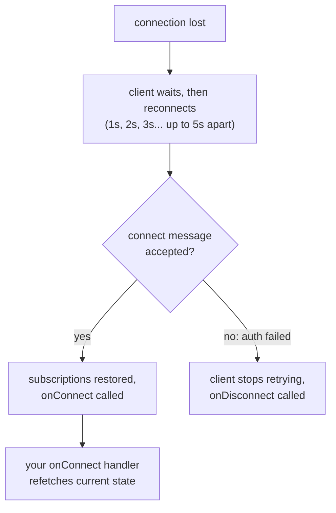
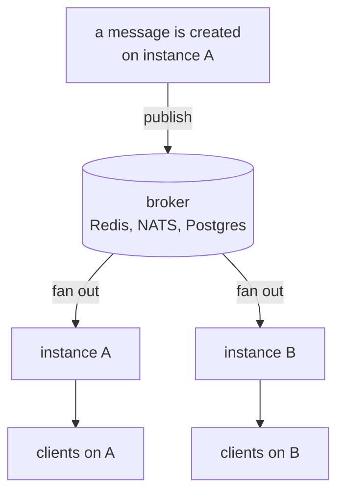

<TutorialLang />

# WebSockets

_This tutorial is compatible with hapi v21 and newer_

## <a name="overview"></a> Overview

[@hapi/nes](/module/nes) adds a WebSocket endpoint to a hapi server. A connected client can do three things over that one socket:

- **Call your routes.** `client.request()` runs a normal hapi route, with its validation, auth scopes, and handler, and returns the response over the socket.
- **Subscribe to updates.** The client subscribes to a path such as `/rooms/lobby`, and the server publishes to it.
- **Receive pushes.** The server sends a message to one socket or broadcasts to all of them.

## <a name="when"></a> When to use WebSockets

| Approach                                   | Direction                   | Good for                                                                    |
| ------------------------------------------ | --------------------------- | --------------------------------------------------------------------------- |
| Polling a normal route                     | client asks, server answers | updates every few minutes, or when real-time adds nothing                   |
| [Server-Sent Events](/tutorials/en_US/sse) | server to client only       | live feeds, progress, notifications; plain HTTP, works through most proxies |
| WebSockets with nes                        | both ways, one connection   | chat, collaboration, games: clients send often and expect pushes back       |

If the client only listens, SSE is simpler to run. Pick WebSockets when the client also sends frequently, or when you want one connection for both requests and updates, which matters on mobile networks.

## <a name="setup"></a> Setup

```sh
npm install @hapi/nes
```

A chat room server: messages are posted through a route, every subscriber of the room receives them, and a second route returns the recent history.

```ts
import Hapi from '@hapi/hapi';
import Joi from 'joi';
import Nes from '@hapi/nes';

interface ChatMessage {
    room: string;
    text: string;
    at: string;
}

const history = new Map<string, ChatMessage[]>();

const server = Hapi.server({ port: 4000 });

await server.register(Nes);

server.subscription('/rooms/{id}');

const roomParams = Joi.object({ id: Joi.string().alphanum().max(50).required() });

server.route<{ Params: { id: string }; Payload: { text: string } }>({
    method: 'POST',
    path: '/rooms/{id}/messages',
    options: {
        validate: {
            params: roomParams,
            payload: Joi.object({ text: Joi.string().max(2000).required() }),
        },
    },
    handler: (request, h) => {
        const message: ChatMessage = {
            room: request.params.id,
            text: request.payload.text,
            at: new Date().toISOString(),
        };

        const messages = history.get(message.room) ?? [];
        history.set(message.room, [...messages, message].slice(-50));

        server.publish(`/rooms/${message.room}`, message);
        return h.response(message).code(201);
    },
});

server.route<{ Params: { id: string } }>({
    method: 'GET',
    path: '/rooms/{id}/messages',
    options: { validate: { params: roomParams } },
    handler: (request, h) => history.get(request.params.id) ?? [],
});

await server.start();
```

nes listens on the same port as your HTTP routes. The routes work over plain HTTP too, so other services can post to a room without opening a socket. The `POST` route publishes only the fields it [validated](/tutorials/en_US/validation), never the raw payload.

The client in Node.js:

```ts
import Nes from '@hapi/nes';

const client = new Nes.Client('ws://localhost:4000');
await client.connect();

await client.subscribe('/rooms/lobby', (message) => {
    console.log('lobby:', message);
});

await client.request({ method: 'POST', path: '/rooms/lobby/messages', payload: { text: 'hello' } });
```

In the browser, import the client file on its own so your bundle does not pull in the server plugin:

```ts
import { Client } from '@hapi/nes/lib/client.js';

const client = new Client(`wss://${location.host}`);
await client.connect();
```

Subscription handlers receive the message as `unknown`. The server can publish anything, so check the shape before you use it, the same way you would for a `fetch()` response.

## <a name="requests"></a> Calling routes over the socket

`client.request()` runs the route through the full hapi [request lifecycle](/api#request-lifecycle): validation, `auth.access` scopes, extensions, and the handler. nes does this with [`server.inject()`](/api#await-server-inject-options), passing the credentials the socket authenticated with when it connected. The request options and the response shape are in [`client.request()`](/module/nes#await-client-request-options).

Inside the handler, `request.socket` is the nes socket for socket requests, and `null` for normal HTTP requests, so check it before you use it.

Use socket requests when a client already holds a connection and you want to avoid a second HTTP round trip. For a page that mostly listens, normal HTTP requests plus a subscription are easier to debug.

## <a name="push"></a> Pushing updates

nes gives you three ways to send a message to clients:

| Method                          | Who receives it                       | Use it for                                 |
| ------------------------------- | ------------------------------------- | ------------------------------------------ |
| `server.publish(path, message)` | sockets subscribed to a matching path | almost everything: rooms, documents, feeds |
| `socket.send(message)`          | one socket                            | replies and per-connection notices         |
| `server.broadcast(message)`     | every connected socket                | rare: maintenance warnings, forced reloads |

Subscriptions are usually what you want, because the client says what it cares about and the server only sends that.



A subscription `filter` decides, per socket, whether the update is sent. Pass data the filter needs but the client should not see in `internal`:

```ts
server.subscription('/documents/{id}', {
    filter: (path, message, options) => {
        return options.internal === options.credentials?.id;
    },
});

server.publish('/documents/42', { title: 'Q3 plan' }, { internal: '2133d32a' });
```

Only the document's owner receives the update, and the owner id never reaches a client. The filter compares against `credentials.id`, which the [bearer strategy](/tutorials/en_US/auth#jwt) from the authentication tutorial sets.

The filter runs for every subscriber on every publish, so keep it to in-memory checks. To change what each user sees, the filter can return `{ override: message }` instead of `true`.

## <a name="auth"></a> Authentication

nes does not have its own authentication. It reuses your hapi [auth strategies](/tutorials/en_US/auth): the socket authenticates when it connects, and every request and subscription on that socket uses those credentials.

The plugin's `auth.type` option decides how the client proves who it is:

| `auth.type`          | How the client authenticates                                                                                          | Fits                                                     |
| -------------------- | --------------------------------------------------------------------------------------------------------------------- | -------------------------------------------------------- |
| `'direct'` (default) | sends normal HTTP auth headers inside the connect message: `client.connect({ auth: { headers: { authorization } } })` | APIs with bearer tokens or basic auth                    |
| `'token'`            | calls `GET /nes/auth` over HTTP first, gets a sealed token, and passes it to `client.connect({ auth: token })`        | clients that cannot rely on cookies, such as mobile apps |
| `'cookie'`           | calls `GET /nes/auth` over HTTP first, which sets an encrypted cookie the browser sends on the WebSocket upgrade      | browser apps already using cookie sessions               |

With `'direct'`, nes runs the headers through the strategy in `auth.route`, or the server's [default strategy](/tutorials/en_US/auth#default) when `auth.route` is not set. With the [bearer strategy](/tutorials/en_US/auth#jwt) from the authentication tutorial as the default:

```ts
const client = new Nes.Client('wss://api.example.com');
await client.connect({ auth: { headers: { authorization: `Bearer ${token}` } } });
```

- **Connecting without credentials.** If the auth strategy's mode is `'required'`, a client that connects without `auth` is rejected with `Connection requires authentication`. Otherwise it connects unauthenticated, and only the routes and subscriptions that need auth refuse it.
- **Expiring tokens.** The `@hapi/jwt` strategy re-checks the token while the socket is open, at most once per `auth.minAuthVerifyInterval` (the heartbeat interval by default). Once the token expires, the server closes the socket, the client's reconnect is rejected with `Token maximum age exceeded`, and the client stops retrying. Send a fresh token before the old one expires:

    ```ts
    await client.reauthenticate({ headers: { authorization: `Bearer ${freshToken}` } });
    ```

    Strategies whose scheme has no `verify()` method keep the credentials from connect time for the life of the socket.

- **Protecting subscriptions.** A subscription without `auth` options uses the default strategy and its mode, but not the scopes in the default's `access`. Those still protect socket requests. Give every protected subscription its own `auth.scope`, which accepts any one of the listed scopes; the `+` and `!` prefixes that [route scopes](/tutorials/en_US/auth#scopes) support are not available.
- **Set `auth.password` for `'token'` and `'cookie'`.** Without it, nes picks a random password when the process starts, so tokens and cookies stop working after a restart, and an instance cannot read what another instance sealed.
- **Set `origin` with cookie auth.** WebSocket upgrades get no CORS check, and sibling subdomains count as the same site, so the nes cookie's `SameSite=Strict` does not stop them. `origin` refuses upgrades from any other origin, including clients that send no `Origin` header, such as the Node.js client above.

```ts
import Hapi from '@hapi/hapi';
import Nes from '@hapi/nes';

import type { Nes as NesTypes } from '@hapi/nes';

const cookiePassword = process.env.NES_COOKIE_PASSWORD;
if (!cookiePassword || cookiePassword.length < 32) {
    throw new Error('NES_COOKIE_PASSWORD must be set to at least 32 characters');
}

const server = Hapi.server({ port: 4000 });

const nesOptions = {
    auth: { type: 'cookie', password: cookiePassword } satisfies NesTypes.PluginOptions['auth'],
    origin: ['https://app.example.com'],
};

await server.register({ plugin: Nes, options: nesOptions });
```

## <a name="reconnect"></a> Reconnects and missed updates

Mobile networks drop connections often, and the client reconnects on its own:



- The client keeps retrying with the delays above until it reconnects, unless you limit `retries` in `client.connect()`.
- On reconnect, the client resends its subscriptions, so your handlers keep working without any code.
- **Updates published while the client was disconnected are lost.** nes does not queue them. If missing an update matters, load the current state in `onConnect`:

```ts
const refreshRoom = async (room: string) => {
    const { payload } = await client.request<ChatMessage[]>(`/rooms/${room}/messages`);
    render(payload);
};

client.onConnect = () => {
    refreshRoom('lobby').catch((err) => console.error('Could not refresh the room', err));
};
```

- The server pings each client every 15 seconds and drops it if it does not answer within 5 seconds; the client disconnects and reconnects if pings stop arriving. Load balancers and proxies that close idle connections need an idle timeout longer than the ping interval, or connections will drop for no visible reason.

## <a name="scaling"></a> Scaling across instances

Two server instances do not share memory. A WebSocket connection held by instance A does not exist on instance B, so `server.publish()` or `server.broadcast()` on A reaches only the clients connected to A. With two instances behind a load balancer, a message posted to A never reaches a client connected to B. This holds for every WebSocket library and hosting provider: each process can only write to the connections it owns.

Scaling out needs message passing between the instances. A pub/sub backend such as Redis, NATS, or Postgres `LISTEN`/`NOTIFY` fans each message out to every instance, and each instance delivers it to its own connections:



With Redis:

```ts
import { createClient } from 'redis';

const publisher = createClient({ url: process.env.REDIS_URL });
const subscriber = publisher.duplicate();
publisher.on('error', (err) => server.log(['redis', 'error'], err));
subscriber.on('error', (err) => server.log(['redis', 'error'], err));
await Promise.all([publisher.connect(), subscriber.connect()]);

await subscriber.subscribe('chat', (raw) => {
    const message: ChatMessage = JSON.parse(raw);
    server.publish(`/rooms/${message.room}`, message);
});

const publishToRoom = async (message: ChatMessage) => {
    await publisher.publish('chat', JSON.stringify(message));
};
```

The `POST` route calls `publishToRoom()` instead of `server.publish()`, and every instance, including the one that handled the request, publishes to its own sockets.

- WebSocket connections stay on the instance they connected to, so the socket itself needs no sticky sessions. For the `'token'` and `'cookie'` auth types, set the same `auth.password` on every instance, since the `/nes/auth` request may land on a different instance than the socket.
- `server.eachSocket()` is local to the process in the same way.

## <a name="cleanup"></a> Cleaning up

Per-connection state lives as long as the socket. Release it when the socket goes away:

- `onDisconnection` in the plugin options runs when any socket closes.
- `onUnsubscribe` in `server.subscription()` options runs when a client unsubscribes or disconnects, which is the place to stop work done only for that subscriber, such as a polling loop.
- `server.stop()` closes every socket. Clients see a disconnect and start reconnecting, which is what you want during a rolling deploy: they come back on another instance.

## <a name="typescript"></a> TypeScript

nes includes its own types for the plugin and the client. Importing `@hapi/nes` adds `server.subscription()`, `server.publish()`, `server.broadcast()`, `server.eachSocket()`, and `request.socket` to hapi's types. `client.request()` takes the payload type as a type argument, as in `client.request<ChatMessage[]>(path)`; it is not checked at runtime, so validate data you do not control.

## <a name="next"></a> Next steps

- [@hapi/nes API reference](/module/nes): every plugin option, [socket auth](/module/nes#socket-auth), and the full client API.
- [Server-Sent Events](/tutorials/en_US/sse) when the client only listens.
- [Authentication](/tutorials/en_US/auth) for the strategies and scopes nes reuses.
