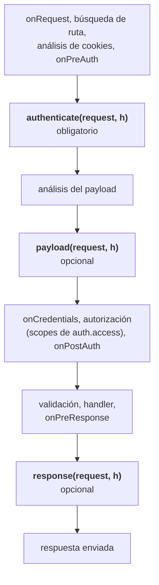
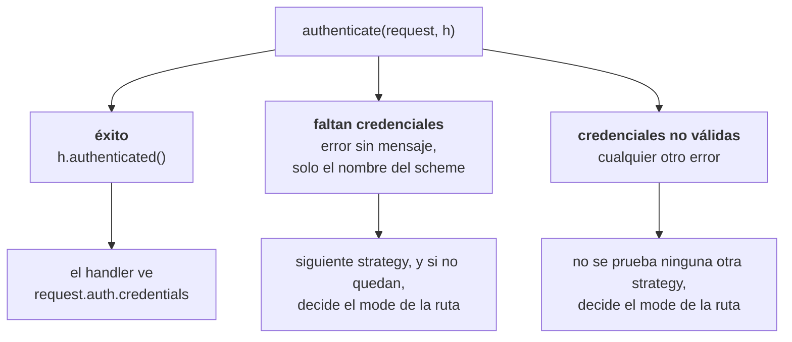
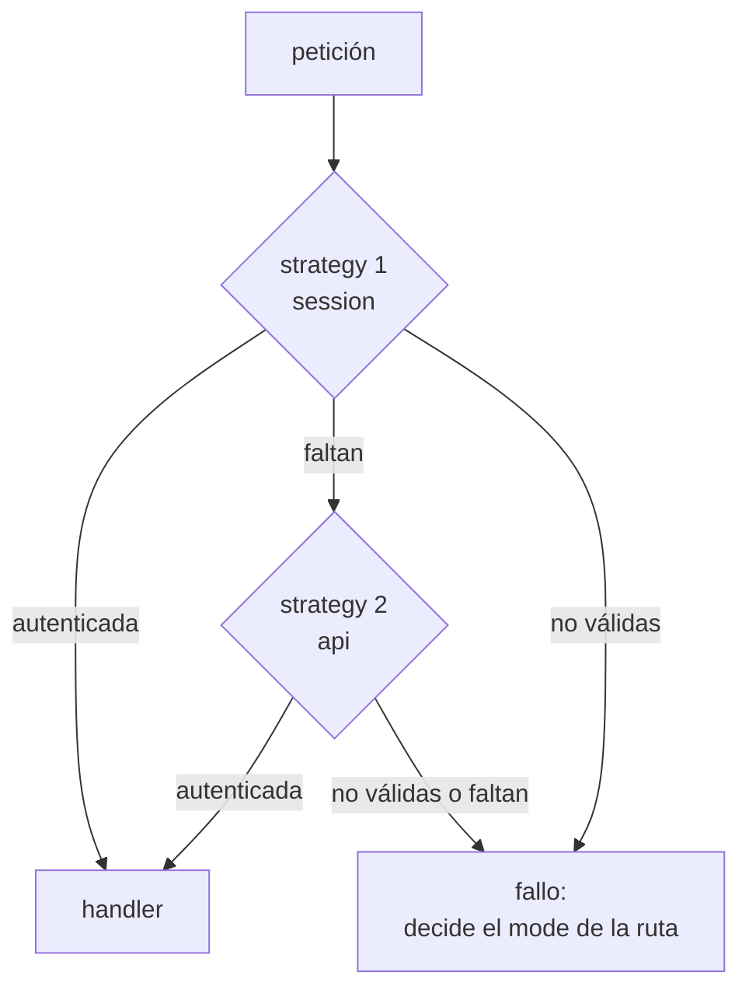
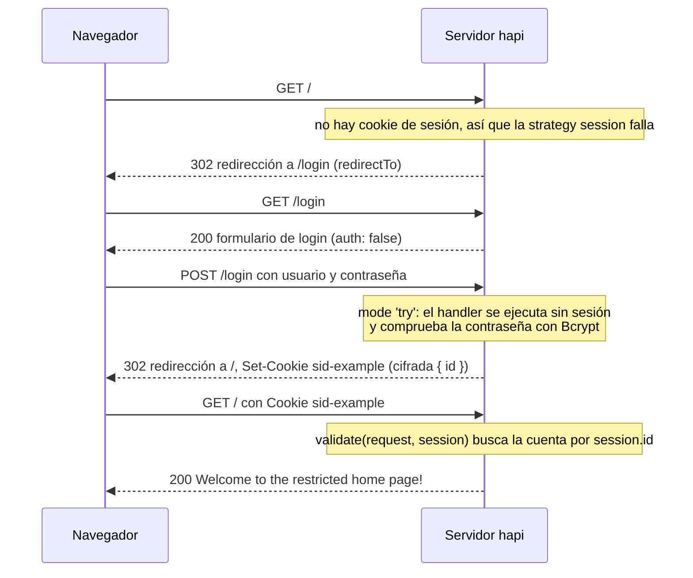
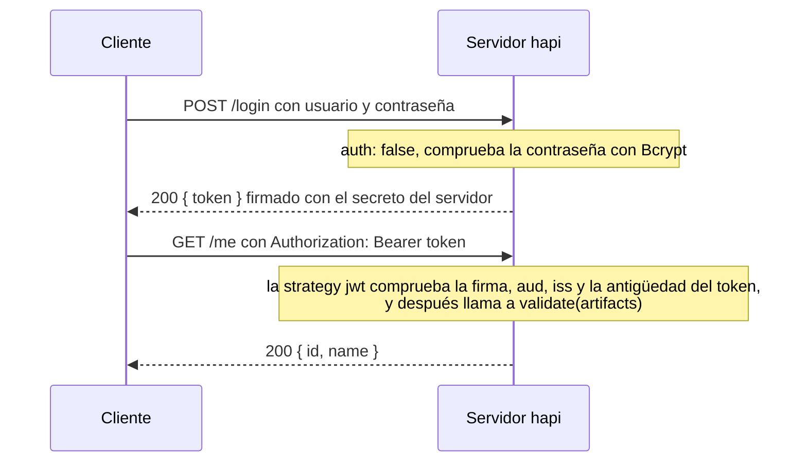

<TutorialLang />

# Autenticación

_Este tutorial es compatible con hapi v21 y versiones posteriores_

## <a name="overview"></a> Introducción

La mayoría de las aplicaciones web modernas usan algún tipo de autenticación. En hapi, la autenticación se construye con dos piezas, los `schemes` (esquemas) y las `strategies` (estrategias):

- Un `scheme` es una forma general de autenticar, como "HTTP basic auth" o "cookie de sesión". Plugins como `@hapi/basic` y `@hapi/cookie` registran cada uno un scheme.
- Una `strategy` es un scheme con un nombre y una configuración, como "basic auth, comprobado contra mi tabla de usuarios". Las rutas se refieren a las strategies por su nombre.

Con `@hapi/basic`, el plugin registra un scheme, tú configuras una strategy a partir de él y una ruta usa esa strategy:

```ts
// Registers the 'basic' scheme.
await server.register(Basic);

server.auth.strategy('simple', 'basic', { validate });

server.route({
    method: 'GET',
    path: '/',
    options: { auth: 'simple' },
    handler: (request, h) => 'welcome',
});
```

## <a name="schemes"></a> Schemes

Un `scheme` es una función con la firma `function (server, options)`. `server` es el servidor al que se añade el scheme, y `options` es el objeto de configuración que se pasa al crear una strategy a partir de este scheme. La función devuelve un objeto scheme, y hapi llama a los métodos de ese objeto en tres puntos del [ciclo de vida de la petición](/api#request-lifecycle):



`payload` y `response` solo se ejecutan en las peticiones que `authenticate` ha aceptado.

Puedes escribir tu propio scheme o usar uno de los plugins de autenticación de hapi, como `@hapi/basic` o `@hapi/cookie`. Este es un scheme completo que lee un token de API de una cabecera de la petición:

```ts
import Boom from '@hapi/boom';
import Hapi from '@hapi/hapi';

import type { ServerAuthScheme } from '@hapi/hapi';

declare module '@hapi/hapi' {
    interface UserCredentials {
        id: string;
        name: string;
    }
}

interface TokenOptions {
    tokens: Map<string, { id: string; name: string }>;
}

const tokenScheme: ServerAuthScheme<TokenOptions> = (server, options) => {
    return {
        authenticate: (request, h) => {
            const token = request.headers['x-api-token'];
            if (typeof token !== 'string') {
                throw Boom.unauthorized(null, 'token');
            }

            const user = options?.tokens.get(token);
            if (!user) {
                throw Boom.unauthorized('Invalid token', 'token');
            }

            return h.authenticated({ credentials: { user }, artifacts: { token } });
        },
        response: (request, h) => {
            if (!Boom.isBoom(request.response)) {
                request.response.header('x-authenticated-user', request.auth.credentials.user?.id ?? '');
            }

            return h.continue;
        },
    };
};

const server = Hapi.server({ port: 4000 });

server.auth.scheme('token', tokenScheme);
server.auth.strategy('api', 'token', {
    tokens: new Map([['a1b2c3', { id: '2133d32a', name: 'John Doe' }]]),
});

server.route({
    method: 'GET',
    path: '/me',
    options: { auth: 'api' },
    handler: (request, h) => {
        return request.auth.credentials.user;
    },
});

await server.start();
```

`ServerAuthScheme<TokenOptions>` tipa las `options` que recibe el scheme. Los tokens se guardan en un `Map` y no en un objeto normal a propósito: buscar en un objeto normal una clave que envía el cliente también encuentra propiedades heredadas, así que un token `constructor` o `toString` autenticaría. El bloque `declare module` le dice a TypeScript qué contienen tus credenciales: hapi exporta una interfaz `UserCredentials` vacía para que la extiendas, y a partir de ahí `request.auth.credentials.user` está tipado en todos los handlers.

### <a name="authenticate"></a> authenticate

El método `authenticate` tiene la firma `function (request, h)` y es el único método _obligatorio_ de un scheme. `request` es el mismo [objeto request](/api#request) que recibe un handler de ruta, y `h` es el [response toolkit](/api#response-toolkit) estándar.

`authenticate` termina de una de tres formas, y cada una lleva a un sitio distinto:



- **Éxito:** devuelve `h.authenticated({ credentials, artifacts })`. `credentials` representa al usuario autenticado. `artifacts` es opcional y guarda cualquier otro dato de autenticación, como el token en bruto. Ambos están disponibles después como `request.auth.credentials` y `request.auth.artifacts`.
- **Faltan credenciales:** lanza un error sin mensaje y con el nombre del scheme, como `Boom.unauthorized(null, 'token')`. hapi trata la petición como si no llevara credenciales para este scheme, así que pasa a la siguiente strategy de la ruta, y el nombre del scheme acaba en la cabecera `WWW-Authenticate`.
- **Credenciales no válidas:** lanza cualquier otro error, como `Boom.unauthorized('Invalid token', 'token')`. hapi deja de probar otras strategies. Un `Boom.unauthorized()` sin mensaje _y_ sin nombre de scheme también cuenta como no válido.

Lo que ocurre después de un fallo depende del [`mode`](#mode) de la ruta.

En lugar de lanzar el error, puedes devolver `h.unauthenticated(error, data)`. Se comporta como lanzar `error`, pero `data` te permite adjuntar `credentials` y `artifacts` a la petición fallida, que una ruta en modo `'try'` puede leer después. Sin `data`, `return h.unauthenticated(error)` y `throw error` son lo mismo. Consulta [`server.auth.scheme()`](/api#server-auth-scheme-name-scheme) para ver las reglas completas. [boom](/module/boom) es la forma recomendada de crear estos errores.

### <a name="payload"></a> payload

El método `payload` tiene la firma `function (request, h)`. Se ejecuta después de parsear el payload, así que puede comprobar el propio payload, por ejemplo una firma calculada sobre el cuerpo de la petición.

Devuelve `h.continue` cuando el payload es correcto y lanza un error cuando no lo es. Las rutas activan la autenticación del payload con la [opción de ruta `payload`](#route). Un scheme que siempre la necesita puede devolver `options: { payload: true }` junto a sus métodos, lo que impide que las rutas la desactiven.

### <a name="response"></a> response

El método `response` tiene la firma `function (request, h)`. Se ejecuta después de `onPreResponse`, justo antes de escribir las cabeceras de la respuesta, así que puede añadir cabeceras de autenticación a `request.response`. El scheme de token de arriba lo usa para añadir una cabecera `x-authenticated-user`.

Cuando se ejecuta `response`, hapi ya ha convertido cualquier error en un objeto response, así que las respuestas de error también reciben la cabecera. La comprobación `Boom.isBoom()` acota `request.response` a un objeto response, de modo que `.header()` pasa la comprobación de tipos. Devuelve `h.continue` cuando termines. Para fallar, lanza un error.

## <a name="strategies"></a> Strategies

Un scheme no hace nada hasta que creas una strategy a partir de él con `server.auth.strategy(name, scheme, [options])`:

- `name` es el nombre de la strategy. Las rutas lo usan para elegirla.
- `scheme` es el nombre de un scheme registrado.
- `options` se pasa a la función del scheme como su argumento `options`.

Un mismo scheme puede servir de base a muchas strategies, cada una con su propia configuración:

```ts
server.auth.strategy('session', 'cookie', {
    cookie: {
        name: 'sid-example',
        password: '!wsYhFA*C2U6nz=Bu^%A@^F#SF3&kSR6',
        isSecure: false,
    },
});

server.auth.strategy('admin-session', 'cookie', {
    cookie: {
        name: 'sid-admin',
        password: 'Q7v!kW2#pL9@zR4$mT6^xB1&nD8*cF3%',
        isSecure: false,
    },
    redirectTo: '/admin/login',
    requestDecoratorName: 'adminCookieAuth',
});
```

Cada strategy de `@hapi/cookie` añade un helper `request.cookieAuth`, y hapi se niega a añadir dos veces la misma decoración de petición, así que la segunda strategy necesita `requestDecoratorName` para dar otro nombre a su helper. Sus rutas llaman a `request.adminCookieAuth.set()`. El paquete `@types/hapi__cookie` (consulta [cookie](#cookie)) solo tipa `cookieAuth`, así que en TypeScript declara también el helper renombrado:

```ts
declare module '@hapi/hapi' {
    interface Request {
        adminCookieAuth: Request['cookieAuth'];
    }
}
```

## <a name="default"></a> Strategy por defecto

`server.auth.default()` fija la strategy que usan todas las rutas salvo que indiquen otra cosa. Acepta el nombre de una strategy, o un objeto con el mismo formato que las [opciones auth](#route) de una ruta. El valor por defecto se aplica a todas las rutas cuya opción `auth` no nombra ninguna strategy, incluidas las rutas añadidas _antes_ de llamar a `server.auth.default()`. La excepción es una ruta cuyo `auth` solo fija `mode` o `access`: hapi la combina con el valor por defecto al añadir la ruta, así que llama primero a `server.auth.default()`.

```ts
server.auth.default('session');

server.route({
    method: 'GET',
    path: '/account',
    handler: (request, h) => 'protected by the session strategy',
});

server.route({
    method: 'GET',
    path: '/health',
    options: { auth: false },
    handler: (request, h) => 'public',
});
```

## <a name="route"></a> Configuración de la ruta

Una ruta configura la autenticación con su propiedad `options.auth`:

```ts
server.route({
    method: 'GET',
    path: '/feed',
    options: {
        auth: {
            mode: 'try',
            strategies: ['session', 'api'],
        },
    },
    handler: (request, h) => {
        if (!request.auth.isAuthenticated) {
            return 'public feed';
        }

        return `personal feed, signed in with ${request.auth.strategy}`;
    },
});
```

`options.auth` puede ser:

- `false`, para desactivar la autenticación en la ruta.
- El nombre de una strategy, como `'session'`.
- Un objeto con `mode`, `strategy` o `strategies`, y `payload`.

### mode

`mode` decide qué ocurre con una petición que no tiene credenciales o que las tiene incorrectas:

| `mode`                     | Sin credenciales                      | Credenciales no válidas               | Credenciales válidas  |
| -------------------------- | ------------------------------------- | ------------------------------------- | --------------------- |
| `'required'` (por defecto) | 401                                   | 401                                   | se ejecuta el handler |
| `'optional'`               | se ejecuta el handler, sin autenticar | 401                                   | se ejecuta el handler |
| `'try'`                    | se ejecuta el handler, sin autenticar | se ejecuta el handler, sin autenticar | se ejecuta el handler |

"Sin credenciales" y "credenciales no válidas" son los dos tipos de [fallo de `authenticate`](#authenticate). Cuando el handler se ejecuta después de un fallo, `request.auth.isAuthenticated` es `false` y `request.auth.error` contiene el motivo: `Missing authentication` cuando ninguna strategy encontró credenciales, o el error que lanzó una strategy al rechazarlas.

### <a name="strategy-and-strategies"></a> strategy y strategies

Usa `strategy: 'session'` para una sola strategy, o `strategies: ['session', 'api']` para varias. hapi las prueba en orden, y solo pasa a la siguiente mientras cada una informe de que faltan credenciales:



### payload

`payload` activa el [método `payload`](#payload) del scheme para la ruta:

- `false`: el payload no se autentica.
- `'required'` o `true`: el payload tiene que estar autenticado.
- `'optional'`: el payload solo se comprueba si el cliente ha enviado información de autenticación del payload.

Solo funciona con una strategy cuyo scheme tenga un método `payload`.

## <a name="scopes"></a> Scopes

La autenticación decide _quién_ hace la petición. Los scopes deciden _qué_ puede hacer. Una strategy pone una lista de cadenas de scope en `credentials.scope`, una ruta enumera los scopes que acepta en `options.auth.access.scope`, y hapi compara ambas en su paso de autorización, después de `onCredentials` y antes de que se ejecute tu handler. Una petición sin un scope que coincida recibe `403 Insufficient scope`, y el handler no llega a ejecutarse.

Los scopes suelen venir de la función `validate` de la strategy. Con los usuarios del ejemplo de [basic](#basic), cada uno con un array `roles`:

```ts
const validate: Basic.Validate = async (request, username, password) => {
    const user = users.get(username);
    if (!user || !(await Bcrypt.compare(password, user.password))) {
        return { isValid: false, credentials: null };
    }

    return { isValid: true, credentials: { id: user.id, name: user.name, scope: user.roles } };
};
```

Cuando los roles están en otro sitio, un hook `onCredentials` puede añadirlos después de la autenticación; consulta [Hooks del ciclo de vida](/tutorials/es_ES/lifecycle-hooks#credentials).

Después, las rutas declaran los scopes que aceptan:

```ts
server.route({
    method: 'GET',
    path: '/reports',
    options: { auth: { strategy: 'simple', access: { scope: ['admin', 'analyst'] } } },
    handler: (request, h) => 'any admin or analyst',
});

server.route({
    method: 'DELETE',
    path: '/users/{id}',
    options: { auth: { strategy: 'simple', access: { scope: ['+admin', '!suspended'] } } },
    handler: (request, h) => 'an admin who is not suspended',
});

server.route({
    method: 'PUT',
    path: '/users/{id}/profile',
    options: { auth: { strategy: 'simple', access: { scope: ['admin', 'user-{params.id}'] } } },
    handler: (request, h) => 'an admin, or the user whose id is in the path',
});
```

| Scope de la ruta       | `credentials.scope` debe                                                                              |
| ---------------------- | ----------------------------------------------------------------------------------------------------- |
| `'admin'`              | incluir `admin`                                                                                       |
| `['admin', 'analyst']` | incluir al menos uno de ellos                                                                         |
| `'+admin'`             | incluir `admin`, diga lo que diga el resto de la lista                                                |
| `'!suspended'`         | no incluir `suspended`                                                                                |
| `'user-{params.id}'`   | incluir `user-42` en una petición a `/users/42`; también funcionan `query`, `payload` y `credentials` |

Reglas de los scopes que es fácil pasar por alto:

- Los scopes solo se comprueban en las peticiones autenticadas. En una ruta en modo `'optional'` o `'try'`, una petición sin credenciales sigue llegando al handler, con `request.auth.isAuthorized` a `false`. Compruébalo antes de hacer algo que solo algunos usuarios pueden hacer.
- `access.entity` restringe una ruta a usuarios o a aplicaciones: `'user'` exige que `credentials.user` esté fijado y `'app'` exige que no lo esté. Úsalo cuando la misma strategy autentica tanto a personas como a clientes máquina.
- `access` puede ser una lista de reglas, y basta con que la petición cumpla una de ellas.
- `server.auth.default()` acepta las mismas opciones `access`, así que un scope puede aplicarse a todas las rutas.

Consulta [`route.options.auth.access`](/api#route-options-auth-access) para ver las reglas completas.

## <a name="basic"></a> basic

El primer `scheme` que vamos a ver es el del plugin [@hapi/basic](/module/basic). Como indica su nombre, el plugin `@hapi/basic` usa autenticación básica para validar a los usuarios. Este es un ejemplo de configuración de `@hapi/basic`:

```ts
import Basic from '@hapi/basic';
import Bcrypt from 'bcrypt';
import Hapi from '@hapi/hapi';

const users = new Map([
    [
        'john',
        {
            username: 'john',
            password: '$2a$10$iqJSHD.BGr0E2IxQwYgJmeP3NvhPrXAeLSaGCj6IR/XU5QtjVu5Tm', // 'secret'
            name: 'John Doe',
            id: '2133d32a',
        },
    ],
]);

const validate: Basic.Validate = async (request, username, password) => {
    const user = users.get(username);
    if (!user) {
        return { credentials: null, isValid: false };
    }

    const isValid = await Bcrypt.compare(password, user.password);
    const credentials = { id: user.id, name: user.name };

    return { isValid, credentials };
};

const start = async () => {
    const server = Hapi.server({ port: 4000 });

    await server.register(Basic);

    server.auth.strategy('simple', 'basic', { validate });

    server.route({
        method: 'GET',
        path: '/',
        options: {
            auth: 'simple',
        },
        handler: function (request, h) {
            return 'welcome';
        },
    });

    await server.start();

    console.log('server running at: ' + server.info.uri);
};

start();
```

Primero defines tu base de datos de `users`, en este ejemplo un `Map` indexado por nombre de usuario, por el motivo explicado en [Schemes](#schemes). Después defines una función de validación, que es una característica propia de [@hapi/basic](/module/basic) y te permite verificar que el usuario ha proporcionado credenciales válidas. Tiparla como `Basic.Validate` permite a TypeScript inferir `request`, `username` y `password`, y comprueba el objeto que devuelves. En esta función de validación usas `Bcrypt` para comparar la contraseña que proporciona el usuario con el hash guardado en tu base de datos.

A continuación registras el plugin, que crea un scheme llamado `basic`. El plugin lo hace internamente con [server.auth.scheme()](/api#server-auth-scheme-name-scheme).

Una vez registrado el plugin, usas [server.auth.strategy()](/api#server-auth-strategy-name-scheme-options) para crear una strategy llamada `simple` que hace referencia a tu scheme `basic`. También pasas un objeto de opciones que se entrega al scheme y te permite configurar su comportamiento.

Por último, indicas a una ruta que use la strategy `simple` para la autenticación.

## <a name="cookie"></a> cookie

[@hapi/cookie](/module/cookie) es un plugin que guarda la sesión en una cookie cifrada en el navegador del usuario una vez que este se ha autenticado. Sin un `cookie.ttl`, la cookie dura hasta que se cierra el navegador; fija `ttl` para que el usuario siga con la sesión iniciada entre sesiones del navegador.

En este ejemplo, la ruta de inicio, "/", está restringida y solo se puede acceder a ella después de iniciar sesión. El navegador se redirige al formulario de login, envía el nombre de usuario y la contraseña, y después llega a la página de inicio con la cookie de sesión:



```ts
import Bcrypt from 'bcrypt';
import Cookie from '@hapi/cookie';
import Hapi from '@hapi/hapi';

const users = [
    {
        username: 'john',
        password: '$2a$10$iqJSHD.BGr0E2IxQwYgJmeP3NvhPrXAeLSaGCj6IR/XU5QtjVu5Tm', // 'secret'
        name: 'John Doe',
        id: '2133d32a',
    },
];

const start = async () => {
    const server = Hapi.server({ port: 4000 });

    await server.register(Cookie);

    server.auth.strategy('session', 'cookie', {
        cookie: {
            name: 'sid-example',
            password: '!wsYhFA*C2U6nz=Bu^%A@^F#SF3&kSR6',
            isSecure: false,
        },
        redirectTo: '/login',
        validate: async (request, session) => {
            if (!session || !('id' in session)) {
                return { isValid: false };
            }

            const account = users.find((user) => user.id === session.id);
            if (!account) {
                return { isValid: false };
            }

            return { isValid: true, credentials: { id: account.id, name: account.name } };
        },
    });

    server.auth.default('session');

    server.route([
        {
            method: 'GET',
            path: '/',
            handler: function (request, h) {
                return 'Welcome to the restricted home page!';
            },
        },
        {
            method: 'GET',
            path: '/login',
            handler: function (request, h) {
                return ` <html>
                            <head>
                                <title>Login page</title>
                            </head>
                            <body>
                                <h3>Please Log In</h3>
                                <form method="post" action="/login">
                                    Username: <input type="text" name="username"><br>
                                    Password: <input type="password" name="password"><br/>
                                <input type="submit" value="Login"></form>
                            </body>
                        </html>`;
            },
            options: {
                auth: false,
            },
        },
    ]);

    server.route<{ Payload: { username: string; password: string } }>({
        method: 'POST',
        path: '/login',
        handler: async (request, h) => {
            const { username, password } = request.payload;
            const account = users.find((user) => user.username === username);

            if (!account || !(await Bcrypt.compare(password, account.password))) {
                return h.redirect('/login');
            }

            request.cookieAuth.set({ id: account.id });

            return h.redirect('/');
        },
        options: {
            auth: {
                mode: 'try',
            },
        },
    });

    await server.start();

    console.log('server running at: ' + server.info.uri);
};

start();
```

`@hapi/cookie` no incluye sus propios tipos. Si usas TypeScript, instálalos con `npm install --save-dev @types/hapi__cookie`. Añaden `request.cookieAuth` al tipo `Request` de hapi y tipan las opciones de la strategy `cookie`. La sesión llega a `validate` como un `object` sin más, así que la comprobación `'id' in session` es lo que permite a TypeScript leer `session.id`. La ruta `POST /login` declara los campos de su formulario con un argumento de tipo en `server.route()`; esto es solo un tipo, así que añade [validación del payload](/tutorials/es_ES/validation) para imponerlo en tiempo de ejecución.

Primero registras el plugin `@hapi/cookie` con `server.register`, lo que añade el scheme `cookie`. Después creas a partir de él la strategy `session` con `server.auth.strategy`, pasando tres opciones:

- `cookie` configura la propia cookie. `name` es el nombre de la cookie, `sid-example`. `password` cifra la cookie y debe tener al menos 32 caracteres. `isSecure: false` permite que la cookie viaje por HTTP sin cifrar, lo que vale en desarrollo; en producción déjala con su valor por defecto, `true`.
- `redirectTo` es a dónde envía el servidor a un usuario no autenticado que pide una ruta protegida.
- `validate` se ejecuta en cada petición que lleva la cookie y comprueba que la sesión sigue siendo válida. Aquí busca la cuenta por el `id` guardado en la cookie, de modo que una cuenta eliminada pierde la sesión en su siguiente petición.

`server.auth.default('session')` protege todas las rutas con la strategy `session`. `GET /login` se excluye con `auth: false`, para que cualquiera pueda ver el formulario.

`POST /login` usa `mode: 'try'`, así que el handler se ejecuta aunque el usuario todavía no tenga sesión. Busca la cuenta por `username` y compara con `Bcrypt` la contraseña enviada con el hash guardado. Si falla cualquiera de las dos comprobaciones, el usuario vuelve a la página de login. Si pasan las dos, `request.cookieAuth.set()` guarda `{ id }` en la cookie cifrada y el usuario se redirige a la página de inicio.

## <a name="jwt"></a> jwt

[@hapi/jwt](/module/jwt) autentica las peticiones que llevan un JSON Web Token en la cabecera `Authorization: Bearer <token>`. Igual que `@hapi/cookie`, no guarda ninguna sesión en el servidor; la diferencia está en cómo viaja la identidad:

|               | `@hapi/cookie`                                 | `@hapi/jwt`                                               |
| ------------- | ---------------------------------------------- | --------------------------------------------------------- |
| Se envía en   | una cookie que adjunta el navegador            | la cabecera `Authorization` que fija el cliente           |
| Contenido     | cifrado: el cliente no puede leerlo            | firmado, pero lo puede leer cualquiera que tenga el token |
| Adecuado para | aplicaciones de navegador en tu propio dominio | APIs llamadas desde apps móviles, otros servidores y SPAs |

No pongas nunca secretos en el payload de un JWT, ya que la firma impide modificarlo pero no leerlo.

El cliente inicia sesión una vez y después envía el token en cada petición:



```ts
import Bcrypt from 'bcrypt';
import Hapi from '@hapi/hapi';
import Jwt from '@hapi/jwt';

const users = [
    {
        username: 'john',
        password: '$2a$10$iqJSHD.BGr0E2IxQwYgJmeP3NvhPrXAeLSaGCj6IR/XU5QtjVu5Tm', // 'secret'
        name: 'John Doe',
        id: '2133d32a',
    },
];

const secret = 'hR7#mX2!vQ9@kL4$wP8^zT1&nB6*cJ3%';

const start = async () => {
    const server = Hapi.server({ port: 4000 });

    await server.register(Jwt);

    server.auth.strategy('bearer', 'jwt', {
        keys: secret,
        verify: {
            aud: 'urn:audience:my-api',
            iss: 'urn:issuer:my-api',
            sub: false,
            maxAgeSec: 4 * 60 * 60,
        },
        validate: async (artifacts, request, h) => {
            const account = users.find((user) => user.id === artifacts.decoded.payload.id);
            if (!account) {
                return { isValid: false };
            }

            return { isValid: true, credentials: { id: account.id, name: account.name } };
        },
    });

    server.auth.default('bearer');

    server.route<{ Payload: { username: string; password: string } }>({
        method: 'POST',
        path: '/login',
        options: { auth: false },
        handler: async (request, h) => {
            const { username, password } = request.payload;
            const account = users.find((user) => user.username === username);

            if (!account || !(await Bcrypt.compare(password, account.password))) {
                return h.response({ error: 'Invalid username or password' }).code(401);
            }

            const token = Jwt.token.generate(
                { aud: 'urn:audience:my-api', iss: 'urn:issuer:my-api', id: account.id },
                secret,
            );

            return { token };
        },
    });

    server.route({
        method: 'GET',
        path: '/me',
        handler: (request, h) => {
            return request.auth.credentials;
        },
    });

    await server.start();

    console.log('server running at: ' + server.info.uri);
};

start();
```

Registras el plugin, que añade el scheme `jwt`, y creas a partir de él la strategy `bearer`:

- `keys` es el secreto con el que se firman los tokens. Un secreto compartido sirve cuando el mismo servidor emite y comprueba los tokens. Para aceptar en su lugar tokens de un proveedor de identidad, `keys` puede apuntar a las claves públicas del proveedor; consulta las opciones `keys` en la [API de @hapi/jwt](/module/jwt).
- `verify` enumera los claims que debe llevar un token. `aud` (audience) e `iss` (issuer) tienen que coincidir con los valores con los que emites los tokens. `maxAgeSec` rechaza los tokens cuyo `iat` (issued at) tenga más de cuatro horas. Los tokens de este ejemplo no llevan `exp`; si los tuyos lo llevan, `exp` y `nbf` se comprueban por defecto.
- `validate` solo se ejecuta cuando la firma y los claims son correctos. Recibe el token decodificado como `artifacts.decoded.payload` y decide qué va en `request.auth.credentials`. Aquí también comprueba que la cuenta sigue existiendo, ya que un token sigue siendo válido hasta que caduca aunque se elimine la cuenta.

`POST /login` se excluye de la autenticación con `auth: false`, comprueba la contraseña y devuelve un token de `Jwt.token.generate()` con los mismos `aud` e `iss` que verifica la strategy. Después, el cliente llama a `GET /me` con `Authorization: Bearer <token>`. `artifacts.decoded.payload` no está tipado, porque hapi no puede saber qué claims pones en un token; `validate` es donde los compruebas y construyes credenciales tipadas.

Para más información sobre otros plugins de autenticación de hapi, consulta la [sección de plugins](/plugins).
