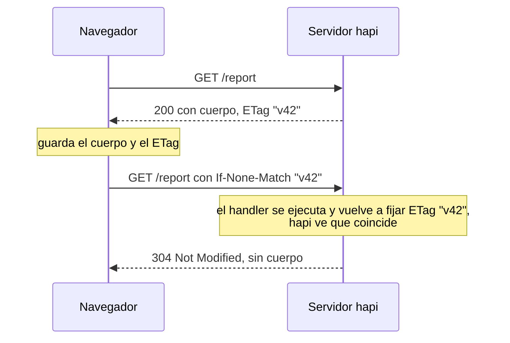
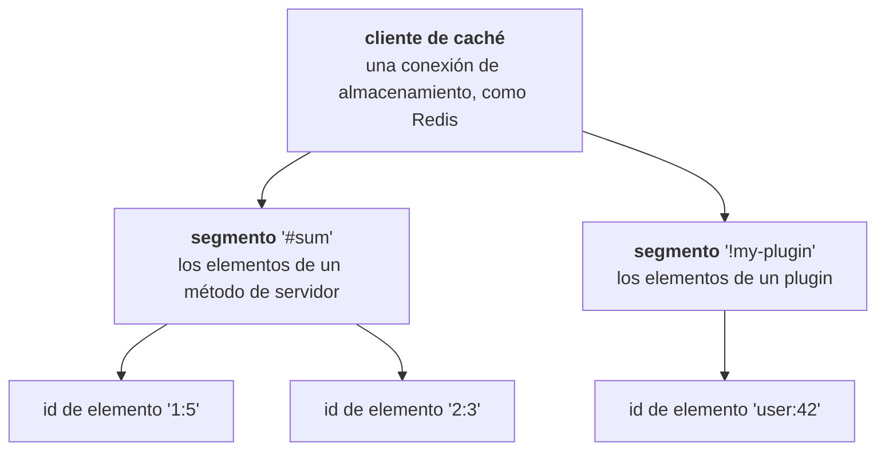
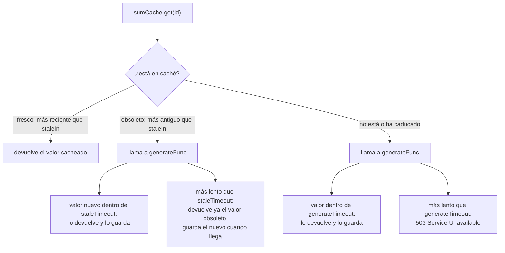

<TutorialLang />

# Caché

_Este tutorial es compatible con hapi v21 y versiones posteriores_

## <a name="overview"></a> Introducción

hapi cachea en dos niveles, y la mayoría de las aplicaciones usan los dos:

| Nivel                          | Dónde está la copia                                       | Qué se ahorra                                                              | Cómo se configura                                                                    |
| ------------------------------ | --------------------------------------------------------- | -------------------------------------------------------------------------- | ------------------------------------------------------------------------------------ |
| [En el cliente](#client-side)  | el navegador, o una CDN o un proxy intermedio             | la petición entera: el cliente nunca llega a hapi                          | cabeceras HTTP: `Cache-Control`, `ETag`, `Last-Modified`                             |
| [En el servidor](#server-side) | memoria, Redis u otro almacén de [catbox](/module/catbox) | el trabajo costoso: una consulta a la base de datos, una llamada a una API | `server.cache()` o un [método de servidor](/tutorials/es_ES/server-methods) cacheado |

## <a name="client-side"></a> Caché en el cliente

Las cabeceras HTTP indican a los clientes si pueden reutilizar una respuesta y durante cuánto tiempo. La [guía de caché HTTP](https://developer.mozilla.org/en-US/docs/Web/HTTP/Caching) de MDN explica las cabeceras en profundidad. Esta sección muestra cómo las fija hapi.

### <a name="cache-control"></a> Cache-Control

Configura la opción `cache` de la ruta y hapi escribe la cabecera `Cache-Control` por ti:

```ts
server.route({
    path: '/hapi/{ttl?}',
    method: 'GET',
    handler: function (request, h) {
        const response = h.response({ be: 'hapi' });

        if (request.params.ttl) {
            response.ttl(Number(request.params.ttl));
        }

        return response;
    },
    options: {
        cache: {
            expiresIn: 30 * 1000,
            privacy: 'private',
        },
    },
});
```

`response.ttl(msec)` sobrescribe `expiresIn` para una sola respuesta. La cabecera que envía hapi depende de la respuesta:

| Petición                                                            | Cabecera `Cache-Control`                     |
| ------------------------------------------------------------------- | -------------------------------------------- |
| `GET /hapi`                                                         | `max-age=30, must-revalidate, private`       |
| `GET /hapi/5000` (llama a `response.ttl(5000)`)                     | `max-age=5, must-revalidate, private`        |
| respuesta con un código distinto de 200 o 204, como un 404 o un 500 | `no-cache` (el `cache.otherwise` de la ruta) |

Lo que conviene saber:

- Si la petición está autenticada, hapi siempre añade `private`, aunque la ruta indique `privacy: 'public'`. Las cachés compartidas, como las CDN, nunca guardan respuestas `private`.
- Las cookies fijadas con `h.state()` no cambian la cabecera: hapi las escribe después de construir `Cache-Control`. Fija tú mismo `privacy: 'private'` en las rutas cacheadas que crean cookies.
- Solo los códigos de estado incluidos en el `cache.statuses` de la ruta (por defecto `[200, 204]`) reciben `max-age`. Las respuestas de error nunca se cachean por accidente.

Consulta las [opciones de ruta](/api#route-options-cache) para ver todos los ajustes de `cache`.

### <a name="last-modified"></a> Peticiones condicionales: ETag y Last-Modified

Una petición condicional permite al cliente preguntar "¿ha cambiado esto desde mi copia?" y recibir un `304 Not Modified` vacío en lugar del cuerpo completo:



Fija el `ETag` con [`response.etag()`](/api#response-object), normalmente a partir de un número de versión o de un hash del contenido:

```ts
return h.response(report).etag(String(report.version));
```

O fija `Last-Modified`, y hapi lo compara con la cabecera `If-Modified-Since` del cliente:

```ts
return h.response(report).header('Last-Modified', report.updatedAt.toUTCString());
```

Lo que conviene saber:

- hapi solo responde `304` en rutas `GET` (y en rutas con método `*`).
- El handler se sigue ejecutando en cada petición. Las peticiones condicionales ahorran ancho de banda, no trabajo del servidor. Combínalas con la [caché en el servidor](#server-side) para ahorrar las dos cosas.
- [inert](/module/inert) fija `ETag` y `Last-Modified` automáticamente para los ficheros estáticos.

## <a name="server-side"></a> Caché en el servidor

hapi cachea valores en el servidor mediante [catbox](/module/catbox), un almacén clave-valor con adaptadores de almacenamiento intercambiables: memoria (el valor por defecto), [Redis](/module/catbox-redis) y [Memcached](/module/catbox-memcached).

### <a name="catbox"></a> catbox

Los elementos cacheados se organizan en tres niveles:



catbox tiene dos interfaces para acceder a estos elementos:

- **[Client](/module/catbox#client)**: la conexión de almacenamiento de bajo nivel. hapi crea un cliente de memoria por ti, y tú añades otros en la opción `cache` del servidor.
- **[Policy](/module/catbox#policy)**: un segmento de un cliente, con reglas de caducidad y una función opcional que genera los valores que faltan. Tu código usa policies, creadas con [`server.cache()`](/api#server-cache-options) o cacheando un [método de servidor](#servermethods).

### <a name="client"></a> Client

Añade un cliente de Redis llamado `my_cache` junto al cliente de memoria por defecto:

```ts
import Hapi from '@hapi/hapi';
import { Engine as CatboxRedis } from '@hapi/catbox-redis';

const server = Hapi.server({
    port: 8000,
    cache: [
        {
            name: 'my_cache',
            provider: {
                constructor: CatboxRedis,
                options: {
                    partition: 'my_cached_data',
                    host: 'redis-cluster.domain.com',
                    port: 6379,
                    database: 0,
                    tls: {},
                },
            },
        },
    ],
});
```

- `name` es como las policies eligen este cliente, con `cache: 'my_cache'`. Omite `name` para sustituir en su lugar el cliente de memoria por defecto.
- `partition` separa las claves de esta aplicación de las de otras que comparten la base de datos de Redis. En Redis se convierte en un prefijo de clave. Por defecto vale `'catbox'`.
- Los clientes de caché se conectan cuando arranca el servidor, en [`server.initialize()`](/api#await-server-initialize) o [`server.start()`](/api#await-server-start). Las policies no pueden leer ni escribir antes de ese momento.

### <a name="policy" /> Policy

[`server.cache(options)`](/api#server-cache-options) crea una policy. Este ejemplo cachea durante diez segundos el resultado de una suma lenta:

```ts
import Hapi from '@hapi/hapi';
import * as Hoek from '@hapi/hoek';

const add = async (a: string, b: string) => {
    await Hoek.wait(1000); // Simulates a slow database call

    return Number(a) + Number(b);
};

const start = async () => {
    const server = Hapi.server({ port: 8000 });

    const sumCache = server.cache({
        segment: 'sums',
        expiresIn: 10 * 1000,
        generateFunc: async (id) => {
            const key = typeof id === 'string' ? id : id.id;
            const [a, b] = key.split(':');

            return await add(a, b);
        },
        generateTimeout: 2000,
    });

    server.route<{ Params: { a: string; b: string } }>({
        path: '/add/{a}/{b}',
        method: 'GET',
        handler: async function (request, h) {
            const { a, b } = request.params;

            return await sumCache.get(`${a}:${b}`);
        },
    });

    await server.start();

    console.log('Server running at:', server.info.uri);
};

start();
```

`GET /add/1/5` responde `6` al cabo de un segundo, más o menos. Si lo repites antes de diez segundos, responde al instante, desde la caché.

| Opción            | Significado                                                                                                                                                                                                         |
| ----------------- | ------------------------------------------------------------------------------------------------------------------------------------------------------------------------------------------------------------------- |
| `segment`         | Da nombre a los elementos de esta policy. Obligatoria en la raíz del servidor. Dentro de un plugin, por defecto vale `'!' + plugin name`. Dos policies no pueden compartir segmento salvo que fijen `shared: true`. |
| `cache`           | El cliente que se usa, como `'my_cache'`. Por defecto, el cliente de memoria.                                                                                                                                       |
| `expiresIn`       | Cuánto vive un elemento después de guardarse, en milisegundos. `expiresAt: 'HH:MM'` hace que todo caduque a una hora del día en su lugar.                                                                           |
| `generateFunc`    | Crea el valor cuando `get()` no encuentra nada. catbox guarda el resultado.                                                                                                                                         |
| `generateTimeout` | Cuánto espera `get()` a `generateFunc` antes de fallar con `503 Service Unavailable`. Obligatoria con `generateFunc`; `false` espera indefinidamente.                                                               |

El id que se pasa a `get()` es una cadena o un objeto con una cadena `id`, y `generateFunc` lo recibe sin cambios. catbox lo tipa como `string | { id: string }`, así que el ejemplo lo acota antes de volver a dividirlo en `a` y `b`.

### <a name="stale"></a> Servir valores obsoletos mientras se regeneran

Un elemento caducado hace que el siguiente que lo pide espere a `generateFunc`. Para evitar esa espera, marca los elementos como obsoletos (stale) antes de que caduquen con `staleIn`. Un elemento obsoleto se sigue sirviendo mientras catbox lo regenera en segundo plano:



```ts
const reportCache = server.cache({
    segment: 'reports',
    expiresIn: 60 * 60 * 1000,
    staleIn: 10 * 60 * 1000,
    staleTimeout: 100,
    generateTimeout: 5000,
    generateFunc: async (id) => await buildReport(id),
});
```

catbox exige `staleIn < expiresIn`, exige `staleTimeout` siempre que se fije `staleIn`, y exige `staleTimeout < expiresIn - staleIn`. Las llamadas concurrentes a `get()` con el mismo id comparten una única llamada a `generateFunc`, así que una ráfaga de peticiones de un elemento que falta consulta tu base de datos una sola vez. Consulta las [opciones de policy](/module/catbox#policy) para los ajustes de gestión de errores, como `dropOnError` y `generateOnReadError`.

### <a name="servermethods"></a> Métodos de servidor

La mayoría de las veces, un [método de servidor](/tutorials/es_ES/server-methods) cacheado es más corto que una policy hecha a mano. hapi crea la policy, llama a su segmento `'#sum'` y construye el id del elemento a partir de los argumentos:

```ts
import Hapi from '@hapi/hapi';
import * as Hoek from '@hapi/hoek';

declare module '@hapi/hapi' {
    interface ServerMethods {
        sum: (a: string, b: string) => Promise<number>;
    }
}

const add = async (a: string, b: string) => {
    await Hoek.wait(1000);

    return Number(a) + Number(b);
};

const start = async () => {
    const server = Hapi.server({ port: 8000 });

    server.method('sum', add, {
        cache: {
            expiresIn: 10 * 1000,
            generateTimeout: 2000,
        },
    });

    server.route<{ Params: { a: string; b: string } }>({
        path: '/add/{a}/{b}',
        method: 'GET',
        handler: async function (request, h) {
            const { a, b } = request.params;

            return await server.methods.sum(a, b);
        },
    });

    await server.start();
};

start();
```

- El bloque `declare module` añade `sum` a la interfaz `ServerMethods` de hapi, para que `server.methods.sum` tenga tipo.
- hapi construye el id del elemento a partir de argumentos `string`, `number` y `boolean`, como `'1:5'`. Otros tipos de argumento necesitan una función [`generateKey`](/tutorials/es_ES/server-methods#key).

## <a name="clientandserver"></a> Caché en el cliente y en el servidor

Combina los dos niveles: la caché del servidor registra cuándo guardó cada valor, y ese momento es el `Last-Modified` adecuado para la respuesta. Fija `getDecoratedValue: true`, y el método cacheado devuelve `{ value, cached, report }` en lugar del valor sin más. `cached` es `null` cuando el valor se acaba de generar:

```ts
import Hapi from '@hapi/hapi';
import * as Hoek from '@hapi/hoek';

declare module '@hapi/hapi' {
    interface ServerMethods {
        sum: (a: string, b: string) => Promise<{ value: number; cached: { stored: number } | null }>;
    }
}

const add = async (a: string, b: string) => {
    await Hoek.wait(1000);

    return Number(a) + Number(b);
};

const start = async () => {
    const server = Hapi.server({ port: 8000 });

    const cache = {
        expiresIn: 10 * 1000,
        generateTimeout: 2000,
        getDecoratedValue: true,
    };

    server.method('sum', add, { cache });

    server.route<{ Params: { a: string; b: string } }>({
        path: '/add/{a}/{b}',
        method: 'GET',
        handler: async function (request, h) {
            const { a, b } = request.params;
            const { value, cached } = await server.methods.sum(a, b);
            const lastModified = cached ? new Date(cached.stored) : new Date();

            return h.response({ sum: value }).header('Last-Modified', lastModified.toUTCString());
        },
    });

    await server.start();
};

start();
```

Consulta la [API de policy](/module/catbox#api-1) para ver qué contienen `cached` y `report`.
