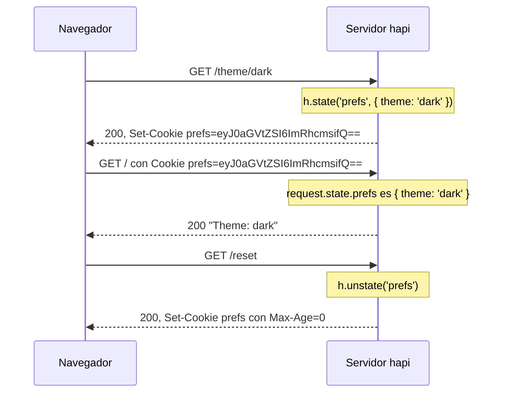

<TutorialLang />

# Cookies

_Este tutorial es compatible con hapi v21 y versiones posteriores_

## <a name="overview"></a> Introducción

hapi lee la cabecera `Cookie` de la petición en `request.state` y escribe cabeceras `Set-Cookie` a partir de `h.state()`. Cada cookie se declara una sola vez con `server.state()`, que fija su codificación y sus flags de seguridad, de modo que los handlers solo trabajan con valores:



El servidor completo detrás de este intercambio:

```ts
import Hapi from '@hapi/hapi';

const server = Hapi.server({ port: 3000 });

server.state('prefs', {
    encoding: 'base64json',
    ttl: 365 * 24 * 60 * 60 * 1000,
    isSecure: process.env.NODE_ENV === 'production',
    path: '/',
});

server.route<{ Params: { theme: string } }>({
    method: 'GET',
    path: '/theme/{theme}',
    handler: (request, h) => {
        h.state('prefs', { theme: request.params.theme });
        return 'saved';
    },
});

server.route({
    method: 'GET',
    path: '/',
    handler: (request, h) => {
        const prefs = request.state.prefs;
        const theme = typeof prefs === 'object' && prefs !== null && 'theme' in prefs ? prefs.theme : 'light';

        return `Theme: ${theme}`;
    },
});

server.route({
    method: 'GET',
    path: '/reset',
    handler: (request, h) => {
        return h.response('reset').unstate('prefs');
    },
});

await server.start();
```

`request.state` tiene el tipo `Record<string, unknown>`, porque una cookie contiene lo que el cliente envíe. El handler de `/` comprueba la forma del valor antes de leer `theme` y, si no encaja, usa un valor por defecto.

## <a name="server"></a> Configurar el servidor

### <a name="server.state"></a> server.state()

[`server.state(name, [options])`](/api#server-state-name-options) declara una cookie. Los valores por defecto son seguros, así que la mayoría de las aplicaciones solo fijan `encoding`, `ttl` y `path`:

| Opción         | Por defecto | Significado                                                                                                                                                                                           |
| -------------- | ----------- | ----------------------------------------------------------------------------------------------------------------------------------------------------------------------------------------------------- |
| `ttl`          | `null`      | Duración en milisegundos. `null` crea una cookie de sesión, que se borra al cerrar el navegador.                                                                                                      |
| `encoding`     | `'none'`    | Cómo se guarda el valor: `'none'` (una cadena), `'base64'`, `'base64json'` (cualquier valor JSON), `'form'` o `'iron'` (cifrado, ver [más abajo](#iron)).                                             |
| `path`         | `null`      | La ruta de URL para la que el navegador envía la cookie. `null` omite el atributo, y entonces los navegadores usan el directorio de la petición que la creó. Usa `'/'` para cookies de todo el sitio. |
| `isSecure`     | `true`      | Solo se envía por HTTPS. Usa `false` para HTTP sin cifrar durante el desarrollo.                                                                                                                      |
| `isHttpOnly`   | `true`      | Oculta al JavaScript del navegador, lo que la protege frente a cross-site scripting.                                                                                                                  |
| `isSameSite`   | `'Strict'`  | No se envía en peticiones procedentes de otros sitios. `'Lax'` permite la navegación de primer nivel desde otros sitios; `false` omite el atributo.                                                   |
| `clearInvalid` | `false`     | Indica al navegador que borre la cookie cuando su valor no se puede parsear.                                                                                                                          |
| `strictHeader` | `true`      | Rechaza nombres y valores que incumplen el [RFC 6265](https://tools.ietf.org/html/rfc6265).                                                                                                           |

Consulta [`server.state()`](/api#server-state-name-options) para el resto, como `domain`, `autoValue` y la firma. Para cambiar los valores por defecto de todas las cookies, pasa esas mismas opciones en la opción [`state`](/api#server-options-state) del servidor.

### <a name="iron"></a> Cookies cifradas

`encoding: 'iron'` cifra y firma el valor con [iron](/module/iron). El cliente no puede leerlo, y hapi lo rechaza si se ha modificado. Úsalo para todo lo que no mostrarías al usuario, como un id de sesión:

```ts
const password = process.env.COOKIE_PASSWORD;
if (!password || password.length < 32) {
    throw new Error('COOKIE_PASSWORD must be set to at least 32 characters');
}

server.state('session', {
    encoding: 'iron',
    password,
    ttl: 24 * 60 * 60 * 1000,
    path: '/',
});
```

Para sesiones de login, [@hapi/cookie](/module/cookie) se apoya en esto: gestiona una cookie de sesión cifrada como [strategy de autenticación](/tutorials/es_ES/auth#cookie).

### <a name="options.state"></a> route.options.state

Las rutas controlan el análisis con [`options.state`](/api#route-options-state):

| Opción       | Por defecto | Significado                                                                         |
| ------------ | ----------- | ----------------------------------------------------------------------------------- |
| `parse`      | `true`      | Parsea las cookies en `request.state`. Usa `false` en las rutas que nunca las leen. |
| `failAction` | `'error'`   | Qué ocurre cuando una cookie no se puede parsear o descifrar.                       |

Una cookie falla cuando su valor no corresponde a su codificación, o cuando una cookie iron se ha manipulado o se cifró con otra contraseña:

| `failAction` | Resultado                                                     |
| ------------ | ------------------------------------------------------------- |
| `'error'`    | la petición falla con `400 Bad Request`                       |
| `'log'`      | la petición continúa sin esa cookie, y hapi registra el error |
| `'ignore'`   | la petición continúa sin esa cookie                           |

Con `clearInvalid: true` en la cookie, la respuesta además borra la cookie defectuosa del navegador. Combínalo con `'log'` o `'ignore'` para que la petición que lleva una cookie caducada, por ejemplo una cifrada antes de un cambio de contraseña, tenga éxito en lugar de fallar una vez con 400.

## <a name="setting"></a> Crear una cookie

### <a name="h.state"></a> h.state()

[`h.state(name, value, [options])`](/api#h-state-name-value-options) crea una cookie desde un handler, un [pre-handler](/api#route-options-pre) o un [hook del ciclo de vida](/tutorials/es_ES/lifecycle-hooks). El mismo método existe en el objeto response, para encadenar llamadas:

```ts
h.state('prefs', { theme: 'dark' });

return h.response('Hello').state('prefs', { theme: 'dark' });
```

## <a name="override"></a> Sobrescribir opciones

El tercer argumento sobrescribe las opciones declaradas de la cookie solo para esta respuesta:

```ts
return h.response('Hello').state('prefs', 'dark', { encoding: 'none' });
```

## <a name="value"></a> Leer el valor de una cookie

`request.state` contiene todas las cookies parseadas, indexadas por nombre. Si el navegador envía dos cookies con el mismo nombre, el valor es un array. Lee los valores como hace el ejemplo de la introducción: comprueba la forma y después úsalo.

## <a name="clear"></a> Borrar una cookie

[`h.unstate(name)`](/api#h-unstate-name-options), o `unstate()` en la respuesta, indica al navegador que borre la cookie:

```ts
return h.response('Bye').unstate('prefs');
```
