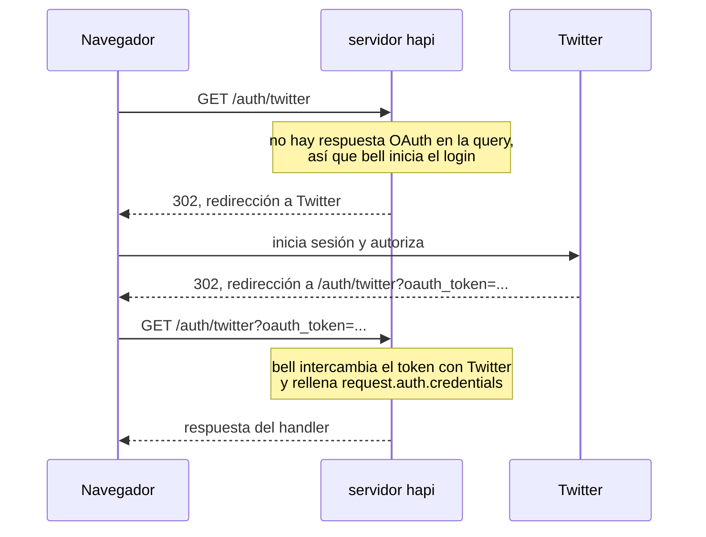

<TutorialLang />

# Migrar desde Express

_Esta guía es compatible con hapi v21 y versiones posteriores_

## <a name="overview" ></a> Introducción

Esta guía muestra cómo hacer en hapi lo que haces en Express. Los ejemplos usan Express 5.

La mayor diferencia: Express añade funcionalidades mediante middleware que instalas y ordenas con `app.use()`, mientras que hapi incluye la mayoría en su núcleo y las configura por ruta. Cuando hapi sí necesita un plugin, el plugin viene del equipo de hapi. Todas las dependencias de runtime de hapi son paquetes `@hapi/*` mantenidos por el mismo equipo.

| En Express usas                  | En hapi usas                                                                                                                                                                   |
| -------------------------------- | ------------------------------------------------------------------------------------------------------------------------------------------------------------------------------ |
| `express.json()`, `body-parser`  | integrado: [parseo del payload](#bodyparser)                                                                                                                                   |
| `cookie-parser`                  | integrado: [`server.state()`](#config)                                                                                                                                         |
| `express-validator`              | integrado: [`validate`](#joi) de la ruta con [joi](https://joi.dev)                                                                                                            |
| `passport`                       | framework de autenticación integrado; esquemas en plugins como `@hapi/basic`, `@hapi/cookie`, `@hapi/jwt` y [bell](#bell) ([tutorial de autenticación](/tutorials/es_ES/auth)) |
| `cors`                           | integrado: opción [`cors`](/api#route-options-cors) de la ruta                                                                                                                 |
| `helmet`                         | en parte integrado: opción [`security`](/api#route-options-security) de la ruta (sin Content-Security-Policy)                                                                  |
| `compression`                    | integrado, activado por defecto                                                                                                                                                |
| `app.set('view engine')`         | plugin [vision](#vision)                                                                                                                                                       |
| `express.static()`               | plugin [inert](#inert)                                                                                                                                                         |
| middleware propio                | [puntos de extensión](#extension) y [plugins](#creating)                                                                                                                       |
| middleware de gestión de errores | una [extensión](#extension) `onPreResponse`; lanza errores de [boom](#boom) en lugar de `next(err)`                                                                            |

## <a name="setup" ></a> Configuración inicial

### <a name="installation" ></a> Instalación

|                  | Express                                 | hapi                     |
| ---------------- | --------------------------------------- | ------------------------ |
| Instalación      | `npm install express`                   | `npm install @hapi/hapi` |
| Tipos TypeScript | `npm install --save-dev @types/express` | incluidos                |

### <a name="server" ></a> Crear un servidor

Express:

```ts
import express from 'express';

const app = express();

app.listen(3000, function () {
    console.log('Server is running on port 3000');
});
```

hapi:

```ts
import Hapi from '@hapi/hapi';

const init = async () => {
    const server = Hapi.server({
        port: 3000,
        host: 'localhost',
    });

    await server.start();
    console.log('Server running on port 3000');
};

init();
```

En hapi, el objeto `server` es el centro de la aplicación. Sus opciones (puerto, host, configuración por defecto de las rutas) deciden cómo se comporta el servidor, y las rutas, los plugins y las extensiones se añaden todos a él. `server.start()` devuelve una promesa.

## <a name="routes" ></a> Rutas

Express:

```ts
app.get('/hello', function (req, res) {
    res.send('Hello World!');
});
```

hapi:

```ts
server.route({
    method: 'GET',
    path: '/hello',
    handler: (request, h) => {
        return 'Hello World!';
    },
});
```

|                      | Express                                 | hapi                                                                      |
| -------------------- | --------------------------------------- | ------------------------------------------------------------------------- |
| Definir una ruta     | `app.METHOD(path, handler)`             | `server.route({ method, path, handler })`                                 |
| Enviar una respuesta | llamar a `res.send()`                   | devolver el valor                                                         |
| Qué ruta se ejecuta  | la primera ruta registrada que coincide | la coincidencia más específica, sea cual sea el orden de registro         |
| Rutas solapadas      | se registran las dos; gana la primera   | `server.route()` lanza una excepción cuando dos rutas entran en conflicto |

Como hapi elige la ruta más específica, `'/home'` siempre gana a `'/{any*}'`, y el orden de registro nunca decide qué ruta responde. Consulta el [tutorial de enrutamiento](/tutorials/es_ES/routing) para ver las reglas.

### <a name="methods" ></a> Métodos

| Express               | hapi                                                 |
| --------------------- | ---------------------------------------------------- |
| `app.get(path, ...)`  | `method: 'GET'`                                      |
| una ruta por método   | `method: ['PUT', 'POST']`                            |
| `app.all(path, ...)`  | `method: '*'`                                        |
| `app.head(path, ...)` | no está permitido: toda ruta `GET` responde a `HEAD` |

```ts
server.route({
    method: ['PUT', 'POST'],
    path: '/',
    handler: function (request, h) {
        return 'I did something!';
    },
});
```

### <a name="path" ></a> Path

En hapi los parámetros van entre llaves:

|                    | Express 5        | hapi              |
| ------------------ | ---------------- | ----------------- |
| Parámetro          | `/users/:userId` | `/users/{userId}` |
| Parámetro opcional | `/hello{/:user}` | `/hello/{user?}`  |
| Comodín            | `/files/*path`   | `/files/{path*}`  |

En hapi, `{user*}` y un `{user?}` que ocupa todo el segmento tienen que ser el último segmento; `{user*2}` y un opcional que ocupa parte del segmento, como `/a{user?}/b`, pueden aparecer en cualquier sitio.

### <a name="parameters" ></a> Parámetros

Express:

```ts
app.get('/hello/:name', function (req, res) {
    const name = req.params.name;
    res.send('Hello ' + name);
});
```

hapi:

```ts
server.route({
    method: 'GET',
    path: '/hello/{name}',
    handler: function (request, h) {
        const name = request.params.name;
        return 'Hello ' + name;
    },
});
```

| Express      | hapi              |
| ------------ | ----------------- |
| `req.params` | `request.params`  |
| `req.query`  | `request.query`   |
| `req.body`   | `request.payload` |

### <a name="handler" ></a> Handler

Un handler de Express recibe `req` y `res`, y llama a métodos de `res` para responder. Un handler de hapi recibe `request` y `h`, el [response toolkit](/api#response-toolkit), y devuelve la respuesta:

| Express                        | hapi                                                          |
| ------------------------------ | ------------------------------------------------------------- |
| `res.send('text')`             | `return 'text'`                                               |
| `res.json(object)`             | `return object`                                               |
| `res.status(201).send(object)` | `return h.response(object).code(201)`                         |
| `res.set('x-name', 'value')`   | `return h.response(object).header('x-name', 'value')`         |
| `res.redirect('/')`            | `return h.redirect('/')`                                      |
| `res.cookie('name', 'value')`  | `h.state('name', 'value')`, consulta [cookies](#config)       |
| `res.sendFile(file)`           | `return h.file(file)`, consulta [inert](#inert)               |
| `res.render('index', context)` | `return h.view('index', context)`, consulta [vision](#vision) |
| `next(err)`                    | `throw Boom.notFound()`, consulta [boom](#boom)               |

Cuando el handler necesita fijar un código de estado o cabeceras, envuelve el valor en `h.response()`:

```ts
server.route({
    method: 'POST',
    path: '/user',
    handler: function (request, h) {
        const user = {
            firstName: 'John',
            lastName: 'Doe',
            id: 123,
        };

        return h.response(user).code(201).header('location', '/user/123');
    },
});
```

hapi serializa el objeto devuelto como JSON y pone el `content-type`. Consulta el [tutorial de serialización de respuestas](/tutorials/es_ES/response-marshalling) para ver cómo convierte hapi un valor devuelto en una respuesta.

## <a name="plugins" ></a> Middleware frente a plugins y extensiones

Express ejecuta el middleware en el orden en que llamas a `app.use()`. Si un middleware depende de otro, tienes que mantener el orden correcto a mano, y un orden incorrecto falla al atender la petición.

hapi hace pasar cada petición por una secuencia fija de pasos, el [ciclo de vida de la petición](/api#request-lifecycle). En lugar de ordenar middleware, enganchas código a un paso con nombre. Cada paso de abajo muestra también el middleware de Express que hace ese trabajo:

| Paso de hapi                           | Punto de extensión               | Equivalente en Express             |
| -------------------------------------- | -------------------------------- | ---------------------------------- |
| petición recibida                      | `onRequest`                      | `app.use()` antes del enrutamiento |
| búsqueda de la ruta, parseo de cookies |                                  | `app.get()`, `cookie-parser`       |
| antes de la autenticación              | `onPreAuth`                      |                                    |
| autenticación                          |                                  | `passport`                         |
| parseo del payload                     |                                  | `express.json()`                   |
| después de la autenticación            | `onCredentials`, `onPostAuth`    |                                    |
| validación                             |                                  | `express-validator`                |
| antes del handler                      | `onPreHandler`                   |                                    |
| handler                                |                                  | callback de la ruta                |
| después del handler                    | `onPostHandler`, `onPreResponse` | middleware de gestión de errores   |
| después de enviar la respuesta         | `onPostResponse`                 |                                    |

Los puntos de extensión son donde añades tu propio código con `server.ext()`. hapi ejecuta los demás pasos a partir de la configuración de cada ruta.

Los plugins sustituyen al middleware reutilizable. Un plugin es una unidad con nombre que registra rutas, extensiones y decoraciones en el servidor. Un plugin puede declarar los otros plugins que necesita en su propiedad `dependencies`, y hapi se niega a arrancar cuando falta alguno, en lugar de fallar al atender una petición. Consulta el [tutorial de plugins](/tutorials/es_ES/plugins).

### <a name="extension" ></a> Puntos de extensión

Un middleware que se ejecuta en todas las peticiones se convierte en una extensión:

Express:

```ts
app.use(function (req, res, next) {
    console.log(req.method, req.url);
    next();
});
```

hapi:

```ts
server.ext('onRequest', function (request, h) {
    console.log(request.method, request.path);
    return h.continue;
});
```

`return h.continue` hace el papel de `next()`: la petición pasa al siguiente paso. Devolver una respuesta takeover (`h.response(...).takeover()`), o lanzar un error, termina la petición en ese punto.

hapi tiene ocho puntos de extensión de petición: `onRequest`, `onPreAuth`, `onCredentials`, `onPostAuth`, `onPreHandler`, `onPostHandler`, `onPreResponse` y `onPostResponse`. El [tutorial de hooks del ciclo de vida](/tutorials/es_ES/lifecycle-hooks) explica cuándo usar cada uno, y [`server.ext()`](/api#server-ext-events) enumera las opciones.

### <a name="creating" ></a> Crear un plugin

Un middleware que añade un helper a cada petición se convierte en un plugin que añade una [decoración](/tutorials/es_ES/decorators). Un plugin es un objeto con un `name` (o `pkg`) y una función `async register(server, options)`.

Express:

```ts
import type { NextFunction, Request, Response } from 'express';

declare global {
    namespace Express {
        interface Request {
            getDate(): Date;
        }
    }
}

const getDate = function (req: Request, res: Response, next: NextFunction) {
    req.getDate = function () {
        const date = new Date();
        return date;
    };

    next();
};
```

hapi:

```ts
import type { Plugin } from '@hapi/hapi';

declare module '@hapi/hapi' {
    interface ResponseToolkit {
        getDate(): Date;
    }
}

const getDate: Plugin<void> = {
    name: 'getDate',
    version: '1.0.0',
    register: async function (server, options) {
        const currentDate = function () {
            const date = new Date();
            return date;
        };

        server.decorate('toolkit', 'getDate', currentDate);
    },
};
```

- El middleware de Express vuelve a asignar `req.getDate` en cada petición. El plugin de hapi llama a `server.decorate()` una sola vez, al registrarse, y a partir de ahí todos los handlers tienen `h.getDate()`.
- TypeScript solo conoce el nuevo método una vez que lo declaras: en Express mediante su interfaz global `Express.Request`, en hapi añadiéndolo a la interfaz `ResponseToolkit` de `@hapi/hapi`.

### <a name="load" ></a> Cargar un plugin

Express:

```ts
app.use(getDate);
```

hapi:

```ts
await server.register({
    plugin: getDate,
});
```

### <a name="options" ></a> Opciones

Un middleware de Express recibe opciones siendo una función que devuelve el middleware. Un plugin de hapi recibe sus opciones como segundo argumento de `register`.

Express:

```ts
import type { NextFunction, Request, Response } from 'express';

declare global {
    namespace Express {
        interface Request {
            getDate(): string;
        }
    }
}

export default function (options: { name: string }) {
    return function getDate(req: Request, res: Response, next: NextFunction) {
        req.getDate = function () {
            const date = 'Hello ' + options.name + ', the date is ' + new Date();
            return date;
        };

        next();
    };
}
```

hapi:

```ts
import type { Plugin } from '@hapi/hapi';

declare module '@hapi/hapi' {
    interface ResponseToolkit {
        getDate(): string;
    }
}

const getDate: Plugin<{ name: string }> = {
    name: 'getDate',
    version: '1.0.0',
    register: async function (server, options) {
        const currentDate = function () {
            const date = 'Hello ' + options.name + ', the date is ' + new Date();
            return date;
        };

        server.decorate('toolkit', 'getDate', currentDate);
    },
};
```

Las opciones se pasan al registrar el plugin. El argumento de tipo de `Plugin<{ name: string }>` tipa `options` dentro de `register`, y TypeScript marca una llamada a `server.register()` cuyas opciones no encajan; hapi no las comprueba en tiempo de ejecución:

Express:

```ts
import getDate from './mw/getDate.ts';

app.use(getDate({ name: 'Tom' }));
```

hapi:

```ts
await server.register({
    plugin: getDate,
    options: {
        name: 'Tom',
    },
});
```

## <a name="bodyparser" ></a> body-parser

hapi parsea el payload de la petición antes de que se ejecute el handler, sin middleware. El resultado está en `request.payload`.

| Tipo de contenido                   | Express                          | hapi                                          |
| ----------------------------------- | -------------------------------- | --------------------------------------------- |
| `application/json`                  | `app.use(express.json())`        | se parsea por defecto                         |
| `application/x-www-form-urlencoded` | `app.use(express.urlencoded())`  | se parsea por defecto                         |
| `text/*`                            | `app.use(express.text())`        | se parsea por defecto                         |
| `multipart/form-data`               | un paquete aparte, como `multer` | opción de ruta `payload: { multipart: true }` |

Express:

```ts
import express from 'express';

const app = express();

app.use(express.urlencoded());

app.post('/hello', function (req, res) {
    const name = req.body.name;
    res.send('Hello ' + name);
});
```

hapi:

```ts
server.route<{ Payload: { name: string } }>({
    method: 'POST',
    path: '/hello',
    handler: function (request, h) {
        const name = request.payload.name;
        return 'Hello ' + name;
    },
});
```

`request.payload` no tiene una forma fija, porque hapi no puede saber qué enviarán los clientes. El argumento de tipo `server.route<{ Payload: { name: string } }>()` le dice a TypeScript qué recibe el handler. Es solo un tipo: para comprobar el payload en tiempo de ejecución, añade [validación](#joi). Los límites de tamaño, los timeouts y las subidas de ficheros se configuran con las [opciones `payload`](/api#route-options-payload) de la ruta.

## <a name="config" ></a> cookie-parser

hapi lee y escribe cookies sin middleware. Mientras que Express recibe las opciones de la cookie en cada llamada a `res.cookie()`, hapi define cada cookie una sola vez con `server.state()`, y después cada ruta la pone por su nombre.

| Opción        | `res.cookie()` de Express           | `server.state()` de hapi             |
| ------------- | ----------------------------------- | ------------------------------------ |
| Flag Secure   | `secure`, desactivado por defecto   | `isSecure`, activado por defecto     |
| Flag HttpOnly | `httpOnly`, desactivado por defecto | `isHttpOnly`, activado por defecto   |
| SameSite      | `sameSite`                          | `isSameSite`, `'Strict'` por defecto |
| Duración      | `maxAge` (ms)                       | `ttl` (ms)                           |
| Valor firmado | `signed`                            | `sign: { password }`                 |
| Valor cifrado | no integrado                        | `encoding: 'iron'`                   |

Consulta [`server.state()`](/api#server-state-name-options) para ver todas las opciones, y el [tutorial de cookies](/tutorials/es_ES/cookies).

### <a name="setCookie" ></a> Poner una cookie

Express:

```ts
import express from 'express';
import cookieParser from 'cookie-parser';

const app = express();

app.use(cookieParser());

app.get('/', function (req, res) {
    res.cookie('username', 'tom', { secure: true, httpOnly: true });
    res.send('Hello');
});
```

hapi:

```ts
import Hapi from '@hapi/hapi';

const server = Hapi.server({ port: 8000 });

server.state('username', {
    ttl: null,
    isSecure: true,
    isHttpOnly: true,
});

server.route({
    method: 'GET',
    path: '/',
    handler: function (request, h) {
        h.state('username', 'tom');
        return 'Hello';
    },
});
```

### <a name="getCookie" ></a> Leer el valor de una cookie

Express:

```ts
app.get('/whoami', (req, res) => {
    res.send(req.cookies.username);
});
```

hapi:

```ts
server.route({
    method: 'GET',
    path: '/whoami',
    handler: (request, h) => {
        const username = request.state.username;
        if (typeof username !== 'string') {
            return 'No username cookie';
        }

        return username;
    },
});
```

`request.state` contiene las cookies que haya enviado el cliente, sean cuales sean, así que hapi tipa cada valor como `unknown`. Comprueba el tipo antes de usarlo.

## <a name="bell" ></a> Passport -> bell

Express gestiona el login con terceros mediante Passport. hapi usa [bell](/module/bell), que trae configuraciones integradas para más de 30 proveedores OAuth, como Twitter, Facebook, Google y GitHub, y soporta proveedores personalizados. Consulta la [lista de proveedores de bell](/module/bell/providers).

Passport necesita dos rutas, una para iniciar el login y otra para el callback del proveedor. bell usa una sola ruta para ambas cosas:



Express:

```
npm install passport passport-twitter
```

Si usas TypeScript, ejecuta también `npm install --save-dev @types/passport @types/passport-twitter`.

```ts
import passport from 'passport';
import { Strategy as TwitterStrategy } from 'passport-twitter';

passport.use(
    new TwitterStrategy(
        {
            consumerKey: TWITTER_CONSUMER_KEY,
            consumerSecret: TWITTER_CONSUMER_SECRET,
            callbackURL: '/auth/twitter/callback',
        },
        function (token, tokenSecret, profile, cb) {
            User.findOrCreate({ twitterId: profile.id }, function (err, user) {
                return cb(err, user);
            });
        },
    ),
);

passport.serializeUser(function (user, cb) {
    cb(null, user);
});

passport.deserializeUser(function (user: Express.User, cb) {
    cb(null, user);
});

app.get('/auth/twitter', passport.authenticate('twitter'));
app.get('/auth/twitter/callback', passport.authenticate('twitter', { failureRedirect: '/login' }), function (req, res) {
    res.redirect('/');
});
```

hapi:

```
npm install @hapi/bell
```

```ts
import Hapi from '@hapi/hapi';
import Bell from '@hapi/bell';

const server = Hapi.server({ port: 8000 });

await server.register(Bell);

server.auth.strategy('twitter', 'bell', {
    provider: 'twitter',
    password: 'cookie_encryption_password_secure',
    clientId: TWITTER_CONSUMER_KEY,
    clientSecret: TWITTER_CONSUMER_SECRET,
    isSecure: false,
});

server.route({
    method: '*',
    path: '/auth/twitter', // The callback endpoint registered with the provider
    handler: function (request, h) {
        if (!request.auth.isAuthenticated) {
            return `Authentication failed due to: ${request.auth.error.message}`;
        }

        // Look up or register the account, start a local session, and redirect.
        // request.auth.credentials holds the provider's profile and tokens.

        return h.redirect('/home');
    },
    options: {
        auth: {
            strategy: 'twitter',
            mode: 'try',
        },
    },
});
```

| Opción         | Qué es                                                                                                               |
| -------------- | -------------------------------------------------------------------------------------------------------------------- |
| `provider`     | el nombre de la configuración de proveedor integrada                                                                 |
| `password`     | cifra la cookie temporal que bell mantiene entre las dos peticiones; al menos 32 caracteres                          |
| `clientId`     | el client ID de OAuth que te da el proveedor                                                                         |
| `clientSecret` | el client secret de OAuth que te da el proveedor                                                                     |
| `isSecure`     | el flag Secure de la cookie. `false` permite HTTP sin cifrar en desarrollo; deja el `true` por defecto en producción |

`mode: 'try'` deja que el handler se ejecute cuando el login falla, para que pueda mostrar el error en lugar de un 401 sin más. Los parámetros de query de la petición que inició el login vuelven en `request.auth.credentials.query`, así que puedes conservar una URL de retorno durante todo el viaje de ida y vuelta al proveedor.

## <a name="joi" ></a> express-validator -> joi

hapi valida las peticiones y las respuestas a partir de la configuración de la ruta, con esquemas de [joi](https://joi.dev). express-validator solo comprueba las peticiones; hapi también puede comprobar lo que devuelve tu handler. Consulta el [tutorial de validación](/tutorials/es_ES/validation) para saber más.

### <a name="input" ></a> Validación de la entrada

Express:

```
npm install express-validator
```

```ts
import express from 'express';
import { body, validationResult } from 'express-validator';

app.use(express.json());
app.use(express.urlencoded());

app.post('/post', body('post', 'Post too long').isLength({ max: 140 }), function (req, res) {
    const errors = validationResult(req);
    if (!errors.isEmpty()) {
        res.status(400).send(errors.array());
    } else {
        res.send('Blog post added!');
    }
});
```

hapi:

```
npm install joi
```

```ts
import Joi from 'joi';

server.route({
    method: 'POST',
    path: '/post',
    handler: (request, h) => {
        return 'Blog post added!';
    },
    options: {
        validate: {
            payload: Joi.object({
                post: Joi.string().max(140),
            }),
        },
    },
});
```

- El handler solo se ejecuta cuando el payload es válido. Si no, hapi responde con un 400 por su cuenta, así que el handler no tiene una rama de error.
- Las reglas se encadenan, como en `Joi.string().min(1).max(140)`.
- `validate` también acepta esquemas `params`, `query`, `headers` y `state`.

### <a name="output" ></a> Validación de la salida

```ts
const bookSchema = Joi.object({
    title: Joi.string().required(),
    author: Joi.string().required(),
    isbn: Joi.string().length(10),
    pageCount: Joi.number(),
    datePublished: Joi.date().iso(),
});

server.route({
    method: 'GET',
    path: '/books',
    handler: async function (request, h) {
        return await getBooks();
    },
    options: {
        response: {
            schema: Joi.array().items(bookSchema),
            failAction: 'log',
        },
    },
});
```

`response.schema` comprueba la lista de libros que devuelve el handler. Con `failAction: 'log'`, una respuesta que no cumple el esquema se envía igualmente y el fallo se registra; el valor por defecto, `'error'`, la sustituye por un 500.

## <a name="vision" ></a> app.set('view engine') -> vision

hapi renderiza plantillas a través del plugin [vision](/module/vision). Soporta varios motores de plantillas a la vez, además de partials, helpers y layouts. Consulta el [tutorial de vistas](/tutorials/es_ES/views) para saber más.

### <a name="viewengine" ></a> Configurar el motor de vistas

Express:

```ts
app.set('view engine', 'pug');
```

hapi:

```ts
import Vision from '@hapi/vision';
import Pug from 'pug';

await server.register(Vision);

server.views({
    engines: {
        pug: Pug,
    },
    relativeTo: import.meta.dirname,
    path: 'views',
});
```

Express busca las plantillas en `./views` por defecto. En hapi, la carpeta se configura con `relativeTo` y `path`.

### <a name="view" ></a> Renderizar una vista

Express:

```ts
app.get('/', function (req, res) {
    res.render('index', { title: 'Homepage', message: 'Welcome' });
});
```

hapi, con `h.view()`:

```ts
server.route({
    method: 'GET',
    path: '/',
    handler: function (request, h) {
        return h.view('index', { title: 'Homepage', message: 'Welcome' });
    },
});
```

hapi, con el handler `view`, cuando la ruta solo renderiza una plantilla:

```ts
server.route({
    method: 'GET',
    path: '/',
    handler: {
        view: {
            template: 'index',
            context: {
                title: 'Homepage',
                message: 'Welcome',
            },
        },
    },
});
```

## <a name="inert" ></a> express.static() -> inert

hapi sirve ficheros estáticos a través del plugin [inert](/module/inert). Añade los handlers `file` y `directory` y el método `h.file()`. Consulta el [tutorial de servir ficheros](/tutorials/es_ES/serving-files) para saber más.

Los dos ejemplos de abajo usan esta configuración, que registra inert y fija la carpeta respecto a la cual se resuelven las rutas de los ficheros:

```ts
import Path from 'node:path';
import Hapi from '@hapi/hapi';
import Inert from '@hapi/inert';

const server = Hapi.server({
    port: 3000,
    routes: {
        files: {
            relativeTo: Path.join(import.meta.dirname, 'public'),
        },
    },
});

await server.register(Inert);
```

### <a name="single" ></a> Servir un solo fichero

Express:

```ts
app.get('/image', function (req, res) {
    res.sendFile('image.jpg', { root: './public' });
});
```

hapi, con `h.file()`:

```ts
server.route({
    method: 'GET',
    path: '/image',
    handler: function (request, h) {
        return h.file('image.jpg');
    },
});
```

hapi, con el handler `file`:

```ts
server.route({
    method: 'GET',
    path: '/image',
    handler: {
        file: 'image.jpg',
    },
});
```

### <a name="static" ></a> Servidor de ficheros estáticos

Express:

```ts
app.use(express.static('public'));
```

hapi:

```ts
server.route({
    method: 'GET',
    path: '/{param*}',
    handler: {
        directory: {
            path: '.',
        },
    },
});
```

El comodín `{param*}` coincide con cualquier path, y el handler `directory` sirve el fichero correspondiente de la carpeta `public`, así que `/logo.png` devuelve `public/logo.png`. Como hapi elige la ruta más específica, tus otras rutas siguen ganando a esta ruta comodín.

## <a name="boom" ></a> Gestión de errores -> boom

hapi responde a los errores con JSON, construido a partir de objetos de error de [boom](/module/boom). Express responde con una página HTML. Para un `GET /hello` que no coincide con ninguna ruta:

Express:

```text
Cannot GET /hello
```

hapi:

```json
{
    "statusCode": 404,
    "error": "Not Found",
    "message": "Not Found"
}
```

### <a name="custom" ></a> Mensajes personalizados

Express:

```ts
res.status(404).send({ status: 404, error: 'Page not found' });
```

hapi:

```ts
throw Boom.notFound('Page not found');
```

El error lanzado se convierte en esta respuesta:

```json
{
    "statusCode": 404,
    "error": "Not Found",
    "message": "Page not found"
}
```

boom tiene una función para cada uno de los estados 4xx y 5xx habituales, como `Boom.badRequest()`, `Boom.unauthorized()` y `Boom.badImplementation()`. Lánzala en cualquier punto de un handler, una extensión o un plugin, y hapi la convierte en la respuesta. Los errores que no son de boom se convierten en un 500, y su mensaje se oculta al cliente. Consulta la [documentación de boom](/module/boom) para ver la lista completa.
