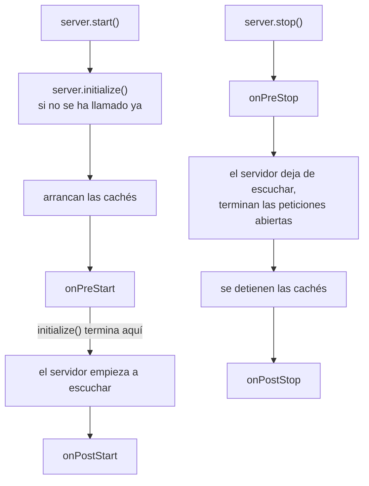
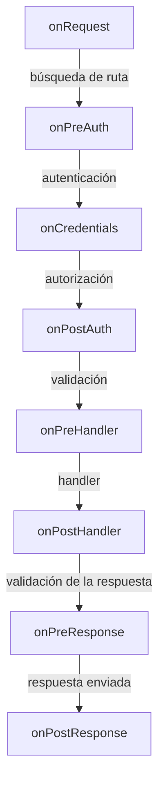

<TutorialLang />

# Hooks del ciclo de vida

_Este tutorial es compatible con hapi v21 y versiones posteriores_

## <a name="overview"></a> Introducción

hapi hace pasar cada petición por la misma secuencia fija de pasos: búsqueda de la ruta, autenticación, validación, el handler, etc. Un hook del ciclo de vida, que la referencia de la API llama punto de extensión (extension point), te permite ejecutar tu propia función en un punto con nombre de esa secuencia. El propio servidor tiene otros cuatro hooks para el arranque y la parada.

La mayoría de las funcionalidades transversales se construyen con hooks. Varios plugins oficiales son, en esencia, unos pocos hooks:

| Plugin                 | Hook            | Qué hace en él                                               |
| ---------------------- | --------------- | ------------------------------------------------------------ |
| [yar](/module/yar)     | `onPreAuth`     | carga la sesión, para que la autenticación pueda usarla      |
| [yar](/module/yar)     | `onPreResponse` | guarda la sesión en una cookie                               |
| [crumb](/module/crumb) | `onPostAuth`    | rechaza peticiones sin token CSRF o con un token incorrecto  |
| [crumb](/module/crumb) | `onPreResponse` | añade el token CSRF al contexto de vista de las páginas HTML |
| [nes](/module/nes)     | `onPreStart`    | arranca los heartbeats de WebSocket                          |
| [nes](/module/nes)     | `onPreStop`     | cierra las conexiones WebSocket abiertas                     |

Los hooks se añaden con [`server.ext()`](/api#server-ext-events); la referencia de la API tiene la lista completa de opciones.

## <a name="server-hooks"></a> Hooks del servidor: arranque y parada

Los hooks del servidor se ejecutan una vez, cuando el servidor arranca o se detiene. Cada uno recibe el `server` y no devuelve nada, o devuelve una promesa. Un error lanzado detiene el arranque o la parada.



[`server.start()`](/api#await-server-start) ejecuta primero `server.initialize()` si no lo has llamado tú. `initialize()` se detiene antes del paso de escucha, así que ejecuta `onPreStart` pero nunca abre un puerto. Por eso es la llamada adecuada en los tests, donde envías peticiones con `server.inject()`.

| Hook          | Se ejecuta                                   | Úsalo para                                                                                      |
| ------------- | -------------------------------------------- | ----------------------------------------------------------------------------------------------- |
| `onPreStart`  | antes de que el servidor escuche             | conectar con bases de datos y comprobar la configuración, para que un fallo detenga el arranque |
| `onPostStart` | después de que el servidor escuche           | trabajo que necesita el puerto asignado, como registrarse en un servicio de descubrimiento      |
| `onPreStop`   | antes de que el servidor deje de escuchar    | avisar a los balanceadores de carga y a las conexiones de larga duración de que se vayan        |
| `onPostStop`  | cuando han terminado las peticiones abiertas | cerrar el pool de la base de datos y otros recursos que usaban las peticiones                   |

Un pool de base de datos es el caso habitual. Conectar en `onPreStart` hace que una base de datos ausente haga fallar `server.start()` en lugar de la primera petición. Cerrar en `onPostStop` espera a que las peticiones en curso terminen sus consultas:

```ts
import Hapi from '@hapi/hapi';
import { Pool } from 'pg';

import type { Plugin } from '@hapi/hapi';

const database: Plugin<{ connectionString: string }> = {
    name: 'database',
    register(server, options) {
        const pool = new Pool({ connectionString: options.connectionString });

        server.ext('onPreStart', async () => {
            await pool.query('SELECT 1');
        });

        server.ext('onPostStop', async () => {
            await pool.end();
        });

        server.expose('pool', pool);
    },
};

const server = Hapi.server({ port: 4000 });

await server.register({
    plugin: database,
    options: { connectionString: 'postgres://localhost/app' },
});

await server.start();

process.on('SIGTERM', async () => {
    await server.stop({ timeout: 10_000 });
    process.exit(0);
});
```

`server.stop({ timeout })` da ese tiempo a las peticiones abiertas para terminar antes de cerrar sus conexiones. Para compartir un servicio como este pool con los handlers, usa una [decoración de servidor](/tutorials/es_ES/decorators#server).

Dos reglas para los hooks del servidor:

- Añade `onPreStart` antes de llamar a `initialize()` o `start()`. Añadirlo después lanza `Cannot add onPreStart (after) extension after the server was initialized`.
- Cuando el trabajo de arranque de un plugin necesita que otro plugin esté listo, ponlo en un callback de [`server.dependency()`](/api#server-dependency-dependencies-after). hapi ejecuta el callback durante `onPreStart`, después de los plugins que nombra, sea cual sea el orden en que se registraron. Consulta [Dependencias](/tutorials/es_ES/plugins#dependencies) en el tutorial de plugins.

## <a name="request-hooks"></a> Hooks de petición

Los hooks de petición se ejecutan en cada petición. Los ocho hooks se sitúan entre los pasos del [ciclo de vida de la petición](/api#request-lifecycle):



`onRequest`, `onPreResponse` y `onPostResponse` se ejecutan en todas las peticiones, incluidos los 404 y las peticiones rechazadas por la autenticación o la validación. La excepción es una petición abortada o cerrada con `h.close`, que se salta `onPreResponse`. `onCredentials` se ejecuta siempre que la ruta tiene autenticación configurada, aunque no se hayan encontrado credenciales. Los demás se ejecutan cuando la petición llega hasta ese punto.

| Hook             | Con qué puedes contar                                                             | Uso típico                                                 |
| ---------------- | --------------------------------------------------------------------------------- | ---------------------------------------------------------- |
| `onRequest`      | la ruta y las cabeceras en bruto; todavía sin ruta asignada; puede cambiar la URL | ids de petición, reescritura de URLs, modo mantenimiento   |
| `onPreAuth`      | `request.route` y las cookies parseadas                                           | cargar una sesión que leerá la autenticación               |
| `onCredentials`  | `request.auth.credentials`, antes de comprobar los scopes                         | añadir roles o scopes desde tu base de datos               |
| `onPostAuth`     | autenticación hecha, payload parseado pero sin validar                            | comprobaciones CSRF, cargar el tenant o la cuenta          |
| `onPreHandler`   | params, query y payload validados                                                 | comprobaciones que necesitan la entrada validada           |
| `onPostHandler`  | el objeto response del handler; si el handler falla, se salta a `onPreResponse`   | modificar las respuestas correctas                         |
| `onPreResponse`  | el `request.response` final, errores incluidos                                    | páginas de error, cabeceras de respuesta, guardar sesiones |
| `onPostResponse` | la respuesta ya se ha enviado                                                     | métricas, logs de acceso, limpieza                         |

### <a name="return-values"></a> Qué devuelve un hook

Un hook de petición es un [método del ciclo de vida](/api#lifecycle-methods): recibe `(request, h)` y tiene que devolver algo. Lo que devuelve decide qué ocurre después:

| Devuelve                       | `onRequest`                  | De `onPreAuth` a `onPreHandler`                                           | `onPostHandler`, `onPreResponse`                                                  | `onPostResponse`                                |
| ------------------------------ | ---------------------------- | ------------------------------------------------------------------------- | --------------------------------------------------------------------------------- | ----------------------------------------------- |
| `h.continue`                   | se ejecuta el siguiente paso | se ejecuta el siguiente paso                                              | se mantiene la respuesta actual                                                   | se ignora                                       |
| `h.response(value).takeover()` | salta a `onPreResponse`      | salta a la validación de respuesta de la ruta y después a `onPreResponse` | sustituye la respuesta; se saltan los hooks posteriores del mismo tipo            | se ignora                                       |
| un error, lanzado o devuelto   | salta a `onPreResponse`      | salta a `onPreResponse`                                                   | sustituye la respuesta; se saltan los hooks posteriores del mismo tipo            | lanzado, o boom devuelto: se registra en el log |
| cualquier otro valor           | error 500                    | error 500                                                                 | sustituye la respuesta; los hooks posteriores del mismo tipo se siguen ejecutando | se ignora                                       |
| nada (`undefined`)             | error 500                    | error 500                                                                 | error 500                                                                         | se ignora                                       |

[`h.continue`](/api#h-continue) es la forma en que un hook dice "aquí no hay nada que hacer". Un takeover es la forma en que un hook anterior al handler responde él mismo a la petición, e incluso un takeover desde `onRequest` pasa por `onPreResponse`. El [flujo del ciclo de vida](/api#lifecycle-workflow) de la referencia de la API tiene las reglas completas.

## <a name="patterns"></a> Patrones

### <a name="request-id"></a> Ids de petición y tiempos

Un id de petición relaciona el informe de error de un cliente con tus logs. Este plugin acepta un id del cliente o crea uno, lo devuelve en una cabecera y registra cuánto tardó cada petición:

```ts
import { randomUUID } from 'node:crypto';
import Boom from '@hapi/boom';

import type { Plugin } from '@hapi/hapi';

declare module '@hapi/hapi' {
    interface PluginsStates {
        'request-tracing': { id: string };
    }
}

const requestTracing: Plugin<void> = {
    name: 'request-tracing',
    register(server) {
        server.ext('onRequest', (request, h) => {
            const incoming = request.headers['x-request-id'];
            request.plugins['request-tracing'] = { id: typeof incoming === 'string' ? incoming : randomUUID() };
            return h.continue;
        });

        server.ext('onPreResponse', (request, h) => {
            const { response } = request;
            const { id } = request.plugins['request-tracing'];
            if (Boom.isBoom(response)) {
                response.output.headers['x-request-id'] = id;
            } else {
                response.header('x-request-id', id);
            }

            return h.continue;
        });

        server.ext('onPostResponse', (request, h) => {
            const { response } = request;
            const statusCode = Boom.isBoom(response) ? response.output.statusCode : response.statusCode;
            const duration = request.info.completed - request.info.received;

            request.log(['metrics'], {
                id: request.plugins['request-tracing'].id,
                path: request.path,
                statusCode,
                duration,
            });
            return h.continue;
        });
    },
};
```

- Un plugin guarda sus datos por petición bajo su propio nombre en [`request.plugins`](/api#request-plugins), y el bloque `declare module` tipa esa entrada mediante la interfaz `PluginsStates` de hapi. [`request.app`](/api#request-app) es para el código propio de tu aplicación.
- `request.response` es un error boom cuando la petición ha fallado, así que `onPreResponse` fija la cabecera en `response.output.headers` en lugar de llamar a `.header()`.
- `onPostResponse` se ejecuta después de enviar la respuesta, así que el cliente nunca lo espera, y su valor de retorno se ignora. hapi ejecuta los hooks `onPostResponse` uno tras otro, así que un hook lento sigue retrasando a los que vienen detrás. Pasa el trabajo lento, como enviar métricas por la red, a una cola, y devuelve.
- hapi ya registra [`request.info.received`](/api#request-info) y `request.info.completed`, así que no hace falta que guardes tú una hora de inicio.

### <a name="rewrite"></a> Reescribir URLs

`onRequest` es el único hook que se ejecuta antes de la búsqueda de la ruta, así que es el único sitio donde una reescritura cambia qué ruta atiende la petición. [`request.setUrl()`](/api#request-seturl-url-striptrailingslash) hace la reescritura:

```ts
server.ext('onRequest', (request, h) => {
    if (request.path.startsWith('/api/v1/')) {
        request.setUrl(request.url.pathname.replace('/api/v1/', '/api/') + request.url.search);
    }

    return h.continue;
});
```

Los clientes antiguos siguen llamando a `/api/v1/users?page=2`, y la ruta `/api/users` les responde con la query string intacta.

### <a name="maintenance"></a> Modo mantenimiento

Una respuesta takeover desde `onRequest` responde a todas las peticiones antes de que se ejecute ninguna ruta:

```ts
let maintenance = false;

server.ext('onRequest', (request, h) => {
    if (!maintenance || request.path === '/health') {
        return h.continue;
    }

    return h.response({ message: 'Down for maintenance' }).code(503).header('retry-after', '600').takeover();
});
```

El health check sigue accesible, para que tu balanceador de carga distinga una parada planificada de una caída.

### <a name="credentials"></a> Cargar roles: onCredentials u onPostAuth

Los dos hooks se ejecutan después de la autenticación. La diferencia es el paso de autorización que hay entre ellos, que comprueba el [`auth.access.scope`](/api#route-options-auth-access-scope) de la ruta (consulta [Scopes](/tutorials/es_ES/auth#scopes)).

Usa `onCredentials` cuando añadas algo que la autorización deba ver. Es habitual que un token identifique al usuario pero no lleve sus roles, así que cargas los roles desde tu base de datos y los añades como scopes:

```ts
server.ext('onCredentials', async (request, h) => {
    if (!request.auth.isAuthenticated) {
        return h.continue;
    }

    const { user } = request.auth.credentials;
    if (user) {
        request.auth.credentials.scope = await loadRoles(user.id);
    }

    return h.continue;
});

server.route<{ Params: { id: string } }>({
    method: 'DELETE',
    path: '/projects/{id}',
    options: { auth: { access: { scope: 'admin' } } },
    handler: (request, h) => deleteProject(request.params.id),
});
```

`onCredentials` se ejecuta siempre que la ruta tiene autenticación configurada, incluidas las rutas `'try'` y `'optional'` en las que no se encontraron credenciales y `request.auth.credentials` es `null`, así que comprueba primero `request.auth.isAuthenticated`. `user.id` depende de la declaración `UserCredentials` que aparece en el [tutorial de autenticación](/tutorials/es_ES/auth#schemes).

Usa `onPostAuth` para el trabajo que no cambia lo que el usuario tiene permitido hacer, o que también debe ejecutarse en rutas sin autenticación, como cargar el tenant indicado en la cabecera `Host`. `onCredentials` nunca se ejecuta en una ruta con `auth: false`.

### <a name="errors"></a> Respuestas de error coherentes

`onPreResponse` ve cada respuesta antes de que salga, así que es el sitio donde cambiar el aspecto de los errores. Un hook que sustituye un error por su propia respuesta tiene que conservar las cabeceras del error, como `WWW-Authenticate` en un 401:

```ts
import Boom from '@hapi/boom';

server.ext(
    'onPreResponse',
    (request, h) => {
        const { response } = request;
        if (!Boom.isBoom(response)) {
            return h.continue;
        }

        const { statusCode, payload, headers } = response.output;
        const reply = h.response({ error: payload.message }).code(statusCode);
        for (const [name, value] of Object.entries(headers)) {
            if (value !== undefined) {
                reply.header(name, String(value));
            }
        }

        return reply;
    },
    { before: ['request-tracing'] },
);
```

La nueva respuesta sustituye al error, y los hooks `onPreResponse` que se ejecutan después de este ven la nueva respuesta. Con `before: ['request-tracing']`, el [hook del id de petición](#request-id) se ejecuta después de este y añade su cabecera a la nueva respuesta. Sin esa opción, el hook del id de petición fijaría primero su cabecera en el error, y solo la copia de cabeceras de arriba la conservaría. El orden importa sobre todo en los hooks que sustituyen la respuesta. El [tutorial de serialización de respuestas](/tutorials/es_ES/response-marshalling#errors) tiene un formato de error completo y páginas de error HTML.

## <a name="ordering"></a> Orden y alcance

Por defecto, los hooks del mismo tipo se ejecutan en el orden en que se añadieron, contando juntos los hooks del servidor, los de los plugins y los de las rutas. Tres opciones cambian qué peticiones ve un hook y cuándo se ejecuta.

**`before` y `after`** reciben nombres de plugins y ordenan el hook de tu plugin respecto a los suyos. Un plugin que lee la sesión que carga yar usaría:

```ts
server.ext('onPreAuth', loadPreferences, { after: ['@hapi/yar'] });
```

**`sandbox: 'plugin'`** limita un hook a las rutas que añadió su plugin. Funciona con todos los hooks de petición excepto `onRequest`, que se ejecuta antes de que hapi conozca la ruta:

```ts
import type { Plugin } from '@hapi/hapi';

const adminPanel: Plugin<void> = {
    name: 'admin-panel',
    register(server) {
        server.ext('onPreHandler', auditAdminAccess, { sandbox: 'plugin' });

        server.route({ method: 'GET', path: '/admin', handler: (request, h) => 'admin' });
    },
};
```

**Los hooks a nivel de ruta** van en el [`options.ext`](/api#route-options-ext) de la ruta y solo se ejecutan para esa ruta:

```ts
server.route({
    method: 'POST',
    path: '/uploads',
    options: {
        ext: {
            onPreHandler: { method: checkStorageQuota },
        },
    },
    handler: (request, h) => saveUpload(request.payload),
});
```

`server.ext()` también acepta un array, lo que mantiene juntos los hooks de un plugin en un solo sitio:

```ts
server.ext([
    { type: 'onRequest', method: assignRequestId },
    { type: 'onPreResponse', method: addRequestIdHeader },
    { type: 'onPostResponse', method: recordMetrics },
]);
```

## <a name="typing"></a> Tipar los hooks

Los hooks escritos directamente en `server.ext()` no necesitan anotaciones: TypeScript infiere `request` y `h` a partir del nombre del hook, e infiere `server` en los hooks del servidor. Un hook definido por separado es un `Lifecycle.Method`:

```ts
import Boom from '@hapi/boom';

import type { Lifecycle } from '@hapi/hapi';

const checkStorageQuota: Lifecycle.Method = async (request, h) => {
    if (!request.auth.isAuthenticated) {
        throw Boom.unauthorized();
    }

    const quota = await getQuota(request.auth.credentials.user?.id);
    if (quota.used >= quota.limit) {
        throw Boom.forbidden('Storage quota exceeded');
    }

    return h.continue;
};
```

Para tipar los datos que tus hooks guardan en la petición, extiende `PluginsStates` como en el [ejemplo del id de petición](#request-id), o `RequestApplicationState` para `request.app` en el código de la aplicación. `user?.id` depende de la declaración `UserCredentials` que aparece en el [tutorial de autenticación](/tutorials/es_ES/auth#schemes).
