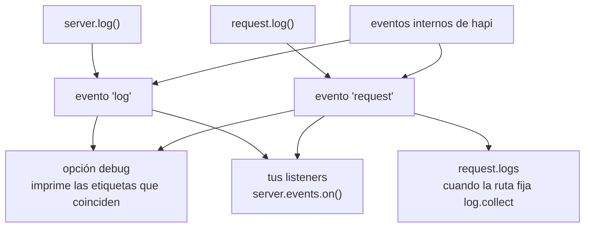

<TutorialLang />

# Logging

_Este tutorial es compatible con hapi v21 y versiones posteriores_

## <a name="overview"></a> Introducción

Aparte del valor por defecto de [`debug`](#debug), que imprime en consola los errores de tu propio código, hapi no escribe logs en ningún sitio. Convierte cada llamada de log en un evento de `server.events`, y tú decides qué hacer con esos eventos: imprimirlos, enviarlos a un servicio de logging o recogerlos por petición.



## <a name="methods"></a> Métodos integrados

Hay dos métodos de logging. Elige el que corresponda a dónde se ejecuta tu código:

| Método                                                            | Úsalo cuando                                                                        | Emite       |
| ----------------------------------------------------------------- | ----------------------------------------------------------------------------------- | ----------- |
| [`request.log(tags, [data])`](/api#request-log-tags-data)         | hay una petición en contexto: un handler, una extensión, un scheme de autenticación | `'request'` |
| [`server.log(tags, [data])`](/api#server-log-tags-data-timestamp) | no hay ninguna petición en contexto: el arranque, el `register()` de un plugin      | `'log'`     |

Ambos reciben los mismos dos argumentos principales:

- `tags`: una cadena o un array de cadenas, como `['error', 'database', 'read']`. hapi usa etiquetas en lugar de niveles de log, así que puedes filtrar por cualquier combinación: todo lo etiquetado con `database`, o solo `error` y `database` juntas.
- `data`: opcional. Un mensaje, un objeto o un `Error`. Si en su lugar pasas una función, hapi solo la llama cuando un listener recibe el evento, así que los datos costosos de calcular no cuestan nada cuando nadie escucha.

### <a name="request.log"></a> request.log()

```ts
server.route({
    method: 'GET',
    path: '/users/{id}',
    handler: async (request, h) => {
        request.log(['users', 'read'], { id: request.params.id });

        return { id: request.params.id };
    },
});
```

Cada evento registrado así lleva el id de la petición, de modo que puedes agrupar los eventos de una misma petición.

### <a name="server.log"></a> server.log()

```ts
import Hapi from '@hapi/hapi';

const server = Hapi.server({ port: 3000 });

await server.start();

server.log(['startup'], `Server running at ${server.info.uri}`);
```

## <a name="display"></a> Obtener y mostrar los logs

Escucha en [`server.events`](/api#server-events). Además de tus propias llamadas, hapi emite sus propios eventos en los mismos canales:

| Evento       | `event.channel` | Procede de                                                               |
| ------------ | --------------- | ------------------------------------------------------------------------ |
| `'log'`      | `'app'`         | tus llamadas a `server.log()`                                            |
| `'log'`      | `'internal'`    | hapi: rechazos por carga del servidor, errores de conexión del cliente   |
| `'request'`  | `'app'`         | tus llamadas a `request.log()`                                           |
| `'request'`  | `'internal'`    | hapi: fallos de autenticación, errores del handler, cabeceras no válidas |
| `'request'`  | `'error'`       | hapi: una vez por cada petición que terminó con un 500                   |
| `'response'` | ninguno         | hapi: una vez por petición, después de enviar la respuesta               |

La lista completa de etiquetas internas está en la referencia de la API, en los eventos [`'log'`](/api#log-event) y [`'request'`](/api#request-event).

Una configuración típica imprime los eventos de la aplicación, informa de los 500 y escribe una línea de log de acceso por petición:

```ts
server.events.on('log', (event, tags) => {
    console.log(event.timestamp, event.tags, event.data ?? event.error);
});

server.events.on({ name: 'request', channels: 'app' }, (request, event, tags) => {
    console.log(request.info.id, event.tags, event.data ?? event.error);
});

server.events.on({ name: 'request', channels: 'error' }, (request, event, tags) => {
    console.error(`Request ${request.info.id} failed:`, event.error);
});

server.events.on('response', (request) => {
    const duration = request.info.completed - request.info.received;

    console.log(`${request.method.toUpperCase()} ${request.path} ${request.raw.res.statusCode} ${duration}ms`);
});
```

- `tags` es un objeto con una clave `true` por etiqueta, así que `if (tags.error)` es una comprobación rápida.
- `event.data` y `event.error` nunca aparecen juntos: un `Error` pasado como `data` llega como `event.error`.
- El objeto de criterios `{ name: 'request', channels: 'error' }` se suscribe a un solo canal. Sin él recibes los tres.

hapi emite `'response'` después de enviar la respuesta y no espera a las promesas que devuelva un listener. Para trabajo asíncrono que hapi deba esperar en orden, usa una extensión `onPostResponse`; consulta [Hooks del ciclo de vida](/tutorials/es_ES/lifecycle-hooks).

### <a name="collecting-the-logs-of-one-request"></a> Recoger los logs de una petición

Para leer los eventos de una petición desde dentro de ella, fija `log.collect` en la ruta. Todos los eventos registrados para esa petición acaban entonces en `request.logs`:

```ts
server.route({
    method: 'GET',
    path: '/',
    options: {
        log: {
            collect: true,
        },
    },
    handler: function (request, h) {
        request.log(['step'], 'loaded user');
        request.log(['step'], 'loaded orders');

        return { steps: request.logs.length };
    },
});
```

Sin `log.collect`, `request.logs` se queda vacío.

## <a name="debug"></a> Modo debug (solo para desarrollo)

La opción de servidor [`debug`](/api#server-options-debug) imprime en consola los eventos que coinciden, con `console.error()`, sin código de listener. Solo cambia lo que se imprime, no lo que se emite.

| Opción          | Por defecto          | Imprime                                                                                                                     |
| --------------- | -------------------- | --------------------------------------------------------------------------------------------------------------------------- |
| `debug.request` | `['implementation']` | eventos `'request'` con cualquiera de estas etiquetas. El valor por defecto imprime los 500 causados por bugs en tu código. |
| `debug.log`     | ninguno              | eventos `'log'` con cualquiera de estas etiquetas.                                                                          |
| `debug: false`  |                      | nada                                                                                                                        |

Cada lista admite etiquetas, `'*'` para todos los eventos o `false` para ninguno. Para imprimir todos los errores de petición mientras desarrollas:

```ts
import Hapi from '@hapi/hapi';

const server = Hapi.server({ debug: { request: ['error'] } });
```

## <a name="plugins"></a> Plugins de logging

Para el logging en producción, usa un plugin que escuche estos eventos por ti, como [hapi-pino](https://www.npmjs.com/package/hapi-pino) para logs JSON estructurados, [New Relic](https://newrelic.com/instant-observability/hapi/2124da5b-0174-457a-be5a-e0068673b2b5) o cualquiera de los demás [plugins de logging para hapi](/plugins#logging).
