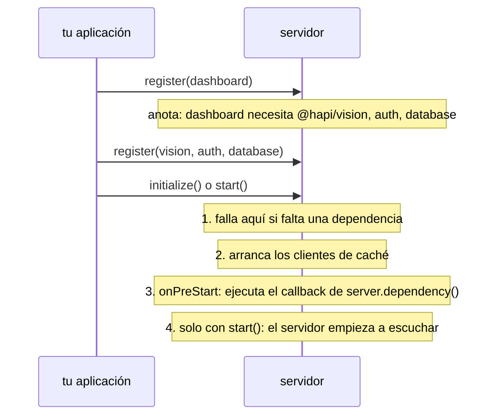

<TutorialLang />

# Plugins

_Este tutorial es compatible con hapi v21 y versiones posteriores_

## <a name="overview"></a> Introducción

Un plugin es una parte de una aplicación hapi empaquetada para poder registrarla en un servidor: un conjunto de rutas, un scheme de autenticación, un logger, un motor de plantillas. La mayor parte del ecosistema hapi se publica como plugins ([inert](/module/inert), [vision](/module/vision), [@hapi/basic](/module/basic)), y dividir tu propia aplicación en plugins mantiene cada parte aislada y fácil de probar.

Un plugin recibe el servidor en su función `register` y lo modifica mediante la API normal del servidor. Las partes que más importan a quien escribe plugins:

| API del servidor                                                         | Qué añade el plugin                                                                    | Tutorial                                                    |
| ------------------------------------------------------------------------ | -------------------------------------------------------------------------------------- | ----------------------------------------------------------- |
| [`server.route()`](/api#server-route-route)                              | rutas                                                                                  | [Enrutamiento](/tutorials/es_ES/routing)                    |
| [`server.ext()`](/api#server-ext-events)                                 | código que se ejecuta en un paso de cada petición, o al arrancar y detener el servidor | [Hooks del ciclo de vida](/tutorials/es_ES/lifecycle-hooks) |
| [`server.decorate()`](/api#server-decorate-type-property-method-options) | métodos nuevos en `server`, `request` o `h`                                            | [Decoradores](/tutorials/es_ES/decorators)                  |
| [`server.auth.scheme()`](/api#server-auth-scheme-name-scheme)            | un scheme de autenticación                                                             | [Autenticación](/tutorials/es_ES/auth)                      |
| [`server.method()`](/api#server-method-name-method-options)              | funciones compartidas que se pueden cachear                                            | [Métodos de servidor](/tutorials/es_ES/server-methods)      |
| [`server.expose()`](/api#server-expose-key-value-options)                | valores que otros plugins leen de `server.plugins[name]`                               |                                                             |

## <a name="create"></a> Crear un plugin

Un plugin es un objeto con un `name` y una función asíncrona `register(server, options)`:

```ts
import type { Plugin } from '@hapi/hapi';

const myPlugin: Plugin<void> = {
    name: 'myPlugin',
    version: '1.0.0',
    register: async function (server, options) {
        server.route({
            method: 'GET',
            path: '/test',
            handler: function (request, h) {
                return 'hello, world';
            },
        });
    },
};
```

Una vez registrado, `GET /test` responde `'hello, world'`.

`Plugin<T>` recibe el tipo de las opciones del plugin. Este plugin no tiene ninguna, así que es `Plugin<void>`. Con el plugin tipado, TypeScript infiere `server` y `options` en `register`, y comprueba que el plugin tenga un `name` o un `pkg`.

Las propiedades del objeto plugin:

| Propiedad      | Significado                                                                                                                  |
| -------------- | ---------------------------------------------------------------------------------------------------------------------------- |
| `register`     | Obligatoria. Configura el plugin. El registro espera a que termine y falla si lanza un error.                                |
| `name`         | Obligatoria salvo que se indique `pkg`. Debe ser única en el servidor. Los plugins publicados usan su nombre de paquete npm. |
| `version`      | Informativa. Otros plugins pueden leerla, y las [dependencias](#dependencies) pueden exigir un rango de versiones.           |
| `pkg`          | Tu `package.json`, del que se toman `name` y `version` en lugar de escribirlos a mano.                                       |
| `dependencies` | Plugins que también deben estar registrados. Consulta [dependencias](#dependencies).                                         |
| `requirements` | Rangos de versiones de `node` y `hapi` admitidos, como `{ hapi: '>=21' }`. El registro falla fuera de ellos.                 |
| `multiple`     | `true` permite registrar el plugin más de una vez en el mismo servidor.                                                      |
| `once`         | `true` hace que los registros repetidos se ignoren en silencio en lugar de dar error.                                        |

### <a name="module"></a> Publicar un plugin como módulo

Un módulo de plugin exporta el objeto plugin, ya sea como export por defecto o como export con nombre `plugin`. `pkg` toma el nombre y la versión de `package.json`:

```ts
import Pkg from './package.json' with { type: 'json' };

import type { Plugin } from '@hapi/hapi';

export const plugin: Plugin<void> = {
    pkg: Pkg,
    register: async function (server, options) {
        server.route({
            method: 'GET',
            path: '/test',
            handler: function (request, h) {
                return 'hello, world';
            },
        });
    },
};
```

hapi acepta cualquiera de las dos formas de export: `server.register()` recibe un objeto plugin, o un módulo cuya propiedad `plugin` sea uno.

### <a name="register"></a> Opciones del plugin

`options` es lo que pase quien registra el plugin, sin cambios. Tipéalo con `Plugin<Options>`:

```ts
import Pkg from './package.json' with { type: 'json' };

import type { Plugin } from '@hapi/hapi';

interface Options {
    name: string;
}

export const plugin: Plugin<Options> = {
    pkg: Pkg,
    register: async function (server, options) {
        server.route({
            method: 'GET',
            path: '/test',
            handler: function (request, h) {
                return `Hello ${options.name}`;
            },
        });
    },
};
```

`options.name` es un `string`, y TypeScript marca como error una llamada a `server.register()` cuyas opciones no encajen con `Options`; hapi no las comprueba en tiempo de ejecución.

## <a name="loading"></a> Cargar un plugin

Registra plugins con [`server.register()`](/api#await-server-register-plugins-options). Pasa el propio plugin, un objeto con `plugin` y `options`, o un array de cualquiera de los dos:

```ts
import Hapi from '@hapi/hapi';
import { plugin as MyPlugin } from 'myplugin';
import { plugin as YourPlugin } from 'yourplugin';

const start = async function () {
    const server = Hapi.server();

    await server.register(YourPlugin);

    await server.register({
        plugin: MyPlugin,
        options: {
            name: 'Bob',
        },
    });

    await server.register([{ plugin: YourPlugin }, { plugin: MyPlugin, options: { name: 'Bob' } }]);
};
```

Los plugins de un array se registran uno tras otro, en orden. Cada función `register` termina antes de que empiece la siguiente.

### <a name="registration"></a> Opciones de registro

El segundo argumento de `server.register()` configura cómo registra hapi el plugin. _No_ se le pasa al plugin:

| Opción          | Efecto                                                                                 |
| --------------- | -------------------------------------------------------------------------------------- |
| `routes.prefix` | Antepone una ruta a cada ruta que añade el plugin. `/test` pasa a ser `/plugins/test`. |
| `routes.vhost`  | Aplica un host virtual a cada ruta que añade el plugin.                                |
| `once`          | `true` omite el plugin si ya está registrado, en lugar de lanzar un error.             |

```ts
import Hapi from '@hapi/hapi';
import { plugin as MyPlugin } from 'myplugin';

const start = async function () {
    const server = Hapi.server();

    await server.register(MyPlugin, {
        routes: {
            prefix: '/plugins',
        },
    });
};
```

Los prefijos se anidan: si un plugin registrado con el prefijo `/api` registra un plugin hijo con el prefijo `/v1`, las rutas del hijo empiezan por `/api/v1`. Consulta [`server.register()`](/api#await-server-register-plugins-options) para ver la lista completa.

## <a name="scope"></a> Qué puede y qué no puede afectar un plugin

Cada plugin recibe su propio [`server.realm`](/api#server-realm): un contenedor de ajustes que se quedan dentro del plugin. Todo lo demás que hace un plugin cambia el servidor entero:

| Cambio                                                                                                                 | Alcance                                           |
| ---------------------------------------------------------------------------------------------------------------------- | ------------------------------------------------- |
| prefijo de ruta y vhost de las opciones de registro                                                                    | las rutas del plugin y sus plugins hijos          |
| [`server.bind()`](/api#server-bind-context), [`server.path()`](/api#server-path-relativeto)                            | rutas, handlers y extensiones que añade el plugin |
| [hooks del ciclo de vida](/tutorials/es_ES/lifecycle-hooks) de la petición con `options.sandbox: 'plugin'`             | las rutas del plugin                              |
| hooks del ciclo de vida de la petición sin `sandbox`                                                                   | **todas las rutas del servidor**                  |
| [decoraciones](/tutorials/es_ES/decorators), métodos de servidor, strategies de autenticación, `server.auth.default()` | **todo el servidor**                              |

Un plugin que añade un hook `onPreResponse` para dar formato a sus propios errores debe pasar `sandbox: 'plugin'`; si no, también reformateará los errores de todos los demás plugins.

## <a name="dependencies"></a> Dependencias

Un plugin que necesita otro plugin lo declara, en lugar de depender del orden de registro:

```ts
import type { Plugin } from '@hapi/hapi';

declare module '@hapi/hapi' {
    interface PluginProperties {
        database: { migrate: () => Promise<void> };
    }
}

export const plugin: Plugin<void> = {
    name: 'dashboard',
    dependencies: ['@hapi/vision', 'auth'],
    register: async function (server, options) {
        server.dependency('database', async (server) => {
            await server.plugins.database.migrate();
        });
    },
};
```

hapi comprueba las dependencias cuando el servidor se inicializa, no cuando se registra el plugin, así que los plugins se pueden registrar en cualquier orden:



- `dependencies` es una lista de nombres, o un objeto que asocia nombres a rangos de versiones, como `{ '@hapi/vision': '7.x' }`.
- [`server.dependency(names, after)`](/api#server-dependency-dependencies-after) declara lo mismo desde dentro de `register` y acepta una función `after`. hapi ejecuta `after` durante el arranque del servidor, una vez registrados todos los plugins de la lista. Úsala para la configuración que necesita la API de otro plugin.
- hapi lanza un error ante dependencias `after` circulares.

`server.plugins.database` es lo que el plugin `database` publicó con [`server.expose()`](/api#server-expose-key-value-options). hapi no puede conocer su forma, así que el bloque `declare module` la añade a la interfaz `PluginProperties` de hapi.
