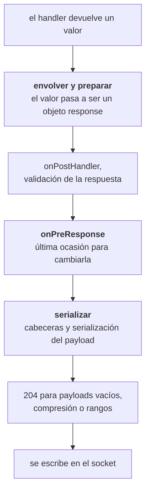

<TutorialLang />

# Serialización de respuestas

_Este tutorial es compatible con hapi v21 y versiones posteriores_

## <a name="overview"></a> Introducción

Un handler devuelve un valor: un string, un objeto, un stream, un error. La serialización de respuestas (response marshalling) es todo lo que hace hapi para convertir ese valor en una respuesta HTTP: elegir el código de estado, poner las cabeceras, serializar el payload, comprimirlo y escribirlo en el socket.

Saber cómo funciona te dice dónde poner el código. Un formato de error uniforme, una página de error en HTML, cabeceras de caché, compresión, un tipo de respuesta propio como CSV, un contador de bytes para métricas: cada una de estas cosas tiene su sitio en un punto concreto del proceso de serialización. Las referencias de la API del [objeto response](/api#response-object) y del [response toolkit](/api#response-toolkit) recogen todos los métodos.

## <a name="pipeline"></a> Del valor devuelto a los bytes

La serialización ocurre en dos fases, con el punto de extensión `onPreResponse` entre ambas:



El paso de serialización sigue un orden fijo, que determina qué ajustes pueden ver qué cabeceras:

1. `content-type` según el tipo del payload
2. cabeceras CORS y de seguridad, si la ruta las activa
3. ETag y `last-modified` desde [`h.entity()`](/api#h-entity-options), y después la comprobación del 304 en las rutas GET
4. `cache-control` según la opción `cache` de la ruta
5. `set-cookie` desde [`h.state()`](/api#h-state-name-value-options) y las cookies con `autoValue`
6. serialización del payload y `content-length`
7. el método `response()` del scheme de autenticación, el último, para que pueda leer todas las cabeceras anteriores

En la práctica, la separación importa:

- **Antes de `onPreResponse`**, la respuesta es un objeto response o un error de [boom](/module/boom), y puedes inspeccionarla, modificarla o sustituirla. Los errores que se producen al envolver y preparar, como un fichero que no existe, llegan a `onPreResponse` como errores de boom.
- **Después de `onPreResponse`**, hapi serializa el payload y calcula las cabeceras. Un error en esta fase, como un objeto que `JSON.stringify()` no puede procesar, se convierte en un 500 que `onPreResponse` nunca ve. Usa payloads que sean datos simples para que la serialización no pueda fallar.

El orden de los pasos del [ciclo de vida de la petición](/api#request-lifecycle) se explica en el tutorial [Hooks del ciclo de vida](/tutorials/es_ES/lifecycle-hooks).

## <a name="return-values"></a> Qué devuelves y qué envía hapi

| El handler devuelve | Estado                   | `content-type` por defecto        | Notas                                                                                                                                                                                       |
| ------------------- | ------------------------ | --------------------------------- | ------------------------------------------------------------------------------------------------------------------------------------------------------------------------------------------- |
| string              | 200, o 204 si está vacío | `text/html; charset=utf-8`        | Usa `.type('text/plain')` para texto plano                                                                                                                                                  |
| objeto o array      | 200                      | `application/json; charset=utf-8` | Se serializa con `JSON.stringify()` y las [opciones `json`](#json) de la ruta                                                                                                               |
| `Buffer`            | 200                      | `application/octet-stream`        |                                                                                                                                                                                             |
| stream legible      | 200                      | `application/octet-stream`        | Se envía por chunks. No puede estar en modo objeto. Copia `statusCode` y `headers` si el stream los tiene                                                                                   |
| `null`              | 204                      | ninguno                           | Pon `response.emptyStatusCode` de la ruta a `200` para enviar un 200                                                                                                                        |
| `undefined`         | 500                      |                                   | Un handler tiene que devolver algo; hapi registra "handler method did not return a value"                                                                                                   |
| `Error`             | 500                      | `application/json; charset=utf-8` | El mensaje no se muestra al cliente                                                                                                                                                         |
| error de boom       | el estado del error      | `application/json; charset=utf-8` | `{ statusCode, error, message }`; los mensajes 5xx se ocultan                                                                                                                               |
| `h.response(value)` | el de `value`            | el de `value`                     | Encadena `.code()`, `.header()`, `.type()` y los demás métodos del [objeto response](/api#response-object)                                                                                  |
| `h.redirect(uri)`   | 302                      | `text/html; charset=utf-8`        | Cuerpo vacío. `.permanent()` da 301, `.rewritable(false)` da 307 y los dos juntos dan 308. Con 307 y 308 el cliente repite el mismo método, así que un POST redirigido sigue siendo un POST |

- `Readable.from(array)` crea un stream en modo objeto, que hapi rechaza con un 500. Pasa `{ objectMode: false }` o devuelve un stream de bytes, como `Fs.createReadStream()`.
- Un stream con propiedades `statusCode` y `headers`, como una respuesta HTTP de [wreck](/module/wreck), transmite su estado y sus cabeceras. Eso convierte un proxy básico en un handler de una línea, y también significa que un 404 del servidor de origen se convierte en tu 404.

## <a name="shaping"></a> Dar forma a una respuesta con h.response()

Devuelve un valor simple cuando los valores por defecto te sirven. Cuando no, envuelve el valor con [`h.response()`](/api#h-response-value) y encadena lo que necesites:

```ts
import Hapi from '@hapi/hapi';

const server = Hapi.server({ port: 4000 });

server.route<{ Payload: { name: string } }>({
    method: 'POST',
    path: '/users',
    handler: (request, h) => {
        const user = { id: '2133d32a', name: request.payload.name };

        return h.response(user).created(`/users/${user.id}`).header('x-request-id', request.info.id);
    },
});

server.route({
    method: 'GET',
    path: '/robots.txt',
    handler: (request, h) => {
        return h.response('User-agent: *\nDisallow: /admin\n').type('text/plain');
    },
});
```

`.created()` pone el estado a 201 y la cabecera `location` en una sola llamada.

## <a name="errors"></a> Errores

Todo error acaba siendo un objeto de boom. hapi envuelve un `Error` normal con `Boom.boomify()`, que le asigna el estado 500, y boom oculta al cliente el mensaje de cualquier error 5xx. Tus usuarios ven `An internal server error occurred`, y hapi emite el error real como un evento `'request'` en el canal `'error'`; consulta [Logging](/tutorials/es_ES/logging) para registrarlo. Lanza un error de boom como `Boom.notFound('No such user')` cuando el cliente deba ver el mensaje.

La respuesta de un error de boom sale de su propiedad `output`:

```ts
import Boom from '@hapi/boom';

const error = Boom.notFound('No such user');

error.output.statusCode; // 404
error.output.payload; // { statusCode: 404, error: 'Not Found', message: 'No such user' }
error.output.headers; // {}, or headers such as WWW-Authenticate from auth errors
```

### <a name="a-consistent-error-format"></a> Un formato de error uniforme

Las APIs suelen necesitar los errores en su propio formato en lugar del de boom. Conviértelos en `onPreResponse`, por donde pasan todos los errores, incluidos los 404 de rutas desconocidas y los errores que lanzan los plugins:

```ts
import Boom from '@hapi/boom';
import Hapi from '@hapi/hapi';

const server = Hapi.server({ port: 4000 });

server.ext('onPreResponse', (request, h) => {
    const { response } = request;
    if (!Boom.isBoom(response)) {
        return h.continue;
    }

    const { statusCode, payload, headers } = response.output;
    const reply = h.response({
        error: {
            status: statusCode,
            code: payload.error,
            message: payload.message,
            requestId: request.info.id,
        },
    });

    reply.code(statusCode);
    for (const [name, value] of Object.entries(headers)) {
        if (value !== undefined) {
            reply.header(name, String(value));
        }
    }

    return reply;
});
```

Copia `output.headers` en la nueva respuesta. Los errores de autenticación llevan ahí `WWW-Authenticate`, y `Boom.methodNotAllowed()` puede llevar `Allow`. `payload.message` ya es el mensaje seguro: en los errores 5xx boom lo ha sustituido por el texto genérico.

### <a name="html-error-pages"></a> Páginas de error en HTML

Un sitio que renderiza HTML puede devolver una página de error desde el mismo hook; el [tutorial de vistas](/tutorials/es_ES/views#errors) lo muestra con @hapi/vision. En una app que sirve tanto páginas como una API, sáltate la página en las rutas de la API, por ejemplo con `request.path.startsWith('/api/')`, para que los clientes de la API sigan recibiendo JSON.

## <a name="custom"></a> Tipos de respuesta personalizados

Los plugins que envían ficheros y plantillas no devuelven strings. [@hapi/inert](/module/inert) y [@hapi/vision](/module/vision) crean sus respuestas con [`request.generateResponse()`](/api#request-generateresponse-source-options), que recibe un valor de origen y procesadores opcionales. `prepare` y `marshal` se ejecutan en las dos fases del proceso, y `close` se ejecuta cuando la respuesta termina, tanto si se envió como si se sustituyó:

| Plugin | `variety` | `prepare` se ejecuta antes de `onPreResponse`                                     | `marshal` se ejecuta después de `onPreResponse`                                                      |
| ------ | --------- | --------------------------------------------------------------------------------- | ---------------------------------------------------------------------------------------------------- |
| inert  | `'file'`  | abre el fichero; pone `content-length`, `content-type`, `last-modified` y el ETag | devuelve un stream de lectura o un fichero precomprimido (`.gz`, u otras extensiones de `lookupMap`) |
| vision | `'view'`  | carga y compila la plantilla                                                      | renderiza la plantilla con su contexto; pone `content-type`                                          |

La separación es intencionada. Un fichero que no existe falla en `prepare`, así que llega a `onPreResponse` como un 404 al que tu gestor de errores puede dar formato. El trabajo costoso, leer el fichero o renderizar la plantilla, ocurre en `marshal`, después de que `onPreResponse` haya tenido ocasión de sustituir la respuesta. inert también pasa `close`, que cierra el fichero incluso cuando un hook `onPreResponse` ha sustituido la respuesta; una respuesta personalizada que abre un recurso también necesita uno.

Puedes usar el mismo mecanismo para tus propios formatos. Esta es una respuesta CSV:

```ts
import Hapi from '@hapi/hapi';

import type { Request } from '@hapi/hapi';

const field = (value: string) => (/[",\n]/.test(value) ? `"${value.replaceAll('"', '""')}"` : value);

const csv = (request: Request, rows: string[][]) => {
    return request
        .generateResponse(rows, {
            variety: 'csv',
            marshal: async () => rows.map((row) => row.map(field).join(',')).join('\n'),
        })
        .type('text/csv');
};

const server = Hapi.server({ port: 4000 });

server.route({
    method: 'GET',
    path: '/users.csv',
    handler: (request, h) => {
        return csv(request, [
            ['id', 'name'],
            ['2133d32a', 'John Doe'],
        ]);
    },
});
```

`field()` pone entre comillas los valores que contienen una coma, unas comillas o un salto de línea, para que no puedan partir una fila. Para llamarlo como `h.csv(rows)` desde cualquier handler, añádelo al response toolkit con un decorador; consulta el tutorial [Decoradores](/tutorials/es_ES/decorators).

## <a name="json"></a> Serialización JSON

Los objetos se serializan con `JSON.stringify()`. Las [opciones `json`](/api#route-options-json) de la ruta controlan cómo:

```ts
import Hapi from '@hapi/hapi';

const server = Hapi.server({
    port: 4000,
    routes: {
        json: {
            space: process.env.NODE_ENV === 'production' ? 0 : 2,
        },
    },
});

server.route({
    method: 'GET',
    path: '/widget-config',
    options: {
        json: { escape: true },
    },
    handler: (request, h) => {
        return { title: '</script><script>alert(1)</script>' };
    },
});
```

- `space` indenta la salida. Un JSON legible ayuda durante el desarrollo y cuesta bytes en producción.
- `escape: true` escribe `<`, `>` y `&` como `\u003c`, `\u003e` y `\u0026`, y también escapa los separadores de línea U+2028 y U+2029. Úsalo en cualquier ruta cuyo JSON se incruste en una página HTML, para que un valor que contenga `</script>` no pueda cerrar la etiqueta script que lo rodea.
- `replacer` se pasa a `JSON.stringify()`, y `suffix` se añade al final de la salida. Una respuesta concreta puede sobrescribirlos con `.spaces()`, `.replacer()` y `.suffix()`.

No confíes en `replacer` para eliminar secretos como los hashes de contraseñas. Construye el objeto response con los campos que quieres enviar y usa la [validación de respuestas](#validation) para detectar errores.

## <a name="caching"></a> Caché y peticiones condicionales

La [opción `cache`](/api#route-options-cache) de la ruta pone `cache-control` durante la serialización:

```ts
server.route({
    method: 'GET',
    path: '/articles/{id}',
    options: {
        cache: { expiresIn: 60 * 1000, privacy: 'public' },
    },
    handler: (request, h) => {
        const article = { id: request.params.id, version: 7, body: '...' };

        const notModified = h.entity({ etag: `${article.id}-${article.version}` });
        if (notModified) {
            return notModified;
        }

        return article;
    },
});
```

- `cache` produce `cache-control: max-age=60, must-revalidate, public`. hapi lo cambia a `private` por su cuenta cuando la petición está autenticada. Las cookies puestas con `h.state()` no lo cambian, y los plugins de sesión como yar y @hapi/cookie ponen las suyas así, de modo que en una ruta que pone una cookie usa `privacy: 'private'` o no uses `cache`. Si no, una caché compartida puede guardar la cookie de un usuario y entregársela a otro.
- [`h.entity()`](/api#h-entity-options) compara el ETag con la cabecera `If-None-Match` de la petición. Si coinciden, devuelve una respuesta 304 y el handler se ahorra construir el cuerpo. Si no, pone la cabecera `etag` y no devuelve nada.

Basa el ETag en algo barato que cambie cada vez que cambie el contenido, como un número de versión o una marca de tiempo de actualización. Calcular el hash del cuerpo completo ahorra ancho de banda, pero no el trabajo de construirlo.

## <a name="compression"></a> Compresión

hapi comprime una respuesta con gzip o deflate cuando se cumple todo esto:

- el cliente envía una cabecera `Accept-Encoding` compatible,
- el tipo de contenido es comprimible (texto, JSON, JavaScript, SVG y similares; no imágenes ni ficheros comprimidos),
- el payload ocupa al menos [`compression.minBytes`](/api#server-options-compression-minbytes), 1024 bytes por defecto, o su tamaño es desconocido, como en los streams.

hapi también añade `vary: accept-encoding`, para que las cachés guarden por separado las copias comprimidas y sin comprimir. Para soportar Brotli, registra un codificador con [`server.encoder()`](/api#server-encoder-encoding-encoder):

```ts
import Zlib from 'node:zlib';

import Hapi from '@hapi/hapi';

const server = Hapi.server({ port: 4000 });

server.encoder('br', (options) => Zlib.createBrotliCompress(options));
```

A partir de ahí hapi prefiere `br` cuando el cliente lo acepta. La [opción `compression`](/api#route-options-compression) de una ruta pasa ajustes a un codificador, como `compression: { br: { params: { [Zlib.constants.BROTLI_PARAM_QUALITY]: 4 } } }` para sacrificar tamaño a cambio de velocidad. Cuando un payload ya está comprimido, como un fichero `.gz` leído del disco, márcalo con `.compressed('gzip')` para que hapi ponga la cabecera y no toque los bytes.

## <a name="validation"></a> Validación de respuestas

La [validación de respuestas](/api#route-options-response) comprueba el payload contra un esquema antes de `onPreResponse`. Detecta handlers que devuelven una forma incorrecta, incluidos campos que nunca deberían salir del servidor:

```ts
import Hapi from '@hapi/hapi';
import Joi from 'joi';

const server = Hapi.server({ port: 4000 });

const User = Joi.object({
    id: Joi.string().required(),
    name: Joi.string().required(),
});

server.route({
    method: 'GET',
    path: '/users/{id}',
    options: {
        response: {
            schema: User,
            sample: process.env.NODE_ENV === 'production' ? 10 : 100,
            failAction: process.env.NODE_ENV === 'production' ? 'log' : 'error',
        },
    },
    handler: (request, h) => {
        return { id: request.params.id, name: 'John Doe' };
    },
});
```

- Con el `failAction: 'error'` por defecto, un payload que no cumple el esquema se convierte en un 500. Úsalo en desarrollo y en los tests, para que los errores salten a la vista.
- `failAction: 'log'` envía el payload original y registra el fallo con las etiquetas `validation`, `response` y `error`. En producción evita que un error en el esquema provoque una caída del servicio, pero el payload sale igualmente, incluido cualquier campo que el esquema haya rechazado.
- `sample` valida solo un porcentaje de las respuestas, lo que limita el coste en rutas con mucho tráfico.

Para eliminar los campos desconocidos en lugar de rechazarlos, pon `modify: true` y `options: { stripUnknown: true }`, y quita `sample`. Con `modify`, la validación forma parte de la lógica de tu respuesta, así que hapi valida todas las respuestas y no acepta `sample`.

## <a name="measuring"></a> Medir las respuestas

Un objeto response emite [eventos](/api#response-events) mientras se escribe: `'peek'` por cada chunk y `'finish'` al final. Un plugin puede usarlos para registrar el tamaño de las respuestas:

```ts
import Boom from '@hapi/boom';
import Hapi from '@hapi/hapi';

const server = Hapi.server({ port: 4000 });

server.ext('onPreResponse', (request, h) => {
    const { response } = request;
    if (Boom.isBoom(response)) {
        return h.continue;
    }

    let bytes = 0;
    response.events.on('peek', (chunk) => {
        bytes += Buffer.byteLength(chunk);
    });
    response.events.once('finish', () => {
        request.log(['metrics'], { path: request.path, bytes });
    });

    return h.continue;
});
```

`'peek'` ve el payload antes de la compresión, así que `bytes` es el tamaño sin comprimir. Aquí se omiten las respuestas de error: un error de boom se convierte en un nuevo objeto response durante la serialización, después de que se ejecute este hook. Para medir el tiempo de una petición completa, usa la extensión `onPostResponse` o el evento `'response'` del servidor, que se explican en [Hooks del ciclo de vida](/tutorials/es_ES/lifecycle-hooks) y [Logging](/tutorials/es_ES/logging).
