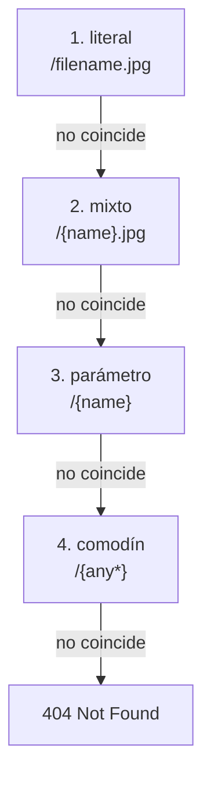

<TutorialLang />

# Enrutamiento

_Este tutorial es compatible con hapi v21 y versiones posteriores_

## <a name="overview"></a> Introducción

Una ruta necesita tres cosas: un `method`, un `path` y un `handler`. Se añade con [`server.route()`](/api#server-route-route):

```ts
server.route({
    method: 'GET',
    path: '/',
    handler: (request, h) => {
        return 'Hello World!';
    },
});
```

`server.route()` también acepta un array de objetos de ruta, así que puedes registrar muchas rutas en una sola llamada.

## <a name="methods"></a> Métodos

`method` es cualquier método HTTP salvo `HEAD` (las rutas GET responden a las peticiones HEAD), un array de métodos, o `'*'` para todos ellos:

```ts
server.route({
    method: ['PUT', 'POST'],
    path: '/',
    handler: (request, h) => {
        return 'I did something!';
    },
});
```

Una ruta para `GET` también responde a las peticiones `HEAD`, así que nunca necesitas una ruta `HEAD` aparte.

## <a name="path"></a> Path

Encierra un segmento del path entre `{}` para capturarlo como parámetro con nombre. Su valor está disponible en `request.params`:

```ts
import * as Hoek from '@hapi/hoek';

server.route<{ Params: { user: string } }>({
    method: 'GET',
    path: '/hello/{user}',
    handler: (request, h) => {
        return `Hello ${Hoek.escapeHtml(request.params.user)}!`;
    },
});
```

Una petición a `/hello/ferris` responde `Hello ferris!`.

- hapi decodifica los valores de los parámetros como URI, así que `/hello/a%20b` da `request.params.user === 'a b'`.
- El valor viene directamente de la URL. Escápalo antes de meterlo en HTML, como hace arriba la llamada a `escapeHtml()` de [Hoek](/module/hoek), o valídalo con [joi](/tutorials/es_ES/validation).
- Desde hapi 21.4.10, los valores de `request.params` tienen tipo `unknown` por defecto. El argumento de tipo `server.route<{ Params: { user: string } }>()` declara la forma, de modo que `request.params.user` es un `string` en el handler. El mismo argumento de tipo acepta `Query`, `Payload`, `Headers` y las demás partes de la petición que se ven más abajo.

### <a name="optionalParameters"></a> Tipos de parámetros

| Path                | Coincide con                                  | `request.params`                    |
| ------------------- | --------------------------------------------- | ----------------------------------- |
| `/hello/{user}`     | `/hello/ferris`                               | `{ user: 'ferris' }`                |
| `/hello/{user?}`    | `/hello`, `/hello/ferris`                     | `{}` o `{ user: 'ferris' }`         |
| `/hello/{user*2}`   | `/hello/john/doe` (exactamente dos segmentos) | `{ user: 'john/doe' }`              |
| `/files/{path*}`    | `/files`, `/files/a`, `/files/a/b/c`          | `{}` o `{ path: 'a/b/c' }`          |
| `/{filename}.{ext}` | `/photo.jpg`                                  | `{ filename: 'photo', ext: 'jpg' }` |

Reglas que hapi aplica al añadir la ruta:

- `{user*}` y un parámetro opcional que ocupa todo el segmento, `{user?}`, tienen que ser el último segmento del path. `{user*2}` y un opcional que ocupa parte del segmento, como `/a{user?}/b`, pueden aparecer en cualquier sitio.
- Dos parámetros en un mismo segmento necesitan un separador literal entre ellos: `{filename}.{ext}` es válido, `{filename}{ext}` no.
- Un nombre de parámetro solo puede aparecer una vez por path.
- Dos rutas con el mismo método y un path equivalente entran en conflicto, y `server.route()` lanza una excepción. `/{name}` y `/{other}` son equivalentes.

### <a name="multiParameters"></a> Parámetros de varios segmentos

Un parámetro de varios segmentos contiene los segmentos que coinciden unidos con `/`, así que divídelo para obtener las partes:

```ts
server.route<{ Params: { user: string } }>({
    method: 'GET',
    path: '/hello/{user*2}',
    handler: (request, h) => {
        const [first, last] = request.params.user.split('/');

        return `Hello ${first} ${last}!`;
    },
});
```

Una petición a `/hello/john/doe` responde `Hello john doe!`.

### <a name="specificity"></a> Qué ruta gana

hapi no prueba las rutas en el orden en que las añadiste. Para cada segmento del path prueba los tipos de coincidencia del más específico al menos específico, y pasa al siguiente tipo cuando el resto del path no coincide:



Con estas cuatro rutas registradas:

| Petición        | Ruta que responde |
| --------------- | ----------------- |
| `/filename.jpg` | `/filename.jpg`   |
| `/photo.jpg`    | `/{name}.jpg`     |
| `/photo`        | `/{name}`         |
| `/a/b`          | `/{any*}`         |

Los paths distinguen entre mayúsculas y minúsculas por defecto: con las rutas anteriores, `/Filename.jpg` lo responde `/{name}.jpg`. Pon [`router.isCaseSensitive`](/api#server-options-router) a `false` en el servidor para cambiarlo.

## <a name="query"></a> Parámetros de query

`request.query` contiene la query string ya parseada. Para `/?name=ferris&location=chicago`:

```ts
server.route<{ Query: { name: string } }>({
    method: 'GET',
    path: '/',
    handler: (request, h) => {
        return `Hello ${request.query.name}!`;
    },
});
```

El parser integrado de hapi no entiende las claves anidadas: `/?foo[bar]=baz` da `{ 'foo[bar]': 'baz' }`. Para parsear claves anidadas, asigna a `query.parser` del servidor un parser como [qs](https://github.com/ljharb/qs):

```ts
import Hapi from '@hapi/hapi';
import Qs from 'qs';

const server = Hapi.server({
    port: 3000,
    host: 'localhost',
    query: {
        parser: (query) => Qs.parse(query),
    },
});

server.route({
    method: 'GET',
    path: '/',
    handler: (request, h) => {
        return request.query;
    },
});

await server.start();
console.log('Server running on %s', server.info.uri);
```

Ahora `/?foo[bar]=baz` responde `{ "foo": { "bar": "baz" } }`. El parser recibe la query que hapi ya ha parseado, como `{ 'foo[bar]': 'baz' }`, no el string original. Sirve cualquier función, siempre que devuelva un objeto que asocie nombres de parámetro con valores.

## <a name="requestpayload"></a> Payload de la petición

El cuerpo de la petición ya parseado está en `request.payload`. hapi parsea cuerpos JSON, de formulario y de texto según la cabecera `Content-Type`. Los cuerpos multipart necesitan la opción de ruta `payload: { multipart: true }`; sin ella reciben un `415 Unsupported Media Type`:

```ts
server.route<{ Payload: { username: string; password: string } }>({
    method: 'POST',
    path: '/signup',
    handler: (request, h) => {
        return `Welcome ${request.payload.username}!`;
    },
});
```

El argumento de tipo solo le indica la forma a TypeScript. Nada lo comprueba en tiempo de ejecución hasta que añades [validación del payload](/tutorials/es_ES/validation).

## <a name="handler"></a> Handler

El handler recibe dos argumentos:

- `request` contiene todo lo relativo a la petición entrante: `params`, `query`, `payload`, `headers`, `auth` y más. Consulta el [objeto request](/api#request).
- `h` es el [response toolkit](/api#response-toolkit), con métodos como `h.response()` y `h.redirect()`.

Lo que devuelve el handler se convierte en la respuesta:

| El handler devuelve                          | Respuesta                                                                    |
| -------------------------------------------- | ---------------------------------------------------------------------------- |
| un string                                    | `200`, `text/html; charset=utf-8`                                            |
| un objeto o array                            | `200`, `application/json; charset=utf-8`                                     |
| un `Buffer`                                  | `200`, `application/octet-stream`                                            |
| un stream legible                            | `200`, el stream se envía al cliente                                         |
| `h.response(value)` con llamadas encadenadas | control total, por ejemplo `h.response('created').code(201)`                 |
| un error lanzado                             | una respuesta de error, `500` salvo que sea un error de [boom](/module/boom) |

Un handler tiene que devolver un valor o una promesa, o lanzar una excepción. [Serialización de respuestas](/tutorials/es_ES/response-marshalling) explica cómo convierte hapi estos valores en los bytes que envía.

Las funciones flecha no pueden usar `this`, así que un handler escrito como función flecha lee el valor que fija [`server.bind()`](/api#server-bind-context) desde [`h.context`](/api#h-context).

## <a name="options"></a> Opciones

Todo lo que va más allá de method, path y handler se pone en las `options` de la ruta:

```ts
import Joi from 'joi';

server.route<{ Payload: { username: string; password: string } }>({
    method: 'POST',
    path: '/signup',
    options: {
        auth: false,
        validate: {
            payload: Joi.object({
                username: Joi.string().min(1).max(20).required(),
                password: Joi.string().min(7).required(),
            }),
        },
    },
    handler: (request, h) => {
        return `Welcome ${request.payload.username}!`;
    },
});
```

| Opción     | Qué controla                                         | Más información                                              |
| ---------- | ---------------------------------------------------- | ------------------------------------------------------------ |
| `auth`     | qué strategy de autenticación se aplica              | [Autenticación](/tutorials/es_ES/auth)                       |
| `validate` | comprobaciones de params, query, payload y cabeceras | [Validación](/tutorials/es_ES/validation)                    |
| `cache`    | cabeceras `Cache-Control` de la respuesta            | [Caché](/tutorials/es_ES/caching)                            |
| `payload`  | parseo del cuerpo, límites de tamaño, subidas        | [opciones de payload de la ruta](/api#route-options-payload) |
| `pre`      | métodos que se ejecutan antes del handler            | [opciones pre de la ruta](/api#route-options-pre)            |
| `ext`      | hooks del ciclo de vida solo para esta ruta          | [Hooks del ciclo de vida](/tutorials/es_ES/lifecycle-hooks)  |

La lista completa está en la [referencia de opciones de ruta](/api#route-options).

## <a name="missing"></a> Gestión de los 404

Cuando ninguna ruta coincide, hapi responde con un error `404` en JSON. Para enviar tu propia respuesta, añade una ruta comodín. El comodín `{any*}` es la coincidencia menos específica, así que solo responde a las peticiones que ninguna otra ruta atiende:

```ts
server.route({
    method: '*',
    path: '/{any*}',
    handler: (request, h) => {
        return h.response('404 Error! Page Not Found!').code(404);
    },
});
```

La ruta comodín solo cubre los paths sin coincidencia. Un `404` lanzado por una ruta que sí coincide, como un handler que lanza `Boom.notFound()`, nunca llega a ella. Para personalizar todos los `404`, los produzca lo que los produzca, cambia la respuesta en un hook `onPreResponse`; consulta [Hooks del ciclo de vida](/tutorials/es_ES/lifecycle-hooks).
