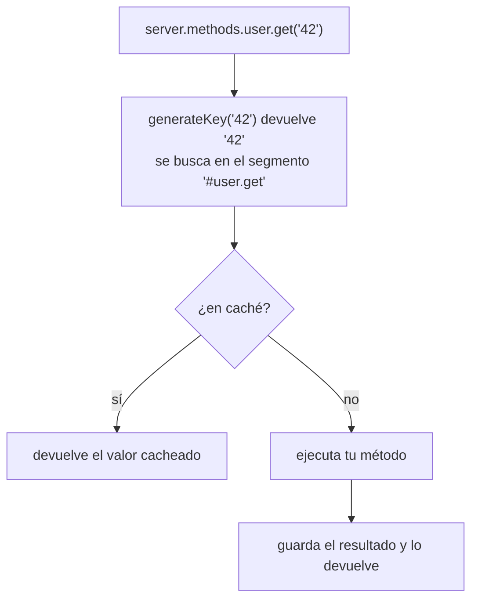

<TutorialLang />

# Métodos de servidor

_Este tutorial es compatible con hapi v21 y versiones posteriores_

## <a name="overview"></a> Introducción

Un método de servidor (server method) es una función que registras en el servidor con [`server.method()`](/api#server-method-name-method-options) y que puedes llamar desde cualquier sitio que tenga acceso al servidor: handlers de rutas, plugins, extensiones. Úsalo cuando:

- varias rutas o plugins necesitan la misma función y no quieres que cada uno la importe.
- la función es costosa y su resultado se puede cachear. Una sola opción activa la [caché](/tutorials/es_ES/caching) de hapi para ella.

```ts
import Hapi from '@hapi/hapi';

declare module '@hapi/hapi' {
    interface ServerMethods {
        add: (x: number, y: number) => number;
    }
}

const server = Hapi.server({ port: 3000 });

server.method('add', (x: number, y: number) => x + y);

server.route({
    method: 'GET',
    path: '/',
    handler: (request, h) => {
        return { sum: request.server.methods.add(1, 2) };
    },
});

await server.start();
```

- `server.methods.add` es la función registrada. En un handler, `request.server.methods` llega a ella sin necesidad de tener la variable `server` en el ámbito.
- hapi no sabe qué métodos registras, así que TypeScript necesita que estén en la interfaz `ServerMethods` de hapi. El bloque `declare module` puede estar en cualquier módulo de tu proyecto.
- Los métodos son globales para el servidor: un método registrado dentro de un plugin está disponible para todos los demás plugins y rutas.

## <a name="server.method"></a> server.method()

`server.method()` acepta argumentos posicionales o un único objeto (o un array de objetos, para registrar varios a la vez):

```ts
server.method('add', add, {});

server.method({
    name: 'add',
    method: add,
    options: {},
});
```

### <a name="name"></a> Nombre

Un nombre con puntos registra un método anidado:

```ts
server.method('math.add', add);

server.methods.math.add(1, 2);
```

Decláralo como un objeto anidado en `ServerMethods`: `math: { add: (x: number, y: number) => number }`. Cada segmento del nombre tiene que ser un identificador de JavaScript válido.

### <a name="method"></a> Método

El método puede recibir cualquier argumento y puede ser `async`. Devuelve el resultado o lanza un error.

```ts
server.method('user.get', async (id: string) => {
    return await db.users.findById(id);
});
```

## <a name="options"></a> Opciones

| Opción                | Úsala para                                                                             |
| --------------------- | -------------------------------------------------------------------------------------- |
| [`cache`](#cache)     | cachear los resultados del método                                                      |
| [`generateKey`](#key) | construir la clave de caché cuando los argumentos no son strings, números ni booleanos |
| [`bind`](#bind)       | fijar `this` dentro del método                                                         |

### <a name="cache"></a> Caché

Con la opción `cache`, llamar al método pasa primero por una caché:



```ts
server.method('user.get', getUser, {
    cache: {
        expiresIn: 60 * 1000,
        staleIn: 30 * 1000,
        staleTimeout: 100,
        generateTimeout: 2000,
    },
});
```

Lo que debes saber:

- `generateTimeout` es obligatorio. Es el tiempo que espera quien llama a tu método antes de recibir un `503`.
- Un método cacheado siempre devuelve una promesa, aunque el método en sí sea síncrono. Decláralo en `ServerMethods` con un tipo de retorno `Promise` y usa `await`.
- hapi guarda los elementos en un segmento llamado `'#'` más el nombre del método. Pon `cache: 'my_cache'` para usar un [cliente de caché con nombre](/tutorials/es_ES/caching#client) en lugar de la caché en memoria por defecto.
- Las demás opciones (`expiresAt`, `staleIn`, `staleTimeout`, `segment`) son las mismas que las de [`server.cache()`](/api#server-cache-options). El [tutorial de caché](/tutorials/es_ES/caching#stale) muestra cómo se sirven los valores caducados (stale).

#### <a name="changing-the-ttl-per-result"></a> Cambiar el TTL de cada resultado

hapi pasa un argumento extra después de los tuyos: un objeto `flags`. Pon `flags.ttl` para cambiar cuánto tiempo se cachea ese resultado concreto, o a `0` para no cachearlo:

```ts
const getUser = async function (id: string, flags: { ttl: number }) {
    const user = await db.users.findById(id);
    if (!user) {
        flags.ttl = 0; // don't cache "not found"
    }

    return user;
};
```

hapi no exporta un tipo para `flags`, así que el ejemplo lo tipa en línea.

#### <a name="removing-a-cached-result"></a> Eliminar un resultado cacheado

Todo método cacheado tiene una función `cache.drop()`. Llámala con los mismos argumentos para eliminar ese resultado, por ejemplo después de una actualización:

```ts
await db.users.update(id, changes);
await server.methods.user.get.cache?.drop(id);
```

hapi tipa `cache` como opcional porque los métodos sin caché no la tienen; de ahí el `?.`.

### <a name="key"></a> Generar una clave personalizada

hapi construye la clave de caché uniendo los argumentos con `:`, lo que solo funciona con strings, números y booleanos. Llamar a un método cacheado con cualquier otro tipo de argumento falla con un error `500`. Proporciona `generateKey` para otros argumentos:

```ts
const sum = function (numbers: number[]) {
    return numbers.reduce((total, item) => total + item, 0);
};

server.method('sum', sum, {
    cache: {
        expiresIn: 60 * 1000,
        generateTimeout: 100,
    },
    generateKey: (numbers: number[]) => numbers.join(','),
});
```

`generateKey` recibe los mismos argumentos que el método y tiene que devolver un string.

### <a name="bind"></a> Bind

`bind` fija `this` dentro del método. Úsalo para pasarle al método una dependencia, como un cliente de base de datos, sin añadirla a los argumentos (donde además pasaría a formar parte de la clave de caché):

```ts
const lookup = async function (this: typeof db, id: string) {
    return await this.users.findById(id);
};

server.method('lookup', lookup, { bind: db });
```

- El parámetro `this` de TypeScript declara el tipo de `this`. Se elimina al compilar y no es uno de los argumentos del método.
- `bind` no tiene efecto en las funciones flecha, que conservan su propio `this`.
- Sin `bind`, `this` es el contexto fijado con [`server.bind()`](/api#server-bind-context) en el plugin o servidor actual.

## <a name="server.methods"></a> server.methods

Todos los métodos registrados están en [`server.methods`](/api#server-methods), que también está disponible como `request.server.methods` en los handlers:

```ts
server.route<{ Params: { id: string } }>({
    method: 'GET',
    path: '/users/{id}',
    handler: async (request, h) => {
        return await request.server.methods.user.get(request.params.id);
    },
});
```

Cada método usado en este tutorial necesita una entrada en `ServerMethods`. Envuelve los métodos cacheados en el tipo `CachedServerMethod` de hapi, que añade `cache.drop()` y `cache.stats`:

```ts
import type { CachedServerMethod } from '@hapi/hapi';

declare module '@hapi/hapi' {
    interface ServerMethods {
        add: (x: number, y: number) => number;
        math: {
            add: (x: number, y: number) => number;
        };
        lookup: (id: string) => Promise<User | null>;
        sum: CachedServerMethod<(numbers: number[]) => Promise<number>>;
        user: {
            get: CachedServerMethod<(id: string) => Promise<User | null>>;
        };
    }
}
```
