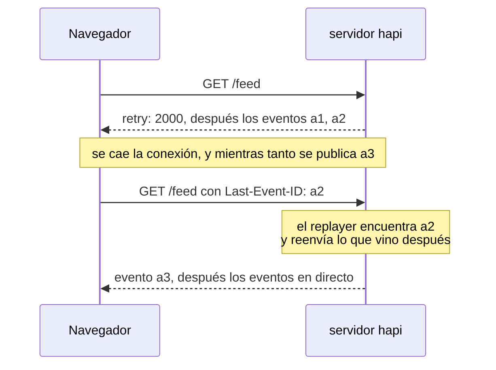
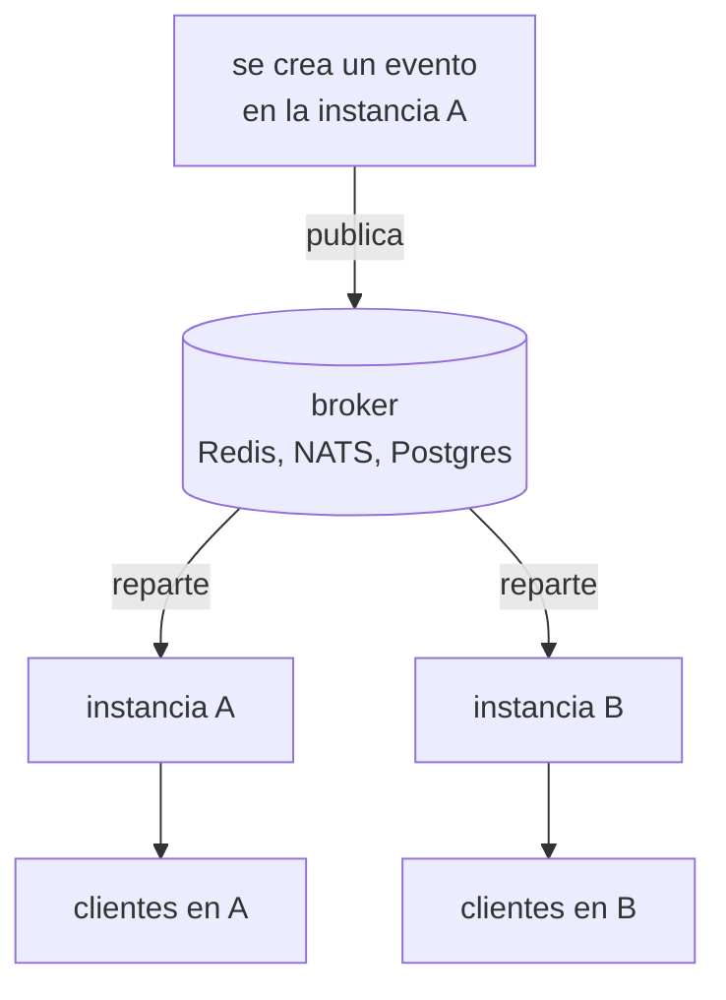

<TutorialLang />

# Server-Sent Events

_Este tutorial es compatible con hapi v21 y versiones posteriores_

## <a name="overview"></a> Introducción

Server-Sent Events (SSE) es una forma de que el servidor envíe un stream de eventos al cliente a través de una única respuesta HTTP normal. El navegador lo abre con la API `EventSource` integrada, que además se reconecta por sí sola cuando se cae la conexión. [@hapi/sse](/module/sse) añade SSE a hapi.

## <a name="when"></a> Cuándo usar SSE

|                              | SSE                                                                | [WebSockets](/tutorials/es_ES/websockets)                                                                            | Polling                                   |
| ---------------------------- | ------------------------------------------------------------------ | -------------------------------------------------------------------------------------------------------------------- | ----------------------------------------- |
| Dirección                    | solo del servidor al cliente                                       | en ambos sentidos                                                                                                    | el cliente pregunta, el servidor responde |
| Transporte                   | una respuesta HTTP normal                                          | un upgrade de protocolo                                                                                              | peticiones HTTP normales                  |
| Reconexión                   | integrada en `EventSource`, continúa desde el id del último evento | el cliente de nes se reconecta y vuelve a suscribirse; los mensajes enviados mientras estaba desconectado se pierden | no hace falta                             |
| Funciona a través de proxies | sí, con el buffering desactivado                                   | el proxy tiene que admitir upgrades                                                                                  | sí                                        |
| Latencia                     | inmediata                                                          | inmediata                                                                                                            | hasta el intervalo de polling             |

Elige SSE cuando el servidor tiene novedades y el cliente solo escucha: el progreso de un trabajo, notificaciones, dashboards en directo, el final de un log y la salida token a token de un modelo de IA. Cuando el cliente también necesita enviar un flujo constante de mensajes, usa WebSockets. Un cliente que solo envía de vez en cuando puede usar SSE para el stream y peticiones `POST` normales para lo demás.

## <a name="setup"></a> Configuración inicial

```sh
npm install @hapi/sse
```

```ts
import Hapi from '@hapi/hapi';
import { SsePlugin } from '@hapi/sse';

const server = Hapi.server({ port: 3000 });

await server.register(SsePlugin);
```

El plugin te da dos formas de abrir un stream:

| Uso                           | Modo handler: `handler: { sse: { stream } }`                       | Suscripciones: `server.sse.subscription()`           |
| ----------------------------- | ------------------------------------------------------------------ | ---------------------------------------------------- |
| Quién produce los eventos     | tu función `stream`, para esa única conexión                       | cualquier código, mediante `server.sse.publish()`    |
| Stream típico                 | el progreso de un trabajo, una respuesta de IA, el final de un log | notificaciones, un feed en directo, una sala de chat |
| Eventos por conexión          | distintos para cada cliente                                        | el mismo evento llega a todos los suscriptores       |
| Continuar tras una reconexión | lees `session.lastEventId` y continúas                             | un replayer reenvía lo que el cliente se perdió      |

## <a name="handler"></a> Modo handler: un stream por petición

Una ruta con el handler `sse` ejecuta tu función `stream` una vez por conexión. Todo lo que envías con `push()` llega al cliente en el momento:

```ts
server.route({
    method: 'GET',
    path: '/jobs/{id}/progress',
    handler: {
        sse: {
            stream: async (request, session) => {
                for await (const update of watchJob(String(request.params.id))) {
                    session.push(update, 'progress', String(update.percent));
                }

                await session.complete();
            },
        },
    },
});
```

Cada `push(data, event, id)` se convierte en un evento en la conexión. Los objetos se envían como JSON:

```text
event: progress
id: 50
data: {"percent":50}
```

`complete()` envía un último evento `complete` y termina la respuesta. Terminar la respuesta no basta para detener a un navegador, porque `EventSource` trata cada conexión cerrada como una conexión caída y se reconecta. El cliente tiene que cerrar la conexión él mismo cuando ve `complete`:

```ts
const source = new EventSource('/jobs/7/progress');

source.addEventListener('progress', (event) => {
    const { percent } = JSON.parse(event.data);
    console.log(`${percent}%`);
});

source.addEventListener('complete', () => source.close());
```

Sin el `close()`, el navegador se reconecta tras el tiempo de `retry` y el stream vuelve a empezar.

Node.js no tiene un `EventSource` global salvo que lo arranques con `--experimental-eventsource`. En Node, usa ese flag o el paquete [`eventsource`](https://www.npmjs.com/package/eventsource); el código del cliente es el mismo que en el navegador.

## <a name="subscriptions"></a> Suscripciones: un evento para muchos clientes

Una suscripción es una ruta a la que se conectan los clientes y en la que publica tu código. El path puede tener parámetros, así que cada usuario o sala tiene su propio stream:

```ts
import Joi from 'joi';

server.sse.subscription('/rooms/{room}/messages');

server.route<{ Params: { room: string }; Payload: { text: string } }>({
    method: 'POST',
    path: '/rooms/{room}/messages',
    options: {
        validate: {
            params: Joi.object({ room: Joi.string().alphanum().max(50).required() }),
            payload: Joi.object({ text: Joi.string().max(2000).required() }),
        },
    },
    handler: async (request, h) => {
        const message = { text: request.payload.text, at: new Date().toISOString() };
        const delivered = await server.sse.publish(`/rooms/${request.params.room}/messages`, message, {
            event: 'message',
            matchMode: 'literal',
        });

        return { delivered };
    },
});
```

- `matchMode: 'literal'` envía el evento solo a los clientes de ese path exacto, así que un mensaje enviado a `/rooms/lobby/messages` llega al lobby y a ninguna otra sala. Consulta [`server.sse.publish()`](/module/sse#server-sse-publish-path-data-opts).
- La ruta publica solo los campos que ha [validado](/tutorials/es_ES/validation), nunca el payload tal cual. Dale la misma [autenticación de ruta](/tutorials/es_ES/auth) que a cualquier ruta que escribe datos.
- `publish()` devuelve el número de clientes a los que se entregó el evento.

Las suscripciones también aceptan `filter`, `onSubscribe`, `refuse` y `maxSessions`; consulta [`server.sse.subscription()`](/module/sse#server-sse-subscription-path-config).

## <a name="reconnect"></a> Reconexiones y `Last-Event-ID`

Cuando se cae una conexión, el navegador espera el tiempo de `retry` que le envió el servidor y después se reconecta con el id del último evento que recibió en una cabecera `Last-Event-ID`:



El navegador envía la cabecera, pero solo tu servidor puede actuar en consecuencia, y los dos modos funcionan distinto:

- **Suscripciones:** dale a la suscripción un replayer, que guarda los eventos recientes en memoria y reenvía todo lo posterior al último id del cliente. Un replayer guarda un único historial para toda la suscripción, compartido por todos los paths y todos los clientes, así que úsalo en suscripciones sin parámetros en el path, como un `/feed` público. Para streams por usuario o por sala, continúa a partir de tu base de datos, como en el modo handler.

    ```ts
    import { FiniteReplayer } from '@hapi/sse';

    server.sse.subscription('/feed', {
        replay: new FiniteReplayer({ size: 100 }),
    });

    await server.sse.publish('/feed', item, { event: 'news', id: item.id });
    ```

- **Modo handler:** lee `session.lastEventId` en `stream` y continúa desde ahí, por ejemplo consultando en tu base de datos las filas posteriores a ese id.

Si el último id del cliente ya no está en el buffer, por ejemplo después de reiniciar el servidor, el replayer reenvía todo lo que tiene, así que dale a tus eventos ids que el cliente pueda usar para descartar duplicados. [Event replay](/module/sse#event-replay) describe lo que guarda cada replayer. Los buffers de replay viven en la memoria de un único proceso; consulta [Escalar a varias instancias](#scaling).

## <a name="disconnect"></a> Limpiar cuando termina un stream

Un stream sigue abierto hasta que uno de los dos lados lo cierra, así que todo lo que arranques para una conexión debe detenerse cuando termina el stream, tanto si el cliente se fue como si el stream se completó o el servidor se está apagando:

```ts
import type { Session } from '@hapi/sse';

const openStreams = new Map<Session, () => void>();

server.route({
    method: 'GET',
    path: '/jobs/{id}/progress',
    handler: {
        sse: {
            stream: async (request, session) => {
                const watcher = watchJob(String(request.params.id));
                openStreams.set(session, () => watcher.stop());
                request.events.once('disconnect', () => watcher.stop());

                try {
                    for await (const update of watcher) {
                        session.push(update, 'progress', String(update.percent));
                    }

                    if (session.isOpen) {
                        await session.complete();
                    }
                } finally {
                    watcher.stop();
                    openStreams.delete(session);
                }
            },
        },
    },
});

server.ext('onPreStop', () => {
    for (const [session, stop] of openStreams) {
        stop();
        session.close();
    }
});
```

- **El cliente se va:** `request.events` emite `'disconnect'`, que detiene el watcher y termina el bucle.
- **El stream termina en el servidor:** se ejecuta el bloque `finally`, así que el `Map` nunca guarda un stream terminado.
- **El servidor se apaga:** el [hook del servidor](/tutorials/es_ES/lifecycle-hooks#server-hooks) `onPreStop` detiene todos los watchers y cierra todos los streams, así que `server.stop()` termina sin esperar a que se agote su `timeout`.
- **Suscripciones:** usa el `onUnsubscribe` de la suscripción, o el hook `onSessionClose` del plugin para todos los streams de suscripción. El plugin quita al cliente de la suscripción por sí solo.

## <a name="proxies"></a> Proxies, buffering y timeouts de inactividad

La mayoría de los problemas de SSE en producción vienen de algo entre el servidor y el navegador que retiene los eventos o cierra una conexión sin tráfico. El plugin resuelve una parte:

| Problema                                                                            | Qué hace el plugin                                        | Qué haces tú                                                                                     |
| ----------------------------------------------------------------------------------- | --------------------------------------------------------- | ------------------------------------------------------------------------------------------------ |
| Un proxy hace buffering de la respuesta y entrega los eventos a ráfagas             | envía `X-Accel-Buffering: no` y `Cache-Control: no-cache` | desactivar el buffering de respuestas en los proxies que no respetan esas cabeceras              |
| La compresión retiene los eventos hasta acumular suficientes bytes                  | vacía gzip y deflate después de cada escritura            | nada; los eventos llegan uno a uno aunque vayan comprimidos                                      |
| Un balanceador de carga o un proxy cierra las conexiones inactivas demasiado tiempo | envía una línea de comentario `:` cada 15 segundos        | mantener `keepAlive.interval` por debajo del timeout de inactividad más corto del camino         |
| Los navegadores solo permiten 6 conexiones HTTP/1.1 por dominio                     | nada                                                      | servir el sitio por HTTP/2, normalmente en el proxy, para que los streams compartan una conexión |

## <a name="auth"></a> Autenticación

Un stream SSE es una ruta normal de hapi, así que se aplica la [autenticación de ruta](/tutorials/es_ES/auth) de siempre, scopes incluidos. En las suscripciones, pásala en la opción `auth`:

```ts
server.sse.subscription('/users/{userId}/notifications', {
    auth: { strategy: 'session', access: { scope: 'user-{params.userId}' } },
});

await server.sse.publish(`/users/${userId}/notifications`, notification, {
    event: 'notification',
    matchMode: 'literal',
});
```

Con el scope `user-{params.userId}`, un usuario solo puede abrir su propio stream de notificaciones; cualquier otro recibe un `403`. Consulta [Scopes](/tutorials/es_ES/auth#scopes). Publica con `matchMode: 'literal'` para que cada notificación llegue solo al stream de su usuario.

`EventSource` no puede poner cabeceras en la petición, así que un bearer token en `Authorization` no es una opción. Las alternativas:

| Enfoque                                | Ventaja                                            | Cuidado con                                                                                                                |
| -------------------------------------- | -------------------------------------------------- | -------------------------------------------------------------------------------------------------------------------------- |
| Sesión con cookie, como `@hapi/cookie` | el navegador la envía, también en las reconexiones | los streams de otro origen necesitan `new EventSource(url, { withCredentials: true })` y CORS con credenciales             |
| Token en la query string               | funciona con cualquier cliente                     | las URL acaban en los logs de acceso del servidor y del proxy; usa un token de corta duración creado solo para este stream |
| `fetch()` con un body en streaming     | puede enviar cualquier cabecera                    | pierdes la reconexión y la gestión de `Last-Event-ID` de `EventSource` y tienes que escribirlas tú                         |

Para una app de navegador en tu propio dominio, una cookie es la opción más sencilla.

## <a name="scaling"></a> Escalar a varias instancias

Dos instancias del servidor no comparten memoria. Un stream SSE es una conexión abierta que mantiene un proceso: un cliente conectado a la instancia A solo existe en A, y la instancia B no tiene forma de escribir en él. Un evento publicado en A solo llega a los clientes de A. Esto vale para cualquier librería de SSE y cualquier proveedor de hosting: cada proceso solo puede escribir en las conexiones que tiene.

Los clientes conectados, los buffers de replay y, por defecto, el registro de streams completados viven en esa memoria de cada proceso. Escalar a varias instancias requiere pasar mensajes entre ellas. Un backend de pub/sub como Redis, NATS o `LISTEN`/`NOTIFY` de Postgres reparte cada evento a todas las instancias, y cada instancia lo escribe en sus propios streams abiertos:



Con Redis:

```ts
import { createClient } from 'redis';

interface RoomMessage {
    room: string;
    text: string;
    at: string;
}

const publisher = createClient({ url: process.env.REDIS_URL });
const subscriber = publisher.duplicate();
publisher.on('error', (err) => server.log(['redis', 'error'], err));
subscriber.on('error', (err) => server.log(['redis', 'error'], err));
await Promise.all([publisher.connect(), subscriber.connect()]);

await subscriber.subscribe('rooms', async (raw) => {
    const message: RoomMessage = JSON.parse(raw);
    await server.sse.publish(`/rooms/${message.room}/messages`, message, { event: 'message', matchMode: 'literal' });
});

const publishToRoom = async (message: RoomMessage) => {
    await publisher.publish('rooms', JSON.stringify(message));
};
```

La ruta `POST` llama a `publishToRoom()` en lugar de a `server.sse.publish()`, y todas las instancias, incluida la que atendió la petición, publican en sus propios streams.

- Con el broker en marcha, todas las instancias publican todos los eventos, así que el replayer de cada instancia guarda el mismo historial y un cliente que se reconecta puede continuar en cualquier instancia. Solo faltan los eventos anteriores al arranque de una instancia, y eso ya lo cubren los ids que permiten descartar duplicados de [Reconexiones](#reconnect).
- Apunta la opción `completion.cache` del plugin a una caché compartida, como catbox-redis, para que todas las instancias reconozcan un stream de suscripción completado.
- `maxDuration` cierra cada stream pasado un tiempo fijo (con jitter), y el cliente se reconecta. Así los streams de larga duración se vuelven a repartir cuando añades instancias, en lugar de quedarse en las antiguas.

## <a name="next"></a> Siguientes pasos

- [Referencia de la API de @hapi/sse](/module/sse): todas las opciones, `Session`, los replayers, la [backpressure](/module/sse#backpressure) para clientes lentos y las [defensas de seguridad integradas](/module/sse#security).
- [WebSockets](/tutorials/es_ES/websockets) cuando el cliente también necesita enviar mensajes.
- [Hooks del ciclo de vida](/tutorials/es_ES/lifecycle-hooks) para `onPreStop` y los demás hooks del servidor.
