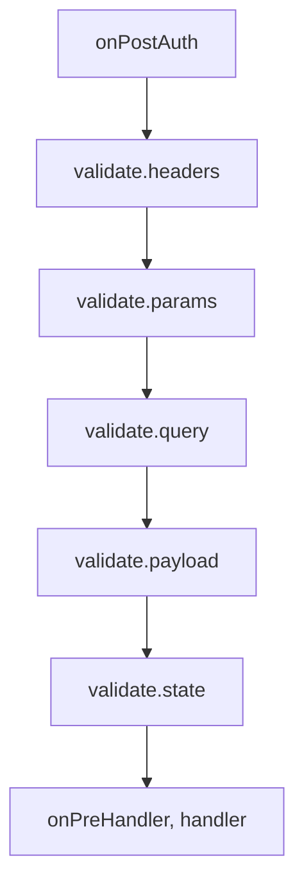

<TutorialLang />

# Validación

_Este tutorial es compatible con hapi v21 y versiones posteriores, y con joi v16 y versiones posteriores_

## <a name="overview"></a> Introducción

hapi comprueba las cabeceras, los parámetros del path, la query, el payload y las cookies de una petición antes de que se ejecute tu handler, y puede comprobar la respuesta antes de enviarla. Tú describes lo que está permitido, normalmente con un esquema de [joi](https://joi.dev), y hapi rechaza todo lo demás.

## <a name="joi"></a> Joi

Instala joi e impórtalo:

```sh
npm install joi
```

```ts
import Joi from 'joi';
```

joi incluye sus propios tipos de TypeScript, así que no hay que instalar un paquete `@types` aparte.

## <a name="input"></a> Validación de la entrada

Las reglas de entrada van en `options.validate` de la ruta. hapi las ejecuta en este orden, después de la autenticación y antes del handler, y se detiene en la primera que falla (consulta [failAction](#failaction)):



| Clave     | Valida                    | Se sustituye si es válido |
| --------- | ------------------------- | ------------------------- |
| `headers` | `request.headers`         | `request.headers`         |
| `params`  | `request.params`          | `request.params`          |
| `query`   | `request.query`           | `request.query`           |
| `payload` | `request.payload`         | `request.payload`         |
| `state`   | `request.state` (cookies) | `request.state`           |

Cada clave acepta:

| Valor                               | Significado                                                                                     |
| ----------------------------------- | ----------------------------------------------------------------------------------------------- |
| `true` o sin definir (por defecto)  | se permite cualquier cosa                                                                       |
| `false`                             | no se permite ningún valor                                                                      |
| un esquema de joi                   | el valor tiene que cumplir el esquema                                                           |
| una función                         | tu propio validador; consulta [Validadores personalizados](#alternatives)                       |
| un objeto simple de esquemas de joi | solo se permite después de `server.validator(Joi)`; si no, `server.route()` lanza una excepción |

La validación sustituye el valor de la petición por el validado, así que las conversiones de tipo y los valores por defecto de joi llegan a tu handler. Una query `?limit=5` llega como el string `'5'`, y después de `Joi.number()` el handler ve el número `5`. El valor original se queda en [`request.orig`](/api#request-orig).

### <a name="pathparams"></a> Parámetros del path

```ts
server.route<{ Params: { name: string } }>({
    method: 'GET',
    path: '/hello/{name}',
    handler: (request, h) => {
        return `Hello ${request.params.name}!`;
    },
    options: {
        validate: {
            params: Joi.object({
                name: Joi.string().min(3).max(10),
            }),
        },
    },
});
```

`/hello/jennifer` responde `Hello jennifer!`. `/hello/a` y `/hello/thisnameiswaytoolong` responden:

```json
{
    "statusCode": 400,
    "error": "Bad Request",
    "message": "Invalid request params input"
}
```

### <a name="queryparams"></a> Parámetros de query

```ts
server.route<{ Query: { limit: number } }>({
    method: 'GET',
    path: '/posts',
    handler: (request, h) => {
        return posts.slice(0, request.query.limit);
    },
    options: {
        validate: {
            query: Joi.object({
                limit: Joi.number().integer().min(1).max(100).default(10),
            }),
        },
    },
});
```

- `limit` tiene que ser un entero entre 1 y 100, y vale 10 por defecto cuando el cliente no lo envía.
- `/posts?limit=15&offset=15` falla con un `400`: un esquema `Joi.object()` rechaza las claves que no enumera. Enumera todos los parámetros que aceptas, o añade `.unknown()` al esquema para dejar pasar otras claves.
- El argumento de tipo `Query: { limit: number }` le dice a TypeScript qué recibe el handler. hapi no lo infiere del esquema de joi, así que tienes que mantener ambos sincronizados tú mismo.

### <a name="payloadparams"></a> Payload

```ts
server.route({
    method: 'POST',
    path: '/post',
    handler: (request, h) => {
        return 'Blog post added';
    },
    options: {
        validate: {
            payload: Joi.object({
                post: Joi.string().min(1).max(140),
                date: Joi.date().required(),
            }),
        },
    },
});
```

`post` tiene que tener entre 1 y 140 caracteres, y `date` es obligatorio y tiene que ser algo que JavaScript pueda interpretar como fecha, como `'2026-10-25'`. joi lo convierte, así que el handler recibe un objeto `Date`. Un fallo responde `400` con el mensaje `Invalid request payload input`.

### <a name="headers"></a> Cabeceras

```ts
server.route({
    method: 'GET',
    path: '/hello/{name}',
    handler: (request, h) => {
        return `Hello ${request.params.name}!`;
    },
    options: {
        validate: {
            headers: Joi.object({
                cookie: Joi.string().required(),
            }),
            options: {
                allowUnknown: true,
            },
        },
    },
});
```

Los navegadores y los proxies añaden muchas cabeceras, así que los esquemas de cabeceras casi siempre necesitan `allowUnknown: true`. `validate.options` pasa opciones de joi a todos los esquemas de entrada de la ruta. Los nombres de las cabeceras están en minúsculas en `request.headers`, así que escríbelos en minúsculas en el esquema.

### <a name="failaction"></a> Cuando la validación falla

`validate.failAction` decide qué pasa:

| `failAction`            | Resultado                                                                                              |
| ----------------------- | ------------------------------------------------------------------------------------------------------ |
| `'error'` (por defecto) | `400` con un mensaje genérico como `Invalid request query input`                                       |
| `'log'`                 | registra un evento `request` con las etiquetas `validation`, `error` y el origen, y ejecuta el handler |
| `'ignore'`              | ejecuta el handler                                                                                     |
| una función             | `(request, h, err)`: lanza un error o devuelve una respuesta takeover                                  |

Con `'log'` e `'ignore'` el handler recibe el valor original sin validar: `?limit=500` llega como el string `'500'`, no como un número.

El `400` por defecto oculta qué campo falló, para que los clientes no puedan sondear tus esquemas. Durante el desarrollo, o en una API cuyos clientes necesitan los detalles, vuelve a lanzar el error detallado desde una función `failAction`:

```ts
server.route({
    method: 'GET',
    path: '/posts',
    handler: (request, h) => posts,
    options: {
        validate: {
            query: Joi.object({
                limit: Joi.number().integer().max(100),
            }),
            failAction: (request, h, err) => {
                throw err;
            },
        },
    },
});
```

Ahora `/posts?limit=500` responde con el mensaje de joi y las claves que fallan:

```json
{
    "statusCode": 400,
    "error": "Bad Request",
    "message": "\"limit\" must be less than or equal to 100",
    "validation": { "source": "query", "keys": ["limit"] }
}
```

Para aplicar un mismo `failAction` a todas las rutas, defínelo en la opción `routes.validate` del servidor. Consulta [`failAction`](/api#failaction-configuration) en la referencia de la API.

## <a name="output"></a> Validación de la respuesta

`options.response` comprueba lo que devuelve el handler, después del handler y antes de `onPreResponse`. Úsalo para asegurarte de que un endpoint cumple su contrato documentado. Plugins como [hapi-swagger](https://github.com/glennjones/hapi-swagger) también leen estos esquemas para documentar la salida de cada endpoint.

```ts
const bookSchema = Joi.object({
    title: Joi.string().required(),
    author: Joi.string().required(),
    isbn: Joi.string().length(10),
    pageCount: Joi.number(),
    datePublished: Joi.date().iso(),
});

server.route({
    method: 'GET',
    path: '/books',
    handler: async (request, h) => {
        return await getBooks();
    },
    options: {
        response: {
            schema: Joi.array().items(bookSchema),
            failAction: 'log',
        },
    },
});
```

| Opción       | Qué hace                                                                                                                     |
| ------------ | ---------------------------------------------------------------------------------------------------------------------------- |
| `schema`     | regla para todas las respuestas, con los mismos valores que las reglas de entrada                                            |
| `status`     | reglas por código de estado, como `{ 201: created, 202: Joi.object({ original, updated }) }`; tiene prioridad sobre `schema` |
| `failAction` | `'error'` (por defecto) responde `500`; también `'log'`, `'ignore'` o una función                                            |
| `sample`     | porcentaje de respuestas que se validan, de `0` a `100`, para ahorrar CPU en rutas con mucho tráfico                         |
| `modify`     | con `true`, el valor validado sustituye a la respuesta, así que se aplican las conversiones de joi y `stripUnknown`          |
| `options`    | opciones de joi para estos esquemas, como `stripUnknown`                                                                     |

Lo que la validación de la respuesta omite o rechaza:

- Las respuestas de error (estado `400` o superior) no se validan, salvo que `status` tenga un esquema para ese código.
- Solo se pueden validar valores simples (objetos, arrays, strings). Una respuesta de stream o de fichero con un esquema de respuesta falla con un `500`.

`modify: true` con `stripUnknown: true` es una forma práctica de evitar que campos como los hashes de contraseñas se filtren desde un endpoint:

```ts
server.route({
    method: 'GET',
    path: '/me',
    handler: (request, h) => {
        return { id: '2133d32a', name: 'John Doe', passwordHash: '$2a$10$...' };
    },
    options: {
        response: {
            schema: Joi.object({
                id: Joi.string(),
                name: Joi.string(),
            }).options({ stripUnknown: true }),
            modify: true,
        },
    },
});
```

El cliente recibe `{ "id": "2133d32a", "name": "John Doe" }`.

## <a name="alternatives"></a> Validadores personalizados

Cualquier regla puede ser una función `async (value, options)` en lugar de un esquema de joi:

- Lanza un error para que la validación falle. `failAction` se encarga de él.
- Devuelve un valor para sustituir al que se está validando. El original se queda en `request.orig`.
- No devuelvas nada para dejar el valor como está.

```ts
server.route({
    method: 'GET',
    path: '/items',
    handler: (request, h) => request.query,
    options: {
        validate: {
            query: async (value) => {
                if (typeof value !== 'object' || value === null || !('ids' in value) || typeof value.ids !== 'string') {
                    throw new Error('ids is required');
                }

                return { ids: value.ids.split(',') };
            },
        },
    },
});
```

`/items?ids=1,2,3` responde `{ "ids": ["1", "2", "3"] }`. Un error lanzado se convierte en un `400`, igual que un fallo de joi.
