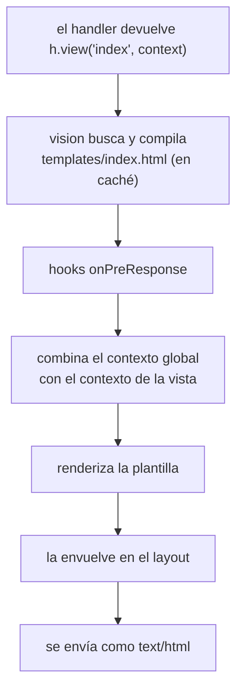

<TutorialLang />

# Vistas

_Este tutorial es compatible con hapi v21 y versiones posteriores_

## <a name="overview"></a> Introducción

hapi renderiza plantillas HTML a través del plugin [vision](/module/vision). Vision funciona con cualquier motor de plantillas que tenga una función `compile`, como handlebars, pug y ejs (los motores con un `compile` distinto, como nunjucks, necesitan el pequeño wrapper que se describe en [Motores](#engines)), y soporta partials, helpers y layouts.

## <a name="vision"></a> Vision

Instala vision y un motor:

```sh
npm install @hapi/vision handlebars
```

Al registrar vision se añade:

| Qué                                   | Para qué sirve                                                  |
| ------------------------------------- | --------------------------------------------------------------- |
| `server.views(options)`               | configurar motores, carpetas de plantillas y layouts            |
| `h.view(template, context)`           | renderizar una plantilla desde un handler                       |
| handler `view`                        | una ruta que solo renderiza una plantilla                       |
| `server.render()`, `request.render()` | renderizar una plantilla a un string, por ejemplo para un email |

Importar `@hapi/vision` también añade todo esto a los tipos de TypeScript de hapi. La API completa está en la [referencia de la API de vision](/module/vision).

## <a name="server"></a> Configurar el servidor

```ts
import Hapi from '@hapi/hapi';
import Vision from '@hapi/vision';
import Handlebars from 'handlebars';

const server = Hapi.server({ port: 3000 });

await server.register(Vision);

server.views({
    engines: {
        html: Handlebars,
    },
    relativeTo: import.meta.dirname,
    path: 'templates',
});

server.route({
    method: 'GET',
    path: '/',
    handler: (request, h) => {
        return h.view('index', { title: 'My home page' });
    },
});

await server.start();
```

- `engines` asocia una extensión de fichero con un motor: los ficheros que terminan en `.html` se renderizan con handlebars.
- `path` es la carpeta que contiene las plantillas, resuelta a partir de `relativeTo`. Los módulos ES no tienen `__dirname`; `import.meta.dirname` es la carpeta del fichero actual.
- `h.view('index', ...)` renderiza `templates/index.html`. Con un solo motor registrado, puedes omitir la extensión.

### <a name="lifecycle"></a> Cómo se renderiza una vista

`h.view()` no renderiza nada en el momento. Devuelve una respuesta de vista, y vision la renderiza cuando hapi envía la respuesta:



Lo que significa este orden en la práctica:

- Una plantilla que no existe falla con un `500` en cuanto el handler devuelve, antes de cualquier hook `onPreResponse`.
- Un hook `onPreResponse` se ejecuta antes del renderizado, así que todavía puede sustituir una vista por otra respuesta, como una página de error. Consulta [Páginas de error](#errors) más abajo.
- [Serialización de respuestas](/tutorials/es_ES/response-marshalling) explica esta separación entre preparar y renderizar para todos los tipos de respuesta.

## <a name="options"></a> Opciones de server.views()

| Opción                | Por defecto           | Efecto                                                                               |
| --------------------- | --------------------- | ------------------------------------------------------------------------------------ |
| `engines`             | obligatoria           | extensión a motor, como `{ html: Handlebars, pug: Pug }`                             |
| `path`                | ninguna               | carpeta (o array de carpetas) con las plantillas                                     |
| `relativeTo`          | directorio de trabajo | carpeta base para todas las demás opciones de rutas                                  |
| `partialsPath`        | ninguna               | carpeta con los partials                                                             |
| `helpersPath`         | ninguna               | carpeta con los módulos de helpers                                                   |
| `layout`              | `false`               | `true` para usar `layout.html`, o el nombre de otro fichero de layout                |
| `layoutPath`          | ninguna               | carpeta con los layouts                                                              |
| `context`             | ninguna               | contexto que se combina con todas las vistas; un objeto o una función de la petición |
| `isCached`            | `true`                | `false` lee y compila las plantillas en cada petición; útil en desarrollo            |
| `defaultExtension`    | el único motor        | extensión que se usa cuando `h.view()` recibe un nombre sin ella                     |
| `compileMode`         | `'sync'`              | `'async'` para los motores cuyo `compile` recibe un callback                         |
| `allowAbsolutePaths`  | `false`               | permite nombres de plantilla absolutos                                               |
| `allowInsecureAccess` | `false`               | permite `../` en los nombres de plantilla                                            |

Las opciones definidas en `server.views()` se aplican a todos los motores:

```ts
server.views({
    engines: { html: Handlebars },
    relativeTo: import.meta.dirname,
    path: 'templates',
    isCached: process.env.NODE_ENV === 'production',
});
```

Aquí las plantillas se cargan desde `templates/`, y fuera de producción vision las vuelve a leer y compilar en cada petición, así que los cambios en las plantillas se ven sin reiniciar.

### <a name="engines"></a> Motores

Un motor es cualquier objeto con una función `compile`:

| `compileMode`          | Firma de `compile`                            | Devuelve                                                                                                   |
| ---------------------- | --------------------------------------------- | ---------------------------------------------------------------------------------------------------------- |
| `'sync'` (por defecto) | `compile(template, compileOptions)`           | `render(context, runtimeOptions)`, que devuelve el HTML                                                    |
| `'async'`              | `compile(template, compileOptions, callback)` | llama a `callback(err, render)`; `render(context, runtimeOptions, callback)` llama a `callback(err, html)` |

`compileOptions` y `runtimeOptions` son opciones de `server.views()` que se pasan tal cual a tu motor. Un motor cuya API no encaja se puede envolver en un objeto con esta función `compile`.

Con más de un motor registrado, `h.view()` necesita la extensión (`h.view('index.pug')`), salvo que pongas en `defaultExtension` la que más uses.

### <a name="paths"></a> Rutas

Con esta estructura de carpetas:

```
templates/
    index.html
    layout/
        layout.html
    helpers/
        fortune.js
```

la configuración es:

```ts
server.views({
    engines: {
        html: Handlebars,
    },
    relativeTo: import.meta.dirname,
    path: 'templates',
    layoutPath: 'templates/layout',
    helpersPath: 'templates/helpers',
});
```

### <a name="global"></a> Contexto global

`context` se combina con el contexto de cada vista, y el contexto propio de la vista gana cuando ambos definen la misma clave. Pasa una función para calcularlo en cada petición, por ejemplo para mostrar el usuario con sesión iniciada en todas las páginas:

```ts
server.views({
    engines: {
        html: Handlebars,
    },
    relativeTo: import.meta.dirname,
    path: 'templates',
    context: (request) => ({
        siteName: 'My personal site',
        user: request?.auth.credentials?.user ?? null,
    }),
});
```

`request` es undefined cuando renderizas fuera de una petición con `server.render()`; por eso la función lo comprueba.

### <a name="helpers"></a> Helpers de vistas

En los motores que soportan helpers, como handlebars, cada módulo de `helpersPath` se convierte en un helper con el nombre de su fichero. Este helper, guardado como `templates/helpers/fortune.js`, devuelve una frase de la suerte al azar:

```js
export default function () {
    const fortunes = [
        'Heisenberg may have slept here...',
        'Wanna buy a duck?',
        'Say no, then negotiate.',
        'Time and tide wait for no man.',
        'To teach is to learn.',
        'Never ask the barber if you need a haircut.',
        'You will forget that you ever knew me.',
        'You will be run over by a beer truck.',
        'Fortune favors the lucky.',
        'Have a nice day!',
    ];

    const x = Math.floor(Math.random() * fortunes.length);
    return fortunes[x];
}
```

Los helpers siguen siendo ficheros JavaScript: vision los carga con `require()` y omite cualquier fichero cuya extensión Node.js no haya registrado en `require.extensions`, que no incluye `.ts`.

Úsalo en `templates/index.html`:

```html
<h1>Your fortune</h1>
<p>{{fortune}}</p>
```

### <a name="layouts"></a> Layouts

Los layouts de vision están desactivados por defecto, porque muchos motores tienen su propio sistema de layouts. Usa uno u otro. Para activar los de vision:

```ts
server.views({
    engines: {
        html: Handlebars,
    },
    relativeTo: import.meta.dirname,
    path: 'templates',
    layout: true,
    layoutPath: 'templates/layout',
});
```

`templates/layout/layout.html` marca con `content` dónde va cada vista:

```html
<html>
    <body>
        {{{content}}}
    </body>
</html>
```

y una vista contiene solo su propia parte:

```html
<div>Content</div>
```

| Para                            | Haz                                                       |
| ------------------------------- | --------------------------------------------------------- |
| usar otro layout por defecto    | `layout: 'another_default'` en `server.views()`           |
| usar otro layout para una vista | `h.view('myview', context, { layout: 'another_layout' })` |
| renderizar una vista sin layout | `h.view('myview', context, { layout: false })`            |

Tu contexto no puede tener una clave `content` mientras los layouts están activados; vision usa ese nombre para la vista renderizada y falla con un `500`. Cambia el nombre con la opción `layoutKeyword`.

## <a name="render"></a> Renderizar una vista

### <a name="hview"></a> h.view()

Usa [`h.view()`](/module/vision#h-view-template-context-options) cuando el handler tiene trabajo que hacer antes, como cargar datos:

```ts
server.route({
    method: 'GET',
    path: '/',
    handler: (request, h) => {
        return h.view('index', { title: 'My home page' });
    },
});
```

`h.view()` devuelve un objeto response normal, así que puedes encadenar `.code()`, `.header()` y los demás métodos del [objeto response](/api#response-object).

### <a name="viewhandler"></a> Handler view

Cuando una ruta solo renderiza una plantilla, usa el handler `view`:

```ts
server.route({
    method: 'GET',
    path: '/',
    handler: {
        view: {
            template: 'index',
            context: {
                title: 'My home page',
            },
        },
    },
});
```

`handler: { view: 'index' }` es la forma corta. El handler view siempre añade `params`, `payload`, `query` y `pre` al contexto, así que una plantilla en `/users/{id}` puede mostrar `params.id` sin código en el handler.

## <a name="errors"></a> Páginas de error

hapi responde a los errores con JSON. Un sitio que renderiza HTML normalmente quiere una página de error en HTML. Como el renderizado ocurre después de `onPreResponse`, un hook ahí puede cambiar cualquier error por una vista:

```ts
import Boom from '@hapi/boom';

server.ext('onPreResponse', (request, h) => {
    const response = request.response;
    if (!Boom.isBoom(response)) {
        return h.continue;
    }

    const { statusCode, payload } = response.output;

    return h.view('error', { statusCode, message: payload.message }).code(statusCode);
});
```

Ahora una petición a una página que no existe recibe `templates/error.html`, renderizada dentro del layout, con estado `404`. El hook también captura los errores que lanzan los handlers y las validaciones fallidas. Consulta [Hooks del ciclo de vida](/tutorials/es_ES/lifecycle-hooks) para saber más sobre `onPreResponse`.
