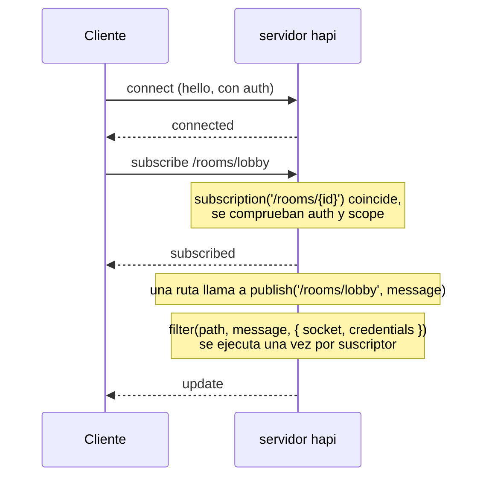
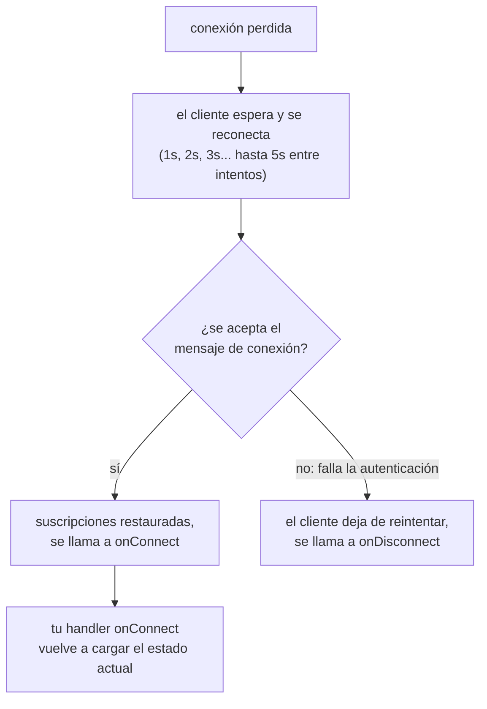
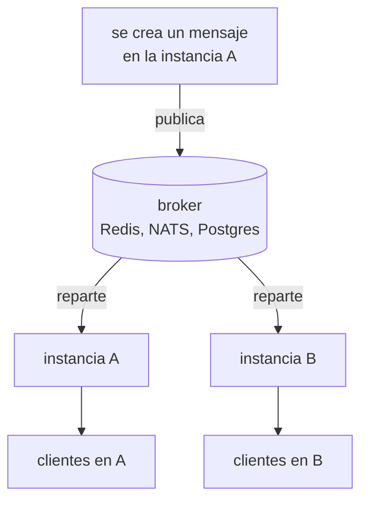

<TutorialLang />

# WebSockets

_Este tutorial es compatible con hapi v21 y versiones posteriores_

## <a name="overview"></a> Introducción

[@hapi/nes](/module/nes) añade un endpoint WebSocket a un servidor hapi. Un cliente conectado puede hacer tres cosas por ese único socket:

- **Llamar a tus rutas.** `client.request()` ejecuta una ruta normal de hapi, con su validación, sus scopes de autenticación y su handler, y devuelve la respuesta por el socket.
- **Suscribirse a actualizaciones.** El cliente se suscribe a un path como `/rooms/lobby`, y el servidor publica en él.
- **Recibir mensajes push.** El servidor envía un mensaje a un socket o lo difunde a todos.

## <a name="when"></a> Cuándo usar WebSockets

| Enfoque                                    | Dirección                                 | Adecuado para                                                                                      |
| ------------------------------------------ | ----------------------------------------- | -------------------------------------------------------------------------------------------------- |
| Polling de una ruta normal                 | el cliente pregunta, el servidor responde | actualizaciones cada pocos minutos, o cuando el tiempo real no aporta nada                         |
| [Server-Sent Events](/tutorials/es_ES/sse) | solo del servidor al cliente              | feeds en directo, progreso, notificaciones; HTTP normal, funciona a través de casi cualquier proxy |
| WebSockets con nes                         | en ambos sentidos, una sola conexión      | chat, colaboración, juegos: los clientes envían a menudo y esperan respuestas push                 |

Si el cliente solo escucha, SSE es más sencillo de operar. Elige WebSockets cuando el cliente también envía con frecuencia, o cuando quieres una sola conexión para peticiones y actualizaciones, algo que importa en redes móviles.

## <a name="setup"></a> Configuración inicial

```sh
npm install @hapi/nes
```

Un servidor de salas de chat: los mensajes se envían a través de una ruta, todos los suscriptores de la sala los reciben y una segunda ruta devuelve el historial reciente.

```ts
import Hapi from '@hapi/hapi';
import Joi from 'joi';
import Nes from '@hapi/nes';

interface ChatMessage {
    room: string;
    text: string;
    at: string;
}

const history = new Map<string, ChatMessage[]>();

const server = Hapi.server({ port: 4000 });

await server.register(Nes);

server.subscription('/rooms/{id}');

const roomParams = Joi.object({ id: Joi.string().alphanum().max(50).required() });

server.route<{ Params: { id: string }; Payload: { text: string } }>({
    method: 'POST',
    path: '/rooms/{id}/messages',
    options: {
        validate: {
            params: roomParams,
            payload: Joi.object({ text: Joi.string().max(2000).required() }),
        },
    },
    handler: (request, h) => {
        const message: ChatMessage = {
            room: request.params.id,
            text: request.payload.text,
            at: new Date().toISOString(),
        };

        const messages = history.get(message.room) ?? [];
        history.set(message.room, [...messages, message].slice(-50));

        server.publish(`/rooms/${message.room}`, message);
        return h.response(message).code(201);
    },
});

server.route<{ Params: { id: string } }>({
    method: 'GET',
    path: '/rooms/{id}/messages',
    options: { validate: { params: roomParams } },
    handler: (request, h) => history.get(request.params.id) ?? [],
});

await server.start();
```

nes escucha en el mismo puerto que tus rutas HTTP. Las rutas también funcionan por HTTP normal, así que otros servicios pueden enviar mensajes a una sala sin abrir un socket. La ruta `POST` publica solo los campos que ha [validado](/tutorials/es_ES/validation), nunca el payload tal cual.

El cliente en Node.js:

```ts
import Nes from '@hapi/nes';

const client = new Nes.Client('ws://localhost:4000');
await client.connect();

await client.subscribe('/rooms/lobby', (message) => {
    console.log('lobby:', message);
});

await client.request({ method: 'POST', path: '/rooms/lobby/messages', payload: { text: 'hello' } });
```

En el navegador, importa el fichero del cliente por separado para que tu bundle no incluya el plugin del servidor:

```ts
import { Client } from '@hapi/nes/lib/client.js';

const client = new Client(`wss://${location.host}`);
await client.connect();
```

Los handlers de suscripción reciben el mensaje como `unknown`. El servidor puede publicar cualquier cosa, así que comprueba la forma antes de usarlo, igual que harías con una respuesta de `fetch()`.

## <a name="requests"></a> Llamar a rutas por el socket

`client.request()` hace pasar la ruta por todo el [ciclo de vida de la petición](/api#request-lifecycle) de hapi: validación, scopes de `auth.access`, extensiones y el handler. nes lo hace con [`server.inject()`](/api#await-server-inject-options), pasando las credenciales con las que se autenticó el socket al conectarse. Las opciones de la petición y la forma de la respuesta están en [`client.request()`](/module/nes#await-client-request-options).

Dentro del handler, `request.socket` es el socket de nes en las peticiones por socket, y `null` en las peticiones HTTP normales, así que compruébalo antes de usarlo.

Usa peticiones por socket cuando un cliente ya tiene una conexión abierta y quieres evitar un segundo viaje de ida y vuelta por HTTP. Para una página que sobre todo escucha, las peticiones HTTP normales más una suscripción son más fáciles de depurar.

## <a name="push"></a> Enviar actualizaciones

nes te da tres formas de enviar un mensaje a los clientes:

| Método                          | Quién lo recibe                              | Para qué usarlo                                         |
| ------------------------------- | -------------------------------------------- | ------------------------------------------------------- |
| `server.publish(path, message)` | los sockets suscritos a un path que coincide | casi todo: salas, documentos, feeds                     |
| `socket.send(message)`          | un socket                                    | respuestas y avisos por conexión                        |
| `server.broadcast(message)`     | todos los sockets conectados                 | casos raros: avisos de mantenimiento, recargas forzadas |

Las suscripciones suelen ser lo que quieres, porque el cliente dice lo que le interesa y el servidor solo envía eso.



El `filter` de una suscripción decide, para cada socket, si se envía la actualización. Pasa en `internal` los datos que el filtro necesita pero que el cliente no debe ver:

```ts
server.subscription('/documents/{id}', {
    filter: (path, message, options) => {
        return options.internal === options.credentials?.id;
    },
});

server.publish('/documents/42', { title: 'Q3 plan' }, { internal: '2133d32a' });
```

Solo el propietario del documento recibe la actualización, y el id del propietario nunca llega a ningún cliente. El filtro compara con `credentials.id`, que pone la [strategy bearer](/tutorials/es_ES/auth#jwt) del tutorial de autenticación.

El filtro se ejecuta para cada suscriptor en cada publicación, así que limítalo a comprobaciones en memoria. Para cambiar lo que ve cada usuario, el filtro puede devolver `{ override: message }` en lugar de `true`.

## <a name="auth"></a> Autenticación

nes no tiene autenticación propia. Reutiliza tus [strategies de autenticación](/tutorials/es_ES/auth) de hapi: el socket se autentica al conectarse, y todas las peticiones y suscripciones de ese socket usan esas credenciales.

La opción `auth.type` del plugin decide cómo demuestra el cliente quién es:

| `auth.type`              | Cómo se autentica el cliente                                                                                                                  | Adecuado para                                                     |
| ------------------------ | --------------------------------------------------------------------------------------------------------------------------------------------- | ----------------------------------------------------------------- |
| `'direct'` (por defecto) | envía las cabeceras de autenticación HTTP normales dentro del mensaje de conexión: `client.connect({ auth: { headers: { authorization } } })` | APIs con bearer tokens o basic auth                               |
| `'token'`                | primero llama a `GET /nes/auth` por HTTP, recibe un token sellado y lo pasa a `client.connect({ auth: token })`                               | clientes que no pueden depender de cookies, como las apps móviles |
| `'cookie'`               | primero llama a `GET /nes/auth` por HTTP, que pone una cookie cifrada que el navegador envía en el upgrade a WebSocket                        | apps de navegador que ya usan sesiones con cookie                 |

Con `'direct'`, nes pasa las cabeceras por la strategy de `auth.route`, o por la [strategy por defecto](/tutorials/es_ES/auth#default) del servidor cuando `auth.route` no está definido. Con la [strategy bearer](/tutorials/es_ES/auth#jwt) del tutorial de autenticación como strategy por defecto:

```ts
const client = new Nes.Client('wss://api.example.com');
await client.connect({ auth: { headers: { authorization: `Bearer ${token}` } } });
```

- **Conectarse sin credenciales.** Si el modo de la strategy de autenticación es `'required'`, un cliente que se conecta sin `auth` se rechaza con `Connection requires authentication`. Si no, se conecta sin autenticar, y solo lo rechazan las rutas y suscripciones que necesitan autenticación.
- **Tokens que caducan.** La strategy de `@hapi/jwt` vuelve a comprobar el token mientras el socket está abierto, como mucho una vez por `auth.minAuthVerifyInterval` (por defecto, el intervalo de heartbeat). Cuando el token caduca, el servidor cierra el socket, la reconexión del cliente se rechaza con `Token maximum age exceeded` y el cliente deja de reintentar. Envía un token nuevo antes de que caduque el anterior:

    ```ts
    await client.reauthenticate({ headers: { authorization: `Bearer ${freshToken}` } });
    ```

    Las strategies cuyo scheme no tiene un método `verify()` mantienen las credenciales del momento de la conexión durante toda la vida del socket.

- **Proteger las suscripciones.** Una suscripción sin opciones `auth` usa la strategy por defecto y su modo, pero no los scopes del `access` de la configuración por defecto. Esos scopes siguen protegiendo las peticiones por socket. Dale a cada suscripción protegida su propio `auth.scope`, que acepta cualquiera de los scopes de la lista; los prefijos `+` y `!` que admiten los [scopes de ruta](/tutorials/es_ES/auth#scopes) no están disponibles.
- **Define `auth.password` para `'token'` y `'cookie'`.** Sin él, nes elige una contraseña aleatoria al arrancar el proceso, así que los tokens y las cookies dejan de funcionar tras un reinicio, y una instancia no puede leer lo que selló otra.
- **Define `origin` con la autenticación por cookie.** Los upgrades a WebSocket no pasan ninguna comprobación CORS, y los subdominios hermanos cuentan como el mismo sitio, así que el `SameSite=Strict` de la cookie de nes no los detiene. `origin` rechaza los upgrades desde cualquier otro origen, incluidos los clientes que no envían cabecera `Origin`, como el cliente de Node.js de arriba.

```ts
import Hapi from '@hapi/hapi';
import Nes from '@hapi/nes';

import type { Nes as NesTypes } from '@hapi/nes';

const cookiePassword = process.env.NES_COOKIE_PASSWORD;
if (!cookiePassword || cookiePassword.length < 32) {
    throw new Error('NES_COOKIE_PASSWORD must be set to at least 32 characters');
}

const server = Hapi.server({ port: 4000 });

const nesOptions = {
    auth: { type: 'cookie', password: cookiePassword } satisfies NesTypes.PluginOptions['auth'],
    origin: ['https://app.example.com'],
};

await server.register({ plugin: Nes, options: nesOptions });
```

## <a name="reconnect"></a> Reconexiones y actualizaciones perdidas

Las redes móviles cortan las conexiones a menudo, y el cliente se reconecta por sí solo:



- El cliente sigue reintentando con los intervalos de arriba hasta que se reconecta, salvo que limites `retries` en `client.connect()`.
- Al reconectarse, el cliente vuelve a enviar sus suscripciones, así que tus handlers siguen funcionando sin código adicional.
- **Las actualizaciones publicadas mientras el cliente estaba desconectado se pierden.** nes no las encola. Si perder una actualización importa, carga el estado actual en `onConnect`:

```ts
const refreshRoom = async (room: string) => {
    const { payload } = await client.request<ChatMessage[]>(`/rooms/${room}/messages`);
    render(payload);
};

client.onConnect = () => {
    refreshRoom('lobby').catch((err) => console.error('Could not refresh the room', err));
};
```

- El servidor hace ping a cada cliente cada 15 segundos y lo desconecta si no responde en 5 segundos; el cliente se desconecta y se reconecta si dejan de llegar pings. Los balanceadores de carga y los proxies que cierran las conexiones inactivas necesitan un timeout de inactividad mayor que el intervalo de ping, o las conexiones se cortarán sin motivo aparente.

## <a name="scaling"></a> Escalar a varias instancias

Dos instancias del servidor no comparten memoria. Una conexión WebSocket que mantiene la instancia A no existe en la instancia B, así que `server.publish()` o `server.broadcast()` en A solo llega a los clientes conectados a A. Con dos instancias detrás de un balanceador de carga, un mensaje enviado a A nunca llega a un cliente conectado a B. Esto vale para cualquier librería de WebSocket y cualquier proveedor de hosting: cada proceso solo puede escribir en las conexiones que tiene.

Escalar a varias instancias requiere pasar mensajes entre ellas. Un backend de pub/sub como Redis, NATS o `LISTEN`/`NOTIFY` de Postgres reparte cada mensaje a todas las instancias, y cada instancia lo entrega a sus propias conexiones:



Con Redis:

```ts
import { createClient } from 'redis';

const publisher = createClient({ url: process.env.REDIS_URL });
const subscriber = publisher.duplicate();
publisher.on('error', (err) => server.log(['redis', 'error'], err));
subscriber.on('error', (err) => server.log(['redis', 'error'], err));
await Promise.all([publisher.connect(), subscriber.connect()]);

await subscriber.subscribe('chat', (raw) => {
    const message: ChatMessage = JSON.parse(raw);
    server.publish(`/rooms/${message.room}`, message);
});

const publishToRoom = async (message: ChatMessage) => {
    await publisher.publish('chat', JSON.stringify(message));
};
```

La ruta `POST` llama a `publishToRoom()` en lugar de a `server.publish()`, y todas las instancias, incluida la que atendió la petición, publican en sus propios sockets.

- Las conexiones WebSocket se quedan en la instancia a la que se conectaron, así que el socket en sí no necesita sticky sessions. Para los tipos de autenticación `'token'` y `'cookie'`, define el mismo `auth.password` en todas las instancias, ya que la petición a `/nes/auth` puede llegar a una instancia distinta de la del socket.
- `server.eachSocket()` también es local al proceso.

## <a name="cleanup"></a> Limpieza

El estado de cada conexión vive tanto como el socket. Libéralo cuando el socket desaparece:

- `onDisconnection` en las opciones del plugin se ejecuta cuando se cierra cualquier socket.
- `onUnsubscribe` en las opciones de `server.subscription()` se ejecuta cuando un cliente cancela la suscripción o se desconecta, y es el sitio para detener el trabajo que se hace solo para ese suscriptor, como un bucle de polling.
- `server.stop()` cierra todos los sockets. Los clientes ven una desconexión y empiezan a reconectarse, que es lo que quieres durante un despliegue gradual: vuelven en otra instancia.

## <a name="typescript"></a> TypeScript

nes incluye sus propios tipos para el plugin y el cliente. Importar `@hapi/nes` añade `server.subscription()`, `server.publish()`, `server.broadcast()`, `server.eachSocket()` y `request.socket` a los tipos de hapi. `client.request()` recibe el tipo del payload como argumento de tipo, como en `client.request<ChatMessage[]>(path)`; no se comprueba en tiempo de ejecución, así que valida los datos que no controlas.

## <a name="next"></a> Siguientes pasos

- [Referencia de la API de @hapi/nes](/module/nes): todas las opciones del plugin, la [autenticación del socket](/module/nes#socket-auth) y la API completa del cliente.
- [Server-Sent Events](/tutorials/es_ES/sse) cuando el cliente solo escucha.
- [Autenticación](/tutorials/es_ES/auth) para las strategies y los scopes que reutiliza nes.
