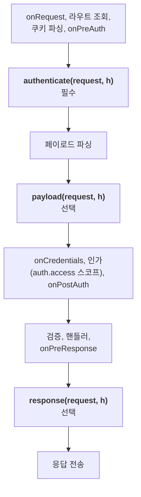
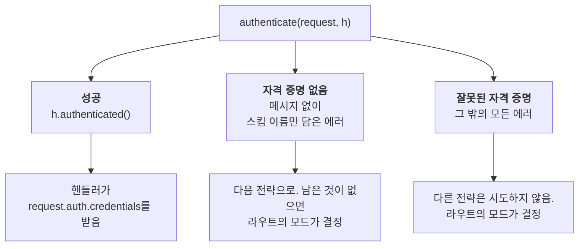
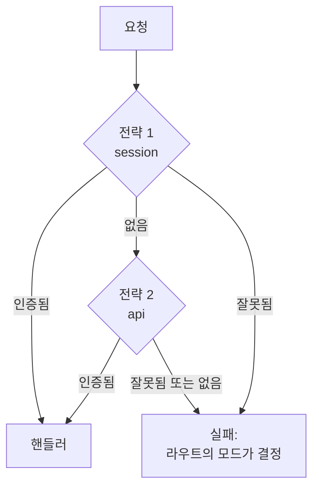
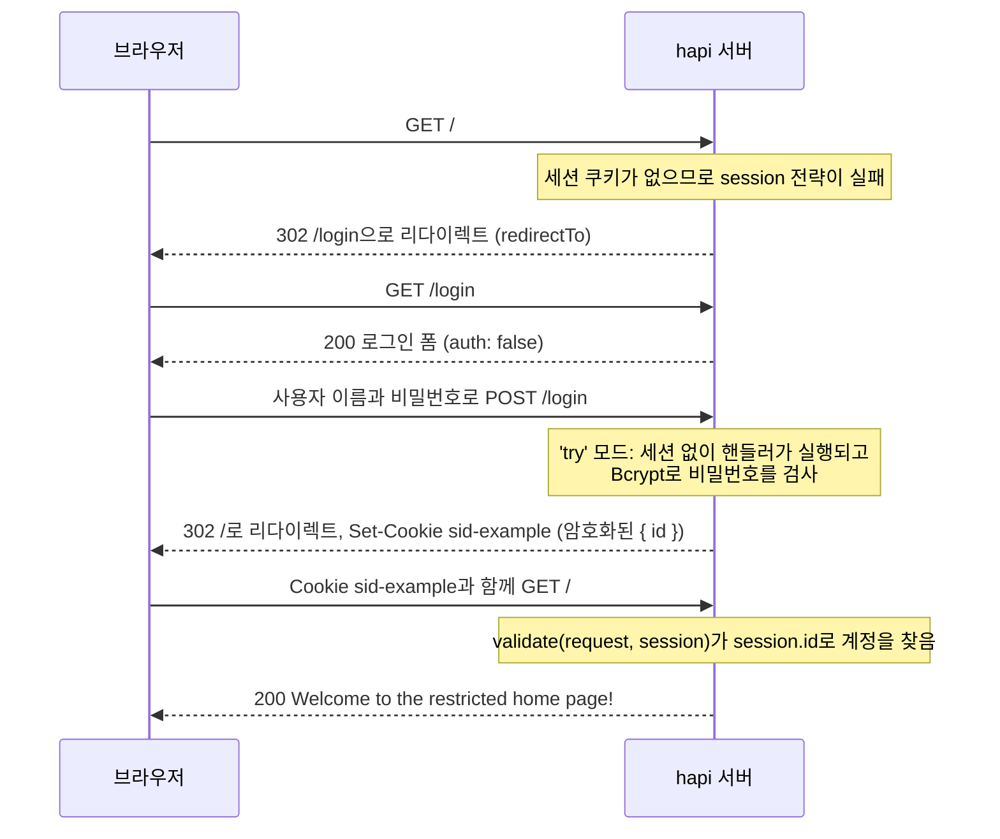
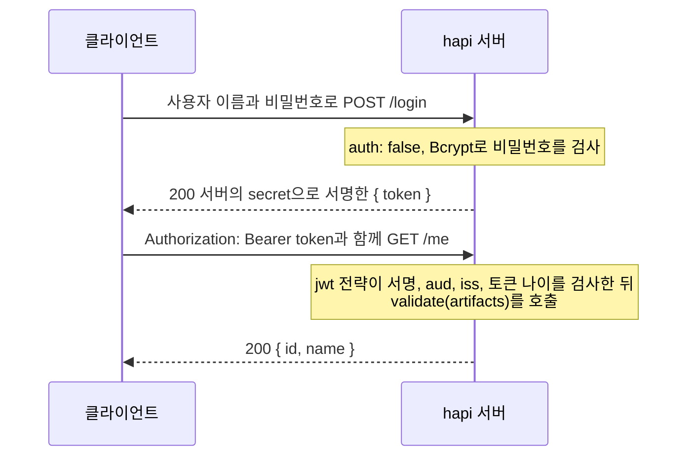

<TutorialLang />

# 인증

_이 튜토리얼은 hapi v21 이상과 호환됩니다_

## <a name="overview"></a> 개요

요즘 웹 앱은 대부분 어떤 형태로든 인증을 사용합니다. hapi의 인증은 `schemes`와 `strategies`라는 두 요소로 구성됩니다.

- `scheme`은 "HTTP basic 인증"이나 "세션 쿠키"처럼 인증을 수행하는 일반적인 방식입니다. `@hapi/basic`, `@hapi/cookie` 같은 플러그인은 각각 스킴 하나를 등록합니다.
- `strategy`는 이름과 설정을 붙인 스킴입니다. "basic 인증, 내 사용자 테이블로 검사" 같은 것이 전략입니다. 라우트는 전략을 이름으로 참조합니다.

`@hapi/basic`을 예로 들면, 플러그인이 스킴을 등록하고, 여러분이 그 스킴으로 전략을 설정하고, 라우트가 그 전략을 사용합니다.

```ts
// Registers the 'basic' scheme.
await server.register(Basic);

server.auth.strategy('simple', 'basic', { validate });

server.route({
    method: 'GET',
    path: '/',
    options: { auth: 'simple' },
    handler: (request, h) => 'welcome',
});
```

## <a name="schemes"></a> 스킴

`scheme`은 `function (server, options)` 시그니처를 가진 함수입니다. `server`는 스킴이 추가되는 서버이고, `options`는 이 스킴으로 전략을 만들 때 전달하는 설정 객체입니다. 이 함수는 스킴 객체를 반환하며, hapi는 [요청 라이프사이클](/api#request-lifecycle)의 세 지점에서 이 객체의 메서드를 호출합니다.



`payload`와 `response`는 `authenticate`가 통과시킨 요청에서만 실행됩니다.

스킴을 직접 작성할 수도 있고, `@hapi/basic`이나 `@hapi/cookie` 같은 hapi 인증 플러그인을 사용할 수도 있습니다. 다음은 요청 헤더에서 API 토큰을 읽는 완전한 스킴입니다.

```ts
import Boom from '@hapi/boom';
import Hapi from '@hapi/hapi';

import type { ServerAuthScheme } from '@hapi/hapi';

declare module '@hapi/hapi' {
    interface UserCredentials {
        id: string;
        name: string;
    }
}

interface TokenOptions {
    tokens: Map<string, { id: string; name: string }>;
}

const tokenScheme: ServerAuthScheme<TokenOptions> = (server, options) => {
    return {
        authenticate: (request, h) => {
            const token = request.headers['x-api-token'];
            if (typeof token !== 'string') {
                throw Boom.unauthorized(null, 'token');
            }

            const user = options?.tokens.get(token);
            if (!user) {
                throw Boom.unauthorized('Invalid token', 'token');
            }

            return h.authenticated({ credentials: { user }, artifacts: { token } });
        },
        response: (request, h) => {
            if (!Boom.isBoom(request.response)) {
                request.response.header('x-authenticated-user', request.auth.credentials.user?.id ?? '');
            }

            return h.continue;
        },
    };
};

const server = Hapi.server({ port: 4000 });

server.auth.scheme('token', tokenScheme);
server.auth.strategy('api', 'token', {
    tokens: new Map([['a1b2c3', { id: '2133d32a', name: 'John Doe' }]]),
});

server.route({
    method: 'GET',
    path: '/me',
    options: { auth: 'api' },
    handler: (request, h) => {
        return request.auth.credentials.user;
    },
});

await server.start();
```

`ServerAuthScheme<TokenOptions>`는 스킴이 받는 `options`의 타입을 지정합니다. 토큰을 일반 객체가 아닌 `Map`에 담은 데는 이유가 있습니다. 클라이언트가 보낸 키로 일반 객체를 조회하면 상속된 속성까지 찾기 때문에, `constructor`나 `toString`이라는 토큰도 인증을 통과하게 됩니다. `declare module` 블록은 자격 증명에 무엇이 들어 있는지 TypeScript에 알려 줍니다. hapi는 확장용으로 빈 `UserCredentials` 인터페이스를 내보내며, 이렇게 확장하면 모든 핸들러에서 `request.auth.credentials.user`에 타입이 붙습니다.

### <a name="authenticate"></a> authenticate

`authenticate` 메서드의 시그니처는 `function (request, h)`이며, 스킴에서 유일한 _필수_ 메서드입니다. `request`는 라우트 핸들러가 받는 것과 같은 [요청 객체](/api#request)이고, `h`는 표준 [응답 툴킷](/api#response-toolkit)입니다.

`authenticate`는 세 가지 방식 중 하나로 끝나며, 각각 다른 결과로 이어집니다.



- **성공:** `h.authenticated({ credentials, artifacts })`를 반환합니다. `credentials`는 인증된 사용자를 나타냅니다. `artifacts`는 선택 사항이며 원본 토큰처럼 그 밖의 인증 데이터를 담습니다. 둘 다 나중에 `request.auth.credentials`와 `request.auth.artifacts`로 사용할 수 있습니다.
- **자격 증명 없음:** `Boom.unauthorized(null, 'token')`처럼 메시지 없이 스킴 이름만 담은 에러를 던집니다. hapi는 이 요청에 해당 스킴의 자격 증명이 없다고 보고 라우트의 다음 전략으로 넘어가며, 스킴 이름은 `WWW-Authenticate` 헤더에 들어갑니다.
- **잘못된 자격 증명:** `Boom.unauthorized('Invalid token', 'token')`처럼 그 밖의 에러를 던집니다. hapi는 다른 전략을 더 시도하지 않습니다. 메시지 _와_ 스킴 이름이 모두 없는 `Boom.unauthorized()`도 잘못된 자격 증명으로 취급됩니다.

실패한 뒤 어떻게 되는지는 라우트의 [`mode`](#mode)에 따라 달라집니다.

에러를 던지는 대신 `h.unauthenticated(error, data)`를 반환할 수도 있습니다. `error`를 던지는 것과 같이 동작하지만, `data`로 실패한 요청에 `credentials`와 `artifacts`를 붙일 수 있고, `'try'` 모드의 라우트에서 이 값을 읽을 수 있습니다. `data`가 없으면 `return h.unauthenticated(error)`와 `throw error`는 같습니다. 전체 규칙은 [`server.auth.scheme()`](/api#server-auth-scheme-name-scheme)을 참고하세요. 이런 에러는 [boom](/module/boom)으로 만드는 것을 권장합니다.

### <a name="payload"></a> payload

`payload` 메서드의 시그니처는 `function (request, h)`입니다. 페이로드가 파싱된 뒤에 실행되므로, 요청 본문으로 계산한 서명처럼 페이로드 자체를 검사할 수 있습니다.

페이로드가 통과하면 `h.continue`를 반환하고, 실패하면 에러를 던집니다. 라우트는 [`payload` 라우트 옵션](#route)으로 페이로드 인증을 켭니다. 항상 페이로드 인증이 필요한 스킴은 메서드와 함께 `options: { payload: true }`를 반환할 수 있으며, 그러면 라우트에서 이를 끌 수 없습니다.

### <a name="response"></a> response

`response` 메서드의 시그니처는 `function (request, h)`입니다. `onPreResponse` 다음, 응답 헤더가 기록되기 직전에 실행되므로 `request.response`에 인증 관련 헤더를 추가할 수 있습니다. 위의 토큰 스킴은 이 메서드로 `x-authenticated-user` 헤더를 추가합니다.

`response`가 실행될 시점에는 hapi가 이미 모든 에러를 응답 객체로 바꿔 두었으므로 에러 응답에도 헤더가 붙습니다. `Boom.isBoom()` 검사는 `request.response`를 응답 객체로 좁혀 주므로 `.header()`가 타입 검사를 통과합니다. 작업이 끝나면 `h.continue`를 반환합니다. 실패시키려면 에러를 던집니다.

## <a name="strategies"></a> 전략

스킴은 `server.auth.strategy(name, scheme, [options])`로 전략을 만들기 전까지는 아무 일도 하지 않습니다.

- `name`은 전략의 이름입니다. 라우트는 이 이름으로 전략을 선택합니다.
- `scheme`은 등록된 스킴의 이름입니다.
- `options`는 스킴 함수의 `options` 인자로 전달됩니다.

스킴 하나로 각자 설정이 다른 전략을 여러 개 만들 수 있습니다.

```ts
server.auth.strategy('session', 'cookie', {
    cookie: {
        name: 'sid-example',
        password: '!wsYhFA*C2U6nz=Bu^%A@^F#SF3&kSR6',
        isSecure: false,
    },
});

server.auth.strategy('admin-session', 'cookie', {
    cookie: {
        name: 'sid-admin',
        password: 'Q7v!kW2#pL9@zR4$mT6^xB1&nD8*cF3%',
        isSecure: false,
    },
    redirectTo: '/admin/login',
    requestDecoratorName: 'adminCookieAuth',
});
```

`@hapi/cookie` 전략은 각각 `request.cookieAuth` 헬퍼를 추가하는데, hapi는 같은 요청 데코레이션을 두 번 추가하지 않습니다. 그래서 두 번째 전략은 `requestDecoratorName`으로 헬퍼에 다른 이름을 붙여야 합니다. 이 전략의 라우트는 `request.adminCookieAuth.set()`을 호출합니다. `@types/hapi__cookie` 패키지([cookie](#cookie) 참고)는 `cookieAuth`의 타입만 제공하므로, TypeScript에서는 이름을 바꾼 헬퍼도 선언해 주어야 합니다.

```ts
declare module '@hapi/hapi' {
    interface Request {
        adminCookieAuth: Request['cookieAuth'];
    }
}
```

## <a name="default"></a> 기본 전략

`server.auth.default()`는 라우트가 따로 지정하지 않는 한 모든 라우트가 사용할 전략을 정합니다. 전략 이름이나, 라우트의 [auth 옵션](#route)과 같은 형식의 객체를 받습니다. 기본값은 `auth` 옵션에 전략을 지정하지 않은 모든 라우트에 적용되며, `server.auth.default()`를 호출하기 _전에_ 추가한 라우트도 포함됩니다. 예외는 `auth`에 `mode`나 `access`만 설정한 라우트입니다. hapi는 라우트를 추가하는 시점에 이를 기본값과 병합하므로, 이 경우에는 `server.auth.default()`를 먼저 호출하세요.

```ts
server.auth.default('session');

server.route({
    method: 'GET',
    path: '/account',
    handler: (request, h) => 'protected by the session strategy',
});

server.route({
    method: 'GET',
    path: '/health',
    options: { auth: false },
    handler: (request, h) => 'public',
});
```

## <a name="route"></a> 라우트 설정

라우트는 `options.auth` 속성으로 인증을 설정합니다.

```ts
server.route({
    method: 'GET',
    path: '/feed',
    options: {
        auth: {
            mode: 'try',
            strategies: ['session', 'api'],
        },
    },
    handler: (request, h) => {
        if (!request.auth.isAuthenticated) {
            return 'public feed';
        }

        return `personal feed, signed in with ${request.auth.strategy}`;
    },
});
```

`options.auth`에는 다음을 지정할 수 있습니다.

- `false`: 라우트의 인증을 끕니다.
- `'session'` 같은 전략 이름.
- `mode`, `strategy` 또는 `strategies`, `payload`를 담은 객체.

### mode

`mode`는 자격 증명이 없거나 잘못된 요청을 어떻게 처리할지 정합니다.

| `mode`                | 자격 증명 없음          | 잘못된 자격 증명        | 유효한 자격 증명 |
| --------------------- | ----------------------- | ----------------------- | ---------------- |
| `'required'` (기본값) | 401                     | 401                     | 핸들러 실행      |
| `'optional'`          | 핸들러 실행, 인증 안 됨 | 401                     | 핸들러 실행      |
| `'try'`               | 핸들러 실행, 인증 안 됨 | 핸들러 실행, 인증 안 됨 | 핸들러 실행      |

"자격 증명 없음"과 "잘못된 자격 증명"은 [`authenticate` 실패](#authenticate)의 두 가지 유형입니다. 실패한 뒤 핸들러가 실행되면 `request.auth.isAuthenticated`는 `false`이고, `request.auth.error`에 이유가 담깁니다. 어떤 전략도 자격 증명을 찾지 못했으면 `Missing authentication`이, 전략이 자격 증명을 거부했으면 그 전략이 던진 에러가 들어갑니다.

### <a name="strategy-and-strategies"></a> strategy와 strategies

전략 하나는 `strategy: 'session'`으로, 여러 개는 `strategies: ['session', 'api']`로 지정합니다. hapi는 순서대로 시도하며, 각 전략이 자격 증명 없음을 보고하는 동안에만 다음 전략으로 넘어갑니다.



### payload

`payload`는 라우트에서 스킴의 [`payload` 메서드](#payload)를 켭니다.

- `false`: 페이로드를 인증하지 않습니다.
- `'required'` 또는 `true`: 페이로드가 반드시 인증되어야 합니다.
- `'optional'`: 클라이언트가 페이로드 인증 정보를 보낸 경우에만 검사합니다.

스킴에 `payload` 메서드가 있는 전략에서만 동작합니다.

## <a name="scopes"></a> 스코프

인증은 요청을 보낸 사람이 _누구인지_ 결정합니다. 스코프는 그 사람이 _무엇을_ 할 수 있는지 결정합니다. 전략은 `credentials.scope`에 스코프 문자열 목록을 넣고, 라우트는 허용할 스코프를 `options.auth.access.scope`에 나열하며, hapi는 인가 단계에서 둘을 비교합니다. 인가 단계는 `onCredentials` 다음, 핸들러가 실행되기 전입니다. 일치하는 스코프가 없는 요청은 `403 Insufficient scope`를 받고, 핸들러는 실행되지 않습니다.

스코프는 보통 전략의 `validate` 함수에서 옵니다. [basic](#basic) 예제의 사용자마다 `roles` 배열이 있다면 다음과 같습니다.

```ts
const validate: Basic.Validate = async (request, username, password) => {
    const user = users.get(username);
    if (!user || !(await Bcrypt.compare(password, user.password))) {
        return { isValid: false, credentials: null };
    }

    return { isValid: true, credentials: { id: user.id, name: user.name, scope: user.roles } };
};
```

역할 정보가 다른 곳에 있다면 `onCredentials` 훅에서 인증 후에 추가할 수 있습니다. [라이프사이클 훅](/tutorials/ko_KR/lifecycle-hooks#credentials)을 참고하세요.

그런 다음 라우트에서 허용할 스코프를 선언합니다.

```ts
server.route({
    method: 'GET',
    path: '/reports',
    options: { auth: { strategy: 'simple', access: { scope: ['admin', 'analyst'] } } },
    handler: (request, h) => 'any admin or analyst',
});

server.route({
    method: 'DELETE',
    path: '/users/{id}',
    options: { auth: { strategy: 'simple', access: { scope: ['+admin', '!suspended'] } } },
    handler: (request, h) => 'an admin who is not suspended',
});

server.route({
    method: 'PUT',
    path: '/users/{id}/profile',
    options: { auth: { strategy: 'simple', access: { scope: ['admin', 'user-{params.id}'] } } },
    handler: (request, h) => 'an admin, or the user whose id is in the path',
});
```

| 라우트 스코프          | `credentials.scope`의 조건                                                                         |
| ---------------------- | -------------------------------------------------------------------------------------------------- |
| `'admin'`              | `admin`을 포함해야 함                                                                              |
| `['admin', 'analyst']` | 둘 중 하나 이상을 포함해야 함                                                                      |
| `'+admin'`             | 목록의 다른 항목과 관계없이 `admin`을 포함해야 함                                                  |
| `'!suspended'`         | `suspended`를 포함하지 않아야 함                                                                   |
| `'user-{params.id}'`   | `/users/42` 요청이라면 `user-42`를 포함해야 함. `query`, `payload`, `credentials`도 사용할 수 있음 |

놓치기 쉬운 스코프 규칙은 다음과 같습니다.

- 스코프는 인증된 요청에서만 검사합니다. `'optional'`이나 `'try'` 모드의 라우트에서는 자격 증명이 없는 요청도 핸들러에 도달하며, 이때 `request.auth.isAuthorized`는 `false`입니다. 일부 사용자만 할 수 있는 작업을 하기 전에 이 값을 확인하세요.
- `access.entity`는 라우트를 사용자 또는 애플리케이션으로 제한합니다. `'user'`는 `credentials.user`가 설정되어 있어야 하고, `'app'`은 없어야 합니다. 같은 전략이 사람과 기계 클라이언트를 모두 인증할 때 사용하세요.
- `access`는 규칙의 목록일 수 있으며, 요청은 그중 하나만 만족하면 됩니다.
- `server.auth.default()`도 같은 `access` 옵션을 받으므로, 스코프를 모든 라우트에 적용할 수 있습니다.

전체 규칙은 [`route.options.auth.access`](/api#route-options-auth-access)를 참고하세요.

## <a name="basic"></a> basic

처음 살펴볼 `scheme`은 [@hapi/basic](/module/basic) 플러그인입니다. 이름 그대로 `@hapi/basic` 플러그인은 basic 인증으로 사용자를 검증합니다. 다음은 `@hapi/basic`을 설정하는 예입니다.

```ts
import Basic from '@hapi/basic';
import Bcrypt from 'bcrypt';
import Hapi from '@hapi/hapi';

const users = new Map([
    [
        'john',
        {
            username: 'john',
            password: '$2a$10$iqJSHD.BGr0E2IxQwYgJmeP3NvhPrXAeLSaGCj6IR/XU5QtjVu5Tm', // 'secret'
            name: 'John Doe',
            id: '2133d32a',
        },
    ],
]);

const validate: Basic.Validate = async (request, username, password) => {
    const user = users.get(username);
    if (!user) {
        return { credentials: null, isValid: false };
    }

    const isValid = await Bcrypt.compare(password, user.password);
    const credentials = { id: user.id, name: user.name };

    return { isValid, credentials };
};

const start = async () => {
    const server = Hapi.server({ port: 4000 });

    await server.register(Basic);

    server.auth.strategy('simple', 'basic', { validate });

    server.route({
        method: 'GET',
        path: '/',
        options: {
            auth: 'simple',
        },
        handler: function (request, h) {
            return 'welcome';
        },
    });

    await server.start();

    console.log('server running at: ' + server.info.uri);
};

start();
```

먼저 `users` 데이터베이스를 정의합니다. 이 예제에서는 사용자 이름을 키로 하는 `Map`이며, 그 이유는 [스킴](#schemes)에서 설명했습니다. 다음으로 검증 함수를 정의합니다. 이는 [@hapi/basic](/module/basic) 전용 기능으로, 사용자가 유효한 자격 증명을 제공했는지 확인할 수 있게 해 줍니다. `Basic.Validate`로 타입을 지정하면 TypeScript가 `request`, `username`, `password`를 추론하고 반환하는 객체도 검사합니다. 이 검증 함수에서는 `Bcrypt`로 사용자가 입력한 비밀번호와 데이터베이스에 저장된 해시를 비교합니다.

그런 다음 플러그인을 등록하면 `basic`이라는 이름의 스킴이 만들어집니다. 이 작업은 플러그인 내부에서 [server.auth.스킴()](/api#server-auth-scheme-name-scheme)으로 이루어집니다.

플러그인을 등록한 뒤에는 [server.auth.전략()](/api#server-auth-strategy-name-scheme-options)로 `basic` 스킴을 참조하는 `simple`이라는 전략을 만듭니다. 이때 옵션 객체도 전달하는데, 이 객체는 스킴에 전달되어 동작을 설정하는 데 쓰입니다.

마지막으로 라우트가 인증에 `simple` 전략을 사용하도록 지정합니다.

## <a name="cookie"></a> cookie

[@hapi/cookie](/module/cookie)는 사용자가 인증되면 세션을 사용자 브라우저의 암호화된 쿠키에 저장하는 플러그인입니다. `cookie.ttl`이 없으면 쿠키는 브라우저를 닫을 때까지 유지됩니다. 브라우저 세션이 바뀌어도 로그인 상태를 유지하려면 `ttl`을 설정하세요.

이 예제에서 홈 라우트 "/"는 제한되어 있어 로그인한 사용자만 접근할 수 있습니다. 브라우저는 로그인 폼으로 리다이렉트되고, 사용자 이름과 비밀번호를 POST로 보낸 다음, 세션 쿠키를 가지고 홈 페이지에 도달합니다.



```ts
import Bcrypt from 'bcrypt';
import Cookie from '@hapi/cookie';
import Hapi from '@hapi/hapi';

const users = [
    {
        username: 'john',
        password: '$2a$10$iqJSHD.BGr0E2IxQwYgJmeP3NvhPrXAeLSaGCj6IR/XU5QtjVu5Tm', // 'secret'
        name: 'John Doe',
        id: '2133d32a',
    },
];

const start = async () => {
    const server = Hapi.server({ port: 4000 });

    await server.register(Cookie);

    server.auth.strategy('session', 'cookie', {
        cookie: {
            name: 'sid-example',
            password: '!wsYhFA*C2U6nz=Bu^%A@^F#SF3&kSR6',
            isSecure: false,
        },
        redirectTo: '/login',
        validate: async (request, session) => {
            if (!session || !('id' in session)) {
                return { isValid: false };
            }

            const account = users.find((user) => user.id === session.id);
            if (!account) {
                return { isValid: false };
            }

            return { isValid: true, credentials: { id: account.id, name: account.name } };
        },
    });

    server.auth.default('session');

    server.route([
        {
            method: 'GET',
            path: '/',
            handler: function (request, h) {
                return 'Welcome to the restricted home page!';
            },
        },
        {
            method: 'GET',
            path: '/login',
            handler: function (request, h) {
                return ` <html>
                            <head>
                                <title>Login page</title>
                            </head>
                            <body>
                                <h3>Please Log In</h3>
                                <form method="post" action="/login">
                                    Username: <input type="text" name="username"><br>
                                    Password: <input type="password" name="password"><br/>
                                <input type="submit" value="Login"></form>
                            </body>
                        </html>`;
            },
            options: {
                auth: false,
            },
        },
    ]);

    server.route<{ Payload: { username: string; password: string } }>({
        method: 'POST',
        path: '/login',
        handler: async (request, h) => {
            const { username, password } = request.payload;
            const account = users.find((user) => user.username === username);

            if (!account || !(await Bcrypt.compare(password, account.password))) {
                return h.redirect('/login');
            }

            request.cookieAuth.set({ id: account.id });

            return h.redirect('/');
        },
        options: {
            auth: {
                mode: 'try',
            },
        },
    });

    await server.start();

    console.log('server running at: ' + server.info.uri);
};

start();
```

`@hapi/cookie`는 자체 타입을 제공하지 않습니다. TypeScript를 사용한다면 `npm install --save-dev @types/hapi__cookie`로 타입을 설치하세요. 이 패키지는 hapi의 `Request` 타입에 `request.cookieAuth`를 추가하고 `cookie` 전략 옵션의 타입을 지정합니다. `validate`에 전달되는 세션은 일반 `object` 타입이므로, `'id' in session` 검사가 있어야 TypeScript가 `session.id`를 읽을 수 있습니다. `POST /login` 라우트는 `server.route()`의 타입 인자로 폼 필드를 선언합니다. 이는 타입일 뿐이므로, 런타임에 강제하려면 [페이로드 검증](/tutorials/ko_KR/validation)을 추가하세요.

먼저 `server.register`로 `@hapi/cookie` 플러그인을 등록하면 `cookie` 스킴이 추가됩니다. 그런 다음 `server.auth.strategy`로 이 스킴에서 `session` 전략을 만들고, 옵션 세 가지를 전달합니다.

- `cookie`는 쿠키 자체를 설정합니다. `name`은 쿠키 이름인 `sid-example`입니다. `password`는 쿠키를 암호화하며 32자 이상이어야 합니다. `isSecure: false`는 쿠키가 일반 HTTP로도 전송되게 하는데, 개발 환경에서는 괜찮지만 프로덕션에서는 기본값인 `true`로 두세요.
- `redirectTo`는 인증되지 않은 사용자가 보호된 라우트를 요청했을 때 서버가 보낼 위치입니다.
- `validate`는 쿠키가 포함된 모든 요청에서 실행되어 세션이 아직 유효한지 확인합니다. 여기서는 쿠키에 저장된 `id`로 계정을 조회하므로, 삭제된 계정은 다음 요청에서 로그아웃됩니다.

`server.auth.default('session')`은 모든 라우트를 `session` 전략으로 보호합니다. `GET /login`은 `auth: false`로 이를 해제하므로 누구나 폼을 볼 수 있습니다.

`POST /login`은 `mode: 'try'`를 사용하므로, 사용자에게 아직 세션이 없어도 핸들러가 실행됩니다. 핸들러는 `username`으로 계정을 찾고, `Bcrypt`로 제출된 비밀번호와 저장된 해시를 비교합니다. 둘 중 하나라도 실패하면 사용자는 로그인 페이지로 돌아갑니다. 둘 다 통과하면 `request.cookieAuth.set()`이 암호화된 쿠키에 `{ id }`를 저장하고, 사용자는 홈 페이지로 리다이렉트됩니다.

## <a name="jwt"></a> jwt

[@hapi/jwt](/module/jwt)는 `Authorization: Bearer <token>` 헤더에 JSON Web Token을 담은 요청을 인증합니다. `@hapi/cookie`와 마찬가지로 서버에 세션을 저장하지 않으며, 차이는 신원 정보가 전달되는 방식에 있습니다.

|           | `@hapi/cookie`                      | `@hapi/jwt`                                |
| --------- | ----------------------------------- | ------------------------------------------ |
| 전달 위치 | 브라우저가 붙여 보내는 쿠키         | 클라이언트가 설정하는 `Authorization` 헤더 |
| 내용      | 암호화됨: 클라이언트가 읽을 수 없음 | 서명됨: 토큰을 가진 누구나 읽을 수 있음    |
| 적합한 곳 | 자체 도메인의 브라우저 앱           | 모바일 앱, 다른 서버, SPA에서 호출하는 API |

JWT 페이로드에는 절대 비밀 정보를 넣지 마세요. 서명은 변조를 막지만 읽는 것은 막지 못합니다.

클라이언트는 한 번 로그인한 뒤, 모든 요청에 토큰을 함께 보냅니다.



```ts
import Bcrypt from 'bcrypt';
import Hapi from '@hapi/hapi';
import Jwt from '@hapi/jwt';

const users = [
    {
        username: 'john',
        password: '$2a$10$iqJSHD.BGr0E2IxQwYgJmeP3NvhPrXAeLSaGCj6IR/XU5QtjVu5Tm', // 'secret'
        name: 'John Doe',
        id: '2133d32a',
    },
];

const secret = 'hR7#mX2!vQ9@kL4$wP8^zT1&nB6*cJ3%';

const start = async () => {
    const server = Hapi.server({ port: 4000 });

    await server.register(Jwt);

    server.auth.strategy('bearer', 'jwt', {
        keys: secret,
        verify: {
            aud: 'urn:audience:my-api',
            iss: 'urn:issuer:my-api',
            sub: false,
            maxAgeSec: 4 * 60 * 60,
        },
        validate: async (artifacts, request, h) => {
            const account = users.find((user) => user.id === artifacts.decoded.payload.id);
            if (!account) {
                return { isValid: false };
            }

            return { isValid: true, credentials: { id: account.id, name: account.name } };
        },
    });

    server.auth.default('bearer');

    server.route<{ Payload: { username: string; password: string } }>({
        method: 'POST',
        path: '/login',
        options: { auth: false },
        handler: async (request, h) => {
            const { username, password } = request.payload;
            const account = users.find((user) => user.username === username);

            if (!account || !(await Bcrypt.compare(password, account.password))) {
                return h.response({ error: 'Invalid username or password' }).code(401);
            }

            const token = Jwt.token.generate(
                { aud: 'urn:audience:my-api', iss: 'urn:issuer:my-api', id: account.id },
                secret,
            );

            return { token };
        },
    });

    server.route({
        method: 'GET',
        path: '/me',
        handler: (request, h) => {
            return request.auth.credentials;
        },
    });

    await server.start();

    console.log('server running at: ' + server.info.uri);
};

start();
```

플러그인을 등록하면 `jwt` 스킴이 추가되고, 이 스킴으로 `bearer` 전략을 만듭니다.

- `keys`는 토큰 서명에 쓰는 secret입니다. 같은 서버가 토큰을 발급하고 검사한다면 공유 secret으로 충분합니다. 대신 ID 제공자(identity provider)가 발급한 토큰을 받으려면 `keys`가 제공자의 공개 키를 가리키게 할 수 있습니다. [@hapi/jwt API](/module/jwt)의 `keys` 옵션을 참고하세요.
- `verify`는 토큰이 가져야 할 클레임을 나열합니다. `aud`(audience)와 `iss`(issuer)는 토큰을 발급할 때 사용한 값과 일치해야 합니다. `maxAgeSec`는 `iat`(issued at)가 4시간보다 오래된 토큰을 거부합니다. 이 예제의 토큰에는 `exp`가 없습니다. 여러분의 토큰에 있다면 `exp`와 `nbf`는 기본으로 검사됩니다.
- `validate`는 서명과 클레임 검사를 통과한 뒤에만 실행됩니다. 디코딩된 토큰을 `artifacts.decoded.payload`로 받고, `request.auth.credentials`에 무엇을 넣을지 결정합니다. 여기서는 계정이 아직 존재하는지도 확인합니다. 토큰은 계정이 삭제되어도 만료될 때까지 유효하기 때문입니다.

`POST /login`은 `auth: false`로 인증을 해제하고, 비밀번호를 검사한 뒤, 전략이 검증하는 것과 같은 `aud`와 `iss`로 `Jwt.token.generate()`가 만든 토큰을 반환합니다. 그러면 클라이언트는 `Authorization: Bearer <token>`과 함께 `GET /me`를 호출합니다. hapi는 토큰에 어떤 클레임을 넣었는지 알 수 없으므로 `artifacts.decoded.payload`에는 타입이 없습니다. `validate`에서 클레임을 검사하고 타입이 지정된 자격 증명을 만드세요.

그 밖의 hapi 인증 플러그인에 대해서는 [플러그인 섹션](/plugins)을 참고하세요.
