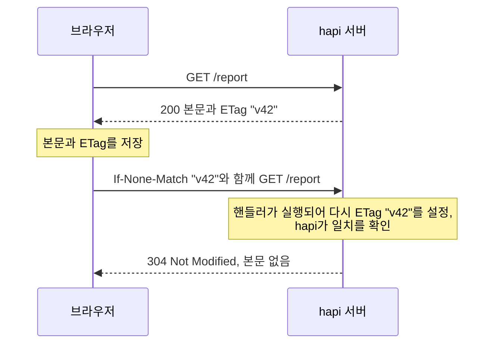
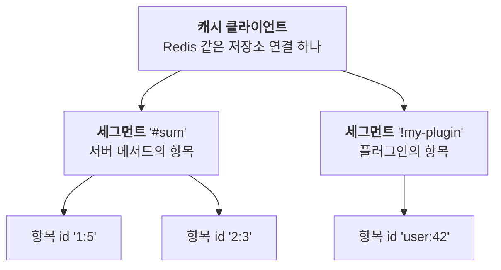
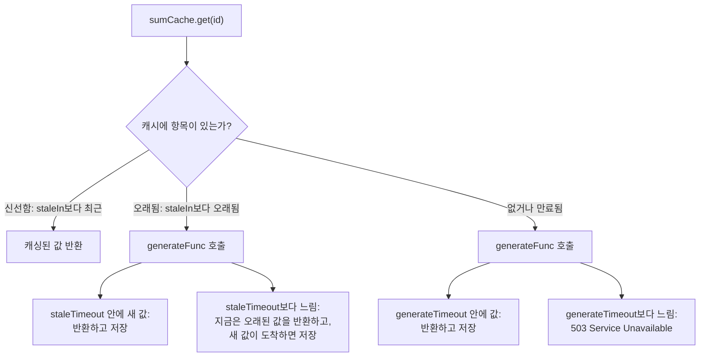

<TutorialLang />

# 캐싱

_이 튜토리얼은 hapi v21 이상과 호환됩니다_

## <a name="overview"></a> 개요

hapi는 두 단계에서 캐싱하며, 대부분의 애플리케이션은 둘 다 사용합니다.

| 단계                          | 사본이 저장되는 곳                                       | 절약되는 것                                  | 설정 방법                                                                   |
| ----------------------------- | -------------------------------------------------------- | -------------------------------------------- | --------------------------------------------------------------------------- |
| [클라이언트 측](#client-side) | 브라우저, 또는 중간의 CDN이나 프록시                     | 요청 전체: 클라이언트가 hapi에 도달하지 않음 | HTTP 헤더: `Cache-Control`, `ETag`, `Last-Modified`                         |
| [서버 측](#server-side)       | 메모리, Redis, 또는 다른 [catbox](/module/catbox) 저장소 | 비용이 큰 작업: 데이터베이스 쿼리, API 호출  | `server.cache()` 또는 캐싱된 [서버 메서드](/tutorials/ko_KR/server-methods) |

## <a name="client-side"></a> 클라이언트 측 캐싱

HTTP 헤더는 클라이언트가 응답을 재사용해도 되는지, 그리고 얼마 동안 재사용할 수 있는지 알려 줍니다. 헤더에 대한 자세한 설명은 MDN의 [HTTP 캐싱 가이드](https://developer.mozilla.org/en-US/docs/Web/HTTP/Caching)를 참고하세요. 이 섹션에서는 hapi가 이 헤더를 설정하는 방법을 보여 줍니다.

### <a name="cache-control"></a> Cache-Control

라우트의 `cache` 옵션을 설정하면 hapi가 `Cache-Control` 헤더를 작성해 줍니다.

```ts
server.route({
    path: '/hapi/{ttl?}',
    method: 'GET',
    handler: function (request, h) {
        const response = h.response({ be: 'hapi' });

        if (request.params.ttl) {
            response.ttl(Number(request.params.ttl));
        }

        return response;
    },
    options: {
        cache: {
            expiresIn: 30 * 1000,
            privacy: 'private',
        },
    },
});
```

`response.ttl(msec)`는 응답 하나에 대해 `expiresIn`을 덮어씁니다. hapi가 보내는 헤더는 응답에 따라 달라집니다.

| 요청                                               | `Cache-Control` 헤더                    |
| -------------------------------------------------- | --------------------------------------- |
| `GET /hapi`                                        | `max-age=30, must-revalidate, private`  |
| `GET /hapi/5000` (`response.ttl(5000)` 호출)       | `max-age=5, must-revalidate, private`   |
| 404나 500처럼 상태 코드가 200 또는 204가 아닌 응답 | `no-cache` (라우트의 `cache.otherwise`) |

알아 둘 점:

- 인증된 요청이면 라우트에 `privacy: 'public'`이라고 되어 있어도 hapi는 항상 `private`을 추가합니다. CDN 같은 공유 캐시는 `private` 응답을 저장하지 않습니다.
- `h.state()`로 설정한 쿠키는 헤더를 바꾸지 않습니다. hapi는 `Cache-Control`을 만든 뒤에 쿠키를 기록하기 때문입니다. 쿠키를 설정하는 캐싱 라우트에는 직접 `privacy: 'private'`을 지정하세요.
- 라우트의 `cache.statuses`(기본값 `[200, 204]`)에 나열된 상태 코드만 `max-age`를 받습니다. 에러 응답이 실수로 캐싱되는 일은 없습니다.

모든 `cache` 설정은 [라우트 옵션](/api#route-options-cache)을 참고하세요.

### <a name="last-modified"></a> 조건부 요청: ETag와 Last-Modified

조건부 요청을 사용하면 클라이언트가 "내 사본 이후로 바뀐 게 있나?"라고 물어보고, 전체 본문 대신 빈 `304 Not Modified`를 받을 수 있습니다.



`ETag`는 [`response.etag()`](/api#response-object)로 설정하며, 보통 버전 번호나 콘텐츠의 해시를 사용합니다.

```ts
return h.response(report).etag(String(report.version));
```

또는 `Last-Modified`를 설정하면, hapi가 이를 클라이언트의 `If-Modified-Since` 헤더와 비교합니다.

```ts
return h.response(report).header('Last-Modified', report.updatedAt.toUTCString());
```

알아 둘 점:

- hapi는 `GET` 라우트(그리고 method가 `*`인 라우트)에서만 `304`로 응답합니다.
- 핸들러는 여전히 매 요청마다 실행됩니다. 조건부 요청은 대역폭을 절약할 뿐 서버 작업을 줄이지는 않습니다. 둘 다 절약하려면 [서버 측 캐싱](#server-side)과 함께 사용하세요.
- [inert](/module/inert)는 정적 파일에 `ETag`와 `Last-Modified`를 자동으로 설정합니다.

## <a name="server-side"></a> 서버 측 캐싱

hapi는 [catbox](/module/catbox)를 통해 서버에 값을 캐싱합니다. catbox는 저장소 어댑터를 바꿔 끼울 수 있는 키-값 저장소로, 메모리(기본값), [Redis](/module/catbox-redis), [Memcached](/module/catbox-memcached) 어댑터가 있습니다.

### <a name="catbox"></a> catbox

캐싱된 항목은 세 단계로 구성됩니다.



catbox는 이 항목들에 접근하는 두 가지 인터페이스를 제공합니다.

- **[클라이언트](/module/catbox#client)**: 저수준 저장소 연결입니다. hapi가 메모리 클라이언트를 만들어 주며, 다른 클라이언트는 서버의 `cache` 옵션에 추가합니다.
- **[정책](/module/catbox#policy)**: 클라이언트의 세그먼트 하나로, 만료 규칙과 없는 값을 생성하는 함수(선택)를 가집니다. 여러분의 코드는 정책을 사용하며, 정책은 [`server.cache()`](/api#server-cache-options)로 만들거나 [서버 메서드](#servermethods)를 캐싱해서 만듭니다.

### <a name="client"></a> 클라이언트

기본 메모리 클라이언트 옆에 `my_cache`라는 Redis 클라이언트를 추가합니다.

```ts
import Hapi from '@hapi/hapi';
import { Engine as CatboxRedis } from '@hapi/catbox-redis';

const server = Hapi.server({
    port: 8000,
    cache: [
        {
            name: 'my_cache',
            provider: {
                constructor: CatboxRedis,
                options: {
                    partition: 'my_cached_data',
                    host: 'redis-cluster.domain.com',
                    port: 6379,
                    database: 0,
                    tls: {},
                },
            },
        },
    ],
});
```

- 정책은 `cache: 'my_cache'`처럼 `name`으로 이 클라이언트를 선택합니다. `name`을 생략하면 기본 메모리 클라이언트를 대체합니다.
- `partition`은 같은 Redis 데이터베이스를 공유하는 다른 애플리케이션과 이 애플리케이션의 키를 분리합니다. Redis에서는 키 접두사가 됩니다. 기본값은 `'catbox'`입니다.
- 캐시 클라이언트는 서버가 시작될 때, 즉 [`server.initialize()`](/api#await-server-initialize)나 [`server.start()`](/api#await-server-start)에서 연결됩니다. 그 전에는 정책이 읽거나 쓸 수 없습니다.

### <a name="policy" /> 정책

[`server.cache(options)`](/api#server-cache-options)는 정책을 만듭니다. 이 예제는 느린 덧셈의 결과를 10초 동안 캐싱합니다.

```ts
import Hapi from '@hapi/hapi';
import * as Hoek from '@hapi/hoek';

const add = async (a: string, b: string) => {
    await Hoek.wait(1000); // Simulates a slow database call

    return Number(a) + Number(b);
};

const start = async () => {
    const server = Hapi.server({ port: 8000 });

    const sumCache = server.cache({
        segment: 'sums',
        expiresIn: 10 * 1000,
        generateFunc: async (id) => {
            const key = typeof id === 'string' ? id : id.id;
            const [a, b] = key.split(':');

            return await add(a, b);
        },
        generateTimeout: 2000,
    });

    server.route<{ Params: { a: string; b: string } }>({
        path: '/add/{a}/{b}',
        method: 'GET',
        handler: async function (request, h) {
            const { a, b } = request.params;

            return await sumCache.get(`${a}:${b}`);
        },
    });

    await server.start();

    console.log('Server running at:', server.info.uri);
};

start();
```

`GET /add/1/5`는 약 1초 뒤에 `6`을 응답합니다. 10초 안에 다시 요청하면 캐시에서 즉시 응답합니다.

| 옵션              | 의미                                                                                                                                                                                            |
| ----------------- | ----------------------------------------------------------------------------------------------------------------------------------------------------------------------------------------------- |
| `segment`         | 이 정책의 항목에 붙이는 이름입니다. 서버 루트에서는 필수입니다. 플러그인 안에서는 기본값이 `'!' + plugin name`입니다. `shared: true`를 설정하지 않으면 두 정책이 세그먼트를 공유할 수 없습니다. |
| `cache`           | 사용할 클라이언트입니다(예: `'my_cache'`). 기본값은 메모리 클라이언트입니다.                                                                                                                    |
| `expiresIn`       | 항목이 저장된 뒤 유지되는 시간(밀리초)입니다. 대신 `expiresAt: 'HH:MM'`을 쓰면 하루 중 특정 시각에 모든 항목이 만료됩니다.                                                                      |
| `generateFunc`    | `get()`이 아무것도 찾지 못했을 때 값을 만듭니다. catbox가 그 결과를 저장합니다.                                                                                                                 |
| `generateTimeout` | `get()`이 `generateFunc`를 기다리는 시간으로, 이 시간이 지나면 `503 Service Unavailable`로 실패합니다. `generateFunc`를 쓸 때 필수이며, `false`면 무한정 기다립니다.                            |

`get()`에 전달하는 id는 문자열이거나 `id` 문자열을 가진 객체이며, `generateFunc`는 이를 그대로 받습니다. catbox는 이 타입을 `string | { id: string }`으로 지정하므로, 예제에서는 다시 `a`와 `b`로 나누기 전에 타입을 좁힙니다.

### <a name="stale"></a> 재생성하는 동안 오래된 값 제공하기

만료된 항목이 있으면 다음 호출자는 `generateFunc`를 기다려야 합니다. 이 대기를 피하려면 `staleIn`으로 만료 전에 항목을 오래된(stale) 상태로 표시합니다. 오래된 항목은 계속 제공되고, 그동안 catbox가 백그라운드에서 값을 다시 생성합니다.



```ts
const reportCache = server.cache({
    segment: 'reports',
    expiresIn: 60 * 60 * 1000,
    staleIn: 10 * 60 * 1000,
    staleTimeout: 100,
    generateTimeout: 5000,
    generateFunc: async (id) => await buildReport(id),
});
```

catbox는 `staleIn < expiresIn`을 강제하고, `staleIn`을 설정하면 `staleTimeout`도 필수이며, `staleTimeout < expiresIn - staleIn`이어야 합니다. 같은 id에 대한 동시 `get()` 호출은 `generateFunc` 호출 하나를 공유하므로, 없는 항목에 요청이 몰려도 데이터베이스 쿼리는 한 번만 실행됩니다. `dropOnError`, `generateOnReadError` 같은 에러 처리 설정은 [정책 옵션](/module/catbox#policy)을 참고하세요.

### <a name="servermethods"></a> 서버 메서드

대부분의 경우 캐싱된 [서버 메서드](/tutorials/ko_KR/server-methods)가 직접 만든 정책보다 짧습니다. hapi가 정책을 만들고, 세그먼트 이름을 `'#sum'`으로 정하고, 인자로부터 항목 id를 만들어 줍니다.

```ts
import Hapi from '@hapi/hapi';
import * as Hoek from '@hapi/hoek';

declare module '@hapi/hapi' {
    interface ServerMethods {
        sum: (a: string, b: string) => Promise<number>;
    }
}

const add = async (a: string, b: string) => {
    await Hoek.wait(1000);

    return Number(a) + Number(b);
};

const start = async () => {
    const server = Hapi.server({ port: 8000 });

    server.method('sum', add, {
        cache: {
            expiresIn: 10 * 1000,
            generateTimeout: 2000,
        },
    });

    server.route<{ Params: { a: string; b: string } }>({
        path: '/add/{a}/{b}',
        method: 'GET',
        handler: async function (request, h) {
            const { a, b } = request.params;

            return await server.methods.sum(a, b);
        },
    });

    await server.start();
};

start();
```

- `declare module` 블록은 hapi의 `ServerMethods` 인터페이스에 `sum`을 추가하므로, `server.methods.sum`에 타입이 생깁니다.
- hapi는 `string`, `number`, `boolean` 인자로 `'1:5'` 같은 항목 id를 만듭니다. 다른 타입의 인자에는 [`generateKey`](/tutorials/ko_KR/server-methods#key) 함수가 필요합니다.

## <a name="clientandserver"></a> 클라이언트와 서버 캐싱

두 단계를 함께 사용해 봅시다. 서버 캐시는 각 값을 저장한 시각을 기록하는데, 이 시각이 응답의 `Last-Modified`로 쓰기에 알맞습니다. `getDecoratedValue: true`를 설정하면 캐싱된 method가 값 자체 대신 `{ value, cached, report }`를 반환합니다. 값이 방금 생성되었다면 `cached`는 `null`입니다.

```ts
import Hapi from '@hapi/hapi';
import * as Hoek from '@hapi/hoek';

declare module '@hapi/hapi' {
    interface ServerMethods {
        sum: (a: string, b: string) => Promise<{ value: number; cached: { stored: number } | null }>;
    }
}

const add = async (a: string, b: string) => {
    await Hoek.wait(1000);

    return Number(a) + Number(b);
};

const start = async () => {
    const server = Hapi.server({ port: 8000 });

    const cache = {
        expiresIn: 10 * 1000,
        generateTimeout: 2000,
        getDecoratedValue: true,
    };

    server.method('sum', add, { cache });

    server.route<{ Params: { a: string; b: string } }>({
        path: '/add/{a}/{b}',
        method: 'GET',
        handler: async function (request, h) {
            const { a, b } = request.params;
            const { value, cached } = await server.methods.sum(a, b);
            const lastModified = cached ? new Date(cached.stored) : new Date();

            return h.response({ sum: value }).header('Last-Modified', lastModified.toUTCString());
        },
    });

    await server.start();
};

start();
```

`cached`와 `report`에 무엇이 들어 있는지는 [정책 API](/module/catbox#api-1)를 참고하세요.
