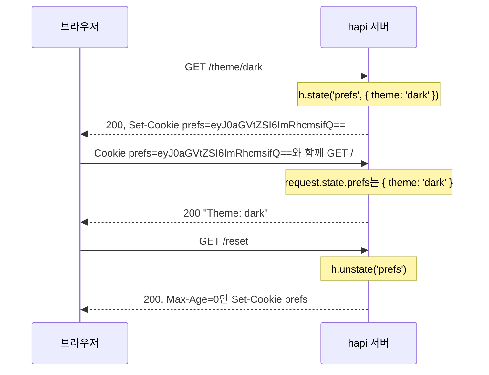

<TutorialLang />

# 쿠키

_이 튜토리얼은 hapi v21 이상과 호환됩니다_

## <a name="overview"></a> 개요

hapi는 요청의 `Cookie` 헤더를 읽어 `request.state`에 담고, `h.state()`로 `Set-Cookie` 헤더를 작성합니다. 각 쿠키는 `server.state()`로 한 번만 선언하며, 이때 인코딩과 보안 플래그를 정하므로 핸들러에서는 값만 다루면 됩니다.



이 주고받기를 처리하는 전체 서버 코드입니다.

```ts
import Hapi from '@hapi/hapi';

const server = Hapi.server({ port: 3000 });

server.state('prefs', {
    encoding: 'base64json',
    ttl: 365 * 24 * 60 * 60 * 1000,
    isSecure: process.env.NODE_ENV === 'production',
    path: '/',
});

server.route<{ Params: { theme: string } }>({
    method: 'GET',
    path: '/theme/{theme}',
    handler: (request, h) => {
        h.state('prefs', { theme: request.params.theme });
        return 'saved';
    },
});

server.route({
    method: 'GET',
    path: '/',
    handler: (request, h) => {
        const prefs = request.state.prefs;
        const theme = typeof prefs === 'object' && prefs !== null && 'theme' in prefs ? prefs.theme : 'light';

        return `Theme: ${theme}`;
    },
});

server.route({
    method: 'GET',
    path: '/reset',
    handler: (request, h) => {
        return h.response('reset').unstate('prefs');
    },
});

await server.start();
```

쿠키에는 클라이언트가 보낸 무엇이든 들어 있을 수 있으므로 `request.state`의 타입은 `Record<string, unknown>`입니다. `/` 핸들러는 `theme`을 읽기 전에 값의 형태를 확인하고, 맞지 않으면 기본값을 사용합니다.

## <a name="server"></a> 서버 설정

### <a name="server.state"></a> server.state()

[`server.state(name, [options])`](/api#server-state-name-options)는 쿠키를 선언합니다. 기본값이 안전하게 설정되어 있으므로, 대부분의 애플리케이션은 `encoding`, `ttl`, `path`만 지정합니다.

| 옵션           | 기본값     | 의미                                                                                                                                                                 |
| -------------- | ---------- | -------------------------------------------------------------------------------------------------------------------------------------------------------------------- |
| `ttl`          | `null`     | 수명(밀리초). `null`이면 브라우저를 닫을 때 삭제되는 세션 쿠키가 됩니다.                                                                                             |
| `encoding`     | `'none'`   | 값을 저장하는 방식: `'none'`(문자열), `'base64'`, `'base64json'`(모든 JSON 값), `'form'`, `'iron'`(암호화, [아래](#iron) 참고).                                      |
| `path`         | `null`     | 브라우저가 쿠키를 보낼 URL 경로. `null`이면 속성을 생략하며, 이 경우 브라우저는 쿠키를 설정한 요청의 디렉터리를 사용합니다. 사이트 전체 쿠키라면 `'/'`로 설정하세요. |
| `isSecure`     | `true`     | HTTPS로만 전송합니다. 개발 중 일반 HTTP를 쓴다면 `false`로 설정하세요.                                                                                               |
| `isHttpOnly`   | `true`     | 브라우저 JavaScript에서 보이지 않게 하여 크로스 사이트 스크립팅(XSS)으로부터 보호합니다.                                                                             |
| `isSameSite`   | `'Strict'` | 다른 사이트에서 온 요청에는 보내지 않습니다. `'Lax'`는 다른 사이트에서의 최상위 탐색을 허용하고, `false`는 속성을 생략합니다.                                        |
| `clearInvalid` | `false`    | 값을 파싱하지 못하면 브라우저에 쿠키를 삭제하라고 알립니다.                                                                                                          |
| `strictHeader` | `true`     | [RFC 6265](https://tools.ietf.org/html/rfc6265)를 위반하는 이름과 값을 거부합니다.                                                                                   |

`domain`, `autoValue`, 서명 등 나머지 옵션은 [`server.state()`](/api#server-state-name-options)를 참고하세요. 모든 쿠키의 기본값을 바꾸려면 서버의 [`state`](/api#server-options-state) 옵션에 같은 옵션을 전달하세요.

### <a name="iron"></a> 암호화된 쿠키

`encoding: 'iron'`은 [iron](/module/iron)으로 값을 암호화하고 서명합니다. 클라이언트는 값을 읽을 수 없고, 값이 변경되면 hapi가 거부합니다. 세션 id처럼 사용자에게 보여 주지 않을 값에 사용하세요.

```ts
const password = process.env.COOKIE_PASSWORD;
if (!password || password.length < 32) {
    throw new Error('COOKIE_PASSWORD must be set to at least 32 characters');
}

server.state('session', {
    encoding: 'iron',
    password,
    ttl: 24 * 60 * 60 * 1000,
    path: '/',
});
```

로그인 세션이라면 이를 기반으로 만든 [@hapi/cookie](/module/cookie)를 사용하세요. 암호화된 세션 쿠키를 [인증 전략](/tutorials/ko_KR/auth#cookie)으로 관리해 줍니다.

### <a name="options.state"></a> route.options.state

라우트는 [`options.state`](/api#route-options-state)로 파싱을 제어합니다.

| 옵션         | 기본값    | 의미                                                                                          |
| ------------ | --------- | --------------------------------------------------------------------------------------------- |
| `parse`      | `true`    | 쿠키를 파싱해 `request.state`에 담습니다. 쿠키를 읽지 않는 라우트에서는 `false`로 설정하세요. |
| `failAction` | `'error'` | 쿠키를 파싱하거나 복호화하지 못했을 때의 동작입니다.                                          |

쿠키 값이 인코딩과 맞지 않거나, iron 쿠키가 변조되었거나 다른 비밀번호로 암호화되었으면 실패합니다.

| `failAction` | 결과                                                      |
| ------------ | --------------------------------------------------------- |
| `'error'`    | 요청이 `400 Bad Request`로 실패                           |
| `'log'`      | 해당 쿠키 없이 요청이 계속되고, hapi가 에러를 로그로 남김 |
| `'ignore'`   | 해당 쿠키 없이 요청이 계속됨                              |

쿠키에 `clearInvalid: true`를 설정하면 응답이 브라우저에서 잘못된 쿠키도 삭제합니다. `'log'`나 `'ignore'`와 함께 쓰면, 비밀번호를 바꾸기 전에 암호화된 쿠키처럼 오래된 쿠키를 가진 요청이 400으로 한 번 실패하는 대신 성공합니다.

## <a name="setting"></a> 쿠키 설정하기

### <a name="h.state"></a> h.state()

[`h.state(name, value, [options])`](/api#h-state-name-value-options)는 핸들러, [pre-handler](/api#route-options-pre), [라이프사이클 훅](/tutorials/ko_KR/lifecycle-hooks)에서 쿠키를 설정합니다. 체이닝할 수 있도록 응답 객체에도 같은 메서드가 있습니다.

```ts
h.state('prefs', { theme: 'dark' });

return h.response('Hello').state('prefs', { theme: 'dark' });
```

## <a name="override"></a> 옵션 덮어쓰기

세 번째 인자는 이 응답에 한해 쿠키에 선언된 옵션을 덮어씁니다.

```ts
return h.response('Hello').state('prefs', 'dark', { encoding: 'none' });
```

## <a name="value"></a> 쿠키 값 가져오기

`request.state`에는 파싱된 모든 쿠키가 이름을 키로 담겨 있습니다. 브라우저가 같은 이름의 쿠키를 두 개 보내면 값은 배열이 됩니다. 개요의 예제처럼 형태를 확인한 다음 값을 사용하세요.

## <a name="clear"></a> 쿠키 삭제하기

[`h.unstate(name)`](/api#h-unstate-name-options) 또는 응답 객체의 `unstate()`는 브라우저에 쿠키를 삭제하라고 알립니다.

```ts
return h.response('Bye').unstate('prefs');
```
