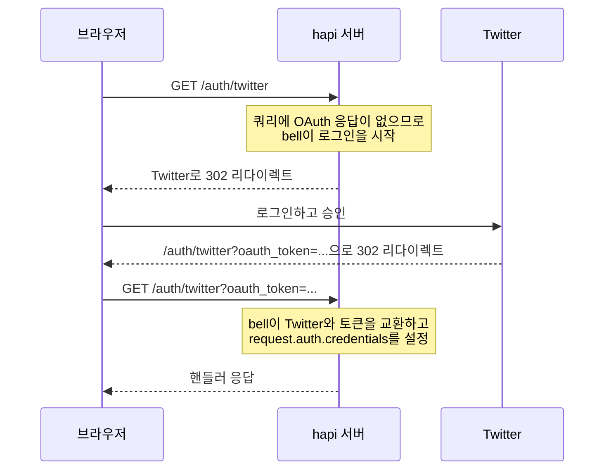

<TutorialLang />

# Express 마이그레이션

_이 가이드는 hapi v21 이상과 호환됩니다_

## <a name="overview" ></a> 개요

이 가이드는 Express에서 하던 일을 hapi에서 어떻게 하는지 보여 줍니다. 예제는 Express 5를 사용합니다.

가장 큰 차이는 이것입니다. Express는 직접 설치하고 `app.use()`로 순서를 정하는 미들웨어로 기능을 추가하지만, hapi는 대부분의 기능을 코어에 내장하고 라우트별로 설정합니다. hapi에 플러그인이 필요한 경우에도 그 플러그인은 hapi 팀이 만듭니다. hapi 자체의 런타임 의존성은 모두 같은 팀이 관리하는 `@hapi/*` 패키지입니다.

| Express에서 쓰는 것             | hapi에서 쓰는 것                                                                                                                                      |
| ------------------------------- | ----------------------------------------------------------------------------------------------------------------------------------------------------- |
| `express.json()`, `body-parser` | 내장: [페이로드 파싱](#bodyparser)                                                                                                                    |
| `cookie-parser`                 | 내장: [`server.state()`](#config)                                                                                                                     |
| `express-validator`             | 내장: [joi](https://joi.dev)를 사용하는 라우트 [`validate`](#joi)                                                                                     |
| `passport`                      | 인증 프레임워크 내장. 스킴은 `@hapi/basic`, `@hapi/cookie`, `@hapi/jwt`, [bell](#bell) 같은 플러그인에서 제공([인증 튜토리얼](/tutorials/ko_KR/auth)) |
| `cors`                          | 내장: 라우트 [`cors`](/api#route-options-cors) 옵션                                                                                                   |
| `helmet`                        | 일부 내장: 라우트 [`security`](/api#route-options-security) 옵션(Content-Security-Policy 제외)                                                        |
| `compression`                   | 내장, 기본으로 켜져 있음                                                                                                                              |
| `app.set('view engine')`        | [vision](#vision) 플러그인                                                                                                                            |
| `express.static()`              | [inert](#inert) 플러그인                                                                                                                              |
| 커스텀 미들웨어                 | [확장 지점](#extension)과 [플러그인](#creating)                                                                                                       |
| 에러 처리 미들웨어              | `onPreResponse` [확장](#extension). `next(err)` 대신 [boom](#boom) 에러를 던짐                                                                        |

## <a name="setup" ></a> 설정

### <a name="installation" ></a> 설치

|                 | Express                                 | hapi                     |
| --------------- | --------------------------------------- | ------------------------ |
| 설치            | `npm install express`                   | `npm install @hapi/hapi` |
| TypeScript 타입 | `npm install --save-dev @types/express` | 포함됨                   |

### <a name="server" ></a> 서버 만들기

Express:

```ts
import express from 'express';

const app = express();

app.listen(3000, function () {
    console.log('Server is running on port 3000');
});
```

hapi:

```ts
import Hapi from '@hapi/hapi';

const init = async () => {
    const server = Hapi.server({
        port: 3000,
        host: 'localhost',
    });

    await server.start();
    console.log('Server running on port 3000');
};

init();
```

hapi에서는 `server` 객체가 애플리케이션의 중심입니다. 서버 옵션(포트, 호스트, 기본 라우트 설정)이 서버의 동작을 결정하고, 라우트, 플러그인, 확장은 모두 서버에 추가됩니다. `server.start()`는 프로미스를 반환합니다.

## <a name="routes" ></a> 라우트

Express:

```ts
app.get('/hello', function (req, res) {
    res.send('Hello World!');
});
```

hapi:

```ts
server.route({
    method: 'GET',
    path: '/hello',
    handler: (request, h) => {
        return 'Hello World!';
    },
});
```

|                 | Express                                | hapi                                                |
| --------------- | -------------------------------------- | --------------------------------------------------- |
| 라우트 정의     | `app.METHOD(path, handler)`            | `server.route({ method, path, handler })`           |
| 응답 보내기     | `res.send()` 호출                      | 값을 반환                                           |
| 실행되는 라우트 | 일치하는 라우트 중 먼저 등록된 것      | 등록 순서와 관계없이 가장 구체적으로 일치하는 것    |
| 겹치는 라우트   | 둘 다 등록되고 먼저 등록된 것이 선택됨 | 두 라우트가 충돌하면 `server.route()`가 예외를 던짐 |

hapi는 가장 구체적인 라우트를 고르기 때문에 `'/home'`은 항상 `'/{any*}'`보다 우선하며, 등록 순서가 응답할 라우트를 결정하는 일은 없습니다. 규칙은 [라우팅 튜토리얼](/tutorials/ko_KR/routing)을 참고하세요.

### <a name="methods" ></a> 메서드

| Express                | hapi                                             |
| ---------------------- | ------------------------------------------------ |
| `app.get(path, ...)`   | `method: 'GET'`                                  |
| 메서드마다 라우트 하나 | `method: ['PUT', 'POST']`                        |
| `app.all(path, ...)`   | `method: '*'`                                    |
| `app.head(path, ...)`  | 허용되지 않음. 모든 `GET` 라우트가 `HEAD`에 응답 |

```ts
server.route({
    method: ['PUT', 'POST'],
    path: '/',
    handler: function (request, h) {
        return 'I did something!';
    },
});
```

### <a name="path" ></a> 경로

hapi에서는 파라미터를 중괄호로 감쌉니다:

|                 | Express 5        | hapi              |
| --------------- | ---------------- | ----------------- |
| 파라미터        | `/users/:userId` | `/users/{userId}` |
| 선택적 파라미터 | `/hello{/:user}` | `/hello/{user?}`  |
| 와일드카드      | `/files/*path`   | `/files/{path*}`  |

hapi에서 `{user*}`와 세그먼트 전체를 차지하는 `{user?}`는 마지막 세그먼트여야 합니다. `{user*2}`와 `/a{user?}/b` 같은 세그먼트 일부의 선택적 파라미터는 어디에나 올 수 있습니다.

### <a name="parameters" ></a> 파라미터

Express:

```ts
app.get('/hello/:name', function (req, res) {
    const name = req.params.name;
    res.send('Hello ' + name);
});
```

hapi:

```ts
server.route({
    method: 'GET',
    path: '/hello/{name}',
    handler: function (request, h) {
        const name = request.params.name;
        return 'Hello ' + name;
    },
});
```

| Express      | hapi              |
| ------------ | ----------------- |
| `req.params` | `request.params`  |
| `req.query`  | `request.query`   |
| `req.body`   | `request.payload` |

### <a name="handler" ></a> 핸들러

Express 핸들러는 `req`와 `res`를 받고 `res`의 메서드를 호출해 응답합니다. hapi 핸들러는 `request`와 [응답 툴킷](/api#response-toolkit)인 `h`를 받고 응답을 반환합니다:

| Express                        | hapi                                                      |
| ------------------------------ | --------------------------------------------------------- |
| `res.send('text')`             | `return 'text'`                                           |
| `res.json(object)`             | `return object`                                           |
| `res.status(201).send(object)` | `return h.response(object).code(201)`                     |
| `res.set('x-name', 'value')`   | `return h.response(object).header('x-name', 'value')`     |
| `res.redirect('/')`            | `return h.redirect('/')`                                  |
| `res.cookie('name', 'value')`  | `h.state('name', 'value')`, [쿠키](#config) 참고          |
| `res.sendFile(file)`           | `return h.file(file)`, [inert](#inert) 참고               |
| `res.render('index', context)` | `return h.view('index', context)`, [vision](#vision) 참고 |
| `next(err)`                    | `throw Boom.notFound()`, [boom](#boom) 참고               |

핸들러가 상태 코드나 헤더를 설정해야 할 때는 값을 `h.response()`로 감쌉니다:

```ts
server.route({
    method: 'POST',
    path: '/user',
    handler: function (request, h) {
        const user = {
            firstName: 'John',
            lastName: 'Doe',
            id: 123,
        };

        return h.response(user).code(201).header('location', '/user/123');
    },
});
```

hapi는 반환된 객체를 JSON으로 직렬화하고 `content-type`을 설정합니다. hapi가 반환 값을 응답으로 바꾸는 방법은 [응답 마샬링 튜토리얼](/tutorials/ko_KR/response-marshalling)을 참고하세요.

## <a name="plugins" ></a> 미들웨어 대 플러그인과 확장

Express는 `app.use()`를 호출한 순서대로 미들웨어를 실행합니다. 한 미들웨어가 다른 미들웨어에 의존하면 직접 올바른 순서를 유지해야 하고, 순서가 틀리면 요청 시점에 실패합니다.

hapi는 모든 요청을 정해진 단계의 순서, 즉 [요청 라이프사이클](/api#request-lifecycle)에 통과시킵니다. 미들웨어의 순서를 정하는 대신, 이름이 붙은 단계에 코드를 연결합니다. 아래 표에는 각 단계가 대신하는 Express 미들웨어도 함께 나와 있습니다:

| hapi 단계              | 확장 지점                        | Express에서 대응하는 것      |
| ---------------------- | -------------------------------- | ---------------------------- |
| 요청 수신              | `onRequest`                      | 라우팅 전의 `app.use()`      |
| 라우트 조회, 쿠키 파싱 |                                  | `app.get()`, `cookie-parser` |
| 인증 전                | `onPreAuth`                      |                              |
| 인증                   |                                  | `passport`                   |
| 페이로드 파싱          |                                  | `express.json()`             |
| 인증 후                | `onCredentials`, `onPostAuth`    |                              |
| 검증                   |                                  | `express-validator`          |
| 핸들러 전              | `onPreHandler`                   |                              |
| 핸들러                 |                                  | 라우트 콜백                  |
| 핸들러 후              | `onPostHandler`, `onPreResponse` | 에러 처리 미들웨어           |
| 응답 전송 후           | `onPostResponse`                 |                              |

확장 지점은 `server.ext()`로 직접 코드를 추가하는 곳입니다. 나머지 단계는 hapi가 각 라우트의 설정에 따라 실행합니다.

재사용 가능한 미들웨어는 플러그인으로 대체합니다. 플러그인은 서버에 라우트, 확장, 데코레이션을 등록하는 이름 있는 단위입니다. 플러그인은 `dependencies` 속성에 필요한 다른 플러그인을 선언할 수 있으며, 그중 하나가 없으면 hapi는 요청 시점에 실패하는 대신 시작 자체를 거부합니다. [플러그인 튜토리얼](/tutorials/ko_KR/plugins)을 참고하세요.

### <a name="extension" ></a> 확장 지점

모든 요청에 실행되는 미들웨어는 확장이 됩니다:

Express:

```ts
app.use(function (req, res, next) {
    console.log(req.method, req.url);
    next();
});
```

hapi:

```ts
server.ext('onRequest', function (request, h) {
    console.log(request.method, request.path);
    return h.continue;
});
```

`return h.continue`는 `next()`의 역할을 합니다. 요청이 다음 단계로 넘어갑니다. 대신 takeover 응답(`h.response(...).takeover()`)을 반환하거나 에러를 던지면 요청이 그 자리에서 끝납니다.

hapi에는 요청 확장 지점이 여덟 개 있습니다: `onRequest`, `onPreAuth`, `onCredentials`, `onPostAuth`, `onPreHandler`, `onPostHandler`, `onPreResponse`, `onPostResponse`. 각각을 언제 쓰는지는 [라이프사이클 훅 튜토리얼](/tutorials/ko_KR/lifecycle-hooks)에서 다루고, 옵션은 [`server.ext()`](/api#server-ext-events)에 나와 있습니다.

### <a name="creating" ></a> 플러그인 만들기

모든 요청에 헬퍼를 추가하는 미들웨어는 [데코레이션](/tutorials/ko_KR/decorators)을 추가하는 플러그인이 됩니다. 플러그인은 `name`(또는 `pkg`)과 `async register(server, options)` 함수를 가진 객체입니다.

Express:

```ts
import type { NextFunction, Request, Response } from 'express';

declare global {
    namespace Express {
        interface Request {
            getDate(): Date;
        }
    }
}

const getDate = function (req: Request, res: Response, next: NextFunction) {
    req.getDate = function () {
        const date = new Date();
        return date;
    };

    next();
};
```

hapi:

```ts
import type { Plugin } from '@hapi/hapi';

declare module '@hapi/hapi' {
    interface ResponseToolkit {
        getDate(): Date;
    }
}

const getDate: Plugin<void> = {
    name: 'getDate',
    version: '1.0.0',
    register: async function (server, options) {
        const currentDate = function () {
            const date = new Date();
            return date;
        };

        server.decorate('toolkit', 'getDate', currentDate);
    },
};
```

- Express 미들웨어는 요청마다 `req.getDate`를 다시 설정합니다. hapi 플러그인은 등록할 때 `server.decorate()`를 한 번 호출하고, 이후 모든 핸들러에서 `h.getDate()`를 쓸 수 있습니다.
- TypeScript는 새 메서드를 선언해야만 알 수 있습니다. Express는 전역 `Express.Request` 인터페이스로, hapi는 `@hapi/hapi`의 `ResponseToolkit` 인터페이스에 추가해서 선언합니다.

### <a name="load" ></a> 플러그인 불러오기

Express:

```ts
app.use(getDate);
```

hapi:

```ts
await server.register({
    plugin: getDate,
});
```

### <a name="options" ></a> 옵션

Express 미들웨어는 미들웨어를 반환하는 함수 형태로 옵션을 받습니다. hapi 플러그인은 `register`의 두 번째 인자로 옵션을 받습니다.

Express:

```ts
import type { NextFunction, Request, Response } from 'express';

declare global {
    namespace Express {
        interface Request {
            getDate(): string;
        }
    }
}

export default function (options: { name: string }) {
    return function getDate(req: Request, res: Response, next: NextFunction) {
        req.getDate = function () {
            const date = 'Hello ' + options.name + ', the date is ' + new Date();
            return date;
        };

        next();
    };
}
```

hapi:

```ts
import type { Plugin } from '@hapi/hapi';

declare module '@hapi/hapi' {
    interface ResponseToolkit {
        getDate(): string;
    }
}

const getDate: Plugin<{ name: string }> = {
    name: 'getDate',
    version: '1.0.0',
    register: async function (server, options) {
        const currentDate = function () {
            const date = 'Hello ' + options.name + ', the date is ' + new Date();
            return date;
        };

        server.decorate('toolkit', 'getDate', currentDate);
    },
};
```

옵션은 플러그인을 등록할 때 넘깁니다. `Plugin<{ name: string }>`의 타입 인자가 `register` 안의 `options` 타입을 정하고, 옵션이 맞지 않는 `server.register()` 호출은 TypeScript가 잡아냅니다. hapi는 런타임에 옵션을 검사하지 않습니다:

Express:

```ts
import getDate from './mw/getDate.ts';

app.use(getDate({ name: 'Tom' }));
```

hapi:

```ts
await server.register({
    plugin: getDate,
    options: {
        name: 'Tom',
    },
});
```

## <a name="bodyparser" ></a> body-parser

hapi는 미들웨어 없이 핸들러가 실행되기 전에 요청 페이로드를 파싱합니다. 결과는 `request.payload`에 있습니다.

| 콘텐츠 타입                         | Express                         | hapi                                       |
| ----------------------------------- | ------------------------------- | ------------------------------------------ |
| `application/json`                  | `app.use(express.json())`       | 기본으로 파싱                              |
| `application/x-www-form-urlencoded` | `app.use(express.urlencoded())` | 기본으로 파싱                              |
| `text/*`                            | `app.use(express.text())`       | 기본으로 파싱                              |
| `multipart/form-data`               | `multer` 같은 별도 패키지       | 라우트 옵션 `payload: { multipart: true }` |

Express:

```ts
import express from 'express';

const app = express();

app.use(express.urlencoded());

app.post('/hello', function (req, res) {
    const name = req.body.name;
    res.send('Hello ' + name);
});
```

hapi:

```ts
server.route<{ Payload: { name: string } }>({
    method: 'POST',
    path: '/hello',
    handler: function (request, h) {
        const name = request.payload.name;
        return 'Hello ' + name;
    },
});
```

hapi는 클라이언트가 무엇을 보낼지 알 수 없으므로 `request.payload`에는 정해진 형태가 없습니다. 타입 인자 `server.route<{ Payload: { name: string } }>()`는 핸들러가 받는 값을 TypeScript에 알려 줍니다. 이것은 타입일 뿐이므로, 런타임에 페이로드를 검사하려면 [검증](#joi)을 추가하세요. 크기 제한, 타임아웃, 파일 업로드는 라우트의 [`payload` 옵션](/api#route-options-payload)으로 설정합니다.

## <a name="config" ></a> cookie-parser

hapi는 미들웨어 없이 쿠키를 읽고 씁니다. Express는 `res.cookie()`를 호출할 때마다 쿠키 옵션을 받지만, hapi는 `server.state()`로 각 쿠키를 한 번 정의하고 이후 모든 라우트에서 이름으로 설정합니다.

| 옵션            | Express `res.cookie()`    | hapi `server.state()`           |
| --------------- | ------------------------- | ------------------------------- |
| Secure 플래그   | `secure`, 기본으로 꺼짐   | `isSecure`, 기본으로 켜짐       |
| HttpOnly 플래그 | `httpOnly`, 기본으로 꺼짐 | `isHttpOnly`, 기본으로 켜짐     |
| SameSite        | `sameSite`                | `isSameSite`, 기본값 `'Strict'` |
| 수명            | `maxAge` (ms)             | `ttl` (ms)                      |
| 서명된 값       | `signed`                  | `sign: { password }`            |
| 암호화된 값     | 내장되지 않음             | `encoding: 'iron'`              |

모든 옵션은 [`server.state()`](/api#server-state-name-options)를, 자세한 내용은 [쿠키 튜토리얼](/tutorials/ko_KR/cookies)을 참고하세요.

### <a name="setCookie" ></a> 쿠키 설정하기

Express:

```ts
import express from 'express';
import cookieParser from 'cookie-parser';

const app = express();

app.use(cookieParser());

app.get('/', function (req, res) {
    res.cookie('username', 'tom', { secure: true, httpOnly: true });
    res.send('Hello');
});
```

hapi:

```ts
import Hapi from '@hapi/hapi';

const server = Hapi.server({ port: 8000 });

server.state('username', {
    ttl: null,
    isSecure: true,
    isHttpOnly: true,
});

server.route({
    method: 'GET',
    path: '/',
    handler: function (request, h) {
        h.state('username', 'tom');
        return 'Hello';
    },
});
```

### <a name="getCookie" ></a> 쿠키 값 읽기

Express:

```ts
app.get('/whoami', (req, res) => {
    res.send(req.cookies.username);
});
```

hapi:

```ts
server.route({
    method: 'GET',
    path: '/whoami',
    handler: (request, h) => {
        const username = request.state.username;
        if (typeof username !== 'string') {
            return 'No username cookie';
        }

        return username;
    },
});
```

`request.state`에는 클라이언트가 보낸 쿠키가 무엇이든 들어 있으므로 hapi는 각 값의 타입을 `unknown`으로 지정합니다. 사용하기 전에 타입을 확인하세요.

## <a name="bell" ></a> Passport -> bell

Express는 Passport로 서드파티 로그인을 처리합니다. hapi는 [bell](/module/bell)을 사용하는데, Twitter, Facebook, Google, GitHub를 포함해 30개가 넘는 OAuth 제공자에 대한 설정이 내장되어 있고 커스텀 제공자도 지원합니다. [bell 제공자 목록](/module/bell/providers)을 참고하세요.

Passport는 로그인을 시작하는 라우트와 제공자의 콜백을 받는 라우트, 두 개가 필요합니다. bell은 하나의 라우트로 둘 다 처리합니다:



Express:

```
npm install passport passport-twitter
```

TypeScript를 사용한다면 `npm install --save-dev @types/passport @types/passport-twitter`도 실행하세요.

```ts
import passport from 'passport';
import { Strategy as TwitterStrategy } from 'passport-twitter';

passport.use(
    new TwitterStrategy(
        {
            consumerKey: TWITTER_CONSUMER_KEY,
            consumerSecret: TWITTER_CONSUMER_SECRET,
            callbackURL: '/auth/twitter/callback',
        },
        function (token, tokenSecret, profile, cb) {
            User.findOrCreate({ twitterId: profile.id }, function (err, user) {
                return cb(err, user);
            });
        },
    ),
);

passport.serializeUser(function (user, cb) {
    cb(null, user);
});

passport.deserializeUser(function (user: Express.User, cb) {
    cb(null, user);
});

app.get('/auth/twitter', passport.authenticate('twitter'));
app.get('/auth/twitter/callback', passport.authenticate('twitter', { failureRedirect: '/login' }), function (req, res) {
    res.redirect('/');
});
```

hapi:

```
npm install @hapi/bell
```

```ts
import Hapi from '@hapi/hapi';
import Bell from '@hapi/bell';

const server = Hapi.server({ port: 8000 });

await server.register(Bell);

server.auth.strategy('twitter', 'bell', {
    provider: 'twitter',
    password: 'cookie_encryption_password_secure',
    clientId: TWITTER_CONSUMER_KEY,
    clientSecret: TWITTER_CONSUMER_SECRET,
    isSecure: false,
});

server.route({
    method: '*',
    path: '/auth/twitter', // The callback endpoint registered with the provider
    handler: function (request, h) {
        if (!request.auth.isAuthenticated) {
            return `Authentication failed due to: ${request.auth.error.message}`;
        }

        // Look up or register the account, start a local session, and redirect.
        // request.auth.credentials holds the provider's profile and tokens.

        return h.redirect('/home');
    },
    options: {
        auth: {
            strategy: 'twitter',
            mode: 'try',
        },
    },
});
```

| 옵션           | 설명                                                                                                       |
| -------------- | ---------------------------------------------------------------------------------------------------------- |
| `provider`     | 내장된 제공자 설정의 이름                                                                                  |
| `password`     | bell이 두 요청 사이에 유지하는 임시 쿠키를 암호화. 최소 32자                                               |
| `clientId`     | 제공자에게서 받은 OAuth 클라이언트 ID                                                                      |
| `clientSecret` | 제공자에게서 받은 OAuth 클라이언트 시크릿                                                                  |
| `isSecure`     | 쿠키의 Secure 플래그. `false`이면 개발 중에 일반 HTTP를 허용. 프로덕션에서는 기본값 `true`를 그대로 두세요 |

`mode: 'try'`는 로그인이 실패해도 핸들러가 실행되게 하므로, 그냥 401을 보내는 대신 에러를 보여 줄 수 있습니다. 로그인을 시작한 요청의 쿼리 파라미터는 `request.auth.credentials.query`로 돌아오므로, 제공자를 왕복하는 동안 돌아갈 URL을 전달할 수 있습니다.

## <a name="joi" ></a> express-validator -> joi

hapi는 [joi](https://joi.dev) 스키마를 사용해 라우트 설정에 따라 요청과 응답을 검증합니다. express-validator는 요청만 검사하지만, hapi는 핸들러가 반환하는 값도 검사할 수 있습니다. 자세한 내용은 [검증 튜토리얼](/tutorials/ko_KR/validation)을 참고하세요.

### <a name="input" ></a> 입력 검증

Express:

```
npm install express-validator
```

```ts
import express from 'express';
import { body, validationResult } from 'express-validator';

app.use(express.json());
app.use(express.urlencoded());

app.post('/post', body('post', 'Post too long').isLength({ max: 140 }), function (req, res) {
    const errors = validationResult(req);
    if (!errors.isEmpty()) {
        res.status(400).send(errors.array());
    } else {
        res.send('Blog post added!');
    }
});
```

hapi:

```
npm install joi
```

```ts
import Joi from 'joi';

server.route({
    method: 'POST',
    path: '/post',
    handler: (request, h) => {
        return 'Blog post added!';
    },
    options: {
        validate: {
            payload: Joi.object({
                post: Joi.string().max(140),
            }),
        },
    },
});
```

- 핸들러는 페이로드가 통과할 때만 실행됩니다. 그렇지 않으면 hapi가 알아서 400으로 응답하므로 핸들러에는 에러 분기가 없습니다.
- 규칙은 `Joi.string().min(1).max(140)`처럼 체이닝합니다.
- `validate`는 `params`, `query`, `headers`, `state` 스키마도 받습니다.

### <a name="output" ></a> 출력 검증

```ts
const bookSchema = Joi.object({
    title: Joi.string().required(),
    author: Joi.string().required(),
    isbn: Joi.string().length(10),
    pageCount: Joi.number(),
    datePublished: Joi.date().iso(),
});

server.route({
    method: 'GET',
    path: '/books',
    handler: async function (request, h) {
        return await getBooks();
    },
    options: {
        response: {
            schema: Joi.array().items(bookSchema),
            failAction: 'log',
        },
    },
});
```

`response.schema`는 핸들러가 반환하는 책 목록을 검사합니다. `failAction: 'log'`이면 스키마를 통과하지 못한 응답도 그대로 전송되고 실패는 로그로 남습니다. 기본값인 `'error'`는 응답을 500으로 바꿉니다.

## <a name="vision" ></a> app.set('view engine') -> vision

hapi는 [vision](/module/vision) 플러그인으로 템플릿을 렌더링합니다. 여러 템플릿 엔진을 동시에 지원하고 partial, 헬퍼, 레이아웃도 지원합니다. 자세한 내용은 [뷰 튜토리얼](/tutorials/ko_KR/views)을 참고하세요.

### <a name="viewengine" ></a> 뷰 엔진 설정하기

Express:

```ts
app.set('view engine', 'pug');
```

hapi:

```ts
import Vision from '@hapi/vision';
import Pug from 'pug';

await server.register(Vision);

server.views({
    engines: {
        pug: Pug,
    },
    relativeTo: import.meta.dirname,
    path: 'views',
});
```

Express는 기본적으로 `./views`에서 템플릿을 찾습니다. hapi에서는 `relativeTo`와 `path`로 폴더를 지정합니다.

### <a name="view" ></a> 뷰 렌더링하기

Express:

```ts
app.get('/', function (req, res) {
    res.render('index', { title: 'Homepage', message: 'Welcome' });
});
```

hapi, `h.view()` 사용:

```ts
server.route({
    method: 'GET',
    path: '/',
    handler: function (request, h) {
        return h.view('index', { title: 'Homepage', message: 'Welcome' });
    },
});
```

hapi, 라우트가 템플릿만 렌더링할 때 `view` 핸들러 사용:

```ts
server.route({
    method: 'GET',
    path: '/',
    handler: {
        view: {
            template: 'index',
            context: {
                title: 'Homepage',
                message: 'Welcome',
            },
        },
    },
});
```

## <a name="inert" ></a> express.static() -> inert

hapi는 [inert](/module/inert) 플러그인으로 정적 파일을 제공합니다. inert는 `file`과 `directory` 핸들러, 그리고 `h.file()` 메서드를 추가합니다. 자세한 내용은 [파일 제공 튜토리얼](/tutorials/ko_KR/serving-files)을 참고하세요.

아래 두 예제는 모두 이 설정을 사용합니다. inert를 등록하고 파일 경로의 기준이 되는 폴더를 지정합니다:

```ts
import Path from 'node:path';
import Hapi from '@hapi/hapi';
import Inert from '@hapi/inert';

const server = Hapi.server({
    port: 3000,
    routes: {
        files: {
            relativeTo: Path.join(import.meta.dirname, 'public'),
        },
    },
});

await server.register(Inert);
```

### <a name="single" ></a> 단일 파일 제공

Express:

```ts
app.get('/image', function (req, res) {
    res.sendFile('image.jpg', { root: './public' });
});
```

hapi, `h.file()` 사용:

```ts
server.route({
    method: 'GET',
    path: '/image',
    handler: function (request, h) {
        return h.file('image.jpg');
    },
});
```

hapi, `file` 핸들러 사용:

```ts
server.route({
    method: 'GET',
    path: '/image',
    handler: {
        file: 'image.jpg',
    },
});
```

### <a name="static" ></a> 정적 파일 서버

Express:

```ts
app.use(express.static('public'));
```

hapi:

```ts
server.route({
    method: 'GET',
    path: '/{param*}',
    handler: {
        directory: {
            path: '.',
        },
    },
});
```

`{param*}` 와일드카드는 모든 경로와 일치하고, `directory` 핸들러는 `public` 폴더에서 일치하는 파일을 제공하므로 `/logo.png`는 `public/logo.png`를 반환합니다. hapi는 가장 구체적인 라우트를 고르므로 다른 라우트는 여전히 이 모든 경로를 받는 라우트보다 우선합니다.

## <a name="boom" ></a> 에러 처리 -> boom

hapi는 [boom](/module/boom) 에러 객체로 만든 JSON으로 에러에 응답합니다. Express는 HTML 페이지로 응답합니다. 일치하는 라우트가 없는 `GET /hello`의 경우:

Express:

```text
Cannot GET /hello
```

hapi:

```json
{
    "statusCode": 404,
    "error": "Not Found",
    "message": "Not Found"
}
```

### <a name="custom" ></a> 커스텀 메시지

Express:

```ts
res.status(404).send({ status: 404, error: 'Page not found' });
```

hapi:

```ts
throw Boom.notFound('Page not found');
```

던진 에러는 다음 응답이 됩니다:

```json
{
    "statusCode": 404,
    "error": "Not Found",
    "message": "Page not found"
}
```

boom에는 `Boom.badRequest()`, `Boom.unauthorized()`, `Boom.badImplementation()`처럼 자주 쓰는 4xx와 5xx 상태마다 함수가 있습니다. 핸들러, 확장, 플러그인 어디서든 던지면 hapi가 이를 응답으로 바꿉니다. boom 에러가 아닌 에러는 500이 되고 메시지는 클라이언트에게 숨겨집니다. 전체 목록은 [boom 문서](/module/boom)를 참고하세요.
