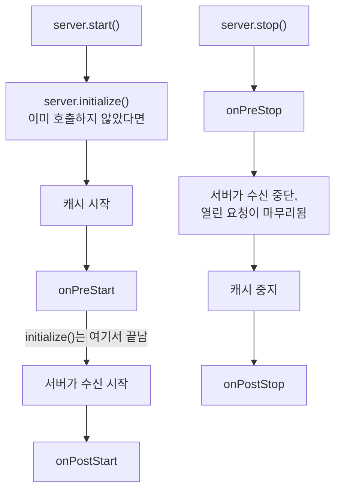
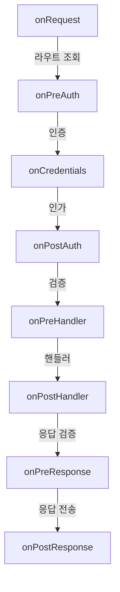

<TutorialLang />

# 라이프사이클 훅

_이 튜토리얼은 hapi v21 이상과 호환됩니다_

## <a name="overview"></a> 개요

hapi는 모든 요청을 라우트 조회, 인증, 검증, 핸들러 등 정해진 같은 순서의 단계로 처리합니다. 라이프사이클 훅(API 레퍼런스에서는 extension point라고 부릅니다)을 사용하면 이 순서의 이름 붙은 지점에서 여러분의 함수를 실행할 수 있습니다. 서버 자체에도 시작과 종료를 위한 훅이 네 개 더 있습니다.

여러 기능에 걸친 공통 기능은 대부분 훅으로 만들어집니다. 몇몇 공식 플러그인은 사실상 훅 몇 개로 이루어져 있습니다.

| 플러그인               | 훅              | 그 훅에서 하는 일                            |
| ---------------------- | --------------- | -------------------------------------------- |
| [yar](/module/yar)     | `onPreAuth`     | 인증에서 쓸 수 있도록 세션을 불러옴          |
| [yar](/module/yar)     | `onPreResponse` | 세션을 쿠키에 저장                           |
| [crumb](/module/crumb) | `onPostAuth`    | CSRF 토큰이 없거나 틀린 요청을 거부          |
| [crumb](/module/crumb) | `onPreResponse` | HTML 페이지의 뷰 컨텍스트에 CSRF 토큰을 추가 |
| [nes](/module/nes)     | `onPreStart`    | WebSocket heartbeat 시작                     |
| [nes](/module/nes)     | `onPreStop`     | 열려 있는 WebSocket 연결을 닫음              |

훅은 [`server.ext()`](/api#server-ext-events)로 추가하며, 전체 옵션 목록은 API 레퍼런스에 있습니다.

## <a name="server-hooks"></a> 서버 훅: 시작과 종료

서버 훅은 서버가 시작하거나 멈출 때 한 번 실행됩니다. 각 훅은 `server`를 받고, 아무것도 반환하지 않거나 promise를 반환합니다. 에러를 던지면 시작이나 종료가 중단됩니다.



[`server.start()`](/api#await-server-start)는 `server.initialize()`를 아직 호출하지 않았다면 먼저 실행합니다. `initialize()`는 수신 단계 전에 멈추므로 `onPreStart`는 실행하지만 포트는 열지 않습니다. 그래서 `server.inject()`로 요청을 보내는 테스트에서는 이 메서드를 호출하는 것이 맞습니다.

| 훅            | 실행 시점                | 용도                                                   |
| ------------- | ------------------------ | ------------------------------------------------------ |
| `onPreStart`  | 서버가 수신하기 전       | 데이터베이스 연결과 설정 검사. 실패하면 시작이 중단됨  |
| `onPostStart` | 서버가 수신을 시작한 뒤  | 서비스 디스커버리 등록처럼 바인딩된 포트가 필요한 작업 |
| `onPreStop`   | 서버가 수신을 멈추기 전  | 로드 밸런서와 장시간 연결에 연결을 끊으라고 알림       |
| `onPostStop`  | 열린 요청이 모두 끝난 뒤 | 데이터베이스 풀 등 요청이 쓰던 리소스 정리             |

데이터베이스 풀이 흔한 예입니다. `onPreStart`에서 연결하면 데이터베이스가 없을 때 첫 요청이 아니라 `server.start()`가 실패합니다. `onPostStop`에서 닫으면 처리 중인 요청이 쿼리를 마칠 때까지 기다립니다.

```ts
import Hapi from '@hapi/hapi';
import { Pool } from 'pg';

import type { Plugin } from '@hapi/hapi';

const database: Plugin<{ connectionString: string }> = {
    name: 'database',
    register(server, options) {
        const pool = new Pool({ connectionString: options.connectionString });

        server.ext('onPreStart', async () => {
            await pool.query('SELECT 1');
        });

        server.ext('onPostStop', async () => {
            await pool.end();
        });

        server.expose('pool', pool);
    },
};

const server = Hapi.server({ port: 4000 });

await server.register({
    plugin: database,
    options: { connectionString: 'postgres://localhost/app' },
});

await server.start();

process.on('SIGTERM', async () => {
    await server.stop({ timeout: 10_000 });
    process.exit(0);
});
```

`server.stop({ timeout })`은 열린 요청에 연결이 닫히기 전까지 그만큼의 시간을 줍니다. 이 풀 같은 서비스를 핸들러와 공유하려면 [서버 데코레이션](/tutorials/ko_KR/decorators#server)을 사용하세요.

서버 훅의 두 가지 규칙:

- `onPreStart`는 `initialize()`나 `start()`를 호출하기 전에 추가하세요. 그 뒤에 추가하면 `Cannot add onPreStart (after) extension after the server was initialized` 에러가 발생합니다.
- 한 플러그인의 시작 작업이 다른 플러그인의 준비를 필요로 한다면 [`server.dependency()`](/api#server-dependency-dependencies-after) 콜백에 넣으세요. hapi는 등록 순서와 관계없이, 지정한 플러그인 다음에 `onPreStart` 동안 이 콜백을 실행합니다. 플러그인 튜토리얼의 [의존성](/tutorials/ko_KR/plugins#dependencies)을 참고하세요.

## <a name="request-hooks"></a> 요청 훅

요청 훅은 요청마다 실행됩니다. 여덟 개의 훅이 [요청 라이프사이클](/api#request-lifecycle)의 단계 사이에 위치합니다.



`onRequest`, `onPreResponse`, `onPostResponse`는 404나 인증 또는 검증에서 거부된 요청을 포함해 모든 요청에서 실행됩니다. 예외는 중단(abort)되었거나 `h.close`로 닫힌 요청으로, 이 경우 `onPreResponse`를 건너뜁니다. `onCredentials`는 라우트에 인증이 설정되어 있으면 자격 증명을 찾지 못했더라도 항상 실행됩니다. 나머지 훅은 요청이 그 단계까지 도달했을 때 실행됩니다.

| 훅               | 믿고 쓸 수 있는 것                                             | 일반적인 용도                         |
| ---------------- | -------------------------------------------------------------- | ------------------------------------- |
| `onRequest`      | 원본 경로와 헤더. 아직 라우트 없음. URL을 바꿀 수 있음         | 요청 id, URL 재작성, 점검 모드        |
| `onPreAuth`      | `request.route`와 파싱된 쿠키                                  | 인증에서 읽을 세션 불러오기           |
| `onCredentials`  | 스코프 검사 전의 `request.auth.credentials`                    | 데이터베이스에서 역할이나 스코프 추가 |
| `onPostAuth`     | 인증 완료, 페이로드는 파싱되었지만 검증 전                     | CSRF 검사, 테넌트나 계정 불러오기     |
| `onPreHandler`   | 파라미터, 쿼리, 페이로드 검증 완료                             | 검증된 입력이 필요한 검사             |
| `onPostHandler`  | 핸들러의 응답 객체. 핸들러가 실패하면 `onPreResponse`로 건너뜀 | 성공한 응답 변경                      |
| `onPreResponse`  | 에러를 포함한 최종 `request.response`                          | 에러 페이지, 응답 헤더, 세션 저장     |
| `onPostResponse` | 응답 전송 완료                                                 | 메트릭, 접근 로그, 정리 작업          |

### <a name="return-values"></a> 훅이 반환하는 값

요청 훅은 [라이프사이클 메서드](/api#lifecycle-methods)입니다. `(request, h)`를 받고 반드시 무언가를 반환해야 합니다. 무엇을 반환하느냐에 따라 다음 동작이 정해집니다.

| 반환값                         | `onRequest`              | `onPreAuth` ~ `onPreHandler`                     | `onPostHandler`, `onPreResponse`             | `onPostResponse`                     |
| ------------------------------ | ------------------------ | ------------------------------------------------ | -------------------------------------------- | ------------------------------------ |
| `h.continue`                   | 다음 단계 실행           | 다음 단계 실행                                   | 현재 응답 유지                               | 무시됨                               |
| `h.response(value).takeover()` | `onPreResponse`로 건너뜀 | 라우트의 응답 검증으로 건너뛴 뒤 `onPreResponse` | 응답을 교체. 같은 유형의 이후 훅은 건너뜀    | 무시됨                               |
| 던지거나 반환한 에러           | `onPreResponse`로 건너뜀 | `onPreResponse`로 건너뜀                         | 응답을 교체. 같은 유형의 이후 훅은 건너뜀    | 던진 에러나 반환한 boom: 로그로 남음 |
| 그 밖의 값                     | 500 에러                 | 500 에러                                         | 응답을 교체. 같은 유형의 이후 훅은 계속 실행 | 무시됨                               |
| 아무것도 없음 (`undefined`)    | 500 에러                 | 500 에러                                         | 500 에러                                     | 무시됨                               |

[`h.continue`](/api#h-continue)는 훅이 "여기서는 할 일이 없음"을 알리는 방법입니다. takeover는 핸들러 이전의 훅이 직접 요청에 응답하는 방법이며, `onRequest`에서 한 takeover도 `onPreResponse`를 거칩니다. 전체 규칙은 API 레퍼런스의 [라이프사이클 워크플로](/api#lifecycle-workflow)에 있습니다.

## <a name="patterns"></a> 패턴

### <a name="request-id"></a> 요청 id와 소요 시간

요청 id는 클라이언트의 에러 보고와 서버 로그를 연결해 줍니다. 다음 플러그인은 클라이언트가 보낸 id를 받거나 새로 만들고, 헤더로 돌려주며, 각 요청에 걸린 시간을 기록합니다.

```ts
import { randomUUID } from 'node:crypto';
import Boom from '@hapi/boom';

import type { Plugin } from '@hapi/hapi';

declare module '@hapi/hapi' {
    interface PluginsStates {
        'request-tracing': { id: string };
    }
}

const requestTracing: Plugin<void> = {
    name: 'request-tracing',
    register(server) {
        server.ext('onRequest', (request, h) => {
            const incoming = request.headers['x-request-id'];
            request.plugins['request-tracing'] = { id: typeof incoming === 'string' ? incoming : randomUUID() };
            return h.continue;
        });

        server.ext('onPreResponse', (request, h) => {
            const { response } = request;
            const { id } = request.plugins['request-tracing'];
            if (Boom.isBoom(response)) {
                response.output.headers['x-request-id'] = id;
            } else {
                response.header('x-request-id', id);
            }

            return h.continue;
        });

        server.ext('onPostResponse', (request, h) => {
            const { response } = request;
            const statusCode = Boom.isBoom(response) ? response.output.statusCode : response.statusCode;
            const duration = request.info.completed - request.info.received;

            request.log(['metrics'], {
                id: request.plugins['request-tracing'].id,
                path: request.path,
                statusCode,
                duration,
            });
            return h.continue;
        });
    },
};
```

- 플러그인은 요청별 데이터를 [`request.plugins`](/api#request-plugins)에 자신의 이름으로 보관하며, `declare module` 블록은 hapi의 `PluginsStates` 인터페이스를 통해 이 항목의 타입을 지정합니다. [`request.app`](/api#request-app)은 애플리케이션 자체 코드용입니다.
- 요청이 실패하면 `request.response`는 boom 에러이므로, `onPreResponse`는 `.header()`를 호출하는 대신 `response.output.headers`에 헤더를 설정합니다.
- `onPostResponse`는 응답을 보낸 뒤에 실행되므로 클라이언트는 이를 기다리지 않으며, 반환값은 무시됩니다. 다만 hapi는 `onPostResponse` 훅을 하나씩 차례로 실행하므로, 느린 훅은 그 뒤의 훅을 지연시킵니다. 네트워크로 메트릭을 보내는 것처럼 느린 작업은 큐에 넘기고 바로 반환하세요.
- hapi가 이미 [`request.info.received`](/api#request-info)와 `request.info.completed`를 기록하므로 시작 시각을 직접 저장할 필요가 없습니다.

### <a name="rewrite"></a> URL 재작성

`onRequest`는 라우트 조회 전에 실행되는 유일한 훅이므로, 어떤 라우트가 요청을 처리할지 바꾸는 재작성은 여기서만 할 수 있습니다. 재작성은 [`request.setUrl()`](/api#request-seturl-url-striptrailingslash)로 합니다.

```ts
server.ext('onRequest', (request, h) => {
    if (request.path.startsWith('/api/v1/')) {
        request.setUrl(request.url.pathname.replace('/api/v1/', '/api/') + request.url.search);
    }

    return h.continue;
});
```

예전 클라이언트는 계속 `/api/v1/users?page=2`를 호출하고, `/api/users` 라우트가 쿼리 문자열을 그대로 유지한 채 응답합니다.

### <a name="maintenance"></a> 점검 모드

`onRequest`에서 takeover 응답을 반환하면 어떤 라우트도 실행되기 전에 모든 요청에 응답합니다.

```ts
let maintenance = false;

server.ext('onRequest', (request, h) => {
    if (!maintenance || request.path === '/health') {
        return h.continue;
    }

    return h.response({ message: 'Down for maintenance' }).code(503).header('retry-after', '600').takeover();
});
```

헬스 체크는 계속 접근할 수 있으므로, 로드 밸런서가 계획된 중단과 장애를 구분할 수 있습니다.

### <a name="credentials"></a> 역할 불러오기: onCredentials 또는 onPostAuth

두 훅 모두 인증 뒤에 실행됩니다. 차이는 둘 사이의 인가 단계로, 이 단계에서 라우트의 [`auth.access.scope`](/api#route-options-auth-access-scope)를 검사합니다([스코프](/tutorials/ko_KR/auth#scopes) 참고).

인가 단계에서 보여야 하는 것을 추가할 때는 `onCredentials`를 사용하세요. 토큰은 사용자를 식별하지만 역할 정보는 담고 있지 않은 경우가 많으므로, 데이터베이스에서 역할을 불러와 스코프로 추가합니다.

```ts
server.ext('onCredentials', async (request, h) => {
    if (!request.auth.isAuthenticated) {
        return h.continue;
    }

    const { user } = request.auth.credentials;
    if (user) {
        request.auth.credentials.scope = await loadRoles(user.id);
    }

    return h.continue;
});

server.route<{ Params: { id: string } }>({
    method: 'DELETE',
    path: '/projects/{id}',
    options: { auth: { access: { scope: 'admin' } } },
    handler: (request, h) => deleteProject(request.params.id),
});
```

`onCredentials`는 라우트에 인증이 설정되어 있으면 항상 실행됩니다. 자격 증명을 찾지 못해 `request.auth.credentials`가 `null`인 `'try'`나 `'optional'` 라우트도 마찬가지이므로, 먼저 `request.auth.isAuthenticated`를 확인하세요. `user.id`는 [인증 튜토리얼](/tutorials/ko_KR/auth#schemes)에 나온 `UserCredentials` 선언을 전제로 합니다.

사용자가 할 수 있는 일을 바꾸지 않는 작업이나, `Host` 헤더에 지정된 테넌트를 불러오는 것처럼 인증이 없는 라우트에서도 실행되어야 하는 작업에는 `onPostAuth`를 사용하세요. `onCredentials`는 `auth: false`인 라우트에서는 실행되지 않습니다.

### <a name="errors"></a> 일관된 에러 응답

`onPreResponse`는 나가는 모든 응답을 보므로, 에러의 모양을 바꾸는 곳입니다. 에러를 자체 응답으로 교체하는 훅은 401의 `WWW-Authenticate`처럼 에러에 있던 헤더를 유지해야 합니다.

```ts
import Boom from '@hapi/boom';

server.ext(
    'onPreResponse',
    (request, h) => {
        const { response } = request;
        if (!Boom.isBoom(response)) {
            return h.continue;
        }

        const { statusCode, payload, headers } = response.output;
        const reply = h.response({ error: payload.message }).code(statusCode);
        for (const [name, value] of Object.entries(headers)) {
            if (value !== undefined) {
                reply.header(name, String(value));
            }
        }

        return reply;
    },
    { before: ['request-tracing'] },
);
```

새 응답이 에러를 대체하며, 이 훅 다음에 실행되는 `onPreResponse` 훅은 새 응답을 보게 됩니다. `before: ['request-tracing']`을 지정하면 [요청 id 훅](#request-id)이 이 훅 다음에 실행되어 새 응답에 헤더를 추가합니다. 이 옵션이 없으면 요청 id 훅이 먼저 에러에 헤더를 설정하고, 위의 헤더 복사 코드만이 그 헤더를 유지하게 됩니다. 순서는 응답을 교체하는 훅에서 가장 중요합니다. 전체 에러 형식과 HTML 에러 페이지는 [응답 마샬링 튜토리얼](/tutorials/ko_KR/response-marshalling#errors)에 있습니다.

## <a name="ordering"></a> 순서와 범위

기본적으로 같은 유형의 훅은 추가된 순서대로 실행되며, 서버 훅, 플러그인 훅, 라우트 훅을 모두 합쳐 셉니다. 세 가지 옵션으로 훅이 어떤 요청을 보고 언제 실행될지 바꿀 수 있습니다.

**`before`와 `after`** 는 플러그인 이름을 받아, 여러분 플러그인의 훅을 그 플러그인들의 훅 기준으로 정렬합니다. yar가 불러온 세션을 읽는 플러그인이라면 다음과 같이 씁니다.

```ts
server.ext('onPreAuth', loadPreferences, { after: ['@hapi/yar'] });
```

**`sandbox: 'plugin'`** 은 훅을 해당 플러그인이 추가한 라우트로 제한합니다. hapi가 라우트를 알기 전에 실행되는 `onRequest`를 제외한 모든 요청 훅에서 동작합니다.

```ts
import type { Plugin } from '@hapi/hapi';

const adminPanel: Plugin<void> = {
    name: 'admin-panel',
    register(server) {
        server.ext('onPreHandler', auditAdminAccess, { sandbox: 'plugin' });

        server.route({ method: 'GET', path: '/admin', handler: (request, h) => 'admin' });
    },
};
```

**라우트 수준 훅** 은 라우트의 [`options.ext`](/api#route-options-ext)에 두며, 그 라우트에서만 실행됩니다.

```ts
server.route({
    method: 'POST',
    path: '/uploads',
    options: {
        ext: {
            onPreHandler: { method: checkStorageQuota },
        },
    },
    handler: (request, h) => saveUpload(request.payload),
});
```

`server.ext()`는 배열도 받으므로, 플러그인의 훅을 한곳에 모아 둘 수 있습니다.

```ts
server.ext([
    { type: 'onRequest', method: assignRequestId },
    { type: 'onPreResponse', method: addRequestIdHeader },
    { type: 'onPostResponse', method: recordMetrics },
]);
```

## <a name="typing"></a> 훅에 타입 지정하기

`server.ext()` 안에 인라인으로 작성한 훅에는 타입 표기가 필요 없습니다. TypeScript가 훅 이름으로 `request`와 `h`를 추론하고, 서버 훅에서는 `server`를 추론합니다. 따로 정의한 훅은 `Lifecycle.Method` 타입입니다.

```ts
import Boom from '@hapi/boom';

import type { Lifecycle } from '@hapi/hapi';

const checkStorageQuota: Lifecycle.Method = async (request, h) => {
    if (!request.auth.isAuthenticated) {
        throw Boom.unauthorized();
    }

    const quota = await getQuota(request.auth.credentials.user?.id);
    if (quota.used >= quota.limit) {
        throw Boom.forbidden('Storage quota exceeded');
    }

    return h.continue;
};
```

훅이 요청에 저장하는 데이터의 타입을 지정하려면 [요청 id 예제](#request-id)처럼 `PluginsStates`를 확장하거나, 애플리케이션 코드의 `request.app`이라면 `RequestApplicationState`를 확장하세요. `user?.id`는 [인증 튜토리얼](/tutorials/ko_KR/auth#schemes)에 나온 `UserCredentials` 선언을 전제로 합니다.
