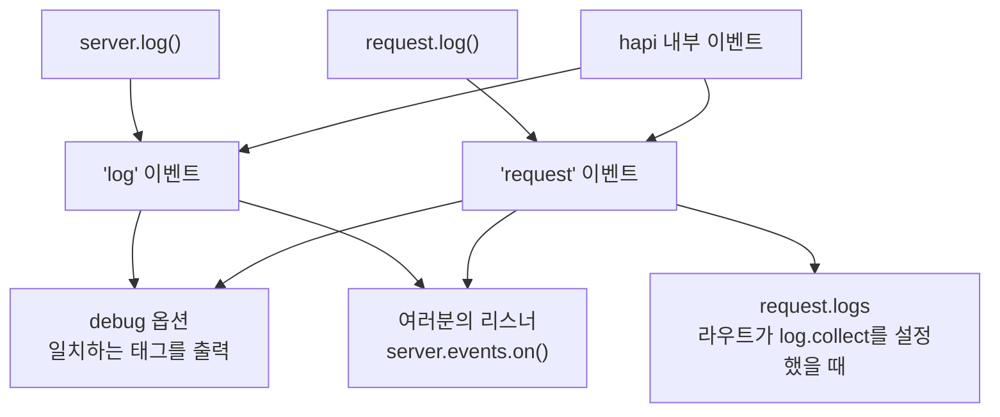

<TutorialLang />

# 로깅

_이 튜토리얼은 hapi v21 이상과 호환됩니다_

## <a name="overview"></a> 개요

여러분 코드에서 발생한 에러를 콘솔에 출력하는 [`debug`](#debug) 기본 설정을 제외하면, hapi는 로그를 어디에도 기록하지 않습니다. 대신 모든 로그 호출을 `server.events`의 이벤트로 바꾸고, 그 이벤트로 무엇을 할지는 여러분이 정합니다. 출력하거나, 로깅 서비스로 보내거나, 요청별로 모을 수 있습니다.



## <a name="methods"></a> 내장 메서드

로깅 메서드는 두 가지입니다. 코드가 실행되는 위치에 맞는 것을 고르세요.

| 메서드                                                            | 사용할 때                                          | 발생 이벤트 |
| ----------------------------------------------------------------- | -------------------------------------------------- | ----------- |
| [`request.log(tags, [data])`](/api#request-log-tags-data)         | 요청이 있는 곳: 핸들러, 확장, 인증 스킴            | `'request'` |
| [`server.log(tags, [data])`](/api#server-log-tags-data-timestamp) | 요청이 없는 곳: 서버 시작, 플러그인의 `register()` | `'log'`     |

두 메서드는 같은 두 가지 주요 인자를 받습니다.

- `tags`: `['error', 'database', 'read']` 같은 문자열 또는 문자열 배열입니다. hapi는 로그 레벨 대신 태그를 사용하므로 어떤 조합으로든 필터링할 수 있습니다. `database` 태그가 붙은 모든 것, 또는 `error`와 `database`가 함께 붙은 것만 고를 수 있습니다.
- `data`: 선택 사항입니다. 메시지, 객체, 또는 `Error`입니다. 대신 함수를 전달하면 hapi는 리스너가 이벤트를 받을 때만 그 함수를 호출하므로, 아무도 듣고 있지 않을 때 비용이 큰 데이터는 아무 비용도 들지 않습니다.

### <a name="request.log"></a> request.log()

```ts
server.route({
    method: 'GET',
    path: '/users/{id}',
    handler: async (request, h) => {
        request.log(['users', 'read'], { id: request.params.id });

        return { id: request.params.id };
    },
});
```

이렇게 기록한 이벤트에는 모두 요청 id가 붙어 있으므로, 한 요청의 이벤트를 묶어서 볼 수 있습니다.

### <a name="server.log"></a> server.log()

```ts
import Hapi from '@hapi/hapi';

const server = Hapi.server({ port: 3000 });

await server.start();

server.log(['startup'], `Server running at ${server.info.uri}`);
```

## <a name="display"></a> 로그 받기와 출력하기

[`server.events`](/api#server-events)를 구독하세요. 여러분의 호출 외에도 hapi는 같은 채널에 자체 이벤트를 발생시킵니다.

| 이벤트       | `event.channel` | 출처                                              |
| ------------ | --------------- | ------------------------------------------------- |
| `'log'`      | `'app'`         | 여러분의 `server.log()` 호출                      |
| `'log'`      | `'internal'`    | hapi: 서버 부하로 인한 거부, 클라이언트 연결 에러 |
| `'request'`  | `'app'`         | 여러분의 `request.log()` 호출                     |
| `'request'`  | `'internal'`    | hapi: 인증 실패, 핸들러 에러, 잘못된 헤더         |
| `'request'`  | `'error'`       | hapi: 500으로 끝난 요청마다 한 번                 |
| `'response'` | 없음            | hapi: 응답을 보낸 뒤 요청마다 한 번               |

내부 태그의 전체 목록은 API 레퍼런스의 [`'log'`](/api#log-event)와 [`'request'`](/api#request-event) 이벤트에 있습니다.

일반적인 설정은 애플리케이션 이벤트를 출력하고, 500 에러를 보고하고, 요청마다 접근 로그 한 줄을 기록합니다.

```ts
server.events.on('log', (event, tags) => {
    console.log(event.timestamp, event.tags, event.data ?? event.error);
});

server.events.on({ name: 'request', channels: 'app' }, (request, event, tags) => {
    console.log(request.info.id, event.tags, event.data ?? event.error);
});

server.events.on({ name: 'request', channels: 'error' }, (request, event, tags) => {
    console.error(`Request ${request.info.id} failed:`, event.error);
});

server.events.on('response', (request) => {
    const duration = request.info.completed - request.info.received;

    console.log(`${request.method.toUpperCase()} ${request.path} ${request.raw.res.statusCode} ${duration}ms`);
});
```

- `tags`는 태그마다 `true` 키를 하나씩 가진 객체이므로, `if (tags.error)`로 간단히 확인할 수 있습니다.
- `event.data`와 `event.error`는 함께 나타나지 않습니다. `data`로 전달한 `Error`는 `event.error`로 도착합니다.
- 조건 객체 `{ name: 'request', channels: 'error' }`는 채널 하나만 구독합니다. 이 객체가 없으면 세 채널을 모두 받습니다.

hapi는 응답을 보낸 뒤에 `'response'`를 발생시키며, 리스너가 반환한 promise를 기다리지 않습니다. hapi가 순서대로 기다려야 하는 비동기 작업에는 `onPostResponse` 확장을 사용하세요. [라이프사이클 훅](/tutorials/ko_KR/lifecycle-hooks)을 참고하세요.

### <a name="collecting-the-logs-of-one-request"></a> 한 요청의 로그 모으기

요청 안에서 그 요청의 이벤트를 읽으려면 라우트에 `log.collect`를 설정하세요. 그러면 그 요청에 대해 기록된 모든 이벤트가 `request.logs`에 쌓입니다.

```ts
server.route({
    method: 'GET',
    path: '/',
    options: {
        log: {
            collect: true,
        },
    },
    handler: function (request, h) {
        request.log(['step'], 'loaded user');
        request.log(['step'], 'loaded orders');

        return { steps: request.logs.length };
    },
});
```

`log.collect`가 없으면 `request.logs`는 비어 있습니다.

## <a name="debug"></a> 디버그 모드 (개발 전용)

[`debug`](/api#server-options-debug) 서버 옵션은 리스너 코드 없이 일치하는 이벤트를 `console.error()`로 콘솔에 출력합니다. 출력되는 것만 바뀔 뿐, 발생하는 이벤트는 바뀌지 않습니다.

| 옵션            | 기본값               | 출력                                                                                      |
| --------------- | -------------------- | ----------------------------------------------------------------------------------------- |
| `debug.request` | `['implementation']` | 이 태그 중 하나라도 붙은 `'request'` 이벤트. 기본값은 코드 버그로 생긴 500 에러를 출력함. |
| `debug.log`     | 없음                 | 이 태그 중 하나라도 붙은 `'log'` 이벤트.                                                  |
| `debug: false`  |                      | 출력하지 않음                                                                             |

각 목록에는 태그, 모든 이벤트를 뜻하는 `'*'`, 또는 아무것도 출력하지 않는 `false`를 지정합니다. 개발 중에 모든 요청 에러를 출력하려면 다음과 같이 합니다.

```ts
import Hapi from '@hapi/hapi';

const server = Hapi.server({ debug: { request: ['error'] } });
```

## <a name="plugins"></a> 로깅 플러그인

프로덕션 로깅에는 이 이벤트들을 대신 구독해 주는 플러그인을 사용하세요. 구조화된 JSON 로그를 위한 [hapi-pino](https://www.npmjs.com/package/hapi-pino), [New Relic](https://newrelic.com/instant-observability/hapi/2124da5b-0174-457a-be5a-e0068673b2b5), 또는 그 밖의 [hapi 로깅 플러그인](/plugins#logging)이 있습니다.
