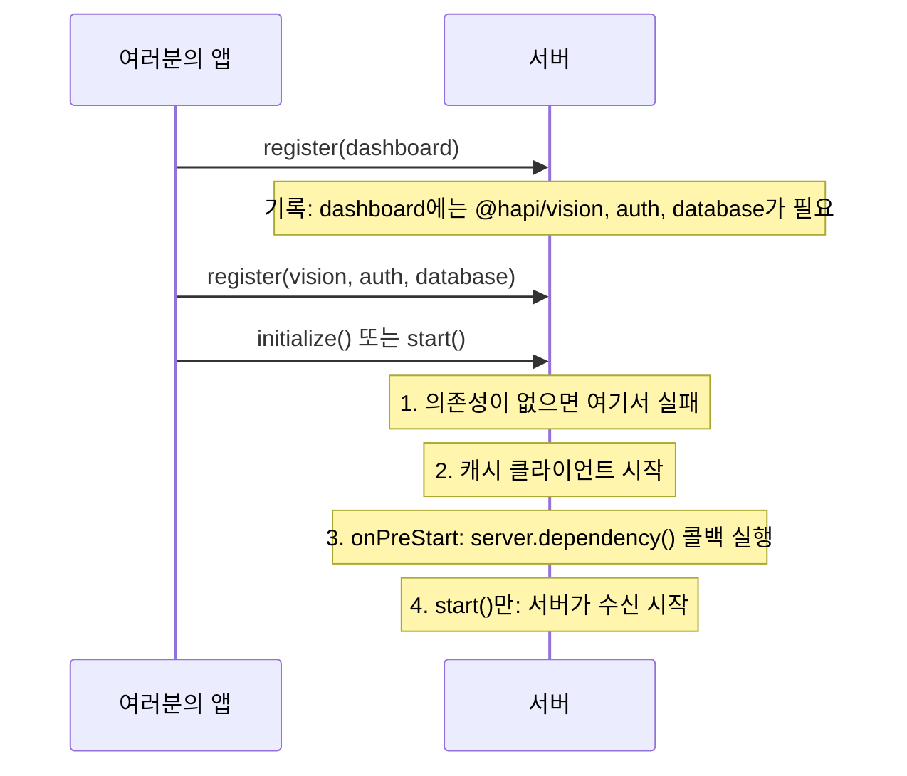

<TutorialLang />

# 플러그인

_이 튜토리얼은 hapi v21 이상과 호환됩니다_

## <a name="overview"></a> 개요

플러그인은 서버에 등록할 수 있도록 묶어 둔 hapi 애플리케이션의 한 조각입니다. 라우트 묶음, 인증 스킴, 로거, 템플릿 엔진 등이 플러그인이 될 수 있습니다. hapi 생태계의 대부분은 플러그인으로 배포되며([inert](/module/inert), [vision](/module/vision), [@hapi/basic](/module/basic)), 여러분의 애플리케이션도 플러그인으로 나누면 각 부분을 격리하고 테스트하기 쉬워집니다.

플러그인은 `register` 함수에서 서버를 받아 일반 서버 API로 서버를 변경합니다. 플러그인 작성자에게 가장 중요한 API는 다음과 같습니다.

| 서버 API                                                                 | 플러그인이 추가하는 것                                        | 튜토리얼                                            |
| ------------------------------------------------------------------------ | ------------------------------------------------------------- | --------------------------------------------------- |
| [`server.route()`](/api#server-route-route)                              | 라우트                                                        | [라우팅](/tutorials/ko_KR/routing)                  |
| [`server.ext()`](/api#server-ext-events)                                 | 모든 요청의 특정 단계나 서버 시작과 종료 시점에 실행되는 코드 | [라이프사이클 훅](/tutorials/ko_KR/lifecycle-hooks) |
| [`server.decorate()`](/api#server-decorate-type-property-method-options) | `server`, `request`, `h`의 새 메서드                          | [데코레이터](/tutorials/ko_KR/decorators)           |
| [`server.auth.scheme()`](/api#server-auth-scheme-name-scheme)            | 인증 스킴                                                     | [인증](/tutorials/ko_KR/auth)                       |
| [`server.method()`](/api#server-method-name-method-options)              | 공유하고 캐싱할 수 있는 함수                                  | [서버 메서드](/tutorials/ko_KR/server-methods)      |
| [`server.expose()`](/api#server-expose-key-value-options)                | 다른 플러그인이 `server.plugins[name]`에서 읽는 값            |                                                     |

## <a name="create"></a> 플러그인 만들기

플러그인은 `name`과 비동기 `register(server, options)` 함수를 가진 객체입니다.

```ts
import type { Plugin } from '@hapi/hapi';

const myPlugin: Plugin<void> = {
    name: 'myPlugin',
    version: '1.0.0',
    register: async function (server, options) {
        server.route({
            method: 'GET',
            path: '/test',
            handler: function (request, h) {
                return 'hello, world';
            },
        });
    },
};
```

등록하고 나면 `GET /test`가 `'hello, world'`로 응답합니다.

`Plugin<T>`는 플러그인 옵션의 타입을 받습니다. 이 플러그인은 옵션이 없으므로 `Plugin<void>`입니다. 플러그인에 타입을 지정하면 TypeScript가 `register`의 `server`와 `options`를 추론하고, 플러그인에 `name`이나 `pkg`가 있는지 검사합니다.

플러그인 객체의 속성은 다음과 같습니다.

| 속성           | 의미                                                                                                   |
| -------------- | ------------------------------------------------------------------------------------------------------ |
| `register`     | 필수. 플러그인을 설정합니다. 등록은 이 함수를 기다리며, 함수가 에러를 던지면 실패합니다.               |
| `name`         | `pkg`가 없으면 필수. 서버에서 고유해야 합니다. 배포된 플러그인은 npm 패키지 이름을 사용합니다.         |
| `version`      | 참고용 정보. 다른 플러그인이 읽을 수 있고, [의존성](#dependencies)에서 버전 범위를 요구할 수 있습니다. |
| `pkg`          | `name`과 `version`을 직접 쓰는 대신 사용하는 `package.json`.                                           |
| `dependencies` | 함께 등록되어야 하는 플러그인. [의존성](#dependencies)을 참고하세요.                                   |
| `requirements` | 지원하는 `node`와 `hapi` 버전 범위(예: `{ hapi: '>=21' }`). 범위를 벗어나면 등록이 실패합니다.         |
| `multiple`     | `true`면 같은 서버에 플러그인을 두 번 이상 등록할 수 있습니다.                                         |
| `once`         | `true`면 반복 등록이 에러 대신 아무 일도 하지 않습니다.                                                |

### <a name="module"></a> 플러그인을 모듈로 배포하기

플러그인 모듈은 플러그인 객체를 default export나 이름이 `plugin`인 named export로 내보냅니다. `pkg`는 `package.json`에서 이름과 버전을 읽습니다.

```ts
import Pkg from './package.json' with { type: 'json' };

import type { Plugin } from '@hapi/hapi';

export const plugin: Plugin<void> = {
    pkg: Pkg,
    register: async function (server, options) {
        server.route({
            method: 'GET',
            path: '/test',
            handler: function (request, h) {
                return 'hello, world';
            },
        });
    },
};
```

hapi는 두 export 형태를 모두 받습니다. `server.register()`는 플러그인 객체, 또는 `plugin` 속성이 플러그인 객체인 모듈을 받습니다.

### <a name="register"></a> 플러그인 옵션

`options`는 호출하는 쪽이 등록할 때 전달한 값 그대로입니다. 타입은 `Plugin<Options>`로 지정합니다.

```ts
import Pkg from './package.json' with { type: 'json' };

import type { Plugin } from '@hapi/hapi';

interface Options {
    name: string;
}

export const plugin: Plugin<Options> = {
    pkg: Pkg,
    register: async function (server, options) {
        server.route({
            method: 'GET',
            path: '/test',
            handler: function (request, h) {
                return `Hello ${options.name}`;
            },
        });
    },
};
```

`options.name`은 `string`이며, 옵션이 `Options`와 맞지 않는 `server.register()` 호출은 TypeScript가 잡아냅니다. hapi는 런타임에 옵션을 검사하지 않습니다.

## <a name="loading"></a> 플러그인 불러오기

플러그인은 [`server.register()`](/api#await-server-register-plugins-options)로 등록합니다. 플러그인 자체, `plugin`과 `options`를 담은 객체, 또는 이들의 배열을 전달합니다.

```ts
import Hapi from '@hapi/hapi';
import { plugin as MyPlugin } from 'myplugin';
import { plugin as YourPlugin } from 'yourplugin';

const start = async function () {
    const server = Hapi.server();

    await server.register(YourPlugin);

    await server.register({
        plugin: MyPlugin,
        options: {
            name: 'Bob',
        },
    });

    await server.register([{ plugin: YourPlugin }, { plugin: MyPlugin, options: { name: 'Bob' } }]);
};
```

배열에 담긴 플러그인은 순서대로 하나씩 등록됩니다. 각 `register` 함수가 끝난 뒤에 다음 함수가 시작됩니다.

### <a name="registration"></a> 등록 옵션

`server.register()`의 두 번째 인자는 hapi가 플러그인을 등록하는 방식을 설정합니다. 이 인자는 플러그인에 전달되지 _않습니다_.

| 옵션            | 효과                                                                                      |
| --------------- | ----------------------------------------------------------------------------------------- |
| `routes.prefix` | 플러그인이 추가하는 모든 라우트 앞에 경로를 붙입니다. `/test`는 `/plugins/test`가 됩니다. |
| `routes.vhost`  | 플러그인이 추가하는 모든 라우트에 가상 호스트를 적용합니다.                               |
| `once`          | `true`면 이미 등록된 플러그인을 에러 없이 건너뜁니다.                                     |

```ts
import Hapi from '@hapi/hapi';
import { plugin as MyPlugin } from 'myplugin';

const start = async function () {
    const server = Hapi.server();

    await server.register(MyPlugin, {
        routes: {
            prefix: '/plugins',
        },
    });
};
```

prefix는 중첩됩니다. prefix `/api`로 등록된 플러그인이 prefix `/v1`로 하위 플러그인을 등록하면, 하위 플러그인의 라우트는 `/api/v1`로 시작합니다. 전체 목록은 [`server.register()`](/api#await-server-register-plugins-options)를 참고하세요.

## <a name="scope"></a> 플러그인이 영향을 줄 수 있는 범위

각 플러그인은 자신만의 [`server.realm`](/api#server-realm)을 가집니다. realm은 플러그인 안에만 머무는 설정을 담는 컨테이너입니다. 그 밖에 플러그인이 하는 모든 일은 서버 전체를 바꿉니다.

| 변경                                                                                          | 범위                                   |
| --------------------------------------------------------------------------------------------- | -------------------------------------- |
| 등록 옵션의 라우트 prefix와 vhost                                                             | 플러그인의 라우트와 하위 플러그인      |
| [`server.bind()`](/api#server-bind-context), [`server.path()`](/api#server-path-relativeto)   | 플러그인이 추가한 라우트, 핸들러, 확장 |
| `options.sandbox: 'plugin'`을 지정한 요청 [라이프사이클 훅](/tutorials/ko_KR/lifecycle-hooks) | 플러그인의 라우트                      |
| `sandbox`를 지정하지 않은 요청 라이프사이클 훅                                                | **서버의 모든 라우트**                 |
| [데코레이션](/tutorials/ko_KR/decorators), 서버 메서드, 인증 전략, `server.auth.default()`    | **서버 전체**                          |

자신의 에러 형식을 맞추려고 `onPreResponse` 훅을 추가하는 플러그인은 `sandbox: 'plugin'`을 지정해야 합니다. 그렇지 않으면 다른 모든 플러그인의 에러 형식까지 바꿔 버립니다.

## <a name="dependencies"></a> 의존성

다른 플러그인이 필요한 플러그인은 등록 순서에 기대는 대신 의존성을 선언합니다.

```ts
import type { Plugin } from '@hapi/hapi';

declare module '@hapi/hapi' {
    interface PluginProperties {
        database: { migrate: () => Promise<void> };
    }
}

export const plugin: Plugin<void> = {
    name: 'dashboard',
    dependencies: ['@hapi/vision', 'auth'],
    register: async function (server, options) {
        server.dependency('database', async (server) => {
            await server.plugins.database.migrate();
        });
    },
};
```

hapi는 플러그인을 등록할 때가 아니라 서버를 초기화할 때 의존성을 검사하므로, 플러그인은 어떤 순서로든 등록할 수 있습니다.



- `dependencies`는 이름의 목록이거나, `{ '@hapi/vision': '7.x' }`처럼 이름과 버전 범위를 짝지은 객체입니다.
- [`server.dependency(names, after)`](/api#server-dependency-dependencies-after)는 같은 내용을 `register` 안에서 선언하며, `after` 함수를 받습니다. hapi는 나열된 플러그인이 모두 등록된 뒤 서버 시작 중에 `after`를 실행합니다. 다른 플러그인의 API가 필요한 설정 작업에 사용하세요.
- `after` 의존성이 순환하면 hapi가 에러를 던집니다.

`server.plugins.database`는 `database` 플러그인이 [`server.expose()`](/api#server-expose-key-value-options)로 공개한 값입니다. hapi는 그 형태를 알 수 없으므로, `declare module` 블록으로 hapi의 `PluginProperties` 인터페이스에 추가합니다.
