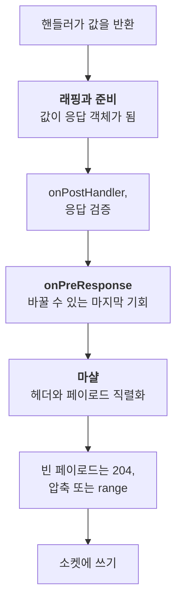

<TutorialLang />

# 응답 마샬링

_이 튜토리얼은 hapi v21 이상과 호환됩니다_

## <a name="overview"></a> 개요

핸들러는 문자열, 객체, 스트림, 에러 같은 값을 반환합니다. 응답 마샬링(response marshalling)은 hapi가 이 값을 HTTP 응답으로 바꾸기 위해 하는 모든 일을 말합니다. 상태 코드를 정하고, 헤더를 설정하고, 페이로드를 직렬화하고, 압축해서 소켓에 씁니다.

이 과정을 알면 코드를 어디에 둘지 알 수 있습니다. 일관된 에러 형식, HTML 에러 페이지, 캐싱 헤더, 압축, CSV 같은 커스텀 응답 타입, 메트릭용 바이트 카운터는 각각 마샬링 파이프라인의 특정 지점에 들어가야 합니다. 모든 메서드는 [응답 객체](/api#response-object)와 [응답 툴킷](/api#response-toolkit) API 레퍼런스에 정리되어 있습니다.

## <a name="pipeline"></a> 반환 값에서 바이트까지

마샬링은 두 단계로 이루어지고, 그 사이에 `onPreResponse` 확장 지점이 있습니다:



마샬 단계는 정해진 순서로 실행되며, 이 순서가 어떤 설정이 어떤 헤더를 볼 수 있는지를 결정합니다:

1. 페이로드 타입에 따른 `content-type`
2. 라우트가 활성화한 경우 CORS와 보안 헤더
3. [`h.entity()`](/api#h-entity-options)에서 온 ETag와 `last-modified`, 그리고 GET 라우트의 304 검사
4. 라우트의 `cache` 옵션에서 온 `cache-control`
5. [`h.state()`](/api#h-state-name-value-options)와 `autoValue`가 있는 쿠키에서 온 `set-cookie`
6. 페이로드 직렬화와 `content-length`
7. 인증 스킴의 `response()` 메서드. 위의 모든 헤더를 읽을 수 있도록 마지막에 실행됩니다

이 구분은 실제로 중요합니다:

- **`onPreResponse` 이전**에는 응답이 응답 객체 또는 [boom](/module/boom) 에러이고, 이를 검사하거나 바꾸거나 교체할 수 있습니다. 래핑과 준비 단계에서 발생한 에러(예: 존재하지 않는 파일)는 boom 에러로 `onPreResponse`에 도착합니다.
- **`onPreResponse` 이후**에는 hapi가 페이로드를 직렬화하고 헤더를 계산합니다. 이 단계의 에러(예: `JSON.stringify()`가 처리할 수 없는 객체)는 `onPreResponse`가 보지 못하는 500이 됩니다. 마샬링이 실패하지 않도록 페이로드는 순수한 데이터로 유지하세요.

[요청 라이프사이클](/api#request-lifecycle) 단계의 순서는 [라이프사이클 훅](/tutorials/ko_KR/lifecycle-hooks) 튜토리얼에서 다룹니다.

## <a name="return-values"></a> 반환하는 값과 hapi가 보내는 것

| 핸들러 반환 값      | 상태                 | 기본 `content-type`               | 비고                                                                                                                                                                  |
| ------------------- | -------------------- | --------------------------------- | --------------------------------------------------------------------------------------------------------------------------------------------------------------------- |
| 문자열              | 200, 비어 있으면 204 | `text/html; charset=utf-8`        | 일반 텍스트는 `.type('text/plain')`을 설정                                                                                                                            |
| 객체 또는 배열      | 200                  | `application/json; charset=utf-8` | `JSON.stringify()`와 라우트의 [`json` 옵션](#json)으로 직렬화                                                                                                         |
| `Buffer`            | 200                  | `application/octet-stream`        |                                                                                                                                                                       |
| readable 스트림     | 200                  | `application/octet-stream`        | chunked로 전송. 객체 모드이면 안 됨. 스트림에 `statusCode`와 `headers`가 있으면 복사                                                                                  |
| `null`              | 204                  | 없음                              | 200을 보내려면 라우트의 `response.emptyStatusCode`를 `200`으로 설정                                                                                                   |
| `undefined`         | 500                  |                                   | 핸들러는 반드시 무언가를 반환해야 함. hapi는 "handler method did not return a value"를 로그로 남김                                                                    |
| `Error`             | 500                  | `application/json; charset=utf-8` | 메시지는 클라이언트에게 숨겨짐                                                                                                                                        |
| boom 에러           | 에러의 상태          | `application/json; charset=utf-8` | `{ statusCode, error, message }`. 5xx 메시지는 숨겨짐                                                                                                                 |
| `h.response(value)` | `value`와 같음       | `value`와 같음                    | `.code()`, `.header()`, `.type()` 등 [응답 객체](/api#response-object) 메서드를 체이닝                                                                                |
| `h.redirect(uri)`   | 302                  | `text/html; charset=utf-8`        | 본문 없음. `.permanent()`는 301, `.rewritable(false)`는 307, 둘 다 쓰면 308. 307과 308은 클라이언트가 같은 메서드를 반복하게 하므로 리다이렉트된 POST는 POST로 유지됨 |

- `Readable.from(array)`는 객체 모드 스트림을 만들고, hapi는 이를 500으로 거부합니다. `{ objectMode: false }`를 넘기거나 `Fs.createReadStream()` 같은 바이트 스트림을 반환하세요.
- [wreck](/module/wreck)의 HTTP 응답처럼 `statusCode`와 `headers` 속성이 있는 스트림은 상태와 헤더를 그대로 전달합니다. 그래서 기본적인 프록시를 한 줄짜리 핸들러로 만들 수 있지만, 업스트림의 404가 그대로 여러분의 404가 된다는 뜻이기도 합니다.

## <a name="shaping"></a> h.response()로 응답 다듬기

기본값이 맞으면 일반 값을 반환하세요. 맞지 않으면 값을 [`h.response()`](/api#h-response-value)로 감싸고 필요한 것을 체이닝합니다:

```ts
import Hapi from '@hapi/hapi';

const server = Hapi.server({ port: 4000 });

server.route<{ Payload: { name: string } }>({
    method: 'POST',
    path: '/users',
    handler: (request, h) => {
        const user = { id: '2133d32a', name: request.payload.name };

        return h.response(user).created(`/users/${user.id}`).header('x-request-id', request.info.id);
    },
});

server.route({
    method: 'GET',
    path: '/robots.txt',
    handler: (request, h) => {
        return h.response('User-agent: *\nDisallow: /admin\n').type('text/plain');
    },
});
```

`.created()`는 상태를 201로 설정하고 `location` 헤더를 한 번에 설정합니다.

## <a name="errors"></a> 에러

모든 에러는 결국 boom 객체가 됩니다. hapi는 일반 `Error`를 `Boom.boomify()`로 감싸 상태 500을 부여하고, boom은 모든 5xx 에러의 메시지를 클라이언트에게 숨깁니다. 사용자는 `An internal server error occurred`를 보게 되고, hapi는 실제 에러를 `'error'` 채널의 `'request'` 이벤트로 내보냅니다. 이를 기록하는 방법은 [로깅](/tutorials/ko_KR/logging)을 참고하세요. 클라이언트가 메시지를 봐야 한다면 `Boom.notFound('No such user')` 같은 boom 에러를 던지세요.

boom 에러의 응답은 `output` 속성에서 나옵니다:

```ts
import Boom from '@hapi/boom';

const error = Boom.notFound('No such user');

error.output.statusCode; // 404
error.output.payload; // { statusCode: 404, error: 'Not Found', message: 'No such user' }
error.output.headers; // {}, or headers such as WWW-Authenticate from auth errors
```

### <a name="a-consistent-error-format"></a> 일관된 에러 형식

API는 boom의 형식이 아닌 자체 형식의 에러가 필요한 경우가 많습니다. 모든 에러가 거쳐 가는 `onPreResponse`에서 변환하세요. 알 수 없는 라우트의 404와 플러그인이 던진 에러도 여기를 지나갑니다:

```ts
import Boom from '@hapi/boom';
import Hapi from '@hapi/hapi';

const server = Hapi.server({ port: 4000 });

server.ext('onPreResponse', (request, h) => {
    const { response } = request;
    if (!Boom.isBoom(response)) {
        return h.continue;
    }

    const { statusCode, payload, headers } = response.output;
    const reply = h.response({
        error: {
            status: statusCode,
            code: payload.error,
            message: payload.message,
            requestId: request.info.id,
        },
    });

    reply.code(statusCode);
    for (const [name, value] of Object.entries(headers)) {
        if (value !== undefined) {
            reply.header(name, String(value));
        }
    }

    return reply;
});
```

`output.headers`를 새 응답에 복사하세요. 인증 에러는 여기에 `WWW-Authenticate`를 담고 있고, `Boom.methodNotAllowed()`는 `Allow`를 담을 수 있습니다. `payload.message`는 이미 안전한 메시지입니다. 5xx 에러의 경우 boom이 일반적인 문구로 바꿔 두었습니다.

### <a name="html-error-pages"></a> HTML 에러 페이지

HTML을 렌더링하는 사이트라면 같은 훅에서 에러 페이지를 반환할 수 있습니다. [뷰 튜토리얼](/tutorials/ko_KR/views#errors)에서 @hapi/vision으로 구현하는 방법을 보여 줍니다. 페이지와 API를 함께 제공하는 앱에서는 API 클라이언트가 계속 JSON을 받도록 API 라우트에서는 페이지를 건너뛰세요. 예를 들어 `request.path.startsWith('/api/')`로 구분할 수 있습니다.

## <a name="custom"></a> 커스텀 응답 타입

파일과 템플릿을 보내는 플러그인은 문자열을 반환하지 않습니다. [@hapi/inert](/module/inert)와 [@hapi/vision](/module/vision)은 [`request.generateResponse()`](/api#request-generateresponse-source-options)로 응답을 만드는데, 이 메서드는 소스 값과 선택적인 프로세서를 받습니다. `prepare`와 `marshal`은 파이프라인의 두 단계에서 실행되고, `close`는 응답이 전송되었든 교체되었든 응답이 끝날 때 실행됩니다:

| 플러그인 | `variety` | `onPreResponse` 전에 실행되는 `prepare`                                    | `onPreResponse` 후에 실행되는 `marshal`                                         |
| -------- | --------- | -------------------------------------------------------------------------- | ------------------------------------------------------------------------------- |
| inert    | `'file'`  | 파일을 열고 `content-length`, `content-type`, `last-modified`, ETag를 설정 | 읽기 스트림 또는 미리 압축된 파일(`.gz`, 또는 `lookupMap`의 다른 확장자)을 반환 |
| vision   | `'view'`  | 템플릿을 로드하고 컴파일                                                   | 컨텍스트로 템플릿을 렌더링하고 `content-type`을 설정                            |

이렇게 나눈 데는 이유가 있습니다. 없는 파일은 `prepare`에서 실패하므로 에러 핸들러가 형식을 맞출 수 있는 404로 `onPreResponse`에 도착합니다. 파일 읽기나 템플릿 렌더링 같은 비용이 큰 작업은 `onPreResponse`가 응답을 교체할 기회를 가진 뒤인 `marshal`에서 일어납니다. inert는 `close`도 넘기는데, `onPreResponse` 훅이 응답을 교체한 경우에도 파일을 닫아 줍니다. 리소스를 여는 커스텀 응답에도 이 처리가 필요합니다.

같은 메커니즘을 직접 만든 형식에도 쓸 수 있습니다. 다음은 CSV 응답입니다:

```ts
import Hapi from '@hapi/hapi';

import type { Request } from '@hapi/hapi';

const field = (value: string) => (/[",\n]/.test(value) ? `"${value.replaceAll('"', '""')}"` : value);

const csv = (request: Request, rows: string[][]) => {
    return request
        .generateResponse(rows, {
            variety: 'csv',
            marshal: async () => rows.map((row) => row.map(field).join(',')).join('\n'),
        })
        .type('text/csv');
};

const server = Hapi.server({ port: 4000 });

server.route({
    method: 'GET',
    path: '/users.csv',
    handler: (request, h) => {
        return csv(request, [
            ['id', 'name'],
            ['2133d32a', 'John Doe'],
        ]);
    },
});
```

`field()`는 쉼표, 따옴표, 줄바꿈이 들어 있는 값을 따옴표로 감싸서 행이 나뉘지 않게 합니다. 어느 핸들러에서든 `h.csv(rows)`로 호출하려면 데코레이터로 응답 툴킷에 추가하세요. [데코레이터](/tutorials/ko_KR/decorators) 튜토리얼을 참고하세요.

## <a name="json"></a> JSON 직렬화

객체는 `JSON.stringify()`로 직렬화됩니다. 라우트의 [`json` 옵션](/api#route-options-json)으로 직렬화 방식을 제어합니다:

```ts
import Hapi from '@hapi/hapi';

const server = Hapi.server({
    port: 4000,
    routes: {
        json: {
            space: process.env.NODE_ENV === 'production' ? 0 : 2,
        },
    },
});

server.route({
    method: 'GET',
    path: '/widget-config',
    options: {
        json: { escape: true },
    },
    handler: (request, h) => {
        return { title: '</script><script>alert(1)</script>' };
    },
});
```

- `space`는 출력을 들여씁니다. 읽기 쉬운 JSON은 개발 중에는 도움이 되지만 프로덕션에서는 바이트를 늘립니다.
- `escape: true`는 `<`, `>`, `&`를 `\u003c`, `\u003e`, `\u0026`로 쓰고, U+2028과 U+2029 줄 구분자도 이스케이프합니다. JSON이 HTML 페이지에 삽입되는 라우트에서는 이 옵션을 사용해 `</script>`가 들어 있는 값이 주변 script 태그를 닫지 못하게 하세요.
- `replacer`는 `JSON.stringify()`에 전달되고, `suffix`는 출력 뒤에 붙습니다. 개별 응답에서는 `.spaces()`, `.replacer()`, `.suffix()`로 이를 덮어쓸 수 있습니다.

비밀번호 해시 같은 민감한 값을 제거하는 데 `replacer`에 의존하지 마세요. 보내려는 필드로 응답 객체를 직접 만들고, 실수를 잡으려면 [응답 검증](#validation)을 사용하세요.

## <a name="caching"></a> 캐싱과 조건부 요청

라우트의 [`cache` 옵션](/api#route-options-cache)은 마샬링 중에 `cache-control`을 설정합니다:

```ts
server.route({
    method: 'GET',
    path: '/articles/{id}',
    options: {
        cache: { expiresIn: 60 * 1000, privacy: 'public' },
    },
    handler: (request, h) => {
        const article = { id: request.params.id, version: 7, body: '...' };

        const notModified = h.entity({ etag: `${article.id}-${article.version}` });
        if (notModified) {
            return notModified;
        }

        return article;
    },
});
```

- `cache`는 `cache-control: max-age=60, must-revalidate, public`을 만듭니다. 요청이 인증된 경우 hapi는 이를 알아서 `private`으로 바꿉니다. `h.state()`로 설정한 쿠키는 이 값을 바꾸지 않으며, yar와 @hapi/cookie 같은 세션 플러그인도 이 방식으로 쿠키를 설정합니다. 따라서 쿠키를 설정하는 라우트에서는 `privacy: 'private'`을 쓰거나 `cache`를 아예 쓰지 마세요. 그렇지 않으면 공유 캐시가 한 사용자의 쿠키를 저장해 다른 사용자에게 넘길 수 있습니다.
- [`h.entity()`](/api#h-entity-options)는 ETag를 요청의 `If-None-Match` 헤더와 비교합니다. 일치하면 304 응답을 반환하고 핸들러는 본문 생성을 건너뜁니다. 일치하지 않으면 `etag` 헤더를 설정하고 아무것도 반환하지 않습니다.

ETag는 콘텐츠가 바뀔 때마다 함께 바뀌는 값 중 계산 비용이 낮은 것, 예를 들어 버전 번호나 수정 타임스탬프를 기반으로 만드세요. 본문 전체를 해싱하면 대역폭은 아끼지만 본문을 만드는 작업은 아끼지 못합니다.

## <a name="compression"></a> 압축

hapi는 다음 조건이 모두 참일 때 응답을 gzip 또는 deflate로 압축합니다:

- 클라이언트가 일치하는 `Accept-Encoding` 헤더를 보냄
- 콘텐츠 타입이 압축 가능함(텍스트, JSON, JavaScript, SVG 등. 이미지나 아카이브는 제외)
- 페이로드가 [`compression.minBytes`](/api#server-options-compression-minbytes)(기본값 1024바이트) 이상이거나, 스트림처럼 크기를 알 수 없음

hapi는 `vary: accept-encoding`도 추가해서 캐시가 압축된 사본과 압축되지 않은 사본을 구분하게 합니다. Brotli를 지원하려면 [`server.encoder()`](/api#server-encoder-encoding-encoder)로 인코더를 등록하세요:

```ts
import Zlib from 'node:zlib';

import Hapi from '@hapi/hapi';

const server = Hapi.server({ port: 4000 });

server.encoder('br', (options) => Zlib.createBrotliCompress(options));
```

이제 클라이언트가 `br`을 받아들이면 hapi는 이를 우선합니다. 라우트의 [`compression` 옵션](/api#route-options-compression)은 인코더에 설정을 전달합니다. 예를 들어 `compression: { br: { params: { [Zlib.constants.BROTLI_PARAM_QUALITY]: 4 } } }`로 크기와 속도를 맞바꿀 수 있습니다. 디스크에서 읽은 `.gz` 파일처럼 페이로드가 이미 압축되어 있다면 `.compressed('gzip')`로 표시하세요. 그러면 hapi는 헤더를 설정하고 바이트는 건드리지 않습니다.

## <a name="validation"></a> 응답 검증

[응답 검증](/api#route-options-response)은 `onPreResponse` 전에 페이로드를 스키마와 대조합니다. 서버 밖으로 나가면 안 되는 필드를 포함해, 잘못된 형태를 반환하는 핸들러를 잡아냅니다:

```ts
import Hapi from '@hapi/hapi';
import Joi from 'joi';

const server = Hapi.server({ port: 4000 });

const User = Joi.object({
    id: Joi.string().required(),
    name: Joi.string().required(),
});

server.route({
    method: 'GET',
    path: '/users/{id}',
    options: {
        response: {
            schema: User,
            sample: process.env.NODE_ENV === 'production' ? 10 : 100,
            failAction: process.env.NODE_ENV === 'production' ? 'log' : 'error',
        },
    },
    handler: (request, h) => {
        return { id: request.params.id, name: 'John Doe' };
    },
});
```

- 기본값인 `failAction: 'error'`에서는 스키마를 통과하지 못한 페이로드가 500이 됩니다. 실수가 확실히 드러나도록 개발과 테스트에서 사용하세요.
- `failAction: 'log'`는 원래 페이로드를 보내고 실패를 `validation`, `response`, `error` 태그로 로그에 남깁니다. 프로덕션에서 스키마 실수가 장애로 번지는 것을 막아 주지만, 스키마가 거부한 필드를 포함해 페이로드는 그대로 나갑니다.
- `sample`은 응답 중 일정 비율만 검증해서 트래픽이 많은 라우트의 비용을 줄입니다.

알 수 없는 필드를 거부하는 대신 제거하려면 `modify: true`와 `options: { stripUnknown: true }`를 설정하고 `sample`을 제거하세요. `modify`를 쓰면 검증이 응답 로직의 일부가 되므로 hapi는 모든 응답을 검증하며 `sample`을 받아들이지 않습니다.

## <a name="measuring"></a> 응답 측정

응답 객체는 쓰이는 동안 [이벤트](/api#response-events)를 내보냅니다. 청크마다 `'peek'`, 끝날 때 `'finish'`입니다. 플러그인은 이를 이용해 응답 크기를 기록할 수 있습니다:

```ts
import Boom from '@hapi/boom';
import Hapi from '@hapi/hapi';

const server = Hapi.server({ port: 4000 });

server.ext('onPreResponse', (request, h) => {
    const { response } = request;
    if (Boom.isBoom(response)) {
        return h.continue;
    }

    let bytes = 0;
    response.events.on('peek', (chunk) => {
        bytes += Buffer.byteLength(chunk);
    });
    response.events.once('finish', () => {
        request.log(['metrics'], { path: request.path, bytes });
    });

    return h.continue;
});
```

`'peek'`는 압축 전의 페이로드를 보므로 `bytes`는 압축되지 않은 크기입니다. 여기서는 에러 응답을 건너뜁니다. boom 에러는 이 훅이 실행된 뒤 마샬링 중에 새 응답 객체가 되기 때문입니다. 요청 전체의 시간을 재려면 `onPostResponse` 확장이나 서버의 `'response'` 이벤트를 사용하세요. [라이프사이클 훅](/tutorials/ko_KR/lifecycle-hooks)과 [로깅](/tutorials/ko_KR/logging)에서 다룹니다.
