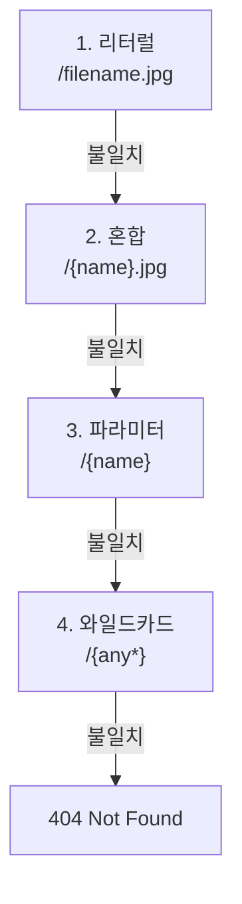

<TutorialLang />

# 라우팅

_이 튜토리얼은 hapi v21 이상과 호환됩니다_

## <a name="overview"></a> 개요

라우트에는 `method`, `path`, `handler` 세 가지가 필요합니다. 라우트는 [`server.route()`](/api#server-route-route)로 추가합니다:

```ts
server.route({
    method: 'GET',
    path: '/',
    handler: (request, h) => {
        return 'Hello World!';
    },
});
```

`server.route()`는 라우트 객체의 배열도 받으므로 한 번의 호출로 여러 라우트를 등록할 수 있습니다.

## <a name="methods"></a> 메서드

`method`는 `HEAD`를 제외한 HTTP 메서드(GET 라우트가 HEAD 요청에 응답합니다), 메서드의 배열, 또는 모든 메서드를 뜻하는 `'*'`입니다:

```ts
server.route({
    method: ['PUT', 'POST'],
    path: '/',
    handler: (request, h) => {
        return 'I did something!';
    },
});
```

`GET` 라우트는 `HEAD` 요청에도 응답하므로 별도의 `HEAD` 라우트는 필요 없습니다.

## <a name="path"></a> 경로

경로 세그먼트를 `{}`로 감싸면 이름 있는 파라미터로 캡처됩니다. 값은 `request.params`에서 사용할 수 있습니다:

```ts
import * as Hoek from '@hapi/hoek';

server.route<{ Params: { user: string } }>({
    method: 'GET',
    path: '/hello/{user}',
    handler: (request, h) => {
        return `Hello ${Hoek.escapeHtml(request.params.user)}!`;
    },
});
```

`/hello/ferris`로 요청하면 `Hello ferris!`로 응답합니다.

- hapi는 파라미터 값을 URI 디코딩하므로 `/hello/a%20b`는 `request.params.user === 'a b'`가 됩니다.
- 값은 URL에서 그대로 옵니다. HTML에 넣기 전에 위의 [Hoek](/module/hoek) `escapeHtml()` 호출처럼 이스케이프하거나, [joi](/tutorials/ko_KR/validation)로 검증하세요.
- hapi 21.4.10부터 `request.params` 값의 타입은 기본적으로 `unknown`입니다. 타입 인자 `server.route<{ Params: { user: string } }>()`로 형태를 선언하면 핸들러에서 `request.params.user`가 `string`이 됩니다. 같은 타입 인자에 `Query`, `Payload`, `Headers`와 아래에 나오는 다른 요청 부분도 지정할 수 있습니다.

### <a name="optionalParameters"></a> 파라미터 종류

| 경로                | 일치하는 요청                          | `request.params`                    |
| ------------------- | -------------------------------------- | ----------------------------------- |
| `/hello/{user}`     | `/hello/ferris`                        | `{ user: 'ferris' }`                |
| `/hello/{user?}`    | `/hello`, `/hello/ferris`              | `{}` 또는 `{ user: 'ferris' }`      |
| `/hello/{user*2}`   | `/hello/john/doe` (정확히 두 세그먼트) | `{ user: 'john/doe' }`              |
| `/files/{path*}`    | `/files`, `/files/a`, `/files/a/b/c`   | `{}` 또는 `{ path: 'a/b/c' }`       |
| `/{filename}.{ext}` | `/photo.jpg`                           | `{ filename: 'photo', ext: 'jpg' }` |

라우트를 추가할 때 hapi가 강제하는 규칙:

- `{user*}`와 세그먼트 전체를 차지하는 선택적 파라미터 `{user?}`는 경로의 마지막 세그먼트여야 합니다. `{user*2}`와 `/a{user?}/b` 같은 세그먼트 일부의 선택적 파라미터는 어디에나 올 수 있습니다.
- 한 세그먼트에 파라미터가 두 개 있으면 그 사이에 리터럴 구분자가 있어야 합니다. `{filename}.{ext}`는 유효하지만 `{filename}{ext}`는 유효하지 않습니다.
- 파라미터 이름은 경로당 한 번만 쓸 수 있습니다.
- 메서드가 같고 경로가 동등한 두 라우트는 충돌하며 `server.route()`가 예외를 던집니다. `/{name}`과 `/{other}`는 동등합니다.

### <a name="multiParameters"></a> 여러 세그먼트 파라미터

여러 세그먼트 파라미터에는 일치한 세그먼트가 `/`로 이어진 값이 들어 있으므로, 나눠서 각 부분을 얻습니다:

```ts
server.route<{ Params: { user: string } }>({
    method: 'GET',
    path: '/hello/{user*2}',
    handler: (request, h) => {
        const [first, last] = request.params.user.split('/');

        return `Hello ${first} ${last}!`;
    },
});
```

`/hello/john/doe`로 요청하면 `Hello john doe!`로 응답합니다.

### <a name="specificity"></a> 어떤 라우트가 선택되는가

hapi는 라우트를 추가한 순서대로 시도하지 않습니다. 경로 세그먼트마다 가장 구체적인 종류의 일치부터 가장 덜 구체적인 종류까지 시도하고, 나머지 경로가 일치하지 않으면 다음 종류로 넘어갑니다:



이 네 라우트가 등록되어 있을 때:

| 요청            | 응답하는 라우트 |
| --------------- | --------------- |
| `/filename.jpg` | `/filename.jpg` |
| `/photo.jpg`    | `/{name}.jpg`   |
| `/photo`        | `/{name}`       |
| `/a/b`          | `/{any*}`       |

경로는 기본적으로 대소문자를 구분합니다. 위 라우트에서 `/Filename.jpg`는 `/{name}.jpg`가 응답합니다. 이를 바꾸려면 서버의 [`router.isCaseSensitive`](/api#server-options-router)를 `false`로 설정하세요.

## <a name="query"></a> 쿼리 파라미터

`request.query`에는 파싱된 쿼리 문자열이 들어 있습니다. `/?name=ferris&location=chicago`의 경우:

```ts
server.route<{ Query: { name: string } }>({
    method: 'GET',
    path: '/',
    handler: (request, h) => {
        return `Hello ${request.query.name}!`;
    },
});
```

hapi의 내장 파서는 중첩 키를 이해하지 못합니다. `/?foo[bar]=baz`는 `{ 'foo[bar]': 'baz' }`가 됩니다. 중첩 키를 파싱하려면 서버의 `query.parser`를 [qs](https://github.com/ljharb/qs) 같은 파서로 설정하세요:

```ts
import Hapi from '@hapi/hapi';
import Qs from 'qs';

const server = Hapi.server({
    port: 3000,
    host: 'localhost',
    query: {
        parser: (query) => Qs.parse(query),
    },
});

server.route({
    method: 'GET',
    path: '/',
    handler: (request, h) => {
        return request.query;
    },
});

await server.start();
console.log('Server running on %s', server.info.uri);
```

이제 `/?foo[bar]=baz`는 `{ "foo": { "bar": "baz" } }`로 응답합니다. 파서는 원본 문자열이 아니라 hapi가 이미 파싱한 쿼리(예: `{ 'foo[bar]': 'baz' }`)를 받습니다. 파라미터 이름과 값의 객체를 반환하기만 하면 어떤 함수든 쓸 수 있습니다.

## <a name="requestpayload"></a> 요청 페이로드

파싱된 요청 본문은 `request.payload`에 있습니다. hapi는 `Content-Type` 헤더에 따라 JSON, 폼 인코딩, 텍스트 본문을 파싱합니다. 멀티파트 본문에는 라우트 옵션 `payload: { multipart: true }`가 필요하며, 이 옵션이 없으면 `415 Unsupported Media Type`을 받습니다:

```ts
server.route<{ Payload: { username: string; password: string } }>({
    method: 'POST',
    path: '/signup',
    handler: (request, h) => {
        return `Welcome ${request.payload.username}!`;
    },
});
```

타입 인자는 TypeScript에게 형태를 알려 줄 뿐입니다. [페이로드 검증](/tutorials/ko_KR/validation)을 추가하기 전까지 런타임에는 아무것도 검사하지 않습니다.

## <a name="handler"></a> 핸들러

핸들러는 두 인자를 받습니다:

- `request`에는 `params`, `query`, `payload`, `headers`, `auth` 등 들어온 요청에 대한 모든 정보가 들어 있습니다. [요청 객체](/api#request)를 참고하세요.
- `h`는 `h.response()`, `h.redirect()` 같은 메서드를 가진 [응답 툴킷](/api#response-toolkit)입니다.

핸들러가 반환한 값이 응답이 됩니다:

| 핸들러 반환 값                         | 응답                                                |
| -------------------------------------- | --------------------------------------------------- |
| 문자열                                 | `200`, `text/html; charset=utf-8`                   |
| 객체 또는 배열                         | `200`, `application/json; charset=utf-8`            |
| `Buffer`                               | `200`, `application/octet-stream`                   |
| readable 스트림                        | `200`, 스트림을 클라이언트로 파이프                 |
| 체이닝 호출을 붙인 `h.response(value)` | 완전한 제어. 예: `h.response('created').code(201)`  |
| 던진 에러                              | 에러 응답. [boom](/module/boom) 에러가 아니면 `500` |

핸들러는 값이나 프로미스를 반환하거나 예외를 던져야 합니다. hapi가 이 값을 전송할 바이트로 바꾸는 과정은 [응답 마샬링](/tutorials/ko_KR/response-marshalling)에서 다룹니다.

화살표 함수는 `this`를 쓸 수 없으므로, 화살표 함수로 작성한 핸들러는 [`server.bind()`](/api#server-bind-context)로 설정한 값을 [`h.context`](/api#h-context)에서 읽습니다.

## <a name="options"></a> 옵션

메서드, 경로, 핸들러 외의 모든 것은 라우트의 `options`에 들어갑니다:

```ts
import Joi from 'joi';

server.route<{ Payload: { username: string; password: string } }>({
    method: 'POST',
    path: '/signup',
    options: {
        auth: false,
        validate: {
            payload: Joi.object({
                username: Joi.string().min(1).max(20).required(),
                password: Joi.string().min(7).required(),
            }),
        },
    },
    handler: (request, h) => {
        return `Welcome ${request.payload.username}!`;
    },
});
```

| 옵션       | 제어하는 것                            | 자세히 보기                                         |
| ---------- | -------------------------------------- | --------------------------------------------------- |
| `auth`     | 적용할 인증 전략                       | [인증](/tutorials/ko_KR/auth)                       |
| `validate` | 파라미터, 쿼리, 페이로드, 헤더 검사    | [검증](/tutorials/ko_KR/validation)                 |
| `cache`    | 응답의 `Cache-Control` 헤더            | [캐싱](/tutorials/ko_KR/caching)                    |
| `payload`  | 본문 파싱, 크기 제한, 업로드           | [라우트 페이로드 옵션](/api#route-options-payload)  |
| `pre`      | 핸들러보다 먼저 실행되는 메서드        | [라우트 pre 옵션](/api#route-options-pre)           |
| `ext`      | 이 라우트에만 적용되는 라이프사이클 훅 | [라이프사이클 훅](/tutorials/ko_KR/lifecycle-hooks) |

전체 목록은 [라우트 옵션 레퍼런스](/api#route-options)에 있습니다.

## <a name="missing"></a> 404 처리

일치하는 라우트가 없으면 hapi는 `404` JSON 에러로 응답합니다. 대신 직접 만든 응답을 보내려면 모든 경로를 받는 라우트를 추가하세요. `{any*}` 와일드카드는 가장 덜 구체적인 일치이므로 다른 라우트가 받지 않는 요청에만 응답합니다:

```ts
server.route({
    method: '*',
    path: '/{any*}',
    handler: (request, h) => {
        return h.response('404 Error! Page Not Found!').code(404);
    },
});
```

이 라우트는 일치하지 않는 경로만 처리합니다. 일치한 라우트가 던진 `404`(예: `Boom.notFound()`를 던지는 핸들러)는 여기에 도달하지 않습니다. 어디서 생겼든 모든 `404`를 바꾸려면 `onPreResponse` 훅에서 응답을 변경하세요. [라이프사이클 훅](/tutorials/ko_KR/lifecycle-hooks)을 참고하세요.
