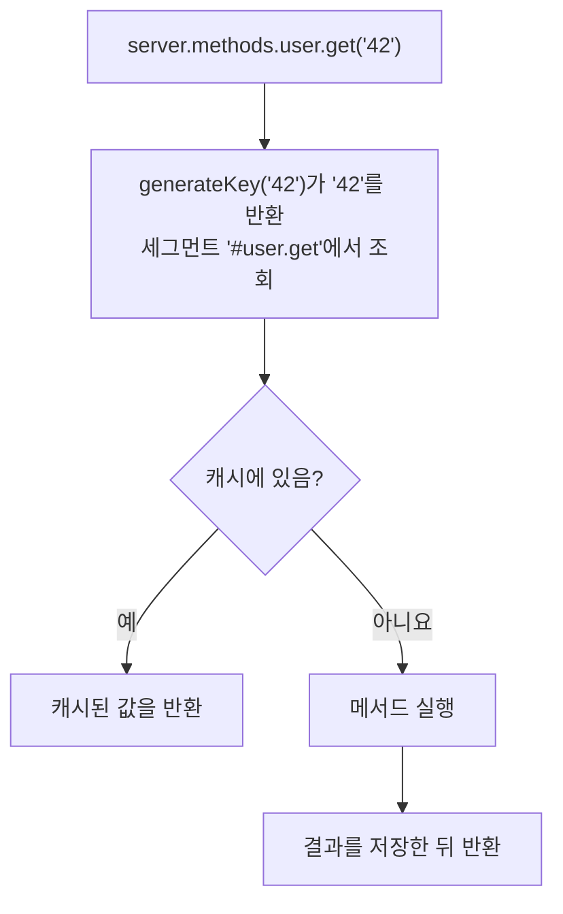

<TutorialLang />

# 서버 메서드

_이 튜토리얼은 hapi v21 이상과 호환됩니다_

## <a name="overview"></a> 개요

서버 메서드는 [`server.method()`](/api#server-method-name-method-options)로 서버에 등록하고, 서버에 접근할 수 있는 곳(라우트 핸들러, 플러그인, 확장)이면 어디서든 호출하는 함수입니다. 다음과 같은 경우에 사용합니다:

- 여러 라우트나 플러그인이 같은 함수를 필요로 하는데, 각각에서 import하고 싶지 않을 때
- 함수의 비용이 크고 결과를 캐시할 수 있을 때. 옵션 하나로 hapi의 [캐싱](/tutorials/ko_KR/caching)을 켤 수 있습니다

```ts
import Hapi from '@hapi/hapi';

declare module '@hapi/hapi' {
    interface ServerMethods {
        add: (x: number, y: number) => number;
    }
}

const server = Hapi.server({ port: 3000 });

server.method('add', (x: number, y: number) => x + y);

server.route({
    method: 'GET',
    path: '/',
    handler: (request, h) => {
        return { sum: request.server.methods.add(1, 2) };
    },
});

await server.start();
```

- `server.methods.add`가 등록된 함수입니다. 핸들러에서는 `server` 변수가 스코프에 없어도 `request.server.methods`로 접근할 수 있습니다.
- hapi는 여러분이 어떤 메서드를 등록하는지 모르므로, TypeScript에서는 hapi의 `ServerMethods` 인터페이스에 메서드를 선언해야 합니다. `declare module` 블록은 프로젝트의 어느 모듈에 두어도 됩니다.
- 메서드는 서버 전역입니다. 플러그인 안에서 등록한 메서드도 다른 모든 플러그인과 라우트에서 사용할 수 있습니다.

## <a name="server.method"></a> server.method()

`server.method()`는 위치 인자를 받거나, 객체 하나(여러 개를 한 번에 등록하려면 객체의 배열)를 받습니다:

```ts
server.method('add', add, {});

server.method({
    name: 'add',
    method: add,
    options: {},
});
```

### <a name="name"></a> 이름

이름에 점이 있으면 중첩된 메서드로 등록됩니다:

```ts
server.method('math.add', add);

server.methods.math.add(1, 2);
```

`ServerMethods`에는 중첩 객체로 선언합니다: `math: { add: (x: number, y: number) => number }`. 이름의 각 세그먼트는 유효한 JavaScript 식별자여야 합니다.

### <a name="method"></a> 메서드

메서드는 어떤 인자든 받을 수 있고 `async`여도 됩니다. 결과를 반환하거나 에러를 던지세요.

```ts
server.method('user.get', async (id: string) => {
    return await db.users.findById(id);
});
```

## <a name="options"></a> 옵션

| 옵션                  | 용도                                                 |
| --------------------- | ---------------------------------------------------- |
| [`cache`](#cache)     | 메서드의 결과를 캐시                                 |
| [`generateKey`](#key) | 인자가 문자열, 숫자, 불리언이 아닐 때 캐시 키를 생성 |
| [`bind`](#bind)       | 메서드 안의 `this`를 설정                            |

### <a name="cache"></a> 캐시

`cache` 옵션이 있으면 메서드 호출은 먼저 캐시를 거칩니다:



```ts
server.method('user.get', getUser, {
    cache: {
        expiresIn: 60 * 1000,
        staleIn: 30 * 1000,
        staleTimeout: 100,
        generateTimeout: 2000,
    },
});
```

알아 둘 점:

- `generateTimeout`은 필수입니다. 호출자가 `503`을 받기 전까지 메서드를 기다리는 시간입니다.
- 캐시되는 메서드는 메서드 자체가 동기이더라도 항상 프로미스를 반환합니다. `ServerMethods`에 `Promise` 반환 타입으로 선언하고 `await`하세요.
- hapi는 항목을 `'#'`에 메서드 이름을 붙인 이름의 세그먼트에 저장합니다. 기본 메모리 캐시 대신 [이름 있는 캐시 클라이언트](/tutorials/ko_KR/caching#client)를 쓰려면 `cache: 'my_cache'`를 설정하세요.
- 나머지 옵션(`expiresAt`, `staleIn`, `staleTimeout`, `segment`)은 [`server.cache()`](/api#server-cache-options)와 같습니다. 오래된(stale) 값을 제공하는 방식은 [캐싱 튜토리얼](/tutorials/ko_KR/caching#stale)에서 보여 줍니다.

#### <a name="changing-the-ttl-per-result"></a> 결과별로 TTL 바꾸기

hapi는 여러분의 인자 뒤에 `flags` 객체를 인자로 하나 더 넘깁니다. `flags.ttl`을 설정하면 이 결과 하나가 캐시되는 시간을 바꿀 수 있고, `0`으로 설정하면 아예 캐시하지 않습니다:

```ts
const getUser = async function (id: string, flags: { ttl: number }) {
    const user = await db.users.findById(id);
    if (!user) {
        flags.ttl = 0; // don't cache "not found"
    }

    return user;
};
```

hapi는 `flags`의 타입을 export하지 않으므로 예제에서는 인라인으로 타입을 지정합니다.

#### <a name="removing-a-cached-result"></a> 캐시된 결과 제거하기

캐시되는 메서드에는 모두 `cache.drop()` 함수가 있습니다. 같은 인자로 호출하면 해당 결과가 제거됩니다. 예를 들어 업데이트 후에 호출합니다:

```ts
await db.users.update(id, changes);
await server.methods.user.get.cache?.drop(id);
```

캐시되지 않는 메서드에는 `cache`가 없기 때문에 hapi는 이를 선택적 속성으로 타입을 지정하며, 그래서 `?.`를 씁니다.

### <a name="key"></a> 커스텀 키 생성

hapi는 인자를 `:`로 이어서 캐시 키를 만드는데, 이 방식은 문자열, 숫자, 불리언에만 통합니다. 캐시되는 메서드를 다른 타입의 인자로 호출하면 `500` 에러로 실패합니다. 다른 인자에는 `generateKey`를 제공하세요:

```ts
const sum = function (numbers: number[]) {
    return numbers.reduce((total, item) => total + item, 0);
};

server.method('sum', sum, {
    cache: {
        expiresIn: 60 * 1000,
        generateTimeout: 100,
    },
    generateKey: (numbers: number[]) => numbers.join(','),
});
```

`generateKey`는 메서드와 같은 인자를 받고 문자열을 반환해야 합니다.

### <a name="bind"></a> 바인드

`bind`는 메서드 안의 `this`를 설정합니다. 데이터베이스 클라이언트 같은 의존성을 인자에 추가하지 않고(인자에 넣으면 캐시 키의 일부가 되기도 합니다) 메서드에 넘길 때 사용하세요:

```ts
const lookup = async function (this: typeof db, id: string) {
    return await this.users.findById(id);
};

server.method('lookup', lookup, { bind: db });
```

- TypeScript의 `this` 파라미터는 `this`의 타입을 선언합니다. 컴파일 시점에 지워지며 메서드의 인자가 아닙니다.
- 화살표 함수는 자신의 `this`를 유지하므로 `bind`가 효과가 없습니다.
- `bind`가 없으면 `this`는 현재 플러그인이나 서버에서 [`server.bind()`](/api#server-bind-context)로 설정한 컨텍스트입니다.

## <a name="server.methods"></a> server.methods

등록된 모든 메서드는 [`server.methods`](/api#server-methods)에 있으며, 핸들러에서는 `request.server.methods`로도 사용할 수 있습니다:

```ts
server.route<{ Params: { id: string } }>({
    method: 'GET',
    path: '/users/{id}',
    handler: async (request, h) => {
        return await request.server.methods.user.get(request.params.id);
    },
});
```

이 튜토리얼에서 사용한 각 메서드에는 `ServerMethods` 항목이 필요합니다. 캐시되는 메서드는 `cache.drop()`과 `cache.stats`를 추가해 주는 hapi의 `CachedServerMethod` 타입으로 감싸세요:

```ts
import type { CachedServerMethod } from '@hapi/hapi';

declare module '@hapi/hapi' {
    interface ServerMethods {
        add: (x: number, y: number) => number;
        math: {
            add: (x: number, y: number) => number;
        };
        lookup: (id: string) => Promise<User | null>;
        sum: CachedServerMethod<(numbers: number[]) => Promise<number>>;
        user: {
            get: CachedServerMethod<(id: string) => Promise<User | null>>;
        };
    }
}
```
