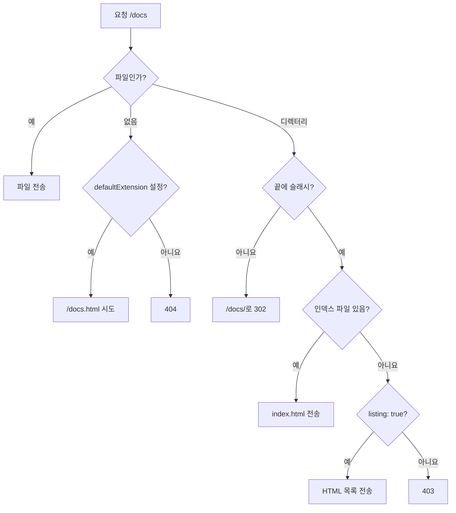

<TutorialLang />

# 정적 콘텐츠 제공

_이 튜토리얼은 hapi v21 이상과 호환됩니다_

## <a name="overview"></a> 개요

hapi는 [inert](/module/inert) 플러그인으로 디스크의 파일을 제공합니다. 설치하세요:

```sh
npm install @hapi/inert
```

## <a name="inert"></a> Inert

inert를 등록하면 파일을 보내는 세 가지 방법이 추가됩니다:

| 방법               | 용도                                                    |
| ------------------ | ------------------------------------------------------- |
| `h.file(path)`     | 핸들러 안에서 직접 작성한 로직을 거친 뒤 파일을 보낼 때 |
| `file` 핸들러      | 항상 한 파일을 제공하는 라우트                          |
| `directory` 핸들러 | 폴더 안의 모든 파일을 제공하는 라우트                   |

`@hapi/inert`를 import하면 hapi의 TypeScript 타입에도 이들이 추가되므로 `h.file()`과 `file`, `directory` 핸들러의 타입 검사가 통과합니다.

## <a name="path"></a> 상대 경로

서버에 `routes.files.relativeTo`를 한 번 설정하면 라우트의 모든 파일 경로가 그 폴더를 기준으로 해석됩니다:

```ts
import Path from 'node:path';
import Hapi from '@hapi/hapi';
import Inert from '@hapi/inert';

const server = Hapi.server({
    routes: {
        files: {
            relativeTo: Path.join(import.meta.dirname, 'public'),
        },
    },
});

await server.register(Inert);

server.route({
    method: 'GET',
    path: '/picture.jpg',
    handler: (request, h) => {
        return h.file('picture.jpg');
    },
});

await server.start();
console.log('Server running at:', server.info.uri);
```

`routes.files.relativeTo`의 기본값은 프로세스의 작업 디렉터리입니다. 서버의 `routes` 아래에 있는 옵션은 모든 라우트에 적용되며, 라우트는 자신의 `options.files`에서 이를 덮어쓸 수 있습니다.

## <a name="hfile"></a> `h.file(path, [options])`

[`h.file()`](/module/inert#h-file-path-options)은 파일을 응답으로 보냅니다. 경로는 `relativeTo` 폴더 안으로 제한됩니다. `'../secrets.json'`이나 디스크의 다른 위치를 가리키는 절대 경로처럼 폴더 밖으로 해석되는 경로는 `403 Forbidden`으로 응답합니다. 덕분에 요청 파라미터로 임의의 파일을 읽을 수 없습니다:

```ts
server.route<{ Params: { filename: string } }>({
    method: 'GET',
    path: '/download/{filename}',
    handler: (request, h) => {
        return h.file(request.params.filename, { mode: 'attachment' });
    },
});
```

`/download/report.pdf`는 `public/report.pdf`를 다운로드로 보내고, `/download/..%2Fserver.ts`는 `403`을 받습니다. 의도적으로 폴더 밖의 파일을 보내려면 `confine: false`를 넘기되, 사용자 입력으로 만든 경로에는 절대 쓰지 마세요.

## <a name="filehandler"></a> 파일 핸들러

라우트가 항상 같은 파일을 제공한다면 핸들러 함수를 작성하는 대신 `file` 핸들러를 사용하세요:

```ts
server.route({
    method: 'GET',
    path: '/picture.jpg',
    handler: {
        file: 'picture.jpg',
    },
});
```

### <a name="fileoptions"></a> 파일 핸들러 옵션

객체 형태는 `h.file()`과 같은 옵션을 받습니다:

```ts
server.route({
    method: 'GET',
    path: '/script.js',
    handler: {
        file: {
            path: 'script.js',
            filename: 'client.js',
            mode: 'attachment',
            lookupCompressed: true,
        },
    },
});
```

| 옵션               | 효과                                                                                                                                                                                                                                                                     |
| ------------------ | ------------------------------------------------------------------------------------------------------------------------------------------------------------------------------------------------------------------------------------------------------------------------ |
| `path`             | 보낼 파일. 함수 `(request) => path`도 받음                                                                                                                                                                                                                               |
| `mode`             | `'attachment'`(다운로드) 또는 `'inline'`. `Content-Disposition` 헤더를 설정                                                                                                                                                                                              |
| `filename`         | `Content-Disposition`의 파일 이름. 여기서는 `script.js` 대신 `client.js`                                                                                                                                                                                                 |
| `lookupCompressed` | `script.js.gz`가 있고 클라이언트가 gzip을 받으면 그 파일을 제공. `lookupMap`은 기본값 `{ gzip: '.gz' }`를 대체하므로 `{ gzip: '.gz', br: '.br' }`처럼 모든 인코딩을 나열해야 함(`br`에는 [`server.encoder()`](/tutorials/ko_KR/response-marshalling#compression)도 필요) |
| `confine`          | `true`(기본값)는 경로를 `relativeTo` 안으로 제한. `false`는 모든 경로를 허용                                                                                                                                                                                             |
| `etagMethod`       | `'hash'`(기본값), `'simple'`(크기와 수정 시간, 비용이 더 낮음), 또는 `false`                                                                                                                                                                                             |

전체 목록은 [inert API](/module/inert#the-file-handler)에 있습니다.

## <a name="directoryhandler"></a> 디렉터리 핸들러

`directory` 핸들러는 한 라우트로 폴더 전체를 제공합니다. 경로는 파라미터로 끝나야 하며, 파라미터의 값이 찾을 파일입니다. 파라미터는 라우트가 제공하는 깊이를 정합니다. `{param}`은 한 단계, `{param?}`은 폴더 루트까지, `{param*}`은 모든 깊이, `{param*2}`는 정확히 두 단계를 제공합니다:

```ts
server.route({
    method: 'GET',
    path: '/{param*}',
    handler: {
        directory: {
            path: 'directory-path-here',
        },
    },
});
```

### <a name="directoryoptions"></a> 디렉터리 핸들러 옵션

inert는 요청마다 다음과 같이 파일을 찾습니다:



| 옵션               | 기본값  | 효과                                                                                               |
| ------------------ | ------- | -------------------------------------------------------------------------------------------------- |
| `path`             | 필수    | 폴더, 순서대로 시도할 폴더의 배열, 또는 함수 `(request) => path`                                   |
| `index`            | `true`  | 디렉터리에 대해 `index.html`을 제공. 문자열이나 배열로 다른 인덱스 파일을 지정. `false`는 비활성화 |
| `listing`          | `false` | 인덱스 파일이 없는 디렉터리에 HTML 목록을 표시                                                     |
| `showHidden`       | `false` | 숨김 파일을 목록에 포함하고 제공                                                                   |
| `redirectToSlash`  | `true`  | `docs`가 디렉터리이면 `/docs`를 `/docs/`로 리다이렉트                                              |
| `defaultExtension` | 없음    | `/about`을 찾지 못하면 `/about.html`을 시도                                                        |
| `lookupCompressed` | `false` | 미리 압축된 `.gz` 파일을 제공. `file` 핸들러 옵션과 같음                                           |

`index: ['index.html', 'default.html']`이면 디렉터리 요청은 `index.html`을 먼저 시도하고 그다음 `default.html`을 시도합니다.

## <a name="fileserver"></a> 정적 파일 서버

사이트 루트에서 `public` 폴더를 제공하는 완전한 서버입니다:

```ts
import Path from 'node:path';
import Hapi from '@hapi/hapi';
import Inert from '@hapi/inert';

const server = Hapi.server({
    port: 3000,
    routes: {
        files: {
            relativeTo: Path.join(import.meta.dirname, 'public'),
        },
    },
});

await server.register(Inert);

server.route({
    method: 'GET',
    path: '/{param*}',
    handler: {
        directory: {
            path: '.',
            defaultExtension: 'html',
        },
    },
});

await server.start();
console.log('Server running at:', server.info.uri);
```

- `path: '.'`는 핸들러가 `relativeTo`, 즉 `public` 폴더를 가리키게 합니다.
- `/`는 `public/index.html`을 제공하고, `/docs`는 `/docs/`로 리다이렉트되어 `public/docs/index.html`을 제공합니다.
- `defaultExtension: 'html'` 덕분에 `/about`이 `public/about.html`을 제공하므로 URL에 `.html`이 필요 없습니다.
- `/{param*}`는 가능한 경로 중 가장 덜 구체적이므로 `/api/users` 같은 다른 라우트를 추가해도 그 라우트가 자신의 요청에 응답합니다. [어떤 라우트가 선택되는가](/tutorials/ko_KR/routing#specificity)를 참고하세요.
