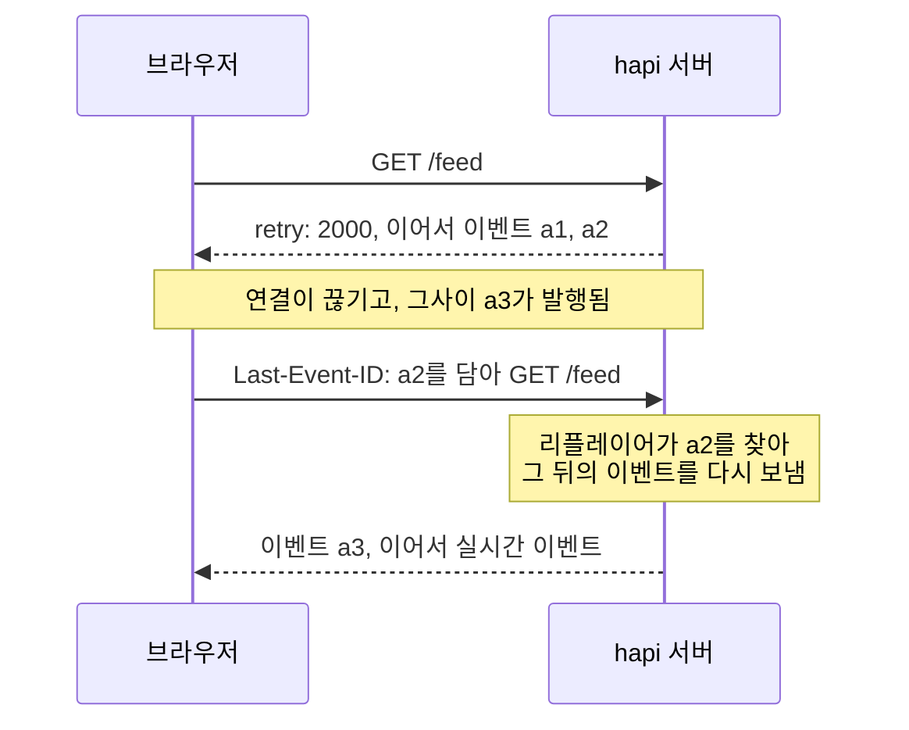
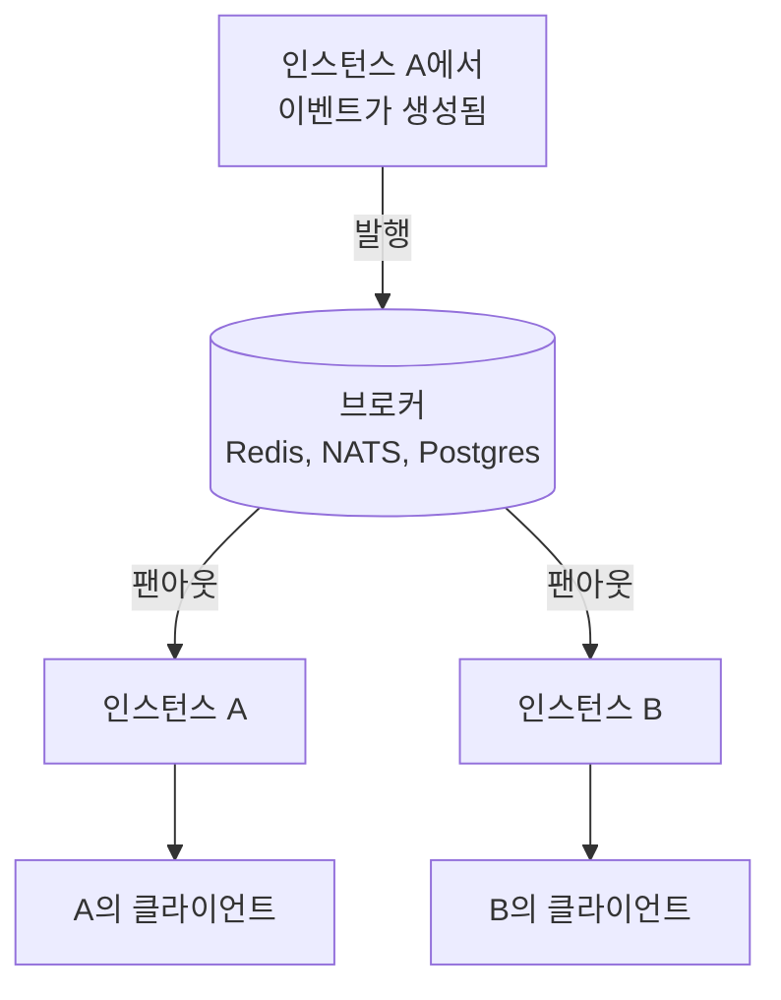

<TutorialLang />

# Server-Sent Events

_이 튜토리얼은 hapi v21 이상과 호환됩니다_

## <a name="overview"></a> 개요

Server-Sent Events(SSE)는 서버가 평범한 HTTP 응답 하나로 클라이언트에 이벤트 스트림을 보내는 방식입니다. 브라우저는 내장 `EventSource` API로 스트림을 열고, 연결이 끊기면 알아서 다시 연결합니다. [@hapi/sse](/module/sse)는 hapi에 SSE를 추가합니다.

## <a name="when"></a> SSE를 언제 쓸까

|             | SSE                                                    | [WebSocket](/tutorials/ko_KR/websockets)                                          | 폴링                          |
| ----------- | ------------------------------------------------------ | --------------------------------------------------------------------------------- | ----------------------------- |
| 방향        | 서버에서 클라이언트로만                                | 양방향                                                                            | 클라이언트가 묻고 서버가 답함 |
| 전송 방식   | 일반 HTTP 응답                                         | 프로토콜 업그레이드                                                               | 일반 HTTP 요청                |
| 재연결      | `EventSource`에 내장, 마지막 이벤트 id부터 이어서 받음 | nes 클라이언트가 다시 연결하고 다시 구독함. 연결이 끊긴 동안 보낸 메시지는 사라짐 | 필요 없음                     |
| 프록시 통과 | 가능, 버퍼링을 꺼야 함                                 | 프록시가 업그레이드를 지원해야 함                                                 | 가능                          |
| 지연 시간   | 즉시                                                   | 즉시                                                                              | 최대 폴링 간격만큼            |

서버에 새 소식이 있고 클라이언트는 듣기만 할 때 SSE를 고르세요. 작업 진행률, 알림, 실시간 대시보드, 로그 tail, AI 모델이 토큰 단위로 내놓는 출력이 그런 예입니다. 클라이언트도 메시지를 꾸준히 보내야 한다면 WebSocket을 사용하세요. 가끔만 보내는 클라이언트라면 스트림은 SSE로 받고 나머지는 평범한 `POST` 요청으로 보내면 됩니다.

## <a name="setup"></a> 설정

```sh
npm install @hapi/sse
```

```ts
import Hapi from '@hapi/hapi';
import { SsePlugin } from '@hapi/sse';

const server = Hapi.server({ port: 3000 });

await server.register(SsePlugin);
```

플러그인은 스트림을 여는 방법을 두 가지 제공합니다.

| 용도                  | 핸들러 모드: `handler: { sse: { stream } }` | 구독: `server.sse.subscription()`                 |
| --------------------- | ------------------------------------------- | ------------------------------------------------- |
| 이벤트를 만드는 쪽    | 그 연결 하나를 위한 여러분의 `stream` 함수  | `server.sse.publish()`를 호출하는 모든 코드       |
| 대표적인 스트림       | 작업 하나의 진행률, AI 응답, 로그 tail      | 알림, 실시간 피드, 채팅방                         |
| 연결별 이벤트         | 클라이언트마다 다름                         | 같은 이벤트가 모든 구독자에게 감                  |
| 재연결 후 이어서 받기 | `session.lastEventId`를 읽고 이어서 보냄    | 리플레이어가 클라이언트가 놓친 이벤트를 다시 보냄 |

## <a name="handler"></a> 핸들러 모드: 요청마다 스트림 하나

`sse` 핸들러를 쓰는 라우트는 연결마다 `stream` 함수를 한 번 실행합니다. `push()`한 내용은 그때그때 클라이언트에 도착합니다.

```ts
server.route({
    method: 'GET',
    path: '/jobs/{id}/progress',
    handler: {
        sse: {
            stream: async (request, session) => {
                for await (const update of watchJob(String(request.params.id))) {
                    session.push(update, 'progress', String(update.percent));
                }

                await session.complete();
            },
        },
    },
});
```

`push(data, event, id)` 한 번이 전송되는 이벤트 하나가 됩니다. 객체는 JSON으로 보냅니다.

```text
event: progress
id: 50
data: {"percent":50}
```

`complete()`는 마지막으로 `complete` 이벤트를 보내고 응답을 끝냅니다. 응답을 끝내는 것만으로는 브라우저를 멈출 수 없습니다. `EventSource`는 닫힌 연결을 모두 끊긴 연결로 보고 다시 연결하기 때문입니다. 클라이언트가 `complete`를 받으면 직접 연결을 닫아야 합니다.

```ts
const source = new EventSource('/jobs/7/progress');

source.addEventListener('progress', (event) => {
    const { percent } = JSON.parse(event.data);
    console.log(`${percent}%`);
});

source.addEventListener('complete', () => source.close());
```

`close()`가 없으면 브라우저는 `retry` 지연 시간이 지난 뒤 다시 연결하고, 스트림은 처음부터 다시 시작됩니다.

Node.js는 `--experimental-eventsource`로 시작하지 않으면 전역 `EventSource`가 없습니다. Node에서는 이 플래그나 [`eventsource`](https://www.npmjs.com/package/eventsource) 패키지를 사용하세요. 클라이언트 코드는 브라우저와 같습니다.

## <a name="subscriptions"></a> 구독: 이벤트 하나를 여러 클라이언트에

구독은 클라이언트가 연결하고 여러분의 코드가 발행하는 라우트입니다. 경로에 파라미터를 둘 수 있으므로 사용자나 채팅방마다 스트림을 따로 가질 수 있습니다.

```ts
import Joi from 'joi';

server.sse.subscription('/rooms/{room}/messages');

server.route<{ Params: { room: string }; Payload: { text: string } }>({
    method: 'POST',
    path: '/rooms/{room}/messages',
    options: {
        validate: {
            params: Joi.object({ room: Joi.string().alphanum().max(50).required() }),
            payload: Joi.object({ text: Joi.string().max(2000).required() }),
        },
    },
    handler: async (request, h) => {
        const message = { text: request.payload.text, at: new Date().toISOString() };
        const delivered = await server.sse.publish(`/rooms/${request.params.room}/messages`, message, {
            event: 'message',
            matchMode: 'literal',
        });

        return { delivered };
    },
});
```

- `matchMode: 'literal'`은 정확히 그 경로의 클라이언트에게만 이벤트를 보냅니다. 따라서 `/rooms/lobby/messages`에 올린 메시지는 lobby에만 가고 다른 방에는 가지 않습니다. [`server.sse.publish()`](/module/sse#server-sse-publish-path-data-opts)를 참고하세요.
- 이 라우트는 원본 페이로드가 아니라 [검증](/tutorials/ko_KR/validation)한 필드만 발행합니다. 데이터를 쓰는 다른 라우트와 같은 [라우트 인증](/tutorials/ko_KR/auth)을 설정하세요.
- `publish()`는 이벤트를 받은 클라이언트 수를 반환합니다.

구독은 `filter`, `onSubscribe`, `refuse`, `maxSessions`도 받습니다. [`server.sse.subscription()`](/module/sse#server-sse-subscription-path-config)을 참고하세요.

## <a name="reconnect"></a> 재연결과 `Last-Event-ID`

연결이 끊기면 브라우저는 서버가 보낸 `retry` 시간만큼 기다린 뒤, 마지막으로 받은 이벤트의 id를 `Last-Event-ID` 헤더에 담아 다시 연결합니다.



헤더는 브라우저가 보내지만, 그 헤더를 처리할 수 있는 것은 서버뿐이며 두 모드는 방식이 다릅니다.

- **구독:** 구독에 리플레이어를 지정하세요. 리플레이어는 최근 이벤트를 메모리에 보관하고, 클라이언트의 마지막 id 이후의 이벤트를 모두 다시 보냅니다. 리플레이어는 구독 전체에 이력 하나만 두고 모든 경로와 모든 클라이언트가 이를 공유하므로, 공개 `/feed`처럼 경로 파라미터가 없는 구독에 사용하세요. 사용자별, 채팅방별 스트림은 핸들러 모드처럼 데이터베이스에서 이어서 보내세요.

    ```ts
    import { FiniteReplayer } from '@hapi/sse';

    server.sse.subscription('/feed', {
        replay: new FiniteReplayer({ size: 100 }),
    });

    await server.sse.publish('/feed', item, { event: 'news', id: item.id });
    ```

- **핸들러 모드:** `stream`에서 `session.lastEventId`를 읽고 거기서부터 이어서 보냅니다. 예를 들어 데이터베이스에서 그 id보다 새로운 행을 조회합니다.

서버가 재시작된 뒤처럼 클라이언트의 마지막 id가 버퍼에 더 이상 없으면, 리플레이어는 가지고 있는 이벤트를 모두 다시 보냅니다. 그러니 클라이언트가 중복을 걸러낼 수 있는 id를 이벤트에 붙이세요. 리플레이어마다 무엇을 보관하는지는 [이벤트 재전송](/module/sse#event-replay)에 나와 있습니다. 재전송 버퍼는 프로세스 하나의 메모리에 있습니다. [여러 인스턴스로 확장하기](#scaling)를 참고하세요.

## <a name="disconnect"></a> 스트림이 끝날 때 정리하기

스트림은 한쪽이 닫을 때까지 열려 있습니다. 그러므로 연결을 위해 시작한 작업은 스트림이 끝날 때 반드시 멈춰야 합니다. 클라이언트가 떠났든, 스트림이 완료되었든, 서버가 종료되고 있든 마찬가지입니다.

```ts
import type { Session } from '@hapi/sse';

const openStreams = new Map<Session, () => void>();

server.route({
    method: 'GET',
    path: '/jobs/{id}/progress',
    handler: {
        sse: {
            stream: async (request, session) => {
                const watcher = watchJob(String(request.params.id));
                openStreams.set(session, () => watcher.stop());
                request.events.once('disconnect', () => watcher.stop());

                try {
                    for await (const update of watcher) {
                        session.push(update, 'progress', String(update.percent));
                    }

                    if (session.isOpen) {
                        await session.complete();
                    }
                } finally {
                    watcher.stop();
                    openStreams.delete(session);
                }
            },
        },
    },
});

server.ext('onPreStop', () => {
    for (const [session, stop] of openStreams) {
        stop();
        session.close();
    }
});
```

- **클라이언트가 떠날 때:** `request.events`가 `'disconnect'`를 발생시키고, 이것이 watcher를 멈춰 루프가 끝납니다.
- **서버에서 스트림이 끝날 때:** `finally` 블록이 실행되므로 `Map`에 끝난 스트림이 남지 않습니다.
- **서버가 종료될 때:** `onPreStop` [서버 훅](/tutorials/ko_KR/lifecycle-hooks#server-hooks)이 모든 watcher를 멈추고 모든 스트림을 닫습니다. 그래서 `server.stop()`이 `timeout`을 다 기다리지 않고 끝납니다.
- **구독:** 구독의 `onUnsubscribe`를 사용하거나, 모든 구독 스트림에 적용되는 플러그인의 `onSessionClose` 훅을 사용하세요. 클라이언트를 구독에서 빼는 일은 플러그인이 알아서 합니다.

## <a name="proxies"></a> 프록시, 버퍼링, 유휴 타임아웃

운영 환경에서 생기는 SSE 문제는 대부분 서버와 브라우저 사이의 무언가가 이벤트를 붙잡아 두거나 조용한 연결을 닫아서 생깁니다. 플러그인이 일부를 처리합니다.

| 문제                                                     | 플러그인이 하는 일                                         | 여러분이 할 일                                                            |
| -------------------------------------------------------- | ---------------------------------------------------------- | ------------------------------------------------------------------------- |
| 프록시가 응답을 버퍼링해 이벤트가 몰아서 도착함          | `X-Accel-Buffering: no`와 `Cache-Control: no-cache`를 보냄 | 이 헤더를 따르지 않는 프록시에서 응답 버퍼링을 끔                         |
| 압축이 충분한 바이트가 쌓일 때까지 이벤트를 붙잡아 둠    | 쓸 때마다 gzip과 deflate를 flush함                         | 없음. 압축해도 이벤트가 하나씩 도착함                                     |
| 로드 밸런서나 프록시가 너무 오래 유휴 상태인 연결을 닫음 | 15초마다 `:` 주석 줄을 보냄                                | `keepAlive.interval`을 경로상 가장 짧은 유휴 타임아웃보다 작게 유지       |
| 브라우저는 도메인당 HTTP/1.1 연결을 6개까지만 허용함     | 없음                                                       | 보통 프록시에서 HTTP/2로 사이트를 제공해 스트림이 연결 하나를 공유하게 함 |

## <a name="auth"></a> 인증

SSE 스트림은 평범한 hapi 라우트이므로, 스코프를 포함해 일반적인 [라우트 인증](/tutorials/ko_KR/auth)이 그대로 적용됩니다. 구독에서는 `auth` 옵션으로 전달합니다.

```ts
server.sse.subscription('/users/{userId}/notifications', {
    auth: { strategy: 'session', access: { scope: 'user-{params.userId}' } },
});

await server.sse.publish(`/users/${userId}/notifications`, notification, {
    event: 'notification',
    matchMode: 'literal',
});
```

`user-{params.userId}` 스코프가 있으면 사용자는 자기 알림 스트림만 열 수 있고, 다른 사람은 `403`을 받습니다. [스코프](/tutorials/ko_KR/auth#scopes)를 참고하세요. 알림이 해당 사용자의 스트림에만 가도록 `matchMode: 'literal'`로 발행하세요.

`EventSource`는 요청 헤더를 설정할 수 없으므로 `Authorization`에 bearer 토큰을 넣는 방법은 쓸 수 없습니다. 선택지는 다음과 같습니다.

| 방법                           | 장점                                 | 주의할 점                                                                                                   |
| ------------------------------ | ------------------------------------ | ----------------------------------------------------------------------------------------------------------- |
| `@hapi/cookie` 같은 쿠키 세션  | 재연결할 때도 브라우저가 알아서 보냄 | 다른 출처의 스트림에는 `new EventSource(url, { withCredentials: true })`와 자격 증명을 허용하는 CORS가 필요 |
| 쿼리 문자열에 담은 토큰        | 어떤 클라이언트에서든 동작           | URL이 서버와 프록시의 접근 로그에 남음. 이 스트림 전용의 수명이 짧은 토큰을 사용                            |
| 스트리밍 본문을 쓰는 `fetch()` | 어떤 헤더든 보낼 수 있음             | `EventSource`의 재연결과 `Last-Event-ID` 처리가 없어지므로 직접 작성해야 함                                 |

자기 도메인에서 동작하는 브라우저 앱이라면 쿠키가 가장 간단합니다.

## <a name="scaling"></a> 여러 인스턴스로 확장하기

두 서버 인스턴스는 메모리를 공유하지 않습니다. SSE 스트림은 프로세스 하나가 붙잡고 있는 열린 연결입니다. 인스턴스 A에 연결된 클라이언트는 A에만 존재하고, 인스턴스 B는 그 연결에 쓸 방법이 없습니다. A에서 발행한 이벤트는 A의 클라이언트에게만 갑니다. 이는 모든 SSE 라이브러리와 호스팅 업체에 해당합니다. 각 프로세스는 자기가 가진 연결에만 쓸 수 있습니다.

연결된 클라이언트, 재전송 버퍼, 그리고 기본 설정에서는 완료된 스트림 기록까지 모두 이 프로세스별 메모리에 있습니다. 여러 인스턴스로 확장하려면 인스턴스 사이에 메시지를 전달해야 합니다. Redis, NATS, Postgres `LISTEN`/`NOTIFY` 같은 pub/sub 백엔드가 각 이벤트를 모든 인스턴스에 퍼뜨리고, 각 인스턴스는 이를 자기의 열린 스트림에 씁니다.



Redis를 사용하면 다음과 같습니다.

```ts
import { createClient } from 'redis';

interface RoomMessage {
    room: string;
    text: string;
    at: string;
}

const publisher = createClient({ url: process.env.REDIS_URL });
const subscriber = publisher.duplicate();
publisher.on('error', (err) => server.log(['redis', 'error'], err));
subscriber.on('error', (err) => server.log(['redis', 'error'], err));
await Promise.all([publisher.connect(), subscriber.connect()]);

await subscriber.subscribe('rooms', async (raw) => {
    const message: RoomMessage = JSON.parse(raw);
    await server.sse.publish(`/rooms/${message.room}/messages`, message, { event: 'message', matchMode: 'literal' });
});

const publishToRoom = async (message: RoomMessage) => {
    await publisher.publish('rooms', JSON.stringify(message));
};
```

`POST` 라우트는 `server.sse.publish()` 대신 `publishToRoom()`을 호출하고, 요청을 처리한 인스턴스를 포함해 모든 인스턴스가 각자의 스트림에 발행합니다.

- 브로커가 있으면 모든 인스턴스가 모든 이벤트를 발행하므로, 모든 인스턴스의 리플레이어가 같은 이력을 갖고 다시 연결한 클라이언트는 어느 인스턴스에서든 이어서 받을 수 있습니다. 인스턴스가 시작되기 전의 이벤트만 빠지는데, 이는 [재연결](#reconnect)에서 설명한 중복에 안전한 id로 이미 해결됩니다.
- 플러그인의 `completion.cache` 옵션을 catbox-redis 같은 공유 캐시로 지정하면, 완료된 구독 스트림을 모든 인스턴스가 알아봅니다.
- `maxDuration`은 정해진 시간(지터 포함)이 지나면 스트림을 닫고, 클라이언트는 다시 연결합니다. 그러면 인스턴스를 추가한 뒤 오래 유지되던 스트림이 기존 인스턴스에 머물지 않고 다시 고르게 퍼집니다.

## <a name="next"></a> 다음 단계

- [@hapi/sse API 레퍼런스](/module/sse): 모든 옵션, `Session`, 리플레이어, 느린 클라이언트를 위한 [백프레셔](/module/sse#backpressure), [내장 보안 방어](/module/sse#security).
- 클라이언트도 메시지를 보내야 할 때는 [WebSocket](/tutorials/ko_KR/websockets).
- `onPreStop`과 그 밖의 서버 훅은 [라이프사이클 훅](/tutorials/ko_KR/lifecycle-hooks).
