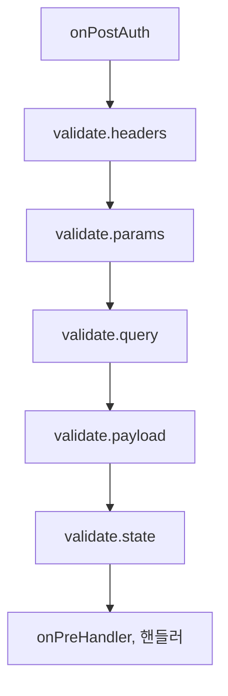

<TutorialLang />

# 검증

_이 튜토리얼은 hapi v21 이상, joi v16 이상과 호환됩니다_

## <a name="overview"></a> 개요

hapi는 핸들러가 실행되기 전에 요청의 헤더, 경로 파라미터, 쿼리, 페이로드, 쿠키를 검사하고, 응답을 보내기 전에 응답도 검사할 수 있습니다. 허용되는 값을 보통 [joi](https://joi.dev) 스키마로 기술하면, hapi가 그 밖의 모든 것을 거부합니다.

## <a name="joi"></a> Joi

joi를 설치하고 import하세요:

```sh
npm install joi
```

```ts
import Joi from 'joi';
```

joi는 자체 TypeScript 타입을 포함하므로 별도의 `@types` 패키지를 설치할 필요가 없습니다.

## <a name="input"></a> 입력 검증

입력 규칙은 라우트의 `options.validate`에 넣습니다. hapi는 인증 후, 핸들러 전에 다음 순서로 규칙을 실행하고, 처음 실패한 규칙에서 멈춥니다([failAction](#failaction) 참고):



| 키        | 검증 대상              | 성공 시 교체되는 값 |
| --------- | ---------------------- | ------------------- |
| `headers` | `request.headers`      | `request.headers`   |
| `params`  | `request.params`       | `request.params`    |
| `query`   | `request.query`        | `request.query`     |
| `payload` | `request.payload`      | `request.payload`   |
| `state`   | `request.state` (쿠키) | `request.state`     |

각 키에 넣을 수 있는 값:

| 값                             | 의미                                                                                |
| ------------------------------ | ----------------------------------------------------------------------------------- |
| `true` 또는 설정 안 함(기본값) | 모든 값을 허용                                                                      |
| `false`                        | 어떤 값도 허용하지 않음                                                             |
| joi 스키마                     | 값이 스키마와 일치해야 함                                                           |
| 함수                           | 직접 작성한 검증기. [커스텀 검증기](#alternatives) 참고                             |
| joi 스키마로 된 일반 객체      | `server.validator(Joi)` 이후에만 허용. 그렇지 않으면 `server.route()`가 예외를 던짐 |

검증은 요청 값을 검증된 값으로 교체하므로 joi의 타입 변환과 기본값이 핸들러에 전달됩니다. `?limit=5` 쿼리는 문자열 `'5'`로 도착하지만, `Joi.number()`를 거치면 핸들러는 숫자 `5`를 받습니다. 원래 값은 [`request.orig`](/api#request-orig)에 남아 있습니다.

### <a name="pathparams"></a> 경로 파라미터

```ts
server.route<{ Params: { name: string } }>({
    method: 'GET',
    path: '/hello/{name}',
    handler: (request, h) => {
        return `Hello ${request.params.name}!`;
    },
    options: {
        validate: {
            params: Joi.object({
                name: Joi.string().min(3).max(10),
            }),
        },
    },
});
```

`/hello/jennifer`는 `Hello jennifer!`로 응답합니다. `/hello/a`와 `/hello/thisnameiswaytoolong`은 다음과 같이 응답합니다:

```json
{
    "statusCode": 400,
    "error": "Bad Request",
    "message": "Invalid request params input"
}
```

### <a name="queryparams"></a> 쿼리 파라미터

```ts
server.route<{ Query: { limit: number } }>({
    method: 'GET',
    path: '/posts',
    handler: (request, h) => {
        return posts.slice(0, request.query.limit);
    },
    options: {
        validate: {
            query: Joi.object({
                limit: Joi.number().integer().min(1).max(100).default(10),
            }),
        },
    },
});
```

- `limit`은 1부터 100 사이의 정수여야 하고, 클라이언트가 생략하면 기본값은 10입니다.
- `/posts?limit=15&offset=15`는 `400`으로 실패합니다. `Joi.object()` 스키마는 나열되지 않은 키를 거부하기 때문입니다. 받는 파라미터를 모두 나열하거나, 스키마에 `.unknown()`을 추가해 다른 키를 통과시키세요.
- `Query: { limit: number }` 타입 인자는 핸들러가 받는 값을 TypeScript에 알려 줍니다. hapi는 joi 스키마에서 이를 추론하지 않으므로 둘을 직접 맞춰 두어야 합니다.

### <a name="payloadparams"></a> 페이로드

```ts
server.route({
    method: 'POST',
    path: '/post',
    handler: (request, h) => {
        return 'Blog post added';
    },
    options: {
        validate: {
            payload: Joi.object({
                post: Joi.string().min(1).max(140),
                date: Joi.date().required(),
            }),
        },
    },
});
```

`post`는 1자에서 140자여야 하고, `date`는 필수이며 `'2026-10-25'`처럼 JavaScript가 날짜로 파싱할 수 있는 값이어야 합니다. joi가 이를 변환하므로 핸들러는 `Date` 객체를 받습니다. 실패하면 `Invalid request payload input` 메시지와 함께 `400`으로 응답합니다.

### <a name="headers"></a> 헤더

```ts
server.route({
    method: 'GET',
    path: '/hello/{name}',
    handler: (request, h) => {
        return `Hello ${request.params.name}!`;
    },
    options: {
        validate: {
            headers: Joi.object({
                cookie: Joi.string().required(),
            }),
            options: {
                allowUnknown: true,
            },
        },
    },
});
```

브라우저와 프록시는 많은 헤더를 추가하므로 헤더 스키마에는 거의 항상 `allowUnknown: true`가 필요합니다. `validate.options`는 라우트의 모든 입력 스키마에 joi 옵션을 전달합니다. `request.headers`의 헤더 이름은 소문자이므로 스키마에도 소문자로 작성하세요.

### <a name="failaction"></a> 검증이 실패하면

무슨 일이 일어날지는 `validate.failAction`이 결정합니다:

| `failAction`       | 결과                                                                                    |
| ------------------ | --------------------------------------------------------------------------------------- |
| `'error'` (기본값) | `Invalid request query input` 같은 일반적인 메시지와 함께 `400`                         |
| `'log'`            | `validation`, `error`, 소스 태그가 붙은 `request` 이벤트를 로그로 남긴 뒤 핸들러를 실행 |
| `'ignore'`         | 핸들러를 실행                                                                           |
| 함수               | `(request, h, err)`: 에러를 던지거나 takeover 응답을 반환                               |

`'log'`와 `'ignore'`에서는 핸들러가 검증되지 않은 원래 값을 받습니다. `?limit=500`은 숫자가 아니라 문자열 `'500'`으로 도착합니다.

기본 `400`은 어떤 필드가 실패했는지 숨기므로 클라이언트가 스키마를 탐색할 수 없습니다. 개발 중이거나 클라이언트가 자세한 정보를 필요로 하는 API라면 `failAction` 함수에서 자세한 에러를 다시 던지세요:

```ts
server.route({
    method: 'GET',
    path: '/posts',
    handler: (request, h) => posts,
    options: {
        validate: {
            query: Joi.object({
                limit: Joi.number().integer().max(100),
            }),
            failAction: (request, h, err) => {
                throw err;
            },
        },
    },
});
```

이제 `/posts?limit=500`은 joi의 메시지와 실패한 키로 응답합니다:

```json
{
    "statusCode": 400,
    "error": "Bad Request",
    "message": "\"limit\" must be less than or equal to 100",
    "validation": { "source": "query", "keys": ["limit"] }
}
```

모든 라우트에 하나의 `failAction`을 적용하려면 서버의 `routes.validate` 옵션에 설정하세요. API 레퍼런스의 [`failAction`](/api#failaction-configuration)을 참고하세요.

## <a name="output"></a> 응답 검증

`options.response`는 핸들러가 반환한 값을 핸들러 이후, `onPreResponse` 이전에 검사합니다. 엔드포인트가 문서화된 계약과 일치하는지 확인할 때 사용하세요. [hapi-swagger](https://github.com/glennjones/hapi-swagger) 같은 플러그인도 이 스키마를 읽어 각 엔드포인트의 출력을 문서화합니다.

```ts
const bookSchema = Joi.object({
    title: Joi.string().required(),
    author: Joi.string().required(),
    isbn: Joi.string().length(10),
    pageCount: Joi.number(),
    datePublished: Joi.date().iso(),
});

server.route({
    method: 'GET',
    path: '/books',
    handler: async (request, h) => {
        return await getBooks();
    },
    options: {
        response: {
            schema: Joi.array().items(bookSchema),
            failAction: 'log',
        },
    },
});
```

| 옵션         | 하는 일                                                                                            |
| ------------ | -------------------------------------------------------------------------------------------------- |
| `schema`     | 모든 응답에 대한 규칙. 입력 규칙과 같은 값을 받음                                                  |
| `status`     | `{ 201: created, 202: Joi.object({ original, updated }) }`처럼 상태 코드별 규칙. `schema`보다 우선 |
| `failAction` | `'error'`(기본값)는 `500`으로 응답. `'log'`, `'ignore'`, 함수도 가능                               |
| `sample`     | 검증할 응답의 비율(`0`에서 `100`). 트래픽이 많은 라우트의 CPU를 아낌                               |
| `modify`     | `true`이면 검증된 값이 응답을 대체하므로 joi 변환과 `stripUnknown`이 적용됨                        |
| `options`    | 이 스키마들에 대한 joi 옵션. 예: `stripUnknown`                                                    |

응답 검증이 건너뛰거나 거부하는 것:

- 에러 응답(상태 `400` 이상)은 `status`에 해당 코드의 스키마가 없으면 검증하지 않습니다.
- 일반 값(객체, 배열, 문자열)만 검증할 수 있습니다. 응답 스키마가 있는 라우트에서 스트림이나 파일 응답은 `500`으로 실패합니다.

`modify: true`와 `stripUnknown: true`를 함께 쓰면 비밀번호 해시 같은 필드가 엔드포인트 밖으로 새어 나가는 것을 실용적으로 막을 수 있습니다:

```ts
server.route({
    method: 'GET',
    path: '/me',
    handler: (request, h) => {
        return { id: '2133d32a', name: 'John Doe', passwordHash: '$2a$10$...' };
    },
    options: {
        response: {
            schema: Joi.object({
                id: Joi.string(),
                name: Joi.string(),
            }).options({ stripUnknown: true }),
            modify: true,
        },
    },
});
```

클라이언트는 `{ "id": "2133d32a", "name": "John Doe" }`를 받습니다.

## <a name="alternatives"></a> 커스텀 검증기

모든 규칙은 joi 스키마 대신 `async (value, options)` 함수가 될 수 있습니다:

- 에러를 던지면 검증이 실패합니다. 처리는 `failAction`이 맡습니다.
- 값을 반환하면 검증 중인 값을 대체합니다. 원래 값은 `request.orig`에 남습니다.
- 아무것도 반환하지 않으면 값이 그대로 유지됩니다.

```ts
server.route({
    method: 'GET',
    path: '/items',
    handler: (request, h) => request.query,
    options: {
        validate: {
            query: async (value) => {
                if (typeof value !== 'object' || value === null || !('ids' in value) || typeof value.ids !== 'string') {
                    throw new Error('ids is required');
                }

                return { ids: value.ids.split(',') };
            },
        },
    },
});
```

`/items?ids=1,2,3`은 `{ "ids": ["1", "2", "3"] }`로 응답합니다. 던진 에러는 joi 실패와 마찬가지로 `400`이 됩니다.
