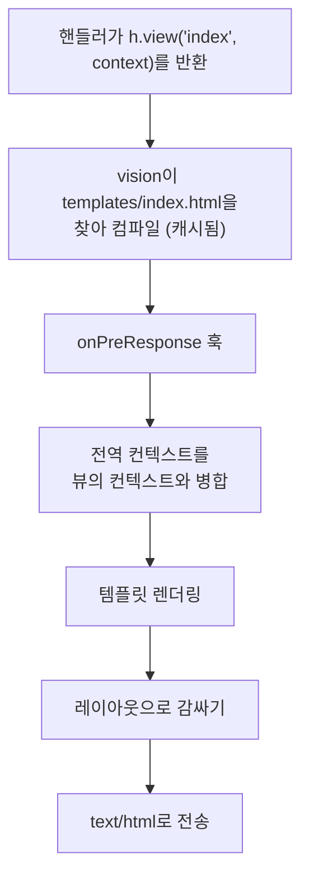

<TutorialLang />

# 뷰

_이 튜토리얼은 hapi v21 이상과 호환됩니다_

## <a name="overview"></a> 개요

hapi는 [vision](/module/vision) 플러그인으로 HTML 템플릿을 렌더링합니다. vision은 handlebars, pug, ejs를 포함해 `compile` 함수가 있는 모든 템플릿 엔진과 함께 동작하며(nunjucks처럼 `compile`이 다른 엔진은 [엔진](#engines)에서 설명하는 작은 래퍼가 필요합니다), partial, 헬퍼, 레이아웃을 지원합니다.

## <a name="vision"></a> Vision

vision과 엔진을 설치하세요:

```sh
npm install @hapi/vision handlebars
```

vision을 등록하면 다음이 추가됩니다:

| 기능                                  | 용도                                           |
| ------------------------------------- | ---------------------------------------------- |
| `server.views(options)`               | 엔진, 템플릿 폴더, 레이아웃 설정               |
| `h.view(template, context)`           | 핸들러에서 템플릿 렌더링                       |
| `view` 핸들러                         | 템플릿만 렌더링하는 라우트                     |
| `server.render()`, `request.render()` | 이메일 등에 쓰기 위해 템플릿을 문자열로 렌더링 |

`@hapi/vision`을 import하면 hapi의 TypeScript 타입에도 이들이 추가됩니다. 전체 API는 [vision API 레퍼런스](/module/vision)에 있습니다.

## <a name="server"></a> 서버 설정

```ts
import Hapi from '@hapi/hapi';
import Vision from '@hapi/vision';
import Handlebars from 'handlebars';

const server = Hapi.server({ port: 3000 });

await server.register(Vision);

server.views({
    engines: {
        html: Handlebars,
    },
    relativeTo: import.meta.dirname,
    path: 'templates',
});

server.route({
    method: 'GET',
    path: '/',
    handler: (request, h) => {
        return h.view('index', { title: 'My home page' });
    },
});

await server.start();
```

- `engines`는 파일 확장자를 엔진에 매핑합니다. `.html`로 끝나는 파일은 handlebars로 렌더링됩니다.
- `path`는 템플릿이 있는 폴더이며 `relativeTo`를 기준으로 해석됩니다. ES 모듈에는 `__dirname`이 없습니다. `import.meta.dirname`이 현재 파일의 폴더입니다.
- `h.view('index', ...)`는 `templates/index.html`을 렌더링합니다. 엔진이 하나만 등록되어 있으면 확장자를 생략할 수 있습니다.

### <a name="lifecycle"></a> 뷰가 렌더링되는 과정

`h.view()`는 즉시 무언가를 렌더링하지 않습니다. 뷰 응답을 반환하고, hapi가 응답을 보낼 때 vision이 렌더링합니다:



이 순서가 실제로 의미하는 것:

- 템플릿이 없으면 핸들러가 반환하는 즉시, 어떤 `onPreResponse` 훅보다도 먼저 `500`으로 실패합니다.
- `onPreResponse` 훅은 렌더링 전에 실행되므로 뷰를 에러 페이지 같은 다른 응답으로 교체할 수 있습니다. 아래의 [에러 페이지](#errors)를 참고하세요.
- 모든 응답 타입에 대한 이 준비 단계와 렌더링 단계의 구분은 [응답 마샬링](/tutorials/ko_KR/response-marshalling)에서 다룹니다.

## <a name="options"></a> server.views() 옵션

| 옵션                  | 기본값        | 효과                                                                   |
| --------------------- | ------------- | ---------------------------------------------------------------------- |
| `engines`             | 필수          | 확장자에서 엔진으로의 매핑. 예: `{ html: Handlebars, pug: Pug }`       |
| `path`                | 없음          | 템플릿이 있는 폴더(또는 폴더의 배열)                                   |
| `relativeTo`          | 작업 디렉터리 | 다른 모든 경로 옵션의 기준 폴더                                        |
| `partialsPath`        | 없음          | partial이 있는 폴더                                                    |
| `helpersPath`         | 없음          | 헬퍼 모듈이 있는 폴더                                                  |
| `layout`              | `false`       | `true`이면 `layout.html`을 사용. 다른 레이아웃 파일의 이름도 지정 가능 |
| `layoutPath`          | 없음          | 레이아웃이 있는 폴더                                                   |
| `context`             | 없음          | 모든 뷰에 병합되는 컨텍스트. 객체 또는 요청을 받는 함수                |
| `isCached`            | `true`        | `false`이면 요청마다 템플릿을 읽고 컴파일. 개발 중에 편리함            |
| `defaultExtension`    | 유일한 엔진   | `h.view()`가 확장자 없는 이름을 받을 때 사용할 확장자                  |
| `compileMode`         | `'sync'`      | `compile`이 콜백을 받는 엔진에는 `'async'`                             |
| `allowAbsolutePaths`  | `false`       | 절대 경로 템플릿 이름 허용                                             |
| `allowInsecureAccess` | `false`       | 템플릿 이름에 `../` 허용                                               |

`server.views()`에 설정한 옵션은 모든 엔진에 적용됩니다:

```ts
server.views({
    engines: { html: Handlebars },
    relativeTo: import.meta.dirname,
    path: 'templates',
    isCached: process.env.NODE_ENV === 'production',
});
```

여기서는 템플릿을 `templates/`에서 불러오고, 프로덕션이 아닐 때는 vision이 요청마다 템플릿을 다시 읽고 컴파일하므로 재시작하지 않아도 템플릿 수정이 반영됩니다.

### <a name="engines"></a> 엔진

엔진은 `compile` 함수가 있는 객체라면 무엇이든 됩니다:

| `compileMode`     | `compile` 시그니처                            | 반환                                                                                                       |
| ----------------- | --------------------------------------------- | ---------------------------------------------------------------------------------------------------------- |
| `'sync'` (기본값) | `compile(template, compileOptions)`           | HTML을 반환하는 `render(context, runtimeOptions)`                                                          |
| `'async'`         | `compile(template, compileOptions, callback)` | `callback(err, render)`를 호출. `render(context, runtimeOptions, callback)`은 `callback(err, html)`을 호출 |

`compileOptions`와 `runtimeOptions`는 엔진에 그대로 전달되는 `server.views()` 옵션입니다. API가 맞지 않는 엔진은 이런 `compile` 함수를 가진 객체로 감싸면 됩니다.

엔진이 둘 이상 등록되어 있으면 가장 많이 쓰는 엔진을 `defaultExtension`으로 설정하지 않는 한 `h.view()`에 확장자가 필요합니다(`h.view('index.pug')`).

### <a name="paths"></a> 경로

다음과 같은 폴더 구조라면:

```
templates/
    index.html
    layout/
        layout.html
    helpers/
        fortune.js
```

설정은 다음과 같습니다:

```ts
server.views({
    engines: {
        html: Handlebars,
    },
    relativeTo: import.meta.dirname,
    path: 'templates',
    layoutPath: 'templates/layout',
    helpersPath: 'templates/helpers',
});
```

### <a name="global"></a> 전역 컨텍스트

`context`는 모든 뷰의 컨텍스트에 병합되며, 둘 다 같은 키를 설정하면 뷰 자신의 컨텍스트가 우선합니다. 요청마다 계산하려면 함수를 넘기세요. 예를 들어 모든 페이지에 로그인한 사용자를 표시할 수 있습니다:

```ts
server.views({
    engines: {
        html: Handlebars,
    },
    relativeTo: import.meta.dirname,
    path: 'templates',
    context: (request) => ({
        siteName: 'My personal site',
        user: request?.auth.credentials?.user ?? null,
    }),
});
```

`server.render()`로 요청 밖에서 렌더링하면 `request`가 undefined이므로 함수에서 이를 확인합니다.

### <a name="helpers"></a> 뷰 헬퍼

handlebars처럼 헬퍼를 지원하는 엔진에서는 `helpersPath`의 각 모듈이 파일 이름을 딴 헬퍼가 됩니다. `templates/helpers/fortune.js`로 저장한 다음 헬퍼는 무작위 운세를 반환합니다:

```js
export default function () {
    const fortunes = [
        'Heisenberg may have slept here...',
        'Wanna buy a duck?',
        'Say no, then negotiate.',
        'Time and tide wait for no man.',
        'To teach is to learn.',
        'Never ask the barber if you need a haircut.',
        'You will forget that you ever knew me.',
        'You will be run over by a beer truck.',
        'Fortune favors the lucky.',
        'Have a nice day!',
    ];

    const x = Math.floor(Math.random() * fortunes.length);
    return fortunes[x];
}
```

헬퍼는 JavaScript 파일로 둡니다. vision은 헬퍼를 `require()`로 불러오고, Node.js가 `require.extensions`에 등록하지 않은 확장자의 파일은 건너뛰는데, 여기에는 `.ts`가 포함되지 않습니다.

`templates/index.html`에서 사용하세요:

```html
<h1>Your fortune</h1>
<p>{{fortune}}</p>
```

### <a name="layouts"></a> 레이아웃

많은 엔진이 자체 레이아웃 시스템을 갖고 있기 때문에 vision의 레이아웃은 기본적으로 꺼져 있습니다. 둘 중 하나만 사용하세요. vision의 레이아웃을 켜려면:

```ts
server.views({
    engines: {
        html: Handlebars,
    },
    relativeTo: import.meta.dirname,
    path: 'templates',
    layout: true,
    layoutPath: 'templates/layout',
});
```

`templates/layout/layout.html`은 `content`로 각 뷰가 들어갈 자리를 표시합니다:

```html
<html>
    <body>
        {{{content}}}
    </body>
</html>
```

그리고 뷰에는 자신의 부분만 들어갑니다:

```html
<div>Content</div>
```

| 하려는 것                    | 방법                                                      |
| ---------------------------- | --------------------------------------------------------- |
| 다른 기본 레이아웃 사용      | `server.views()`에 `layout: 'another_default'`            |
| 한 뷰에만 다른 레이아웃 사용 | `h.view('myview', context, { layout: 'another_layout' })` |
| 한 뷰를 레이아웃 없이 렌더링 | `h.view('myview', context, { layout: false })`            |

레이아웃이 켜져 있는 동안에는 컨텍스트에 `content` 키를 둘 수 없습니다. vision이 렌더링된 뷰에 그 이름을 쓰기 때문이며, 이 경우 `500`으로 실패합니다. 이름은 `layoutKeyword` 옵션으로 바꿀 수 있습니다.

## <a name="render"></a> 뷰 렌더링

### <a name="hview"></a> h.view()

데이터 로딩처럼 핸들러에서 먼저 할 일이 있을 때는 [`h.view()`](/module/vision#h-view-template-context-options)를 사용하세요:

```ts
server.route({
    method: 'GET',
    path: '/',
    handler: (request, h) => {
        return h.view('index', { title: 'My home page' });
    },
});
```

`h.view()`는 일반 응답 객체를 반환하므로 `.code()`, `.header()` 등 [응답 객체](/api#response-object) 메서드를 체이닝할 수 있습니다.

### <a name="viewhandler"></a> 뷰 핸들러

라우트가 템플릿만 렌더링한다면 `view` 핸들러를 사용하세요:

```ts
server.route({
    method: 'GET',
    path: '/',
    handler: {
        view: {
            template: 'index',
            context: {
                title: 'My home page',
            },
        },
    },
});
```

`handler: { view: 'index' }`가 짧은 형태입니다. 뷰 핸들러는 항상 컨텍스트에 `params`, `payload`, `query`, `pre`를 추가하므로 `/users/{id}`의 템플릿은 핸들러 코드 없이도 `params.id`를 출력할 수 있습니다.

## <a name="errors"></a> 에러 페이지

hapi는 에러에 JSON으로 응답합니다. HTML을 렌더링하는 사이트는 보통 HTML 에러 페이지를 원합니다. 렌더링은 `onPreResponse` 이후에 일어나므로, 그 훅에서 어떤 에러든 뷰로 바꿀 수 있습니다:

```ts
import Boom from '@hapi/boom';

server.ext('onPreResponse', (request, h) => {
    const response = request.response;
    if (!Boom.isBoom(response)) {
        return h.continue;
    }

    const { statusCode, payload } = response.output;

    return h.view('error', { statusCode, message: payload.message }).code(statusCode);
});
```

이제 없는 페이지를 요청하면 레이아웃 안에 렌더링된 `templates/error.html`을 상태 `404`와 함께 받습니다. 이 훅은 핸들러가 던진 에러와 검증 실패도 잡습니다. `onPreResponse`에 대해서는 [라이프사이클 훅](/tutorials/ko_KR/lifecycle-hooks)을 참고하세요.
