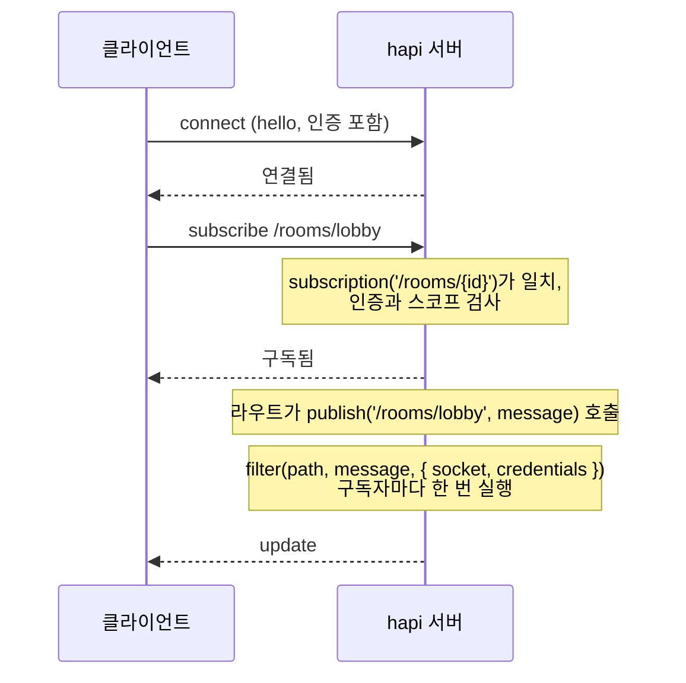
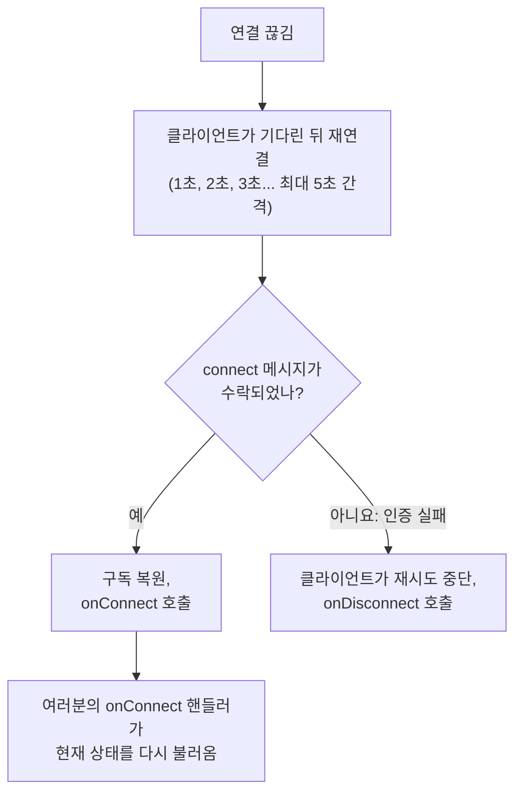
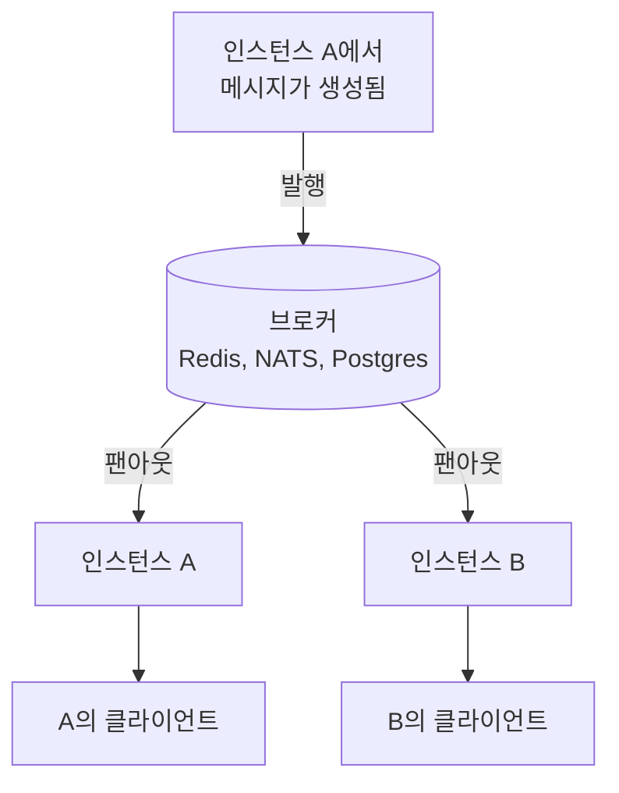

<TutorialLang />

# WebSocket

_이 튜토리얼은 hapi v21 이상과 호환됩니다_

## <a name="overview"></a> 개요

[@hapi/nes](/module/nes)는 hapi 서버에 WebSocket 엔드포인트를 추가합니다. 연결된 클라이언트는 소켓 하나로 세 가지 일을 할 수 있습니다.

- **라우트 호출.** `client.request()`는 검증, 인증 스코프, 핸들러를 갖춘 일반 hapi 라우트를 실행하고 응답을 소켓으로 돌려줍니다.
- **업데이트 구독.** 클라이언트가 `/rooms/lobby` 같은 경로를 구독하면 서버가 그 경로로 발행합니다.
- **푸시 수신.** 서버가 소켓 하나에 메시지를 보내거나 모든 소켓에 브로드캐스트합니다.

## <a name="when"></a> WebSocket을 언제 쓸까

| 방법                                       | 방향                          | 적합한 용도                                                         |
| ------------------------------------------ | ----------------------------- | ------------------------------------------------------------------- |
| 일반 라우트 폴링                           | 클라이언트가 묻고 서버가 답함 | 몇 분마다 바뀌는 데이터, 또는 실시간이어도 얻는 것이 없을 때        |
| [Server-Sent Events](/tutorials/ko_KR/sse) | 서버에서 클라이언트로만       | 실시간 피드, 진행률, 알림. 평범한 HTTP라서 대부분의 프록시를 통과함 |
| nes를 사용한 WebSocket                     | 양방향, 연결 하나             | 채팅, 협업, 게임: 클라이언트가 자주 보내고 푸시를 돌려받기를 기대함 |

클라이언트가 듣기만 한다면 SSE가 운영하기 더 간단합니다. 클라이언트도 자주 보내거나, 요청과 업데이트를 연결 하나로 처리하고 싶다면 WebSocket을 고르세요. 모바일 네트워크에서는 이 차이가 중요합니다.

## <a name="setup"></a> 설정

```sh
npm install @hapi/nes
```

채팅방 서버입니다. 메시지는 라우트로 올리고, 그 방의 모든 구독자가 메시지를 받으며, 두 번째 라우트는 최근 이력을 반환합니다.

```ts
import Hapi from '@hapi/hapi';
import Joi from 'joi';
import Nes from '@hapi/nes';

interface ChatMessage {
    room: string;
    text: string;
    at: string;
}

const history = new Map<string, ChatMessage[]>();

const server = Hapi.server({ port: 4000 });

await server.register(Nes);

server.subscription('/rooms/{id}');

const roomParams = Joi.object({ id: Joi.string().alphanum().max(50).required() });

server.route<{ Params: { id: string }; Payload: { text: string } }>({
    method: 'POST',
    path: '/rooms/{id}/messages',
    options: {
        validate: {
            params: roomParams,
            payload: Joi.object({ text: Joi.string().max(2000).required() }),
        },
    },
    handler: (request, h) => {
        const message: ChatMessage = {
            room: request.params.id,
            text: request.payload.text,
            at: new Date().toISOString(),
        };

        const messages = history.get(message.room) ?? [];
        history.set(message.room, [...messages, message].slice(-50));

        server.publish(`/rooms/${message.room}`, message);
        return h.response(message).code(201);
    },
});

server.route<{ Params: { id: string } }>({
    method: 'GET',
    path: '/rooms/{id}/messages',
    options: { validate: { params: roomParams } },
    handler: (request, h) => history.get(request.params.id) ?? [],
});

await server.start();
```

nes는 HTTP 라우트와 같은 포트에서 수신합니다. 라우트는 평범한 HTTP로도 동작하므로, 다른 서비스는 소켓을 열지 않고도 방에 메시지를 올릴 수 있습니다. `POST` 라우트는 원본 페이로드가 아니라 [검증](/tutorials/ko_KR/validation)한 필드만 발행합니다.

Node.js 클라이언트는 다음과 같습니다.

```ts
import Nes from '@hapi/nes';

const client = new Nes.Client('ws://localhost:4000');
await client.connect();

await client.subscribe('/rooms/lobby', (message) => {
    console.log('lobby:', message);
});

await client.request({ method: 'POST', path: '/rooms/lobby/messages', payload: { text: 'hello' } });
```

브라우저에서는 번들이 서버 플러그인까지 끌어오지 않도록 클라이언트 파일만 따로 import하세요.

```ts
import { Client } from '@hapi/nes/lib/client.js';

const client = new Client(`wss://${location.host}`);
await client.connect();
```

구독 핸들러는 메시지를 `unknown`으로 받습니다. 서버는 무엇이든 발행할 수 있으므로, `fetch()` 응답을 다룰 때처럼 사용하기 전에 형태를 확인하세요.

## <a name="requests"></a> 소켓으로 라우트 호출하기

`client.request()`는 검증, `auth.access` 스코프, 확장, 핸들러로 이어지는 hapi [요청 라이프사이클](/api#request-lifecycle) 전체를 거쳐 라우트를 실행합니다. nes는 소켓이 연결할 때 인증한 자격 증명을 넘겨 [`server.inject()`](/api#await-server-inject-options)로 이를 처리합니다. 요청 옵션과 응답 형태는 [`client.request()`](/module/nes#await-client-request-options)에 있습니다.

핸들러 안에서 `request.socket`은 소켓 요청이면 nes 소켓이고 일반 HTTP 요청이면 `null`이므로, 사용하기 전에 확인하세요.

클라이언트가 이미 연결을 가지고 있고 HTTP 왕복을 한 번 더 하고 싶지 않을 때 소켓 요청을 사용하세요. 주로 듣기만 하는 페이지라면 일반 HTTP 요청과 구독을 함께 쓰는 편이 디버깅하기 쉽습니다.

## <a name="push"></a> 업데이트 푸시하기

nes는 클라이언트에 메시지를 보내는 방법을 세 가지 제공합니다.

| 메서드                          | 받는 쪽                     | 용도                               |
| ------------------------------- | --------------------------- | ---------------------------------- |
| `server.publish(path, message)` | 일치하는 경로를 구독한 소켓 | 거의 모든 경우: 채팅방, 문서, 피드 |
| `socket.send(message)`          | 소켓 하나                   | 답장과 연결별 알림                 |
| `server.broadcast(message)`     | 연결된 모든 소켓            | 드묾: 점검 경고, 강제 새로고침     |

보통은 구독이 원하는 방법입니다. 클라이언트가 관심 있는 것을 말하고, 서버는 그것만 보내기 때문입니다.



구독의 `filter`는 소켓마다 업데이트를 보낼지 정합니다. 필터에는 필요하지만 클라이언트에게는 보이면 안 되는 데이터는 `internal`로 전달하세요.

```ts
server.subscription('/documents/{id}', {
    filter: (path, message, options) => {
        return options.internal === options.credentials?.id;
    },
});

server.publish('/documents/42', { title: 'Q3 plan' }, { internal: '2133d32a' });
```

문서 소유자만 업데이트를 받고, 소유자 id는 어떤 클라이언트에게도 전달되지 않습니다. 필터는 `credentials.id`와 비교하는데, 이 값은 인증 튜토리얼의 [bearer 전략](/tutorials/ko_KR/auth#jwt)이 설정합니다.

필터는 발행할 때마다 모든 구독자에 대해 실행되므로, 메모리 안에서 끝나는 검사만 하세요. 사용자마다 보이는 내용을 바꾸려면 필터가 `true` 대신 `{ override: message }`를 반환하면 됩니다.

## <a name="auth"></a> 인증

nes에는 자체 인증이 없습니다. hapi의 [인증 전략](/tutorials/ko_KR/auth)을 재사용합니다. 소켓은 연결할 때 인증하고, 그 소켓의 모든 요청과 구독은 그 자격 증명을 사용합니다.

플러그인의 `auth.type` 옵션은 클라이언트가 자신을 증명하는 방식을 정합니다.

| `auth.type`         | 클라이언트의 인증 방식                                                                                             | 적합한 경우                                    |
| ------------------- | ------------------------------------------------------------------------------------------------------------------ | ---------------------------------------------- |
| `'direct'` (기본값) | connect 메시지 안에 일반 HTTP 인증 헤더를 담아 보냄: `client.connect({ auth: { headers: { authorization } } })`    | bearer 토큰이나 basic 인증을 쓰는 API          |
| `'token'`           | 먼저 HTTP로 `GET /nes/auth`를 호출해 봉인된 토큰을 받고, 이를 `client.connect({ auth: token })`에 전달             | 모바일 앱처럼 쿠키에 의존할 수 없는 클라이언트 |
| `'cookie'`          | 먼저 HTTP로 `GET /nes/auth`를 호출하면 암호화된 쿠키가 설정되고, 브라우저가 WebSocket 업그레이드 때 이 쿠키를 보냄 | 이미 쿠키 세션을 쓰는 브라우저 앱              |

`'direct'`에서 nes는 헤더를 `auth.route`의 전략으로 처리하고, `auth.route`가 없으면 서버의 [기본 전략](/tutorials/ko_KR/auth#default)으로 처리합니다. 인증 튜토리얼의 [bearer 전략](/tutorials/ko_KR/auth#jwt)을 기본값으로 쓰면 다음과 같습니다.

```ts
const client = new Nes.Client('wss://api.example.com');
await client.connect({ auth: { headers: { authorization: `Bearer ${token}` } } });
```

- **자격 증명 없이 연결하기.** 인증 전략의 모드가 `'required'`이면 `auth` 없이 연결한 클라이언트는 `Connection requires authentication`으로 거부됩니다. 그렇지 않으면 인증되지 않은 상태로 연결되고, 인증이 필요한 라우트와 구독만 이를 거부합니다.
- **만료되는 토큰.** `@hapi/jwt` 전략은 소켓이 열려 있는 동안 `auth.minAuthVerifyInterval`(기본값은 heartbeat 간격)마다 최대 한 번 토큰을 다시 검사합니다. 토큰이 만료되면 서버가 소켓을 닫고, 클라이언트의 재연결은 `Token maximum age exceeded`로 거부되며, 클라이언트는 재시도를 멈춥니다. 기존 토큰이 만료되기 전에 새 토큰을 보내세요.

    ```ts
    await client.reauthenticate({ headers: { authorization: `Bearer ${freshToken}` } });
    ```

    스킴에 `verify()` 메서드가 없는 전략은 소켓이 살아 있는 동안 연결 시점의 자격 증명을 그대로 유지합니다.

- **구독 보호하기.** `auth` 옵션이 없는 구독은 기본 전략과 그 모드를 사용하지만, 기본값의 `access`에 있는 스코프는 사용하지 않습니다. 그 스코프는 여전히 소켓 요청을 보호합니다. 보호해야 하는 구독마다 `auth.scope`를 따로 지정하세요. 나열한 스코프 중 하나만 있으면 통과하며, [라우트 스코프](/tutorials/ko_KR/auth#scopes)가 지원하는 `+`와 `!` 접두사는 쓸 수 없습니다.
- **`'token'`과 `'cookie'`에는 `auth.password`를 설정하세요.** 설정하지 않으면 nes가 프로세스가 시작될 때 무작위 비밀번호를 고르므로, 재시작하면 토큰과 쿠키가 더 이상 동작하지 않고 한 인스턴스가 봉인한 것을 다른 인스턴스가 읽을 수 없습니다.
- **쿠키 인증에는 `origin`을 설정하세요.** WebSocket 업그레이드는 CORS 검사를 받지 않고, 형제 서브도메인은 같은 사이트로 취급되므로 nes 쿠키의 `SameSite=Strict`로는 이를 막을 수 없습니다. `origin`은 다른 출처의 업그레이드를 거부하며, 위의 Node.js 클라이언트처럼 `Origin` 헤더를 보내지 않는 클라이언트도 거부합니다.

```ts
import Hapi from '@hapi/hapi';
import Nes from '@hapi/nes';

import type { Nes as NesTypes } from '@hapi/nes';

const cookiePassword = process.env.NES_COOKIE_PASSWORD;
if (!cookiePassword || cookiePassword.length < 32) {
    throw new Error('NES_COOKIE_PASSWORD must be set to at least 32 characters');
}

const server = Hapi.server({ port: 4000 });

const nesOptions = {
    auth: { type: 'cookie', password: cookiePassword } satisfies NesTypes.PluginOptions['auth'],
    origin: ['https://app.example.com'],
};

await server.register({ plugin: Nes, options: nesOptions });
```

## <a name="reconnect"></a> 재연결과 놓친 업데이트

모바일 네트워크는 연결이 자주 끊기며, 클라이언트는 알아서 다시 연결합니다.



- 클라이언트는 다시 연결될 때까지 위의 간격으로 계속 재시도합니다. `client.connect()`에서 `retries`로 횟수를 제한할 수 있습니다.
- 재연결하면 클라이언트가 구독을 다시 보내므로, 코드를 추가하지 않아도 핸들러가 계속 동작합니다.
- **클라이언트의 연결이 끊긴 동안 발행된 업데이트는 사라집니다.** nes는 이를 큐에 쌓아 두지 않습니다. 업데이트를 놓치면 안 된다면 `onConnect`에서 현재 상태를 불러오세요.

```ts
const refreshRoom = async (room: string) => {
    const { payload } = await client.request<ChatMessage[]>(`/rooms/${room}/messages`);
    render(payload);
};

client.onConnect = () => {
    refreshRoom('lobby').catch((err) => console.error('Could not refresh the room', err));
};
```

- 서버는 15초마다 각 클라이언트에 ping을 보내고, 5초 안에 응답하지 않으면 연결을 끊습니다. 클라이언트도 ping이 오지 않으면 연결을 끊고 다시 연결합니다. 유휴 연결을 닫는 로드 밸런서와 프록시는 유휴 타임아웃을 ping 간격보다 길게 잡아야 합니다. 그렇지 않으면 눈에 보이는 이유 없이 연결이 끊깁니다.

## <a name="scaling"></a> 여러 인스턴스로 확장하기

두 서버 인스턴스는 메모리를 공유하지 않습니다. 인스턴스 A가 가진 WebSocket 연결은 인스턴스 B에 존재하지 않으므로, A에서 호출한 `server.publish()`나 `server.broadcast()`는 A에 연결된 클라이언트에게만 갑니다. 로드 밸런서 뒤에 인스턴스가 두 개 있으면, A에 올린 메시지는 B에 연결된 클라이언트에게 절대 도착하지 않습니다. 이는 모든 WebSocket 라이브러리와 호스팅 업체에 해당합니다. 각 프로세스는 자기가 가진 연결에만 쓸 수 있습니다.

여러 인스턴스로 확장하려면 인스턴스 사이에 메시지를 전달해야 합니다. Redis, NATS, Postgres `LISTEN`/`NOTIFY` 같은 pub/sub 백엔드가 각 메시지를 모든 인스턴스에 퍼뜨리고, 각 인스턴스는 이를 자기 연결에 전달합니다.



Redis를 사용하면 다음과 같습니다.

```ts
import { createClient } from 'redis';

const publisher = createClient({ url: process.env.REDIS_URL });
const subscriber = publisher.duplicate();
publisher.on('error', (err) => server.log(['redis', 'error'], err));
subscriber.on('error', (err) => server.log(['redis', 'error'], err));
await Promise.all([publisher.connect(), subscriber.connect()]);

await subscriber.subscribe('chat', (raw) => {
    const message: ChatMessage = JSON.parse(raw);
    server.publish(`/rooms/${message.room}`, message);
});

const publishToRoom = async (message: ChatMessage) => {
    await publisher.publish('chat', JSON.stringify(message));
};
```

`POST` 라우트는 `server.publish()` 대신 `publishToRoom()`을 호출하고, 요청을 처리한 인스턴스를 포함해 모든 인스턴스가 각자의 소켓에 발행합니다.

- WebSocket 연결은 처음 연결한 인스턴스에 머무르므로, 소켓 자체에는 sticky 세션이 필요 없습니다. `'token'`과 `'cookie'` 인증 방식에서는 `/nes/auth` 요청이 소켓과 다른 인스턴스로 갈 수 있으므로, 모든 인스턴스에 같은 `auth.password`를 설정하세요.
- `server.eachSocket()`도 같은 방식으로 프로세스 안에서만 동작합니다.

## <a name="cleanup"></a> 정리하기

연결별 상태는 소켓이 살아 있는 동안 유지됩니다. 소켓이 사라지면 해제하세요.

- 플러그인 옵션의 `onDisconnection`은 소켓이 닫힐 때마다 실행됩니다.
- `server.subscription()` 옵션의 `onUnsubscribe`는 클라이언트가 구독을 취소하거나 연결이 끊길 때 실행됩니다. 폴링 루프처럼 그 구독자만을 위해 하던 작업을 멈추기 좋은 곳입니다.
- `server.stop()`은 모든 소켓을 닫습니다. 클라이언트는 연결이 끊긴 것을 보고 재연결을 시작하는데, 롤링 배포 중에는 이것이 바로 원하는 동작입니다. 클라이언트가 다른 인스턴스로 돌아오기 때문입니다.

## <a name="typescript"></a> TypeScript

nes는 플러그인과 클라이언트의 타입을 자체적으로 제공합니다. `@hapi/nes`를 import하면 hapi의 타입에 `server.subscription()`, `server.publish()`, `server.broadcast()`, `server.eachSocket()`, `request.socket`이 추가됩니다. `client.request()`는 `client.request<ChatMessage[]>(path)`처럼 페이로드 타입을 타입 인자로 받습니다. 이 타입은 런타임에 검사되지 않으므로, 여러분이 통제하지 않는 데이터는 검증하세요.

## <a name="next"></a> 다음 단계

- [@hapi/nes API 레퍼런스](/module/nes): 모든 플러그인 옵션, [소켓 인증](/module/nes#socket-auth), 클라이언트 API 전체.
- 클라이언트가 듣기만 할 때는 [Server-Sent Events](/tutorials/ko_KR/sse).
- nes가 재사용하는 전략과 스코프는 [인증](/tutorials/ko_KR/auth).
