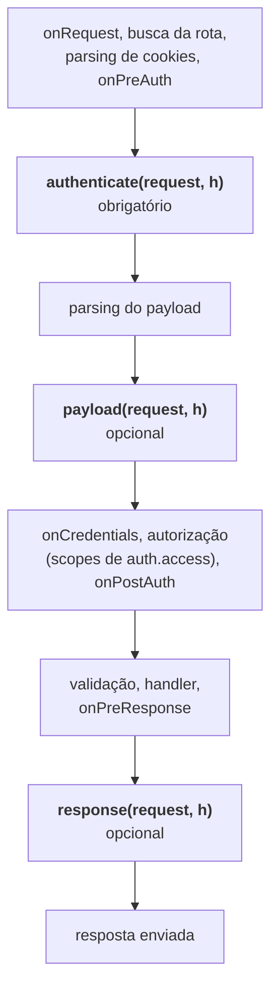
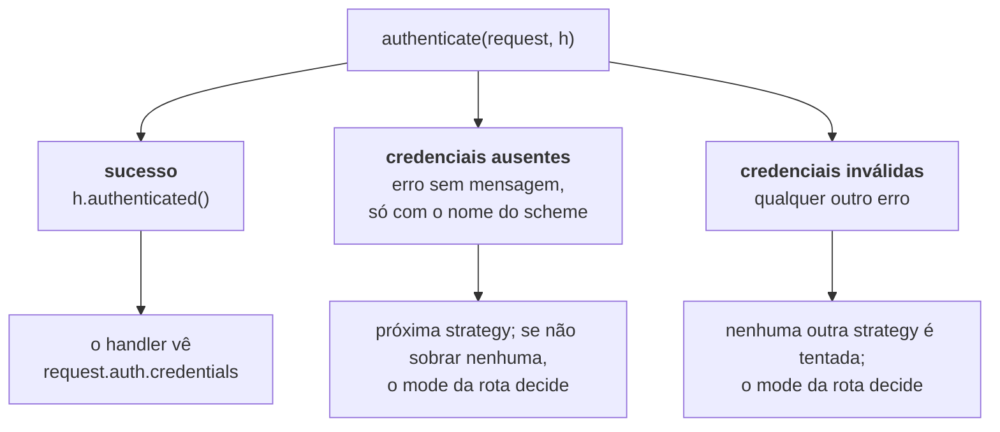
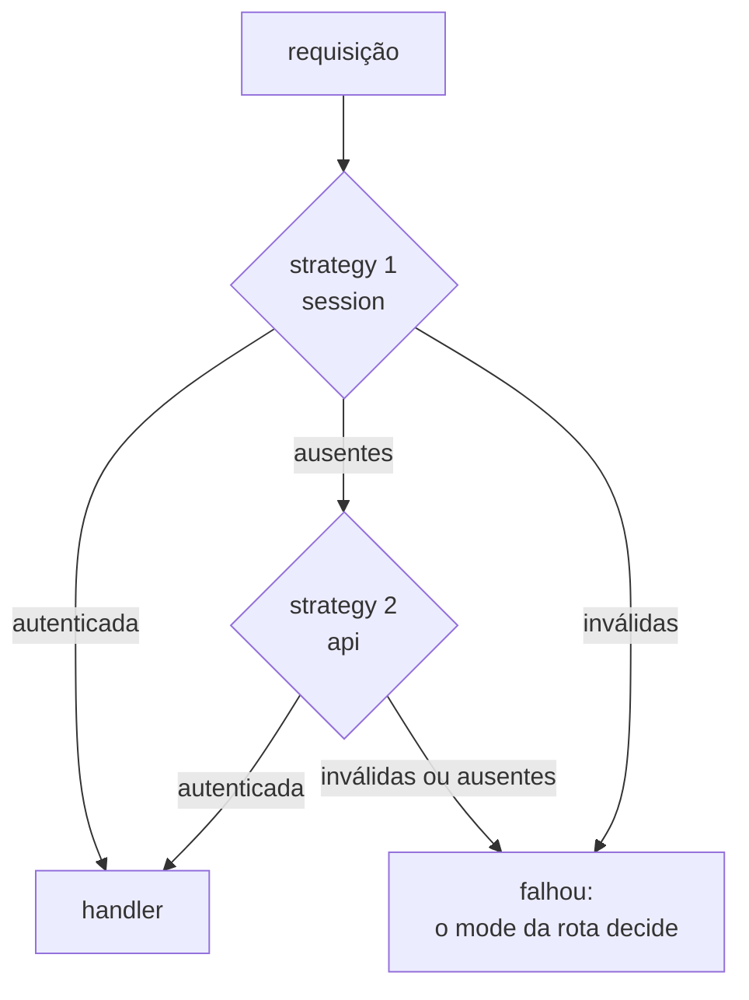
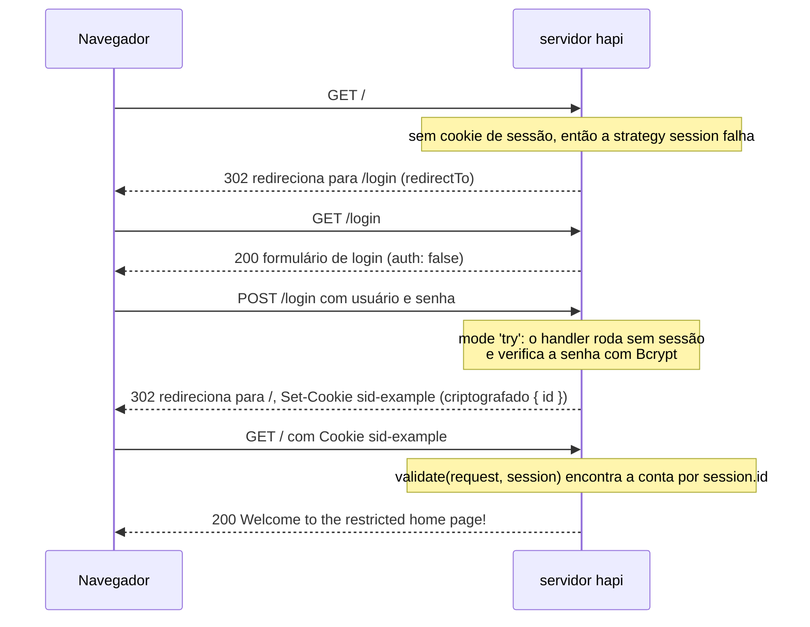
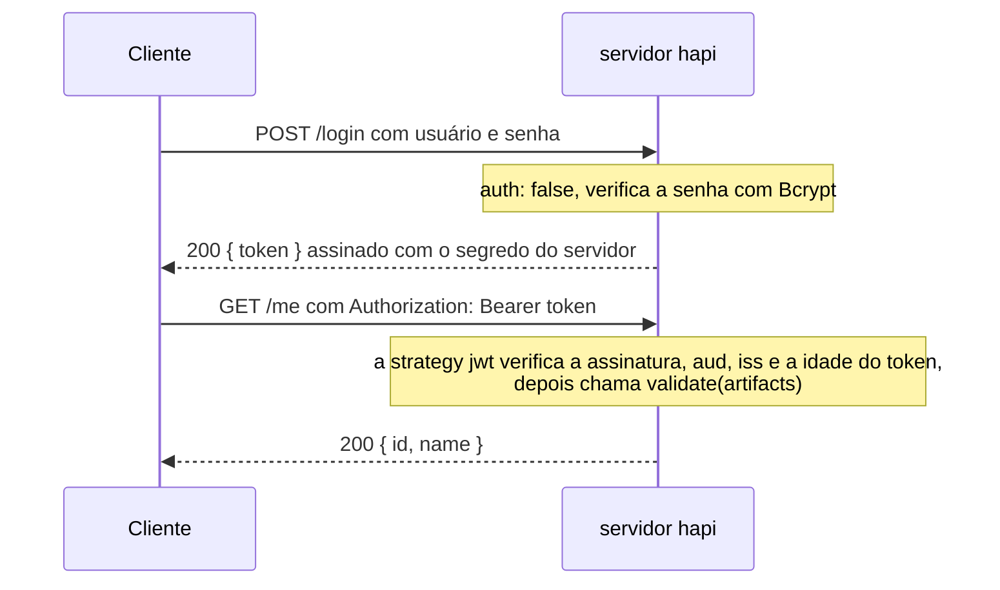

<TutorialLang />

# Autenticação

_Este tutorial é compatível com hapi v21 e versões mais recentes_

## <a name="overview"></a> Visão geral

A maioria das aplicações web modernas usa alguma forma de autenticação. No hapi, a autenticação é construída a partir de duas peças, `schemes` e `strategies`:

- Um `scheme` é uma forma genérica de autenticar, como "HTTP basic auth" ou "cookie de sessão". Plugins como `@hapi/basic` e `@hapi/cookie` registram, cada um, um scheme.
- Uma `strategy` é um scheme com um nome e uma configuração, como "basic auth, verificada contra a minha tabela de usuários". As rotas se referem às strategies pelo nome.

Com `@hapi/basic`, o plugin registra um scheme, você configura uma strategy a partir dele e uma rota usa essa strategy:

```ts
// Registers the 'basic' scheme.
await server.register(Basic);

server.auth.strategy('simple', 'basic', { validate });

server.route({
    method: 'GET',
    path: '/',
    options: { auth: 'simple' },
    handler: (request, h) => 'welcome',
});
```

## <a name="schemes"></a> Schemes

Um `scheme` é uma função com a assinatura `function (server, options)`. `server` é o servidor ao qual o scheme é adicionado, e `options` é o objeto de configuração passado quando uma strategy é criada a partir desse scheme. A função retorna um objeto de scheme, e o hapi chama os métodos desse objeto em três pontos do [ciclo de vida da requisição](/api#request-lifecycle):



`payload` e `response` só rodam para requisições que `authenticate` aceitou.

Você pode escrever seu próprio scheme ou usar um dos plugins de autenticação do hapi, como `@hapi/basic` ou `@hapi/cookie`. Aqui está um scheme completo que lê um token de API de um header da requisição:

```ts
import Boom from '@hapi/boom';
import Hapi from '@hapi/hapi';

import type { ServerAuthScheme } from '@hapi/hapi';

declare module '@hapi/hapi' {
    interface UserCredentials {
        id: string;
        name: string;
    }
}

interface TokenOptions {
    tokens: Map<string, { id: string; name: string }>;
}

const tokenScheme: ServerAuthScheme<TokenOptions> = (server, options) => {
    return {
        authenticate: (request, h) => {
            const token = request.headers['x-api-token'];
            if (typeof token !== 'string') {
                throw Boom.unauthorized(null, 'token');
            }

            const user = options?.tokens.get(token);
            if (!user) {
                throw Boom.unauthorized('Invalid token', 'token');
            }

            return h.authenticated({ credentials: { user }, artifacts: { token } });
        },
        response: (request, h) => {
            if (!Boom.isBoom(request.response)) {
                request.response.header('x-authenticated-user', request.auth.credentials.user?.id ?? '');
            }

            return h.continue;
        },
    };
};

const server = Hapi.server({ port: 4000 });

server.auth.scheme('token', tokenScheme);
server.auth.strategy('api', 'token', {
    tokens: new Map([['a1b2c3', { id: '2133d32a', name: 'John Doe' }]]),
});

server.route({
    method: 'GET',
    path: '/me',
    options: { auth: 'api' },
    handler: (request, h) => {
        return request.auth.credentials.user;
    },
});

await server.start();
```

`ServerAuthScheme<TokenOptions>` tipa as `options` que o scheme recebe. Os tokens ficam em um `Map`, e não em um objeto comum, de propósito: buscar uma chave enviada pelo cliente em um objeto comum também encontra propriedades herdadas, então um token `constructor` ou `toString` seria autenticado. O bloco `declare module` diz ao TypeScript o que suas credenciais contêm: o hapi exporta uma interface `UserCredentials` vazia para você estender, e depois disso `request.auth.credentials.user` fica tipado em todos os handlers.

### <a name="authenticate"></a> authenticate

O método `authenticate` tem a assinatura `function (request, h)` e é o único método _obrigatório_ de um scheme. `request` é o mesmo [objeto de requisição](/api#request) que um handler de rota recebe, e `h` é o [response toolkit](/api#response-toolkit) padrão.

`authenticate` termina de uma de três formas, e cada uma leva a um lugar diferente:



- **Sucesso:** retorne `h.authenticated({ credentials, artifacts })`. `credentials` representa o usuário autenticado. `artifacts` é opcional e guarda qualquer outro dado de autenticação, como o token bruto. Os dois ficam disponíveis depois como `request.auth.credentials` e `request.auth.artifacts`.
- **Credenciais ausentes:** lance um erro sem mensagem e com o nome do scheme, como `Boom.unauthorized(null, 'token')`. O hapi trata a requisição como se ela não trouxesse credenciais para esse scheme, então passa para a próxima strategy da rota, e o nome do scheme vai parar no header `WWW-Authenticate`.
- **Credenciais inválidas:** lance qualquer outro erro, como `Boom.unauthorized('Invalid token', 'token')`. O hapi para de tentar outras strategies. Um `Boom.unauthorized()` sem mensagem _e_ sem nome de scheme também conta como inválido.

O que acontece depois de uma falha depende do [`mode`](#mode) da rota.

Em vez de lançar o erro, você pode retornar `h.unauthenticated(error, data)`. O comportamento é o mesmo de lançar `error`, mas `data` permite anexar `credentials` e `artifacts` à requisição que falhou, e uma rota em mode `'try'` pode lê-los. Sem `data`, `return h.unauthenticated(error)` e `throw error` são equivalentes. Veja [`server.auth.scheme()`](/api#server-auth-scheme-name-scheme) para as regras completas. O [boom](/module/boom) é a forma recomendada de criar esses erros.

### <a name="payload"></a> payload

O método `payload` tem a assinatura `function (request, h)`. Ele roda depois que o payload é processado, então pode verificar o próprio payload, por exemplo uma assinatura calculada sobre o corpo da requisição.

Retorne `h.continue` quando o payload passar e lance um erro quando falhar. As rotas ativam a autenticação do payload com a [opção de rota `payload`](#route). Um scheme que sempre precisa dela pode retornar `options: { payload: true }` junto com seus métodos, o que impede as rotas de desativá-la.

### <a name="response"></a> response

O método `response` tem a assinatura `function (request, h)`. Ele roda depois de `onPreResponse`, logo antes de os headers da resposta serem escritos, então pode adicionar headers de autenticação a `request.response`. O scheme de token acima o usa para adicionar um header `x-authenticated-user`.

Quando `response` roda, o hapi já transformou qualquer erro em um objeto de resposta, então as respostas de erro também recebem o header. A checagem `Boom.isBoom()` restringe `request.response` a um objeto de resposta, e assim `.header()` passa na checagem de tipos. Retorne `h.continue` ao terminar. Para falhar, lance um erro.

## <a name="strategies"></a> Strategies

Um scheme não faz nada até você criar uma strategy a partir dele com `server.auth.strategy(name, scheme, [options])`:

- `name` é o nome da strategy. As rotas o usam para escolher a strategy.
- `scheme` é o nome de um scheme registrado.
- `options` é passado à função do scheme como seu argumento `options`.

Um mesmo scheme pode servir de base para várias strategies, cada uma com sua própria configuração:

```ts
server.auth.strategy('session', 'cookie', {
    cookie: {
        name: 'sid-example',
        password: '!wsYhFA*C2U6nz=Bu^%A@^F#SF3&kSR6',
        isSecure: false,
    },
});

server.auth.strategy('admin-session', 'cookie', {
    cookie: {
        name: 'sid-admin',
        password: 'Q7v!kW2#pL9@zR4$mT6^xB1&nD8*cF3%',
        isSecure: false,
    },
    redirectTo: '/admin/login',
    requestDecoratorName: 'adminCookieAuth',
});
```

Cada strategy do `@hapi/cookie` adiciona um helper `request.cookieAuth`, e o hapi se recusa a adicionar a mesma decoração de request duas vezes, então a segunda strategy precisa de `requestDecoratorName` para dar outro nome ao seu helper. As rotas dela chamam `request.adminCookieAuth.set()`. O pacote `@types/hapi__cookie` (veja [cookie](#cookie)) só tipa `cookieAuth`, então em TypeScript declare também o helper renomeado:

```ts
declare module '@hapi/hapi' {
    interface Request {
        adminCookieAuth: Request['cookieAuth'];
    }
}
```

## <a name="default"></a> Strategy padrão

`server.auth.default()` define a strategy que toda rota usa, a menos que ela diga o contrário. Aceita o nome de uma strategy ou um objeto no mesmo formato das [opções de auth](#route) de uma rota. O padrão vale para toda rota cuja opção `auth` não nomeia uma strategy, inclusive rotas adicionadas _antes_ de `server.auth.default()` ser chamado. A exceção é uma rota cujo `auth` define apenas `mode` ou `access`: o hapi a mescla com o padrão no momento em que a rota é adicionada, então chame `server.auth.default()` primeiro.

```ts
server.auth.default('session');

server.route({
    method: 'GET',
    path: '/account',
    handler: (request, h) => 'protected by the session strategy',
});

server.route({
    method: 'GET',
    path: '/health',
    options: { auth: false },
    handler: (request, h) => 'public',
});
```

## <a name="route"></a> Configuração da rota

Uma rota define a autenticação com sua propriedade `options.auth`:

```ts
server.route({
    method: 'GET',
    path: '/feed',
    options: {
        auth: {
            mode: 'try',
            strategies: ['session', 'api'],
        },
    },
    handler: (request, h) => {
        if (!request.auth.isAuthenticated) {
            return 'public feed';
        }

        return `personal feed, signed in with ${request.auth.strategy}`;
    },
});
```

`options.auth` pode ser:

- `false`, para desativar a autenticação na rota.
- O nome de uma strategy, como `'session'`.
- Um objeto com `mode`, `strategy` ou `strategies`, e `payload`.

### <a name="mode"></a> mode

`mode` decide o que acontece com uma requisição sem credenciais, ou com credenciais inválidas:

| `mode`                | Sem credenciais                  | Credenciais inválidas            | Credenciais válidas |
| --------------------- | -------------------------------- | -------------------------------- | ------------------- |
| `'required'` (padrão) | 401                              | 401                              | o handler roda      |
| `'optional'`          | o handler roda, sem autenticação | 401                              | o handler roda      |
| `'try'`               | o handler roda, sem autenticação | o handler roda, sem autenticação | o handler roda      |

"Sem credenciais" e "credenciais inválidas" são os dois tipos de [falha de `authenticate`](#authenticate). Quando o handler roda depois de uma falha, `request.auth.isAuthenticated` é `false` e `request.auth.error` guarda o motivo: `Missing authentication` quando nenhuma strategy encontrou credenciais, ou o erro que uma strategy lançou ao rejeitá-las.

### <a name="strategy-and-strategies"></a> strategy e strategies

Use `strategy: 'session'` para uma strategy ou `strategies: ['session', 'api']` para várias. O hapi as tenta em ordem e só passa para a próxima enquanto cada uma reportar credenciais ausentes:



### <a name="payload-1"></a> payload

`payload` ativa o [método `payload`](#payload) do scheme para a rota:

- `false`: o payload não é autenticado.
- `'required'` ou `true`: o payload precisa ser autenticado.
- `'optional'`: o payload só é verificado se o cliente enviou informações de autenticação do payload.

Só funciona com uma strategy cujo scheme tenha um método `payload`.

## <a name="scopes"></a> Scopes

A autenticação decide _quem_ está fazendo a requisição. Os scopes decidem _o que_ essa pessoa pode fazer. Uma strategy coloca uma lista de strings de scope em `credentials.scope`, uma rota lista os scopes que aceita em `options.auth.access.scope`, e o hapi compara os dois na etapa de autorização, depois de `onCredentials` e antes de o seu handler rodar. Uma requisição sem um scope correspondente recebe `403 Insufficient scope`, e o handler nunca roda.

Os scopes normalmente vêm da função `validate` da strategy. Com os usuários do exemplo [basic](#basic), cada um com um array `roles`:

```ts
const validate: Basic.Validate = async (request, username, password) => {
    const user = users.get(username);
    if (!user || !(await Bcrypt.compare(password, user.password))) {
        return { isValid: false, credentials: null };
    }

    return { isValid: true, credentials: { id: user.id, name: user.name, scope: user.roles } };
};
```

Quando os papéis ficam em outro lugar, um hook `onCredentials` pode adicioná-los depois da autenticação; veja [Lifecycle hooks](/tutorials/pt_BR/lifecycle-hooks#credentials).

As rotas então declaram os scopes que aceitam:

```ts
server.route({
    method: 'GET',
    path: '/reports',
    options: { auth: { strategy: 'simple', access: { scope: ['admin', 'analyst'] } } },
    handler: (request, h) => 'any admin or analyst',
});

server.route({
    method: 'DELETE',
    path: '/users/{id}',
    options: { auth: { strategy: 'simple', access: { scope: ['+admin', '!suspended'] } } },
    handler: (request, h) => 'an admin who is not suspended',
});

server.route({
    method: 'PUT',
    path: '/users/{id}/profile',
    options: { auth: { strategy: 'simple', access: { scope: ['admin', 'user-{params.id}'] } } },
    handler: (request, h) => 'an admin, or the user whose id is in the path',
});
```

| Scope da rota          | `credentials.scope` precisa                                                                              |
| ---------------------- | -------------------------------------------------------------------------------------------------------- |
| `'admin'`              | incluir `admin`                                                                                          |
| `['admin', 'analyst']` | incluir pelo menos um deles                                                                              |
| `'+admin'`             | incluir `admin`, independentemente do resto da lista                                                     |
| `'!suspended'`         | não incluir `suspended`                                                                                  |
| `'user-{params.id}'`   | incluir `user-42` para uma requisição a `/users/42`; `query`, `payload` e `credentials` também funcionam |

Regras de scope fáceis de deixar passar:

- Os scopes só são verificados em requisições autenticadas. Em uma rota com mode `'optional'` ou `'try'`, uma requisição sem credenciais ainda chega ao handler, com `request.auth.isAuthorized` igual a `false`. Verifique esse valor antes de fazer algo que só alguns usuários podem fazer.
- `access.entity` restringe uma rota a usuários ou a aplicações: `'user'` exige que `credentials.user` esteja definido, `'app'` exige que ele esteja ausente. Use quando a mesma strategy autentica tanto pessoas quanto clientes de máquina.
- `access` pode ser uma lista de regras, e a requisição só precisa satisfazer uma delas.
- `server.auth.default()` aceita as mesmas opções de `access`, então um scope pode valer para todas as rotas.

Veja [`route.options.auth.access`](/api#route-options-auth-access) para as regras completas.

## <a name="basic"></a> basic

O primeiro `scheme` que vamos ver é o plugin [@hapi/basic](/module/basic). Como o nome diz, o plugin `@hapi/basic` usa basic authentication para validar usuários. Aqui está um exemplo de configuração do `@hapi/basic`:

```ts
import Basic from '@hapi/basic';
import Bcrypt from 'bcrypt';
import Hapi from '@hapi/hapi';

const users = new Map([
    [
        'john',
        {
            username: 'john',
            password: '$2a$10$iqJSHD.BGr0E2IxQwYgJmeP3NvhPrXAeLSaGCj6IR/XU5QtjVu5Tm', // 'secret'
            name: 'John Doe',
            id: '2133d32a',
        },
    ],
]);

const validate: Basic.Validate = async (request, username, password) => {
    const user = users.get(username);
    if (!user) {
        return { credentials: null, isValid: false };
    }

    const isValid = await Bcrypt.compare(password, user.password);
    const credentials = { id: user.id, name: user.name };

    return { isValid, credentials };
};

const start = async () => {
    const server = Hapi.server({ port: 4000 });

    await server.register(Basic);

    server.auth.strategy('simple', 'basic', { validate });

    server.route({
        method: 'GET',
        path: '/',
        options: {
            auth: 'simple',
        },
        handler: function (request, h) {
            return 'welcome';
        },
    });

    await server.start();

    console.log('server running at: ' + server.info.uri);
};

start();
```

Primeiro, você define seu banco de `users`, neste exemplo um `Map` indexado pelo nome de usuário, pelo motivo explicado em [Schemes](#schemes). Depois, define uma função de validação, um recurso específico do [@hapi/basic](/module/basic) que permite verificar se o usuário forneceu credenciais válidas. Tipá-la como `Basic.Validate` deixa o TypeScript inferir `request`, `username` e `password`, e verifica o objeto que você retorna. Nessa função de validação, você usa o `Bcrypt` para comparar a senha informada pelo usuário com o hash da senha guardado no banco.

Em seguida, você registra o plugin, que cria um scheme com o nome `basic`. Isso é feito dentro do plugin com [server.auth.scheme()](/api#server-auth-scheme-name-scheme).

Com o plugin registrado, você usa [server.auth.strategy()](/api#server-auth-strategy-name-scheme-options) para criar uma strategy chamada `simple` que se refere ao seu scheme chamado `basic`. Você também passa um objeto de opções, que é repassado ao scheme e permite configurar o comportamento dele.

Por último, você diz a uma rota para usar a strategy chamada `simple` na autenticação.

## <a name="cookie"></a> cookie

[@hapi/cookie](/module/cookie) é um plugin que guarda a sessão em um cookie criptografado no navegador do usuário depois que ele se autentica. Sem um `cookie.ttl`, o cookie dura até o navegador ser fechado; defina `ttl` para manter o usuário logado entre sessões do navegador.

Neste exemplo, a rota inicial, "/", é restrita e só pode ser acessada depois que o usuário faz login. O navegador é redirecionado para o formulário de login, envia o usuário e a senha e então chega à página inicial com o cookie de sessão:



```ts
import Bcrypt from 'bcrypt';
import Cookie from '@hapi/cookie';
import Hapi from '@hapi/hapi';

const users = [
    {
        username: 'john',
        password: '$2a$10$iqJSHD.BGr0E2IxQwYgJmeP3NvhPrXAeLSaGCj6IR/XU5QtjVu5Tm', // 'secret'
        name: 'John Doe',
        id: '2133d32a',
    },
];

const start = async () => {
    const server = Hapi.server({ port: 4000 });

    await server.register(Cookie);

    server.auth.strategy('session', 'cookie', {
        cookie: {
            name: 'sid-example',
            password: '!wsYhFA*C2U6nz=Bu^%A@^F#SF3&kSR6',
            isSecure: false,
        },
        redirectTo: '/login',
        validate: async (request, session) => {
            if (!session || !('id' in session)) {
                return { isValid: false };
            }

            const account = users.find((user) => user.id === session.id);
            if (!account) {
                return { isValid: false };
            }

            return { isValid: true, credentials: { id: account.id, name: account.name } };
        },
    });

    server.auth.default('session');

    server.route([
        {
            method: 'GET',
            path: '/',
            handler: function (request, h) {
                return 'Welcome to the restricted home page!';
            },
        },
        {
            method: 'GET',
            path: '/login',
            handler: function (request, h) {
                return ` <html>
                            <head>
                                <title>Login page</title>
                            </head>
                            <body>
                                <h3>Please Log In</h3>
                                <form method="post" action="/login">
                                    Username: <input type="text" name="username"><br>
                                    Password: <input type="password" name="password"><br/>
                                <input type="submit" value="Login"></form>
                            </body>
                        </html>`;
            },
            options: {
                auth: false,
            },
        },
    ]);

    server.route<{ Payload: { username: string; password: string } }>({
        method: 'POST',
        path: '/login',
        handler: async (request, h) => {
            const { username, password } = request.payload;
            const account = users.find((user) => user.username === username);

            if (!account || !(await Bcrypt.compare(password, account.password))) {
                return h.redirect('/login');
            }

            request.cookieAuth.set({ id: account.id });

            return h.redirect('/');
        },
        options: {
            auth: {
                mode: 'try',
            },
        },
    });

    await server.start();

    console.log('server running at: ' + server.info.uri);
};

start();
```

O `@hapi/cookie` não traz seus próprios tipos. Se você usa TypeScript, instale-os com `npm install --save-dev @types/hapi__cookie`. Eles adicionam `request.cookieAuth` ao tipo `Request` do hapi e tipam as opções da strategy `cookie`. A sessão chega em `validate` como um `object` comum, então é a checagem `'id' in session` que permite ao TypeScript ler `session.id`. A rota `POST /login` declara os campos do formulário com um argumento de tipo para `server.route()`; isso é só um tipo, então adicione [validação do payload](/tutorials/pt_BR/validation) para garanti-lo em tempo de execução.

Primeiro, você registra o plugin `@hapi/cookie` com `server.register`, o que adiciona o scheme `cookie`. Depois, cria a strategy `session` a partir dele com `server.auth.strategy`, passando três opções:

- `cookie` configura o próprio cookie. `name` é o nome do cookie, `sid-example`. `password` criptografa o cookie e precisa ter pelo menos 32 caracteres. `isSecure: false` permite que o cookie trafegue por HTTP sem TLS, o que não tem problema em desenvolvimento; em produção, deixe o valor padrão `true`.
- `redirectTo` é para onde o servidor manda um usuário não autenticado que pede uma rota protegida.
- `validate` roda em toda requisição que traz o cookie e verifica se a sessão continua válida. Aqui ele busca a conta pelo `id` guardado no cookie, então uma conta apagada é deslogada na sua próxima requisição.

`server.auth.default('session')` protege todas as rotas com a strategy `session`. `GET /login` fica de fora com `auth: false`, então qualquer pessoa pode ver o formulário.

`POST /login` usa `mode: 'try'`, então o handler roda mesmo que o usuário ainda não tenha sessão. Ele encontra a conta pelo `username` e compara a senha enviada com o hash guardado usando o `Bcrypt`. Se alguma das verificações falhar, o usuário volta para a página de login. Se as duas passarem, `request.cookieAuth.set()` guarda `{ id }` no cookie criptografado e o usuário é redirecionado para a página inicial.

## <a name="jwt"></a> jwt

O [@hapi/jwt](/module/jwt) autentica requisições que trazem um JSON Web Token no header `Authorization: Bearer <token>`. Como o `@hapi/cookie`, ele não guarda sessão no servidor; a diferença está em como a identidade trafega:

|               | `@hapi/cookie`                                 | `@hapi/jwt`                                             |
| ------------- | ---------------------------------------------- | ------------------------------------------------------- |
| Enviado em    | um cookie que o navegador anexa                | o header `Authorization` que o cliente define           |
| Conteúdo      | criptografado: ilegível para o cliente         | assinado, mas legível por qualquer um que tenha o token |
| Indicado para | aplicações de navegador no seu próprio domínio | APIs chamadas por apps mobile, outros servidores e SPAs |

Nunca coloque segredos no payload de um JWT, já que a assinatura impede a adulteração, mas não a leitura.

O cliente faz login uma vez e depois envia o token em toda requisição:



```ts
import Bcrypt from 'bcrypt';
import Hapi from '@hapi/hapi';
import Jwt from '@hapi/jwt';

const users = [
    {
        username: 'john',
        password: '$2a$10$iqJSHD.BGr0E2IxQwYgJmeP3NvhPrXAeLSaGCj6IR/XU5QtjVu5Tm', // 'secret'
        name: 'John Doe',
        id: '2133d32a',
    },
];

const secret = 'hR7#mX2!vQ9@kL4$wP8^zT1&nB6*cJ3%';

const start = async () => {
    const server = Hapi.server({ port: 4000 });

    await server.register(Jwt);

    server.auth.strategy('bearer', 'jwt', {
        keys: secret,
        verify: {
            aud: 'urn:audience:my-api',
            iss: 'urn:issuer:my-api',
            sub: false,
            maxAgeSec: 4 * 60 * 60,
        },
        validate: async (artifacts, request, h) => {
            const account = users.find((user) => user.id === artifacts.decoded.payload.id);
            if (!account) {
                return { isValid: false };
            }

            return { isValid: true, credentials: { id: account.id, name: account.name } };
        },
    });

    server.auth.default('bearer');

    server.route<{ Payload: { username: string; password: string } }>({
        method: 'POST',
        path: '/login',
        options: { auth: false },
        handler: async (request, h) => {
            const { username, password } = request.payload;
            const account = users.find((user) => user.username === username);

            if (!account || !(await Bcrypt.compare(password, account.password))) {
                return h.response({ error: 'Invalid username or password' }).code(401);
            }

            const token = Jwt.token.generate(
                { aud: 'urn:audience:my-api', iss: 'urn:issuer:my-api', id: account.id },
                secret,
            );

            return { token };
        },
    });

    server.route({
        method: 'GET',
        path: '/me',
        handler: (request, h) => {
            return request.auth.credentials;
        },
    });

    await server.start();

    console.log('server running at: ' + server.info.uri);
};

start();
```

Você registra o plugin, que adiciona o scheme `jwt`, e cria a strategy `bearer` a partir dele:

- `keys` é o segredo com que os tokens são assinados. Um segredo compartilhado funciona quando o mesmo servidor emite e verifica os tokens. Para aceitar tokens de um provedor de identidade, `keys` pode apontar para as chaves públicas do provedor; veja as opções de `keys` na [API do @hapi/jwt](/module/jwt).
- `verify` lista as claims que um token precisa ter. `aud` (audience) e `iss` (issuer) precisam bater com os valores usados na emissão dos tokens. `maxAgeSec` rejeita tokens cujo `iat` (issued at) foi há mais de quatro horas. Os tokens deste exemplo não têm `exp`; se os seus tiverem, `exp` e `nbf` são verificados por padrão.
- `validate` só roda depois que a assinatura e as claims passam. Ele recebe o token decodificado como `artifacts.decoded.payload` e decide o que vai para `request.auth.credentials`. Aqui ele também verifica se a conta ainda existe, já que um token continua válido até expirar, mesmo que a conta seja apagada.

`POST /login` fica fora da autenticação com `auth: false`, verifica a senha e retorna um token de `Jwt.token.generate()` com os mesmos `aud` e `iss` que a strategy verifica. O cliente então chama `GET /me` com `Authorization: Bearer <token>`. `artifacts.decoded.payload` não é tipado, porque o hapi não tem como saber quais claims você colocou no token; é em `validate` que você as verifica e monta credenciais tipadas.

Para mais informações sobre outros plugins de autenticação do hapi, veja a [seção de plugins](/plugins).
