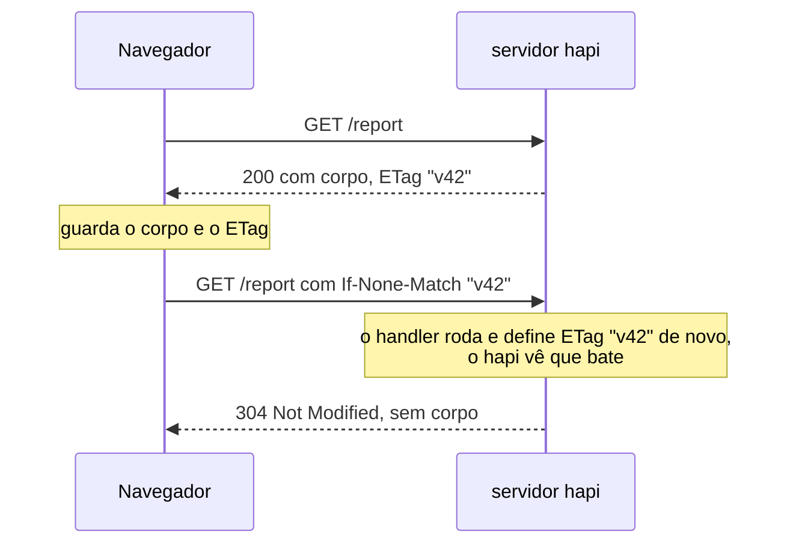
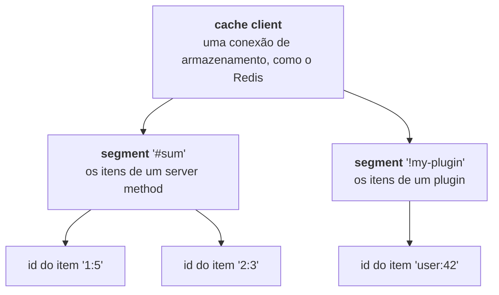
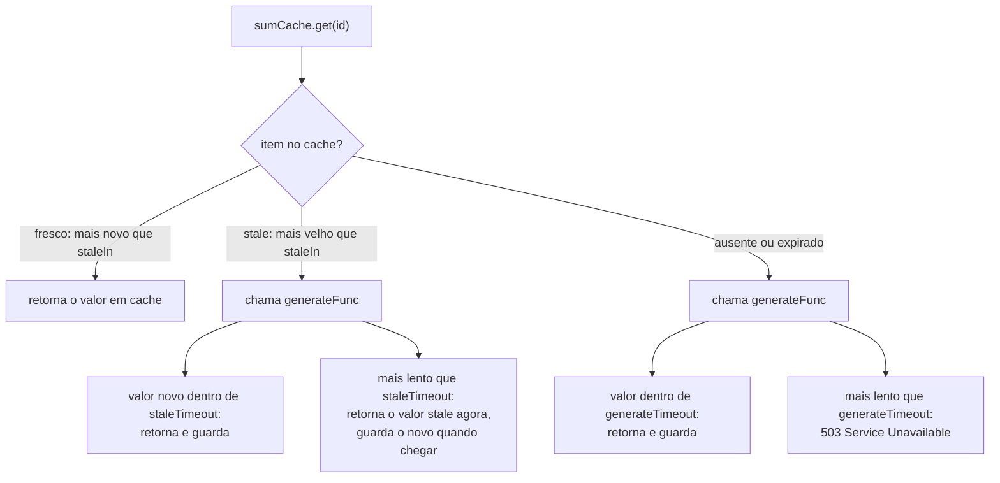

<TutorialLang />

# Cache

_Este tutorial é compatível com hapi v21 e versões mais recentes_

## <a name="overview"></a> Visão geral

O hapi faz cache em dois níveis, e a maioria das aplicações usa os dois:

| Nível                       | Onde a cópia fica                                                  | O que ela economiza                                        | Como configurar                                                                        |
| --------------------------- | ------------------------------------------------------------------ | ---------------------------------------------------------- | -------------------------------------------------------------------------------------- |
| [No cliente](#client-side)  | no navegador, ou em uma CDN ou proxy no meio do caminho            | a requisição inteira: o cliente nem chega ao hapi          | headers HTTP: `Cache-Control`, `ETag`, `Last-Modified`                                 |
| [No servidor](#server-side) | em memória, no Redis ou em outro store do [catbox](/module/catbox) | o trabalho caro: uma consulta ao banco, uma chamada de API | `server.cache()` ou um [método de servidor](/tutorials/pt_BR/server-methods) com cache |

## <a name="client-side"></a> Cache no cliente

Os headers HTTP dizem aos clientes se, e por quanto tempo, eles podem reutilizar uma resposta. O [guia de cache HTTP](https://developer.mozilla.org/en-US/docs/Web/HTTP/Caching) da MDN explica os headers em detalhes. Esta seção mostra como o hapi os define.

### <a name="cache-control"></a> Cache-Control

Defina a opção `cache` da rota, e o hapi escreve o header `Cache-Control` por você:

```ts
server.route({
    path: '/hapi/{ttl?}',
    method: 'GET',
    handler: function (request, h) {
        const response = h.response({ be: 'hapi' });

        if (request.params.ttl) {
            response.ttl(Number(request.params.ttl));
        }

        return response;
    },
    options: {
        cache: {
            expiresIn: 30 * 1000,
            privacy: 'private',
        },
    },
});
```

`response.ttl(msec)` sobrescreve `expiresIn` para uma única resposta. O header que o hapi envia depende da resposta:

| Requisição                                                        | Header `Cache-Control`                   |
| ----------------------------------------------------------------- | ---------------------------------------- |
| `GET /hapi`                                                       | `max-age=30, must-revalidate, private`   |
| `GET /hapi/5000` (chama `response.ttl(5000)`)                     | `max-age=5, must-revalidate, private`    |
| status de resposta diferente de 200 ou 204, como um 404 ou um 500 | `no-cache` (o `cache.otherwise` da rota) |

O que é bom saber:

- Se a requisição for autenticada, o hapi sempre adiciona `private`, mesmo quando a rota diz `privacy: 'public'`. Caches compartilhados, como CDNs, nunca guardam respostas `private`.
- Cookies definidos com `h.state()` não alteram o header: o hapi os escreve depois de montar o `Cache-Control`. Defina você mesmo `privacy: 'private'` em rotas com cache que definem cookies.
- Só os status codes listados em `cache.statuses` da rota (padrão `[200, 204]`) recebem `max-age`. Respostas de erro nunca entram em cache por acidente.

Veja as [opções de rota](/api#route-options-cache) para todas as configurações de `cache`.

### <a name="last-modified"></a> Requisições condicionais: ETag e Last-Modified

Uma requisição condicional permite ao cliente perguntar "isto mudou desde a minha cópia?" e receber um `304 Not Modified` vazio em vez do corpo inteiro:



Defina o `ETag` com [`response.etag()`](/api#response-object), normalmente a partir de um número de versão ou de um hash do conteúdo:

```ts
return h.response(report).etag(String(report.version));
```

Ou defina `Last-Modified`, e o hapi o compara com o header `If-Modified-Since` do cliente:

```ts
return h.response(report).header('Last-Modified', report.updatedAt.toUTCString());
```

O que é bom saber:

- O hapi só responde `304` em rotas `GET` (e em rotas com método `*`).
- O handler continua rodando em toda requisição. Requisições condicionais economizam banda, não trabalho do servidor. Combine-as com [cache no servidor](#server-side) para economizar os dois.
- O [inert](/module/inert) define `ETag` e `Last-Modified` automaticamente para arquivos estáticos.

## <a name="server-side"></a> Cache no servidor

O hapi guarda valores em cache no servidor por meio do [catbox](/module/catbox), um store de chave-valor com adaptadores de armazenamento intercambiáveis: memória (o padrão), [Redis](/module/catbox-redis) e [Memcached](/module/catbox-memcached).

### <a name="catbox"></a> catbox

Os itens em cache são organizados em três níveis:



O catbox tem duas interfaces para esses itens:

- **[Client](/module/catbox#client)**: a conexão de armazenamento de baixo nível. O hapi cria um client em memória para você, e você adiciona outros na opção `cache` do servidor.
- **[Policy](/module/catbox#policy)**: um segment de um client, com regras de expiração e uma função opcional que gera os valores ausentes. Seu código usa policies, criadas com [`server.cache()`](/api#server-cache-options) ou colocando um [método de servidor](#servermethods) em cache.

### <a name="client"></a> Client

Adicione um client Redis chamado `my_cache` ao lado do client padrão em memória:

```ts
import Hapi from '@hapi/hapi';
import { Engine as CatboxRedis } from '@hapi/catbox-redis';

const server = Hapi.server({
    port: 8000,
    cache: [
        {
            name: 'my_cache',
            provider: {
                constructor: CatboxRedis,
                options: {
                    partition: 'my_cached_data',
                    host: 'redis-cluster.domain.com',
                    port: 6379,
                    database: 0,
                    tls: {},
                },
            },
        },
    ],
});
```

- `name` é como as policies escolhem esse client, com `cache: 'my_cache'`. Omita `name` para substituir o client padrão em memória.
- `partition` separa as chaves desta aplicação das de outras que compartilham o mesmo banco Redis. No Redis, vira um prefixo de chave. O padrão é `'catbox'`.
- Os cache clients se conectam quando o servidor inicia, em [`server.initialize()`](/api#await-server-initialize) ou [`server.start()`](/api#await-server-start). Antes disso, as policies não conseguem ler nem escrever.

### <a name="policy" /> Policy

[`server.cache(options)`](/api#server-cache-options) cria uma policy. Este exemplo guarda em cache, por dez segundos, o resultado de uma soma lenta:

```ts
import Hapi from '@hapi/hapi';
import * as Hoek from '@hapi/hoek';

const add = async (a: string, b: string) => {
    await Hoek.wait(1000); // Simulates a slow database call

    return Number(a) + Number(b);
};

const start = async () => {
    const server = Hapi.server({ port: 8000 });

    const sumCache = server.cache({
        segment: 'sums',
        expiresIn: 10 * 1000,
        generateFunc: async (id) => {
            const key = typeof id === 'string' ? id : id.id;
            const [a, b] = key.split(':');

            return await add(a, b);
        },
        generateTimeout: 2000,
    });

    server.route<{ Params: { a: string; b: string } }>({
        path: '/add/{a}/{b}',
        method: 'GET',
        handler: async function (request, h) {
            const { a, b } = request.params;

            return await sumCache.get(`${a}:${b}`);
        },
    });

    await server.start();

    console.log('Server running at:', server.info.uri);
};

start();
```

`GET /add/1/5` responde `6` depois de cerca de um segundo. Repita dentro de dez segundos e a resposta vem na hora, do cache.

| Opção             | Significado                                                                                                                                                                                                |
| ----------------- | ---------------------------------------------------------------------------------------------------------------------------------------------------------------------------------------------------------- |
| `segment`         | Dá nome aos itens desta policy. Obrigatório na raiz do servidor. Dentro de um plugin, o padrão é `'!' + plugin name`. Duas policies não podem compartilhar um segment, a menos que definam `shared: true`. |
| `cache`           | O client a usar, como `'my_cache'`. O padrão é o client em memória.                                                                                                                                        |
| `expiresIn`       | Por quanto tempo um item vive depois de ser guardado, em milissegundos. `expiresAt: 'HH:MM'` faz tudo expirar em um horário do dia.                                                                        |
| `generateFunc`    | Cria o valor quando `get()` não encontra nada. O catbox guarda o resultado.                                                                                                                                |
| `generateTimeout` | Quanto tempo `get()` espera por `generateFunc` antes de falhar com `503 Service Unavailable`. Obrigatório com `generateFunc`; `false` espera para sempre.                                                  |

O id passado para `get()` é uma string ou um objeto com uma string `id`, e `generateFunc` o recebe sem alterações. O catbox o tipa como `string | { id: string }`, então o exemplo restringe o tipo antes de dividi-lo de volta em `a` e `b`.

### <a name="stale"></a> Servindo valores stale enquanto regenera

Um item expirado faz o próximo chamador esperar por `generateFunc`. Para evitar essa espera, marque os itens como stale antes de expirarem, com `staleIn`. Um item stale continua sendo servido enquanto o catbox o regenera em segundo plano:



```ts
const reportCache = server.cache({
    segment: 'reports',
    expiresIn: 60 * 60 * 1000,
    staleIn: 10 * 60 * 1000,
    staleTimeout: 100,
    generateTimeout: 5000,
    generateFunc: async (id) => await buildReport(id),
});
```

O catbox exige `staleIn < expiresIn`, exige `staleTimeout` sempre que `staleIn` é definido e exige `staleTimeout < expiresIn - staleIn`. Chamadas concorrentes a `get()` para o mesmo id compartilham uma única chamada a `generateFunc`, então uma rajada de requisições por um item ausente consulta seu banco uma vez só. Veja as [opções de policy](/module/catbox#policy) para configurações de tratamento de erro como `dropOnError` e `generateOnReadError`.

### <a name="servermethods"></a> Métodos de servidor

Na maior parte das vezes, um [método de servidor](/tutorials/pt_BR/server-methods) com cache é mais curto que uma policy feita à mão. O hapi cria a policy, chama o segment de `'#sum'` e monta o id do item a partir dos argumentos:

```ts
import Hapi from '@hapi/hapi';
import * as Hoek from '@hapi/hoek';

declare module '@hapi/hapi' {
    interface ServerMethods {
        sum: (a: string, b: string) => Promise<number>;
    }
}

const add = async (a: string, b: string) => {
    await Hoek.wait(1000);

    return Number(a) + Number(b);
};

const start = async () => {
    const server = Hapi.server({ port: 8000 });

    server.method('sum', add, {
        cache: {
            expiresIn: 10 * 1000,
            generateTimeout: 2000,
        },
    });

    server.route<{ Params: { a: string; b: string } }>({
        path: '/add/{a}/{b}',
        method: 'GET',
        handler: async function (request, h) {
            const { a, b } = request.params;

            return await server.methods.sum(a, b);
        },
    });

    await server.start();
};

start();
```

- O bloco `declare module` adiciona `sum` à interface `ServerMethods` do hapi, para que `server.methods.sum` tenha um tipo.
- O hapi monta o id do item a partir de argumentos `string`, `number` e `boolean`, como `'1:5'`. Outros tipos de argumento precisam de uma função [`generateKey`](/tutorials/pt_BR/server-methods#key).

## <a name="clientandserver"></a> Cache no cliente e no servidor

Combine os dois níveis: o cache do servidor registra quando guardou cada valor, e esse momento é o `Last-Modified` certo para a resposta. Defina `getDecoratedValue: true`, e o method com cache retorna `{ value, cached, report }` em vez do valor puro. `cached` é `null` quando o valor acabou de ser gerado:

```ts
import Hapi from '@hapi/hapi';
import * as Hoek from '@hapi/hoek';

declare module '@hapi/hapi' {
    interface ServerMethods {
        sum: (a: string, b: string) => Promise<{ value: number; cached: { stored: number } | null }>;
    }
}

const add = async (a: string, b: string) => {
    await Hoek.wait(1000);

    return Number(a) + Number(b);
};

const start = async () => {
    const server = Hapi.server({ port: 8000 });

    const cache = {
        expiresIn: 10 * 1000,
        generateTimeout: 2000,
        getDecoratedValue: true,
    };

    server.method('sum', add, { cache });

    server.route<{ Params: { a: string; b: string } }>({
        path: '/add/{a}/{b}',
        method: 'GET',
        handler: async function (request, h) {
            const { a, b } = request.params;
            const { value, cached } = await server.methods.sum(a, b);
            const lastModified = cached ? new Date(cached.stored) : new Date();

            return h.response({ sum: value }).header('Last-Modified', lastModified.toUTCString());
        },
    });

    await server.start();
};

start();
```

Veja a [API de policy](/module/catbox#api-1) para o que `cached` e `report` contêm.
