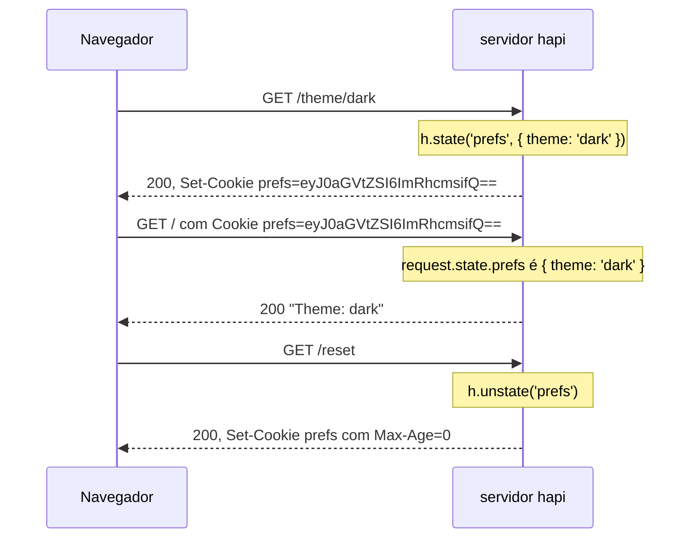

<TutorialLang />

# Cookies

_Este tutorial é compatível com hapi v21 e versões mais recentes_

## <a name="overview"></a> Visão geral

O hapi lê o header `Cookie` da requisição para `request.state` e escreve headers `Set-Cookie` a partir de `h.state()`. Cada cookie é declarado uma única vez com `server.state()`, que define sua codificação e suas flags de segurança, então os handlers só lidam com valores:



O servidor completo por trás dessa troca:

```ts
import Hapi from '@hapi/hapi';

const server = Hapi.server({ port: 3000 });

server.state('prefs', {
    encoding: 'base64json',
    ttl: 365 * 24 * 60 * 60 * 1000,
    isSecure: process.env.NODE_ENV === 'production',
    path: '/',
});

server.route<{ Params: { theme: string } }>({
    method: 'GET',
    path: '/theme/{theme}',
    handler: (request, h) => {
        h.state('prefs', { theme: request.params.theme });
        return 'saved';
    },
});

server.route({
    method: 'GET',
    path: '/',
    handler: (request, h) => {
        const prefs = request.state.prefs;
        const theme = typeof prefs === 'object' && prefs !== null && 'theme' in prefs ? prefs.theme : 'light';

        return `Theme: ${theme}`;
    },
});

server.route({
    method: 'GET',
    path: '/reset',
    handler: (request, h) => {
        return h.response('reset').unstate('prefs');
    },
});

await server.start();
```

`request.state` é tipado como `Record<string, unknown>`, porque um cookie contém o que quer que o cliente envie. O handler de `/` verifica o formato do valor antes de ler `theme` e, se não bater, usa um valor padrão.

## <a name="server"></a> Configurando o servidor

### <a name="server.state"></a> server.state()

[`server.state(name, [options])`](/api#server-state-name-options) declara um cookie. Os padrões são seguros, então a maioria das aplicações só define `encoding`, `ttl` e `path`:

| Opção          | Padrão     | Significado                                                                                                                                                                                            |
| -------------- | ---------- | ------------------------------------------------------------------------------------------------------------------------------------------------------------------------------------------------------ |
| `ttl`          | `null`     | Tempo de vida em milissegundos. `null` cria um cookie de sessão, apagado quando o navegador fecha.                                                                                                     |
| `encoding`     | `'none'`   | Como o valor é guardado: `'none'` (uma string), `'base64'`, `'base64json'` (qualquer valor JSON), `'form'` ou `'iron'` (criptografado, veja [abaixo](#iron)).                                          |
| `path`         | `null`     | O caminho de URL para o qual o navegador envia o cookie. `null` omite o atributo, e os navegadores usam então o diretório da requisição que o definiu. Use `'/'` para cookies válidos no site inteiro. |
| `isSecure`     | `true`     | Enviado só por HTTPS. Use `false` para HTTP sem TLS durante o desenvolvimento.                                                                                                                         |
| `isHttpOnly`   | `true`     | Oculto do JavaScript do navegador, o que o protege de cross-site scripting.                                                                                                                            |
| `isSameSite`   | `'Strict'` | Não é enviado em requisições vindas de outros sites. `'Lax'` permite navegação de nível superior a partir de outros sites; `false` omite o atributo.                                                   |
| `clearInvalid` | `false`    | Diz ao navegador para apagar o cookie quando o valor dele não puder ser processado.                                                                                                                    |
| `strictHeader` | `true`     | Rejeita nomes e valores que violam a [RFC 6265](https://tools.ietf.org/html/rfc6265).                                                                                                                  |

Veja [`server.state()`](/api#server-state-name-options) para o restante, como `domain`, `autoValue` e assinatura. Para mudar os padrões de todos os cookies, passe as mesmas opções na opção [`state`](/api#server-options-state) do servidor.

### <a name="iron"></a> Cookies criptografados

`encoding: 'iron'` criptografa e assina o valor com o [iron](/module/iron). O cliente não consegue lê-lo, e o hapi o rejeita se ele tiver sido alterado. Use para qualquer coisa que você não mostraria ao usuário, como um id de sessão:

```ts
const password = process.env.COOKIE_PASSWORD;
if (!password || password.length < 32) {
    throw new Error('COOKIE_PASSWORD must be set to at least 32 characters');
}

server.state('session', {
    encoding: 'iron',
    password,
    ttl: 24 * 60 * 60 * 1000,
    path: '/',
});
```

Para sessões de login, o [@hapi/cookie](/module/cookie) se apoia nisso: ele gerencia um cookie de sessão criptografado como uma [strategy de autenticação](/tutorials/pt_BR/auth#cookie).

### <a name="options.state"></a> route.options.state

As rotas controlam o parsing com [`options.state`](/api#route-options-state):

| Opção        | Padrão    | Significado                                                                       |
| ------------ | --------- | --------------------------------------------------------------------------------- |
| `parse`      | `true`    | Processa os cookies para `request.state`. Use `false` em rotas que nunca os leem. |
| `failAction` | `'error'` | O que acontece quando um cookie não pode ser processado ou descriptografado.      |

Um cookie falha quando seu valor não corresponde à sua codificação, ou quando um cookie iron foi adulterado ou criptografado com outra senha:

| `failAction` | Resultado                                                       |
| ------------ | --------------------------------------------------------------- |
| `'error'`    | a requisição falha com `400 Bad Request`                        |
| `'log'`      | a requisição continua sem esse cookie, e o hapi registra o erro |
| `'ignore'`   | a requisição continua sem esse cookie                           |

Com `clearInvalid: true` no cookie, a resposta também apaga o cookie inválido do navegador. Combine com `'log'` ou `'ignore'` para que a requisição que traz um cookie antigo, por exemplo um criptografado antes de uma troca de senha, tenha sucesso em vez de falhar uma vez com 400.

## <a name="setting"></a> Definindo um cookie

### <a name="h.state"></a> h.state()

[`h.state(name, value, [options])`](/api#h-state-name-value-options) define um cookie a partir de um handler, de um [pre-handler](/api#route-options-pre) ou de um [lifecycle hook](/tutorials/pt_BR/lifecycle-hooks). O mesmo método existe no objeto de resposta, para encadeamento:

```ts
h.state('prefs', { theme: 'dark' });

return h.response('Hello').state('prefs', { theme: 'dark' });
```

## <a name="override"></a> Sobrescrevendo opções

O terceiro argumento sobrescreve as opções declaradas do cookie apenas para esta resposta:

```ts
return h.response('Hello').state('prefs', 'dark', { encoding: 'none' });
```

## <a name="value"></a> Lendo o valor de um cookie

`request.state` contém todos os cookies processados, indexados pelo nome. Se o navegador enviar dois cookies com o mesmo nome, o valor é um array. Leia os valores como o exemplo da visão geral faz: verifique o formato e depois use.

## <a name="clear"></a> Apagando um cookie

[`h.unstate(name)`](/api#h-unstate-name-options), ou `unstate()` na resposta, diz ao navegador para apagar o cookie:

```ts
return h.response('Bye').unstate('prefs');
```
