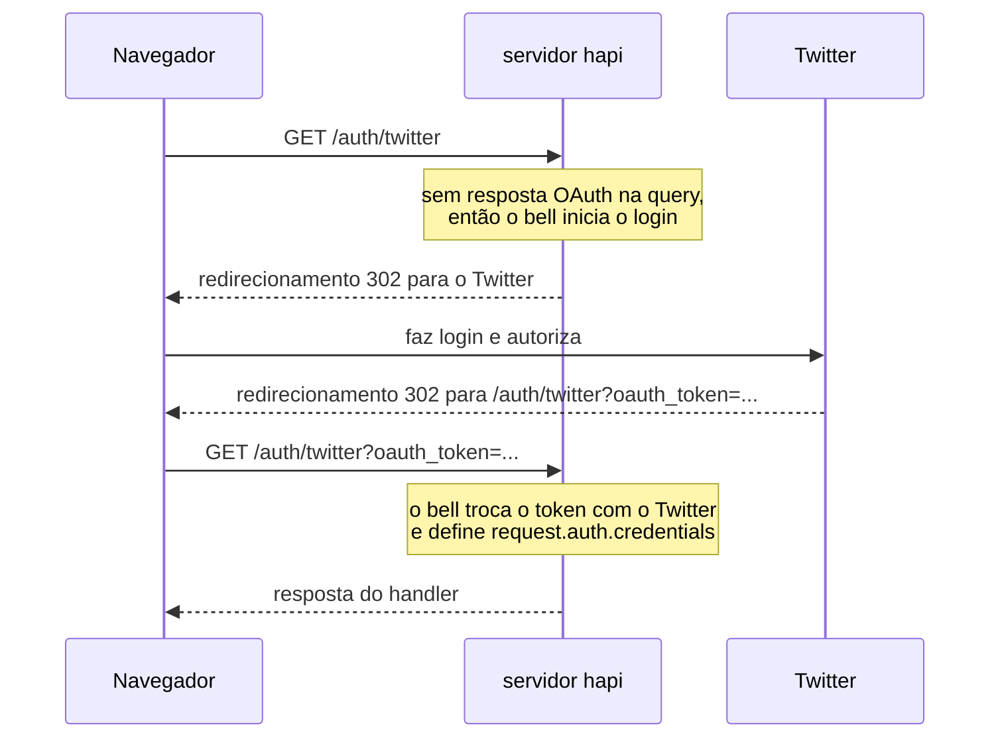

<TutorialLang />

# Migrando do Express

_Este guia é compatível com o hapi v21 e versões mais recentes_

## <a name="overview" ></a> Visão geral

Este guia mostra como fazer no hapi o que você faz no Express. Os exemplos usam o Express 5.

A maior diferença: o Express adiciona recursos por meio de middlewares que você instala e ordena com `app.use()`, enquanto o hapi traz a maioria deles no próprio core e os configura por rota. Quando o hapi precisa de um plugin, o plugin vem do time do hapi. As dependências de runtime do próprio hapi são todas pacotes `@hapi/*` mantidos pelo mesmo time.

| No Express você usa               | No hapi você usa                                                                                                                                                               |
| --------------------------------- | ------------------------------------------------------------------------------------------------------------------------------------------------------------------------------ |
| `express.json()`, `body-parser`   | embutido: [interpretação do payload](#bodyparser)                                                                                                                              |
| `cookie-parser`                   | embutido: [`server.state()`](#config)                                                                                                                                          |
| `express-validator`               | embutido: [`validate`](#joi) da rota com [joi](https://joi.dev)                                                                                                                |
| `passport`                        | framework de autenticação embutido; schemes vindos de plugins como `@hapi/basic`, `@hapi/cookie`, `@hapi/jwt` e [bell](#bell) (tutorial [Autenticação](/tutorials/pt_BR/auth)) |
| `cors`                            | embutido: opção [`cors`](/api#route-options-cors) da rota                                                                                                                      |
| `helmet`                          | parcialmente embutido: opção [`security`](/api#route-options-security) da rota (sem Content-Security-Policy)                                                                   |
| `compression`                     | embutido, ativado por padrão                                                                                                                                                   |
| `app.set('view engine')`          | plugin [vision](#vision)                                                                                                                                                       |
| `express.static()`                | plugin [inert](#inert)                                                                                                                                                         |
| middleware próprio                | [pontos de extensão](#extension) e [plugins](#creating)                                                                                                                        |
| middleware de tratamento de erros | uma [extensão](#extension) `onPreResponse`; lance erros do [boom](#boom) no lugar de `next(err)`                                                                               |

## <a name="setup" ></a> Configuração

### <a name="installation" ></a> Instalação

|                  | Express                                 | hapi                     |
| ---------------- | --------------------------------------- | ------------------------ |
| Instalação       | `npm install express`                   | `npm install @hapi/hapi` |
| Tipos TypeScript | `npm install --save-dev @types/express` | incluídos                |

### <a name="server" ></a> Criando um servidor

Express:

```ts
import express from 'express';

const app = express();

app.listen(3000, function () {
    console.log('Server is running on port 3000');
});
```

hapi:

```ts
import Hapi from '@hapi/hapi';

const init = async () => {
    const server = Hapi.server({
        port: 3000,
        host: 'localhost',
    });

    await server.start();
    console.log('Server running on port 3000');
};

init();
```

No hapi, o objeto `server` é o centro da aplicação. As opções dele (porta, host, configurações padrão de rota) definem como o servidor se comporta, e rotas, plugins e extensões são todos adicionados a ele. `server.start()` retorna uma promise.

## <a name="routes" ></a> Rotas

Express:

```ts
app.get('/hello', function (req, res) {
    res.send('Hello World!');
});
```

hapi:

```ts
server.route({
    method: 'GET',
    path: '/hello',
    handler: (request, h) => {
        return 'Hello World!';
    },
});
```

|                     | Express                                    | hapi                                                                 |
| ------------------- | ------------------------------------------ | -------------------------------------------------------------------- |
| Definir uma rota    | `app.METHOD(path, handler)`                | `server.route({ method, path, handler })`                            |
| Enviar uma resposta | chamar `res.send()`                        | retornar o valor                                                     |
| Qual rota executa   | a primeira rota registrada que corresponde | a correspondência mais específica, seja qual for a ordem de registro |
| Rotas sobrepostas   | as duas são registradas; a primeira vence  | `server.route()` lança um erro quando duas rotas entram em conflito  |

Como o hapi escolhe a rota mais específica, `'/home'` sempre vence `'/{any*}'`, e a ordem de registro nunca decide qual rota responde. Veja as regras no tutorial [Roteamento](/tutorials/pt_BR/routing).

### <a name="methods" ></a> Métodos

| Express               | hapi                                             |
| --------------------- | ------------------------------------------------ |
| `app.get(path, ...)`  | `method: 'GET'`                                  |
| uma rota por método   | `method: ['PUT', 'POST']`                        |
| `app.all(path, ...)`  | `method: '*'`                                    |
| `app.head(path, ...)` | não permitido: toda rota `GET` responde a `HEAD` |

```ts
server.route({
    method: ['PUT', 'POST'],
    path: '/',
    handler: function (request, h) {
        return 'I did something!';
    },
});
```

### <a name="path" ></a> Caminho

No hapi, os parâmetros ficam entre chaves:

|                    | Express 5        | hapi              |
| ------------------ | ---------------- | ----------------- |
| Parâmetro          | `/users/:userId` | `/users/{userId}` |
| Parâmetro opcional | `/hello{/:user}` | `/hello/{user?}`  |
| Curinga            | `/files/*path`   | `/files/{path*}`  |

No hapi, `{user*}` e um `{user?}` de segmento inteiro precisam ser o último segmento; `{user*2}` e um opcional de segmento parcial, como `/a{user?}/b`, podem aparecer em qualquer lugar.

### <a name="parameters" ></a> Parâmetros

Express:

```ts
app.get('/hello/:name', function (req, res) {
    const name = req.params.name;
    res.send('Hello ' + name);
});
```

hapi:

```ts
server.route({
    method: 'GET',
    path: '/hello/{name}',
    handler: function (request, h) {
        const name = request.params.name;
        return 'Hello ' + name;
    },
});
```

| Express      | hapi              |
| ------------ | ----------------- |
| `req.params` | `request.params`  |
| `req.query`  | `request.query`   |
| `req.body`   | `request.payload` |

### <a name="handler" ></a> Handler

Um handler do Express recebe `req` e `res`, e chama métodos de `res` para responder. Um handler do hapi recebe `request` e `h`, o [response toolkit](/api#response-toolkit), e retorna a resposta:

| Express                        | hapi                                                      |
| ------------------------------ | --------------------------------------------------------- |
| `res.send('text')`             | `return 'text'`                                           |
| `res.json(object)`             | `return object`                                           |
| `res.status(201).send(object)` | `return h.response(object).code(201)`                     |
| `res.set('x-name', 'value')`   | `return h.response(object).header('x-name', 'value')`     |
| `res.redirect('/')`            | `return h.redirect('/')`                                  |
| `res.cookie('name', 'value')`  | `h.state('name', 'value')`, veja [cookies](#config)       |
| `res.sendFile(file)`           | `return h.file(file)`, veja [inert](#inert)               |
| `res.render('index', context)` | `return h.view('index', context)`, veja [vision](#vision) |
| `next(err)`                    | `throw Boom.notFound()`, veja [boom](#boom)               |

Quando o handler precisa definir um status code ou headers, ele envolve o valor em `h.response()`:

```ts
server.route({
    method: 'POST',
    path: '/user',
    handler: function (request, h) {
        const user = {
            firstName: 'John',
            lastName: 'Doe',
            id: 123,
        };

        return h.response(user).code(201).header('location', '/user/123');
    },
});
```

O hapi serializa o objeto retornado como JSON e define o `content-type`. Veja o tutorial [Marshalling de respostas](/tutorials/pt_BR/response-marshalling) para entender como o hapi transforma um valor retornado em uma resposta.

## <a name="plugins" ></a> Middleware vs. plugins e extensões

O Express executa os middlewares na ordem em que você chama `app.use()`. Se um middleware depende de outro, você mantém a ordem certa manualmente, e uma ordem errada falha em tempo de requisição.

O hapi passa toda requisição por uma sequência fixa de etapas, o [ciclo de vida da requisição](/api#request-lifecycle). Em vez de ordenar middlewares, você conecta o código a uma etapa com nome. Cada etapa abaixo também mostra o middleware do Express que faz o mesmo trabalho:

| Etapa do hapi                      | Ponto de extensão                | Equivalente no Express            |
| ---------------------------------- | -------------------------------- | --------------------------------- |
| requisição recebida                | `onRequest`                      | `app.use()` antes do roteamento   |
| busca da rota, leitura dos cookies |                                  | `app.get()`, `cookie-parser`      |
| antes da autenticação              | `onPreAuth`                      |                                   |
| autenticação                       |                                  | `passport`                        |
| interpretação do payload           |                                  | `express.json()`                  |
| depois da autenticação             | `onCredentials`, `onPostAuth`    |                                   |
| validação                          |                                  | `express-validator`               |
| antes do handler                   | `onPreHandler`                   |                                   |
| handler                            |                                  | callback da rota                  |
| depois do handler                  | `onPostHandler`, `onPreResponse` | middleware de tratamento de erros |
| depois que a resposta é enviada    | `onPostResponse`                 |                                   |

Os pontos de extensão são onde você adiciona o seu próprio código com `server.ext()`. O hapi executa as outras etapas a partir da configuração de cada rota.

Plugins substituem os middlewares reutilizáveis. Um plugin é uma unidade com nome que registra rotas, extensões e decorações no servidor. Um plugin pode declarar os outros plugins de que precisa na propriedade `dependencies`, e o hapi se recusa a iniciar quando falta algum, em vez de falhar em tempo de requisição. Veja o tutorial [Plugins](/tutorials/pt_BR/plugins).

### <a name="extension" ></a> Pontos de extensão

Um middleware que roda em toda requisição vira uma extensão:

Express:

```ts
app.use(function (req, res, next) {
    console.log(req.method, req.url);
    next();
});
```

hapi:

```ts
server.ext('onRequest', function (request, h) {
    console.log(request.method, request.path);
    return h.continue;
});
```

`return h.continue` faz o papel de `next()`: a requisição segue para a próxima etapa. Retornar uma resposta de takeover (`h.response(...).takeover()`), ou lançar um erro, encerra a requisição ali.

O hapi tem oito pontos de extensão de requisição: `onRequest`, `onPreAuth`, `onCredentials`, `onPostAuth`, `onPreHandler`, `onPostHandler`, `onPreResponse` e `onPostResponse`. O tutorial [Lifecycle hooks](/tutorials/pt_BR/lifecycle-hooks) explica quando usar cada um, e [`server.ext()`](/api#server-ext-events) lista as opções.

### <a name="creating" ></a> Criando um plugin

Um middleware que adiciona um helper a toda requisição vira um plugin que adiciona uma [decoração](/tutorials/pt_BR/decorators). Um plugin é um objeto com um `name` (ou `pkg`) e uma função `async register(server, options)`.

Express:

```ts
import type { NextFunction, Request, Response } from 'express';

declare global {
    namespace Express {
        interface Request {
            getDate(): Date;
        }
    }
}

const getDate = function (req: Request, res: Response, next: NextFunction) {
    req.getDate = function () {
        const date = new Date();
        return date;
    };

    next();
};
```

hapi:

```ts
import type { Plugin } from '@hapi/hapi';

declare module '@hapi/hapi' {
    interface ResponseToolkit {
        getDate(): Date;
    }
}

const getDate: Plugin<void> = {
    name: 'getDate',
    version: '1.0.0',
    register: async function (server, options) {
        const currentDate = function () {
            const date = new Date();
            return date;
        };

        server.decorate('toolkit', 'getDate', currentDate);
    },
};
```

- O middleware do Express define `req.getDate` de novo a cada requisição. O plugin do hapi chama `server.decorate()` uma vez, no registro, e a partir daí todo handler tem `h.getDate()`.
- O TypeScript só conhece o novo método depois que você o declara: no Express, pela interface global `Express.Request`; no hapi, adicionando-o à interface `ResponseToolkit` de `@hapi/hapi`.

### <a name="load" ></a> Carregando um plugin

Express:

```ts
app.use(getDate);
```

hapi:

```ts
await server.register({
    plugin: getDate,
});
```

### <a name="options" ></a> Opções

Um middleware do Express recebe opções sendo uma função que retorna o middleware. Um plugin do hapi recebe as opções como segundo argumento de `register`.

Express:

```ts
import type { NextFunction, Request, Response } from 'express';

declare global {
    namespace Express {
        interface Request {
            getDate(): string;
        }
    }
}

export default function (options: { name: string }) {
    return function getDate(req: Request, res: Response, next: NextFunction) {
        req.getDate = function () {
            const date = 'Hello ' + options.name + ', the date is ' + new Date();
            return date;
        };

        next();
    };
}
```

hapi:

```ts
import type { Plugin } from '@hapi/hapi';

declare module '@hapi/hapi' {
    interface ResponseToolkit {
        getDate(): string;
    }
}

const getDate: Plugin<{ name: string }> = {
    name: 'getDate',
    version: '1.0.0',
    register: async function (server, options) {
        const currentDate = function () {
            const date = 'Hello ' + options.name + ', the date is ' + new Date();
            return date;
        };

        server.decorate('toolkit', 'getDate', currentDate);
    },
};
```

Você passa as opções ao registrar o plugin. O argumento de tipo de `Plugin<{ name: string }>` tipa `options` dentro de `register`, e o TypeScript aponta uma chamada a `server.register()` cujas opções não correspondem a ele; o hapi não as verifica em tempo de execução:

Express:

```ts
import getDate from './mw/getDate.ts';

app.use(getDate({ name: 'Tom' }));
```

hapi:

```ts
await server.register({
    plugin: getDate,
    options: {
        name: 'Tom',
    },
});
```

## <a name="bodyparser" ></a> body-parser

O hapi interpreta o payload da requisição antes de o handler rodar, sem nenhum middleware. O resultado fica em `request.payload`.

| Content type                        | Express                             | hapi                                         |
| ----------------------------------- | ----------------------------------- | -------------------------------------------- |
| `application/json`                  | `app.use(express.json())`           | interpretado por padrão                      |
| `application/x-www-form-urlencoded` | `app.use(express.urlencoded())`     | interpretado por padrão                      |
| `text/*`                            | `app.use(express.text())`           | interpretado por padrão                      |
| `multipart/form-data`               | um pacote separado, como o `multer` | opção de rota `payload: { multipart: true }` |

Express:

```ts
import express from 'express';

const app = express();

app.use(express.urlencoded());

app.post('/hello', function (req, res) {
    const name = req.body.name;
    res.send('Hello ' + name);
});
```

hapi:

```ts
server.route<{ Payload: { name: string } }>({
    method: 'POST',
    path: '/hello',
    handler: function (request, h) {
        const name = request.payload.name;
        return 'Hello ' + name;
    },
});
```

`request.payload` não tem um formato fixo, já que o hapi não tem como saber o que os clientes vão enviar. O argumento de tipo `server.route<{ Payload: { name: string } }>()` informa ao TypeScript o que o handler recebe. É apenas um tipo: para verificar o payload em tempo de execução, adicione [validação](#joi). Limites de tamanho, timeouts e upload de arquivos são definidos nas [opções `payload`](/api#route-options-payload) da rota.

## <a name="config" ></a> cookie-parser

O hapi lê e escreve cookies sem middleware. Enquanto o Express recebe as opções do cookie em toda chamada a `res.cookie()`, o hapi define cada cookie uma única vez com `server.state()`, e a partir daí qualquer rota o define pelo nome.

| Opção               | Express `res.cookie()`            | hapi `server.state()`               |
| ------------------- | --------------------------------- | ----------------------------------- |
| Flag Secure         | `secure`, desativada por padrão   | `isSecure`, ativada por padrão      |
| Flag HttpOnly       | `httpOnly`, desativada por padrão | `isHttpOnly`, ativada por padrão    |
| SameSite            | `sameSite`                        | `isSameSite`, `'Strict'` por padrão |
| Tempo de vida       | `maxAge` (ms)                     | `ttl` (ms)                          |
| Valor assinado      | `signed`                          | `sign: { password }`                |
| Valor criptografado | não embutido                      | `encoding: 'iron'`                  |

Veja [`server.state()`](/api#server-state-name-options) para todas as opções, e o tutorial [Cookies](/tutorials/pt_BR/cookies).

### <a name="setCookie" ></a> Definindo um cookie

Express:

```ts
import express from 'express';
import cookieParser from 'cookie-parser';

const app = express();

app.use(cookieParser());

app.get('/', function (req, res) {
    res.cookie('username', 'tom', { secure: true, httpOnly: true });
    res.send('Hello');
});
```

hapi:

```ts
import Hapi from '@hapi/hapi';

const server = Hapi.server({ port: 8000 });

server.state('username', {
    ttl: null,
    isSecure: true,
    isHttpOnly: true,
});

server.route({
    method: 'GET',
    path: '/',
    handler: function (request, h) {
        h.state('username', 'tom');
        return 'Hello';
    },
});
```

### <a name="getCookie" ></a> Lendo o valor de um cookie

Express:

```ts
app.get('/whoami', (req, res) => {
    res.send(req.cookies.username);
});
```

hapi:

```ts
server.route({
    method: 'GET',
    path: '/whoami',
    handler: (request, h) => {
        const username = request.state.username;
        if (typeof username !== 'string') {
            return 'No username cookie';
        }

        return username;
    },
});
```

`request.state` contém os cookies que o cliente enviou, sejam quais forem, então o hapi tipa cada valor como `unknown`. Verifique o tipo antes de usá-lo.

## <a name="bell" ></a> Passport -> bell

O Express faz o login com terceiros usando o Passport. O hapi usa o [bell](/module/bell), que tem configurações embutidas para mais de 30 provedores OAuth, incluindo Twitter, Facebook, Google e GitHub, e suporta provedores próprios. Veja a [lista de provedores do bell](/module/bell/providers).

O Passport precisa de duas rotas, uma para iniciar o login e outra para o callback do provedor. O bell usa uma única rota para as duas coisas:



Express:

```
npm install passport passport-twitter
```

Se você usa TypeScript, rode também `npm install --save-dev @types/passport @types/passport-twitter`.

```ts
import passport from 'passport';
import { Strategy as TwitterStrategy } from 'passport-twitter';

passport.use(
    new TwitterStrategy(
        {
            consumerKey: TWITTER_CONSUMER_KEY,
            consumerSecret: TWITTER_CONSUMER_SECRET,
            callbackURL: '/auth/twitter/callback',
        },
        function (token, tokenSecret, profile, cb) {
            User.findOrCreate({ twitterId: profile.id }, function (err, user) {
                return cb(err, user);
            });
        },
    ),
);

passport.serializeUser(function (user, cb) {
    cb(null, user);
});

passport.deserializeUser(function (user: Express.User, cb) {
    cb(null, user);
});

app.get('/auth/twitter', passport.authenticate('twitter'));
app.get('/auth/twitter/callback', passport.authenticate('twitter', { failureRedirect: '/login' }), function (req, res) {
    res.redirect('/');
});
```

hapi:

```
npm install @hapi/bell
```

```ts
import Hapi from '@hapi/hapi';
import Bell from '@hapi/bell';

const server = Hapi.server({ port: 8000 });

await server.register(Bell);

server.auth.strategy('twitter', 'bell', {
    provider: 'twitter',
    password: 'cookie_encryption_password_secure',
    clientId: TWITTER_CONSUMER_KEY,
    clientSecret: TWITTER_CONSUMER_SECRET,
    isSecure: false,
});

server.route({
    method: '*',
    path: '/auth/twitter', // The callback endpoint registered with the provider
    handler: function (request, h) {
        if (!request.auth.isAuthenticated) {
            return `Authentication failed due to: ${request.auth.error.message}`;
        }

        // Look up or register the account, start a local session, and redirect.
        // request.auth.credentials holds the provider's profile and tokens.

        return h.redirect('/home');
    },
    options: {
        auth: {
            strategy: 'twitter',
            mode: 'try',
        },
    },
});
```

| Opção          | O que é                                                                                                        |
| -------------- | -------------------------------------------------------------------------------------------------------------- |
| `provider`     | o nome da configuração de provedor embutida                                                                    |
| `password`     | criptografa o cookie temporário que o bell guarda entre as duas requisições; no mínimo 32 caracteres           |
| `clientId`     | o client ID OAuth fornecido pelo provedor                                                                      |
| `clientSecret` | o client secret OAuth fornecido pelo provedor                                                                  |
| `isSecure`     | a flag Secure do cookie. `false` permite HTTP simples em desenvolvimento; mantenha o padrão `true` em produção |

`mode: 'try'` deixa o handler rodar quando o login falha, para que ele mostre o erro em vez de um 401 sem explicação. Os parâmetros de query da requisição que iniciou o login voltam em `request.auth.credentials.query`, então você pode levar uma URL de retorno durante a ida e volta pelo provedor.

## <a name="joi" ></a> express-validator -> joi

O hapi valida requisições e respostas a partir da configuração da rota, usando schemas do [joi](https://joi.dev). O express-validator só verifica requisições; o hapi também pode verificar o que o seu handler retorna. Veja o tutorial [Validação](/tutorials/pt_BR/validation) para saber mais.

### <a name="input" ></a> Validação de entrada

Express:

```
npm install express-validator
```

```ts
import express from 'express';
import { body, validationResult } from 'express-validator';

app.use(express.json());
app.use(express.urlencoded());

app.post('/post', body('post', 'Post too long').isLength({ max: 140 }), function (req, res) {
    const errors = validationResult(req);
    if (!errors.isEmpty()) {
        res.status(400).send(errors.array());
    } else {
        res.send('Blog post added!');
    }
});
```

hapi:

```
npm install joi
```

```ts
import Joi from 'joi';

server.route({
    method: 'POST',
    path: '/post',
    handler: (request, h) => {
        return 'Blog post added!';
    },
    options: {
        validate: {
            payload: Joi.object({
                post: Joi.string().max(140),
            }),
        },
    },
});
```

- O handler só roda quando o payload passa. Caso contrário, o hapi responde com 400 por conta própria, então o handler não tem um ramo de erro.
- As regras são encadeadas, como em `Joi.string().min(1).max(140)`.
- `validate` também aceita schemas para `params`, `query`, `headers` e `state`.

### <a name="output" ></a> Validação de saída

```ts
const bookSchema = Joi.object({
    title: Joi.string().required(),
    author: Joi.string().required(),
    isbn: Joi.string().length(10),
    pageCount: Joi.number(),
    datePublished: Joi.date().iso(),
});

server.route({
    method: 'GET',
    path: '/books',
    handler: async function (request, h) {
        return await getBooks();
    },
    options: {
        response: {
            schema: Joi.array().items(bookSchema),
            failAction: 'log',
        },
    },
});
```

`response.schema` verifica a lista de livros que o handler retorna. Com `failAction: 'log'`, uma resposta que não passa no schema ainda é enviada e a falha é registrada no log; o padrão, `'error'`, a substitui por um 500.

## <a name="vision" ></a> app.set('view engine') -> vision

O hapi renderiza templates por meio do plugin [vision](/module/vision). Ele suporta várias template engines ao mesmo tempo, além de partials, helpers e layouts. Veja o tutorial [Views](/tutorials/pt_BR/views) para saber mais.

### <a name="viewengine" ></a> Definindo a view engine

Express:

```ts
app.set('view engine', 'pug');
```

hapi:

```ts
import Vision from '@hapi/vision';
import Pug from 'pug';

await server.register(Vision);

server.views({
    engines: {
        pug: Pug,
    },
    relativeTo: import.meta.dirname,
    path: 'views',
});
```

O Express procura os templates em `./views` por padrão. No hapi, você define a pasta com `relativeTo` e `path`.

### <a name="view" ></a> Renderizando uma view

Express:

```ts
app.get('/', function (req, res) {
    res.render('index', { title: 'Homepage', message: 'Welcome' });
});
```

hapi, com `h.view()`:

```ts
server.route({
    method: 'GET',
    path: '/',
    handler: function (request, h) {
        return h.view('index', { title: 'Homepage', message: 'Welcome' });
    },
});
```

hapi, com o handler `view`, quando a rota só renderiza um template:

```ts
server.route({
    method: 'GET',
    path: '/',
    handler: {
        view: {
            template: 'index',
            context: {
                title: 'Homepage',
                message: 'Welcome',
            },
        },
    },
});
```

## <a name="inert" ></a> express.static() -> inert

O hapi serve arquivos estáticos por meio do plugin [inert](/module/inert). Ele adiciona os handlers `file` e `directory` e o método `h.file()`. Veja o tutorial [Servindo arquivos](/tutorials/pt_BR/serving-files) para saber mais.

Os dois exemplos abaixo usam esta configuração, que registra o inert e define a pasta a partir da qual os caminhos de arquivo são resolvidos:

```ts
import Path from 'node:path';
import Hapi from '@hapi/hapi';
import Inert from '@hapi/inert';

const server = Hapi.server({
    port: 3000,
    routes: {
        files: {
            relativeTo: Path.join(import.meta.dirname, 'public'),
        },
    },
});

await server.register(Inert);
```

### <a name="single" ></a> Servindo arquivos individuais

Express:

```ts
app.get('/image', function (req, res) {
    res.sendFile('image.jpg', { root: './public' });
});
```

hapi, com `h.file()`:

```ts
server.route({
    method: 'GET',
    path: '/image',
    handler: function (request, h) {
        return h.file('image.jpg');
    },
});
```

hapi, com o handler `file`:

```ts
server.route({
    method: 'GET',
    path: '/image',
    handler: {
        file: 'image.jpg',
    },
});
```

### <a name="static" ></a> Servidor de arquivos estáticos

Express:

```ts
app.use(express.static('public'));
```

hapi:

```ts
server.route({
    method: 'GET',
    path: '/{param*}',
    handler: {
        directory: {
            path: '.',
        },
    },
});
```

O curinga `{param*}` corresponde a qualquer caminho, e o handler `directory` serve o arquivo correspondente da pasta `public`, então `/logo.png` retorna `public/logo.png`. Como o hapi escolhe a rota mais específica, suas outras rotas continuam vencendo esta rota pega-tudo.

## <a name="boom" ></a> Tratamento de erros -> boom

O hapi responde aos erros com JSON, montado a partir de objetos de erro do [boom](/module/boom). O Express responde com uma página HTML. Para um `GET /hello` que não corresponde a nenhuma rota:

Express:

```text
Cannot GET /hello
```

hapi:

```json
{
    "statusCode": 404,
    "error": "Not Found",
    "message": "Not Found"
}
```

### <a name="custom" ></a> Mensagens próprias

Express:

```ts
res.status(404).send({ status: 404, error: 'Page not found' });
```

hapi:

```ts
throw Boom.notFound('Page not found');
```

O erro lançado vira esta resposta:

```json
{
    "statusCode": 404,
    "error": "Not Found",
    "message": "Page not found"
}
```

O boom tem uma função para os status 4xx e 5xx mais comuns, como `Boom.badRequest()`, `Boom.unauthorized()` e `Boom.badImplementation()`. Lance uma delas em qualquer ponto de um handler, extensão ou plugin, e o hapi a transforma na resposta. Erros que não são do boom viram um 500, e a mensagem fica oculta para o cliente. Veja a [documentação do boom](/module/boom) para a lista completa.
