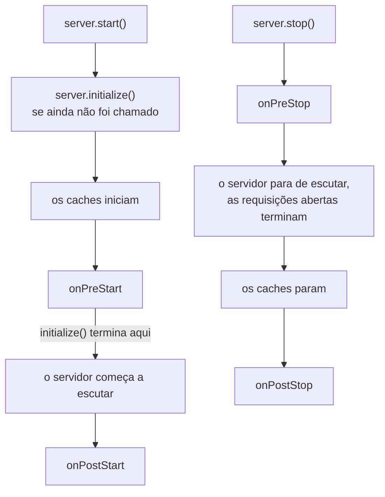
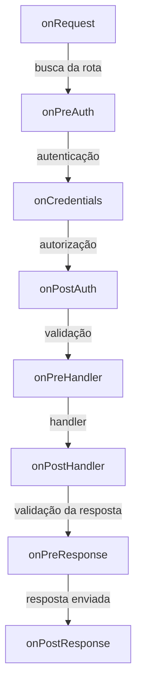

<TutorialLang />

# Lifecycle hooks

_Este tutorial é compatível com hapi v21 e versões mais recentes_

## <a name="overview"></a> Visão geral

O hapi passa toda requisição pela mesma sequência fixa de etapas: busca da rota, autenticação, validação, o handler e assim por diante. Um lifecycle hook, que a referência da API chama de extension point, permite rodar uma função sua em um ponto nomeado dessa sequência. O próprio servidor tem mais quatro hooks para inicialização e desligamento.

A maioria dos recursos transversais é construída com hooks. Vários plugins oficiais são, basicamente, alguns hooks:

| Plugin                 | Hook            | O que ele faz ali                                          |
| ---------------------- | --------------- | ---------------------------------------------------------- |
| [yar](/module/yar)     | `onPreAuth`     | carrega a sessão, para que a autenticação possa usá-la     |
| [yar](/module/yar)     | `onPreResponse` | salva a sessão em um cookie                                |
| [crumb](/module/crumb) | `onPostAuth`    | rejeita requisições com token CSRF ausente ou errado       |
| [crumb](/module/crumb) | `onPreResponse` | adiciona o token CSRF ao contexto de view das páginas HTML |
| [nes](/module/nes)     | `onPreStart`    | inicia os heartbeats do WebSocket                          |
| [nes](/module/nes)     | `onPreStop`     | fecha as conexões WebSocket abertas                        |

Você adiciona um hook com [`server.ext()`](/api#server-ext-events); a referência da API tem a lista completa de opções.

## <a name="server-hooks"></a> Server hooks: inicialização e desligamento

Os server hooks rodam uma vez, quando o servidor inicia ou para. Cada um recebe o `server` e não retorna nada, ou retorna uma promise. Um erro lançado interrompe a inicialização ou o desligamento.



[`server.start()`](/api#await-server-start) roda `server.initialize()` primeiro, se você ainda não o chamou. `initialize()` para antes da etapa de escuta, então roda `onPreStart` mas nunca abre uma porta. Por isso é a chamada certa em testes, nos quais você envia requisições com `server.inject()`.

| Hook          | Roda                                       | Use para                                                                                      |
| ------------- | ------------------------------------------ | --------------------------------------------------------------------------------------------- |
| `onPreStart`  | antes de o servidor escutar                | conectar a bancos de dados e checar a configuração, para que uma falha impeça a inicialização |
| `onPostStart` | depois de o servidor escutar               | trabalho que precisa da porta já vinculada, como se registrar em um service discovery         |
| `onPreStop`   | antes de o servidor parar de escutar       | avisar load balancers e conexões de longa duração para irem embora                            |
| `onPostStop`  | depois que as requisições abertas terminam | fechar o pool do banco e outros recursos que as requisições estavam usando                    |

Um pool de banco de dados é o caso comum. Conectar em `onPreStart` faz um banco indisponível derrubar o `server.start()` em vez da primeira requisição. Fechar em `onPostStop` espera até que as requisições em andamento terminem suas consultas:

```ts
import Hapi from '@hapi/hapi';
import { Pool } from 'pg';

import type { Plugin } from '@hapi/hapi';

const database: Plugin<{ connectionString: string }> = {
    name: 'database',
    register(server, options) {
        const pool = new Pool({ connectionString: options.connectionString });

        server.ext('onPreStart', async () => {
            await pool.query('SELECT 1');
        });

        server.ext('onPostStop', async () => {
            await pool.end();
        });

        server.expose('pool', pool);
    },
};

const server = Hapi.server({ port: 4000 });

await server.register({
    plugin: database,
    options: { connectionString: 'postgres://localhost/app' },
});

await server.start();

process.on('SIGTERM', async () => {
    await server.stop({ timeout: 10_000 });
    process.exit(0);
});
```

`server.stop({ timeout })` dá às requisições abertas esse tempo para terminarem antes que suas conexões sejam fechadas. Para compartilhar um serviço como esse pool com os handlers, use uma [decoração de server](/tutorials/pt_BR/decorators#server).

Duas regras para server hooks:

- Adicione `onPreStart` antes de chamar `initialize()` ou `start()`. Adicionar um depois lança `Cannot add onPreStart (after) extension after the server was initialized`.
- Quando o trabalho de inicialização de um plugin precisa que outro plugin esteja pronto, coloque-o em um callback de [`server.dependency()`](/api#server-dependency-dependencies-after). O hapi roda o callback durante `onPreStart`, depois dos plugins que ele nomeia, qualquer que seja a ordem em que foram registrados. Veja [Dependências](/tutorials/pt_BR/plugins#dependencies) no tutorial Plugins.

## <a name="request-hooks"></a> Request hooks

Os request hooks rodam para cada requisição. Os oito hooks ficam entre as etapas do [ciclo de vida da requisição](/api#request-lifecycle):



`onRequest`, `onPreResponse` e `onPostResponse` rodam em toda requisição, inclusive em 404s e em requisições rejeitadas pela autenticação ou pela validação. A exceção é uma requisição abortada ou encerrada com `h.close`, que pula `onPreResponse`. `onCredentials` roda sempre que a rota tem autenticação configurada, mesmo quando nenhuma credencial foi encontrada. Os demais rodam quando a requisição chega até eles.

| Hook             | Com o que você pode contar                                                      | Uso típico                                              |
| ---------------- | ------------------------------------------------------------------------------- | ------------------------------------------------------- |
| `onRequest`      | o caminho e os headers brutos; ainda sem rota; pode mudar a URL                 | ids de requisição, reescrita de URL, modo de manutenção |
| `onPreAuth`      | `request.route` e os cookies já processados                                     | carregar uma sessão que a autenticação vai ler          |
| `onCredentials`  | `request.auth.credentials`, antes de os scopes serem verificados                | adicionar papéis ou scopes a partir do seu banco        |
| `onPostAuth`     | autenticação concluída, payload processado mas não validado                     | checagens de CSRF, carregar o tenant ou a conta         |
| `onPreHandler`   | params, query e payload validados                                               | checagens que precisam de entrada validada              |
| `onPostHandler`  | o objeto de resposta do handler; um handler que falha pula para `onPreResponse` | alterar respostas bem-sucedidas                         |
| `onPreResponse`  | o `request.response` final, erros incluídos                                     | páginas de erro, headers de resposta, salvar sessões    |
| `onPostResponse` | a resposta já foi enviada                                                       | métricas, logs de acesso, limpeza                       |

### <a name="return-values"></a> O que um hook retorna

Um request hook é um [lifecycle method](/api#lifecycle-methods): recebe `(request, h)` e precisa retornar alguma coisa. O que ele retorna decide o que acontece em seguida:

| Retorno                        | `onRequest`               | `onPreAuth` até `onPreHandler`                                    | `onPostHandler`, `onPreResponse`                                   | `onPostResponse`                              |
| ------------------------------ | ------------------------- | ----------------------------------------------------------------- | ------------------------------------------------------------------ | --------------------------------------------- |
| `h.continue`                   | a próxima etapa roda      | a próxima etapa roda                                              | a resposta atual é mantida                                         | ignorado                                      |
| `h.response(value).takeover()` | pula para `onPreResponse` | pula para a validação de resposta da rota, depois `onPreResponse` | substitui a resposta; os hooks seguintes do mesmo tipo são pulados | ignorado                                      |
| um erro, lançado ou retornado  | pula para `onPreResponse` | pula para `onPreResponse`                                         | substitui a resposta; os hooks seguintes do mesmo tipo são pulados | lançado, ou boom retornado: registrado em log |
| qualquer outro valor           | erro 500                  | erro 500                                                          | substitui a resposta; os hooks seguintes do mesmo tipo ainda rodam | ignorado                                      |
| nada (`undefined`)             | erro 500                  | erro 500                                                          | erro 500                                                           | ignorado                                      |

[`h.continue`](/api#h-continue) é como um hook diz "nada a fazer aqui". Um takeover é como um hook anterior ao handler responde a requisição ele mesmo, e até um takeover vindo de `onRequest` passa por `onPreResponse`. O [lifecycle workflow](/api#lifecycle-workflow) na referência da API tem as regras completas.

## <a name="patterns"></a> Padrões

### <a name="request-id"></a> Ids de requisição e tempo de resposta

Um id de requisição liga o relato de erro de um cliente aos seus logs. Este plugin aceita um id enviado pelo cliente ou cria um, devolve-o em um header e registra quanto tempo cada requisição levou:

```ts
import { randomUUID } from 'node:crypto';
import Boom from '@hapi/boom';

import type { Plugin } from '@hapi/hapi';

declare module '@hapi/hapi' {
    interface PluginsStates {
        'request-tracing': { id: string };
    }
}

const requestTracing: Plugin<void> = {
    name: 'request-tracing',
    register(server) {
        server.ext('onRequest', (request, h) => {
            const incoming = request.headers['x-request-id'];
            request.plugins['request-tracing'] = { id: typeof incoming === 'string' ? incoming : randomUUID() };
            return h.continue;
        });

        server.ext('onPreResponse', (request, h) => {
            const { response } = request;
            const { id } = request.plugins['request-tracing'];
            if (Boom.isBoom(response)) {
                response.output.headers['x-request-id'] = id;
            } else {
                response.header('x-request-id', id);
            }

            return h.continue;
        });

        server.ext('onPostResponse', (request, h) => {
            const { response } = request;
            const statusCode = Boom.isBoom(response) ? response.output.statusCode : response.statusCode;
            const duration = request.info.completed - request.info.received;

            request.log(['metrics'], {
                id: request.plugins['request-tracing'].id,
                path: request.path,
                statusCode,
                duration,
            });
            return h.continue;
        });
    },
};
```

- Um plugin guarda seus dados por requisição sob o próprio nome em [`request.plugins`](/api#request-plugins), e o bloco `declare module` tipa essa entrada pela interface `PluginsStates` do hapi. [`request.app`](/api#request-app) é para o código da sua própria aplicação.
- `request.response` é um erro boom quando a requisição falhou, então `onPreResponse` define o header em `response.output.headers` em vez de chamar `.header()`.
- `onPostResponse` roda depois que a resposta é enviada, então o cliente nunca espera por ele, e seu valor de retorno é ignorado. O hapi roda os hooks `onPostResponse` um depois do outro, então um hook lento ainda atrasa os hooks seguintes. Passe trabalho lento, como enviar métricas pela rede, para uma fila e retorne.
- O hapi já registra [`request.info.received`](/api#request-info) e `request.info.completed`, então não é preciso guardar o horário de início você mesmo.

### <a name="rewrite"></a> Reescrevendo URLs

`onRequest` é o único hook que roda antes da busca da rota, então é o único lugar em que uma reescrita muda qual rota atende a requisição. [`request.setUrl()`](/api#request-seturl-url-striptrailingslash) faz a reescrita:

```ts
server.ext('onRequest', (request, h) => {
    if (request.path.startsWith('/api/v1/')) {
        request.setUrl(request.url.pathname.replace('/api/v1/', '/api/') + request.url.search);
    }

    return h.continue;
});
```

Clientes antigos continuam chamando `/api/v1/users?page=2`, e a rota `/api/users` os atende com a query string intacta.

### <a name="maintenance"></a> Modo de manutenção

Uma resposta de takeover vinda de `onRequest` responde a toda requisição antes de qualquer rota rodar:

```ts
let maintenance = false;

server.ext('onRequest', (request, h) => {
    if (!maintenance || request.path === '/health') {
        return h.continue;
    }

    return h.response({ message: 'Down for maintenance' }).code(503).header('retry-after', '600').takeover();
});
```

O health check continua acessível, então seu load balancer consegue distinguir uma parada planejada de uma queda.

### <a name="credentials"></a> Carregando papéis: onCredentials ou onPostAuth

Os dois hooks rodam depois da autenticação. A diferença é a etapa de autorização entre eles, que verifica o [`auth.access.scope`](/api#route-options-auth-access-scope) da rota (veja [Scopes](/tutorials/pt_BR/auth#scopes)).

Use `onCredentials` quando você adiciona algo que a autorização precisa ver. Um token muitas vezes identifica o usuário mas não traz seus papéis, então você carrega os papéis do seu banco e os adiciona como scopes:

```ts
server.ext('onCredentials', async (request, h) => {
    if (!request.auth.isAuthenticated) {
        return h.continue;
    }

    const { user } = request.auth.credentials;
    if (user) {
        request.auth.credentials.scope = await loadRoles(user.id);
    }

    return h.continue;
});

server.route<{ Params: { id: string } }>({
    method: 'DELETE',
    path: '/projects/{id}',
    options: { auth: { access: { scope: 'admin' } } },
    handler: (request, h) => deleteProject(request.params.id),
});
```

`onCredentials` roda sempre que a rota tem autenticação configurada, inclusive em rotas `'try'` e `'optional'` em que nenhuma credencial foi encontrada e `request.auth.credentials` é `null`, então verifique `request.auth.isAuthenticated` primeiro. `user.id` depende da declaração de `UserCredentials` mostrada no tutorial [Autenticação](/tutorials/pt_BR/auth#schemes).

Use `onPostAuth` para trabalho que não muda o que o usuário pode fazer, ou que também precisa rodar em rotas sem autenticação, como carregar o tenant indicado no header `Host`. `onCredentials` nunca roda em uma rota com `auth: false`.

### <a name="errors"></a> Respostas de erro consistentes

`onPreResponse` vê toda resposta na saída, então é ali que você muda a aparência dos erros. Um hook que substitui um erro por uma resposta própria precisa manter os headers do erro, como `WWW-Authenticate` em um 401:

```ts
import Boom from '@hapi/boom';

server.ext(
    'onPreResponse',
    (request, h) => {
        const { response } = request;
        if (!Boom.isBoom(response)) {
            return h.continue;
        }

        const { statusCode, payload, headers } = response.output;
        const reply = h.response({ error: payload.message }).code(statusCode);
        for (const [name, value] of Object.entries(headers)) {
            if (value !== undefined) {
                reply.header(name, String(value));
            }
        }

        return reply;
    },
    { before: ['request-tracing'] },
);
```

A nova resposta substitui o erro, e os hooks `onPreResponse` que rodam depois deste veem a nova resposta. Com `before: ['request-tracing']`, o [hook de id de requisição](#request-id) roda depois deste e adiciona seu header à nova resposta. Sem isso, o hook de id de requisição definiria seu header primeiro no erro, e só a cópia de headers acima o manteria. A ordem importa mais para hooks que substituem a resposta. O tutorial [Marshalling de respostas](/tutorials/pt_BR/response-marshalling#errors) tem um formato de erro completo e páginas de erro em HTML.

## <a name="ordering"></a> Ordem e escopo

Por padrão, hooks do mesmo tipo rodam na ordem em que foram adicionados, contando juntos os hooks do servidor, dos plugins e das rotas. Três opções mudam quais requisições um hook vê e quando ele roda.

**`before` e `after`** recebem nomes de plugins e ordenam o hook do seu plugin em relação aos deles. Um plugin que lê a sessão que o yar carrega usaria:

```ts
server.ext('onPreAuth', loadPreferences, { after: ['@hapi/yar'] });
```

**`sandbox: 'plugin'`** limita um hook às rotas que o plugin dele adicionou. Funciona para todos os request hooks exceto `onRequest`, que roda antes de o hapi saber qual é a rota:

```ts
import type { Plugin } from '@hapi/hapi';

const adminPanel: Plugin<void> = {
    name: 'admin-panel',
    register(server) {
        server.ext('onPreHandler', auditAdminAccess, { sandbox: 'plugin' });

        server.route({ method: 'GET', path: '/admin', handler: (request, h) => 'admin' });
    },
};
```

**Hooks de rota** ficam em [`options.ext`](/api#route-options-ext) da rota e só rodam para aquela rota:

```ts
server.route({
    method: 'POST',
    path: '/uploads',
    options: {
        ext: {
            onPreHandler: { method: checkStorageQuota },
        },
    },
    handler: (request, h) => saveUpload(request.payload),
});
```

`server.ext()` também aceita um array, o que mantém os hooks de um plugin juntos em um só lugar:

```ts
server.ext([
    { type: 'onRequest', method: assignRequestId },
    { type: 'onPreResponse', method: addRequestIdHeader },
    { type: 'onPostResponse', method: recordMetrics },
]);
```

## <a name="typing"></a> Tipando hooks

Hooks escritos inline em `server.ext()` não precisam de anotações: o TypeScript infere `request` e `h` a partir do nome do hook, e infere `server` nos server hooks. Um hook definido separadamente é um `Lifecycle.Method`:

```ts
import Boom from '@hapi/boom';

import type { Lifecycle } from '@hapi/hapi';

const checkStorageQuota: Lifecycle.Method = async (request, h) => {
    if (!request.auth.isAuthenticated) {
        throw Boom.unauthorized();
    }

    const quota = await getQuota(request.auth.credentials.user?.id);
    if (quota.used >= quota.limit) {
        throw Boom.forbidden('Storage quota exceeded');
    }

    return h.continue;
};
```

Para tipar dados que seus hooks guardam na requisição, estenda `PluginsStates` como no [exemplo de id de requisição](#request-id), ou `RequestApplicationState` para `request.app` no código da aplicação. `user?.id` depende da declaração de `UserCredentials` mostrada no tutorial [Autenticação](/tutorials/pt_BR/auth#schemes).
