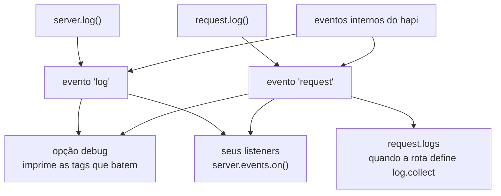

<TutorialLang />

# Logging

_Este tutorial é compatível com hapi v21 e versões mais recentes_

## <a name="overview"></a> Visão geral

Tirando o padrão de [`debug`](#debug), que imprime no console os erros do seu próprio código, o hapi não escreve logs em lugar nenhum. Ele transforma cada chamada de log em um evento em `server.events`, e você decide o que fazer com esses eventos: imprimi-los, enviá-los para um serviço de logging ou coletá-los por requisição.



## <a name="methods"></a> Métodos nativos

Existem dois métodos de logging. Escolha o que corresponde ao lugar onde seu código roda:

| Método                                                            | Use quando                                                                         | Emite       |
| ----------------------------------------------------------------- | ---------------------------------------------------------------------------------- | ----------- |
| [`request.log(tags, [data])`](/api#request-log-tags-data)         | há uma requisição no contexto: um handler, uma extensão, um scheme de autenticação | `'request'` |
| [`server.log(tags, [data])`](/api#server-log-tags-data-timestamp) | não há requisição no contexto: a inicialização, o `register()` de um plugin        | `'log'`     |

Os dois recebem os mesmos dois argumentos principais:

- `tags`: uma string ou um array de strings, como `['error', 'database', 'read']`. O hapi usa tags em vez de níveis de log, então você pode filtrar por qualquer combinação: tudo com a tag `database`, ou só `error` e `database` juntas.
- `data`: opcional. Uma mensagem, um objeto ou um `Error`. Se você passar uma função, o hapi só a chama quando um listener recebe o evento, então dados caros não custam nada quando ninguém está escutando.

### <a name="request.log"></a> request.log()

```ts
server.route({
    method: 'GET',
    path: '/users/{id}',
    handler: async (request, h) => {
        request.log(['users', 'read'], { id: request.params.id });

        return { id: request.params.id };
    },
});
```

Todo evento registrado dessa forma carrega o id da requisição, então você pode agrupar os eventos de uma mesma requisição.

### <a name="server.log"></a> server.log()

```ts
import Hapi from '@hapi/hapi';

const server = Hapi.server({ port: 3000 });

await server.start();

server.log(['startup'], `Server running at ${server.info.uri}`);
```

## <a name="display"></a> Lendo e exibindo logs

Escute em [`server.events`](/api#server-events). Além das suas próprias chamadas, o hapi emite seus próprios eventos nos mesmos canais:

| Evento       | `event.channel` | Vem de                                                             |
| ------------ | --------------- | ------------------------------------------------------------------ |
| `'log'`      | `'app'`         | suas chamadas a `server.log()`                                     |
| `'log'`      | `'internal'`    | hapi: rejeições por carga do servidor, erros de conexão do cliente |
| `'request'`  | `'app'`         | suas chamadas a `request.log()`                                    |
| `'request'`  | `'internal'`    | hapi: falhas de autenticação, erros de handler, headers inválidos  |
| `'request'`  | `'error'`       | hapi: uma vez por requisição que terminou com 500                  |
| `'response'` | nenhum          | hapi: uma vez por requisição, depois que a resposta é enviada      |

A lista completa de tags internas está na referência da API, nos eventos [`'log'`](/api#log-event) e [`'request'`](/api#request-event).

Uma configuração típica imprime os eventos da aplicação, reporta os 500s e escreve uma linha de log de acesso por requisição:

```ts
server.events.on('log', (event, tags) => {
    console.log(event.timestamp, event.tags, event.data ?? event.error);
});

server.events.on({ name: 'request', channels: 'app' }, (request, event, tags) => {
    console.log(request.info.id, event.tags, event.data ?? event.error);
});

server.events.on({ name: 'request', channels: 'error' }, (request, event, tags) => {
    console.error(`Request ${request.info.id} failed:`, event.error);
});

server.events.on('response', (request) => {
    const duration = request.info.completed - request.info.received;

    console.log(`${request.method.toUpperCase()} ${request.path} ${request.raw.res.statusCode} ${duration}ms`);
});
```

- `tags` é um objeto com uma chave `true` por tag, então `if (tags.error)` é uma checagem rápida.
- `event.data` e `event.error` nunca aparecem juntos: um `Error` passado como `data` chega como `event.error`.
- O objeto de critérios `{ name: 'request', channels: 'error' }` assina um único canal. Sem ele, você recebe os três.

O hapi emite `'response'` depois que a resposta é enviada e não espera pelas promises que um listener retorna. Para trabalho assíncrono que o hapi deve aguardar em ordem, use uma extensão `onPostResponse`; veja [Lifecycle hooks](/tutorials/pt_BR/lifecycle-hooks).

### <a name="collecting-the-logs-of-one-request"></a> Coletando os logs de uma requisição

Para ler os eventos de uma requisição de dentro dela, defina `log.collect` na rota. Todo evento registrado para aquela requisição vai então para `request.logs`:

```ts
server.route({
    method: 'GET',
    path: '/',
    options: {
        log: {
            collect: true,
        },
    },
    handler: function (request, h) {
        request.log(['step'], 'loaded user');
        request.log(['step'], 'loaded orders');

        return { steps: request.logs.length };
    },
});
```

Sem `log.collect`, `request.logs` fica vazio.

## <a name="debug"></a> Modo debug (só em desenvolvimento)

A opção de servidor [`debug`](/api#server-options-debug) imprime os eventos correspondentes no console com `console.error()`, sem código de listener. Ela só muda o que é impresso, não o que é emitido.

| Opção           | Padrão               | Imprime                                                                                                     |
| --------------- | -------------------- | ----------------------------------------------------------------------------------------------------------- |
| `debug.request` | `['implementation']` | eventos `'request'` com qualquer uma dessas tags. O padrão imprime os 500s causados por bugs no seu código. |
| `debug.log`     | nenhum               | eventos `'log'` com qualquer uma dessas tags.                                                               |
| `debug: false`  |                      | nada                                                                                                        |

Cada lista recebe tags, `'*'` para todos os eventos ou `false` para nenhum. Para imprimir todo erro de requisição durante o desenvolvimento:

```ts
import Hapi from '@hapi/hapi';

const server = Hapi.server({ debug: { request: ['error'] } });
```

## <a name="plugins"></a> Plugins de logging

Para logging em produção, use um plugin que escute esses eventos por você, como o [hapi-pino](https://www.npmjs.com/package/hapi-pino) para logs estruturados em JSON, o [New Relic](https://newrelic.com/instant-observability/hapi/2124da5b-0174-457a-be5a-e0068673b2b5) ou qualquer outro dos [plugins de logging do hapi](/plugins#logging).
