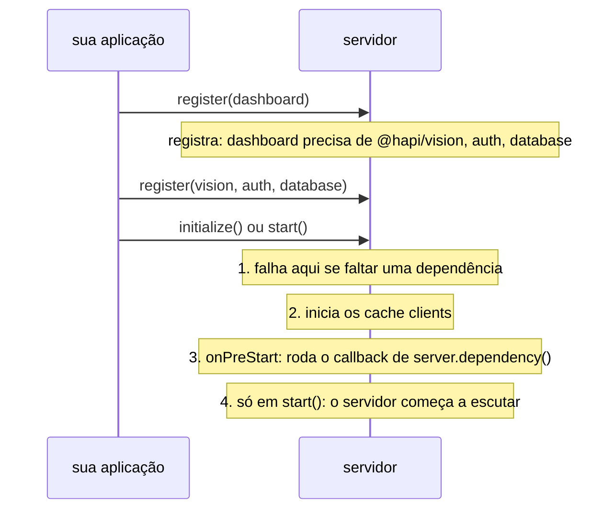

<TutorialLang />

# Plugins

_Este tutorial é compatível com hapi v21 e versões mais recentes_

## <a name="overview"></a> Visão geral

Um plugin é uma parte de uma aplicação hapi empacotada para ser registrada em um servidor: um conjunto de rotas, um scheme de autenticação, um logger, um template engine. A maior parte do ecossistema hapi é publicada como plugins ([inert](/module/inert), [vision](/module/vision), [@hapi/basic](/module/basic)), e dividir sua própria aplicação em plugins mantém cada parte isolada e testável.

Um plugin recebe o servidor na sua função `register` e o altera pela API normal do servidor. As que mais importam para quem escreve plugins:

| API do servidor                                                          | O que o plugin adiciona                                                                   | Tutorial                                               |
| ------------------------------------------------------------------------ | ----------------------------------------------------------------------------------------- | ------------------------------------------------------ |
| [`server.route()`](/api#server-route-route)                              | rotas                                                                                     | [Roteamento](/tutorials/pt_BR/routing)                 |
| [`server.ext()`](/api#server-ext-events)                                 | código que roda em uma etapa de toda requisição, ou na inicialização e parada do servidor | [Lifecycle hooks](/tutorials/pt_BR/lifecycle-hooks)    |
| [`server.decorate()`](/api#server-decorate-type-property-method-options) | novos métodos em `server`, `request` ou `h`                                               | [Decorators](/tutorials/pt_BR/decorators)              |
| [`server.auth.scheme()`](/api#server-auth-scheme-name-scheme)            | um scheme de autenticação                                                                 | [Autenticação](/tutorials/pt_BR/auth)                  |
| [`server.method()`](/api#server-method-name-method-options)              | funções compartilhadas e com cache                                                        | [Métodos de servidor](/tutorials/pt_BR/server-methods) |
| [`server.expose()`](/api#server-expose-key-value-options)                | valores que outros plugins leem em `server.plugins[name]`                                 |                                                        |

## <a name="create"></a> Criando um plugin

Um plugin é um objeto com um `name` e uma função assíncrona `register(server, options)`:

```ts
import type { Plugin } from '@hapi/hapi';

const myPlugin: Plugin<void> = {
    name: 'myPlugin',
    version: '1.0.0',
    register: async function (server, options) {
        server.route({
            method: 'GET',
            path: '/test',
            handler: function (request, h) {
                return 'hello, world';
            },
        });
    },
};
```

Depois de registrado, `GET /test` responde `'hello, world'`.

`Plugin<T>` recebe o tipo das opções do plugin. Este plugin não tem opções, então é `Plugin<void>`. Com o plugin tipado, o TypeScript infere `server` e `options` em `register` e verifica se o plugin tem um `name` ou um `pkg`.

As propriedades do objeto de plugin:

| Propriedade    | Significado                                                                                                                  |
| -------------- | ---------------------------------------------------------------------------------------------------------------------------- |
| `register`     | Obrigatória. Configura o plugin. O registro espera por ela e falha se ela lançar um erro.                                    |
| `name`         | Obrigatória, a menos que `pkg` esteja definido. Precisa ser única no servidor. Plugins publicados usam o nome do pacote npm. |
| `version`      | Informativa. Outros plugins podem lê-la, e as [dependências](#dependencies) podem exigir uma faixa de versões.               |
| `pkg`          | Seu `package.json`, usado para `name` e `version` em vez de defini-los à mão.                                                |
| `dependencies` | Plugins que também precisam estar registrados. Veja [dependências](#dependencies).                                           |
| `requirements` | Faixas de versão suportadas de `node` e `hapi`, como `{ hapi: '>=21' }`. O registro falha fora delas.                        |
| `multiple`     | `true` permite registrar o plugin mais de uma vez no mesmo servidor.                                                         |
| `once`         | `true` faz registros repetidos serem ignorados em silêncio em vez de gerar um erro.                                          |

### <a name="module"></a> Publicando um plugin como módulo

Um módulo de plugin exporta o objeto de plugin, como export default ou como um export nomeado `plugin`. `pkg` lê o nome e a versão do `package.json`:

```ts
import Pkg from './package.json' with { type: 'json' };

import type { Plugin } from '@hapi/hapi';

export const plugin: Plugin<void> = {
    pkg: Pkg,
    register: async function (server, options) {
        server.route({
            method: 'GET',
            path: '/test',
            handler: function (request, h) {
                return 'hello, world';
            },
        });
    },
};
```

O hapi aceita os dois formatos de export: `server.register()` recebe um objeto de plugin, ou um módulo cuja propriedade `plugin` seja um.

### <a name="register"></a> Opções do plugin

`options` é o que quer que quem registra passe no registro, sem alterações. Tipe com `Plugin<Options>`:

```ts
import Pkg from './package.json' with { type: 'json' };

import type { Plugin } from '@hapi/hapi';

interface Options {
    name: string;
}

export const plugin: Plugin<Options> = {
    pkg: Pkg,
    register: async function (server, options) {
        server.route({
            method: 'GET',
            path: '/test',
            handler: function (request, h) {
                return `Hello ${options.name}`;
            },
        });
    },
};
```

`options.name` é uma `string`, e o TypeScript aponta uma chamada a `server.register()` cujas opções não batem com `Options`; o hapi não as verifica em tempo de execução.

## <a name="loading"></a> Carregando um plugin

Registre plugins com [`server.register()`](/api#await-server-register-plugins-options). Passe o próprio plugin, ou um objeto com `plugin` e `options`, ou um array de qualquer um dos dois:

```ts
import Hapi from '@hapi/hapi';
import { plugin as MyPlugin } from 'myplugin';
import { plugin as YourPlugin } from 'yourplugin';

const start = async function () {
    const server = Hapi.server();

    await server.register(YourPlugin);

    await server.register({
        plugin: MyPlugin,
        options: {
            name: 'Bob',
        },
    });

    await server.register([{ plugin: YourPlugin }, { plugin: MyPlugin, options: { name: 'Bob' } }]);
};
```

Os plugins de um array são registrados um depois do outro, em ordem. Cada função `register` termina antes de a próxima começar.

### <a name="registration"></a> Opções de registro

O segundo argumento de `server.register()` configura como o hapi registra o plugin. Ele _não_ é passado ao plugin:

| Opção           | Efeito                                                                                          |
| --------------- | ----------------------------------------------------------------------------------------------- |
| `routes.prefix` | Adiciona um caminho no início de toda rota que o plugin adiciona. `/test` vira `/plugins/test`. |
| `routes.vhost`  | Aplica um virtual host a toda rota que o plugin adiciona.                                       |
| `once`          | `true` pula o plugin se ele já estiver registrado, em vez de lançar um erro.                    |

```ts
import Hapi from '@hapi/hapi';
import { plugin as MyPlugin } from 'myplugin';

const start = async function () {
    const server = Hapi.server();

    await server.register(MyPlugin, {
        routes: {
            prefix: '/plugins',
        },
    });
};
```

Os prefixos se acumulam: se um plugin registrado com prefixo `/api` registra um plugin filho com prefixo `/v1`, as rotas do filho começam com `/api/v1`. Veja [`server.register()`](/api#await-server-register-plugins-options) para a lista completa.

## <a name="scope"></a> O que um plugin pode e não pode afetar

Cada plugin recebe seu próprio [`server.realm`](/api#server-realm): um contêiner para configurações que ficam dentro do plugin. Todo o resto que um plugin faz muda o servidor inteiro:

| Mudança                                                                                                             | Escopo                                              |
| ------------------------------------------------------------------------------------------------------------------- | --------------------------------------------------- |
| prefixo de rota e vhost vindos das opções de registro                                                               | as rotas do plugin e seus plugins filhos            |
| [`server.bind()`](/api#server-bind-context), [`server.path()`](/api#server-path-relativeto)                         | rotas, handlers e extensões adicionados pelo plugin |
| [lifecycle hooks](/tutorials/pt_BR/lifecycle-hooks) de requisição com `options.sandbox: 'plugin'`                   | as rotas do plugin                                  |
| lifecycle hooks de requisição sem `sandbox`                                                                         | **todas as rotas do servidor**                      |
| [decorações](/tutorials/pt_BR/decorators), métodos de servidor, strategies de autenticação, `server.auth.default()` | **o servidor inteiro**                              |

Um plugin que adiciona um hook `onPreResponse` para formatar os próprios erros deve passar `sandbox: 'plugin'`, senão vai reformatar também os erros de todos os outros plugins.

## <a name="dependencies"></a> Dependências

Um plugin que precisa de outro plugin o declara, em vez de depender da ordem de registro:

```ts
import type { Plugin } from '@hapi/hapi';

declare module '@hapi/hapi' {
    interface PluginProperties {
        database: { migrate: () => Promise<void> };
    }
}

export const plugin: Plugin<void> = {
    name: 'dashboard',
    dependencies: ['@hapi/vision', 'auth'],
    register: async function (server, options) {
        server.dependency('database', async (server) => {
            await server.plugins.database.migrate();
        });
    },
};
```

O hapi verifica as dependências quando o servidor inicializa, não quando o plugin é registrado, então os plugins podem ser registrados em qualquer ordem:



- `dependencies` é uma lista de nomes, ou um objeto que mapeia nomes para faixas de versão, como `{ '@hapi/vision': '7.x' }`.
- [`server.dependency(names, after)`](/api#server-dependency-dependencies-after) declara a mesma coisa de dentro de `register` e aceita uma função `after`. O hapi roda `after` durante a inicialização do servidor, quando todos os plugins listados estão registrados. Use para configurações que precisam da API de outro plugin.
- O hapi lança um erro em dependências `after` circulares.

`server.plugins.database` é o que o plugin `database` publicou com [`server.expose()`](/api#server-expose-key-value-options). O hapi não tem como saber o formato disso, então o bloco `declare module` o adiciona à interface `PluginProperties` do hapi.
